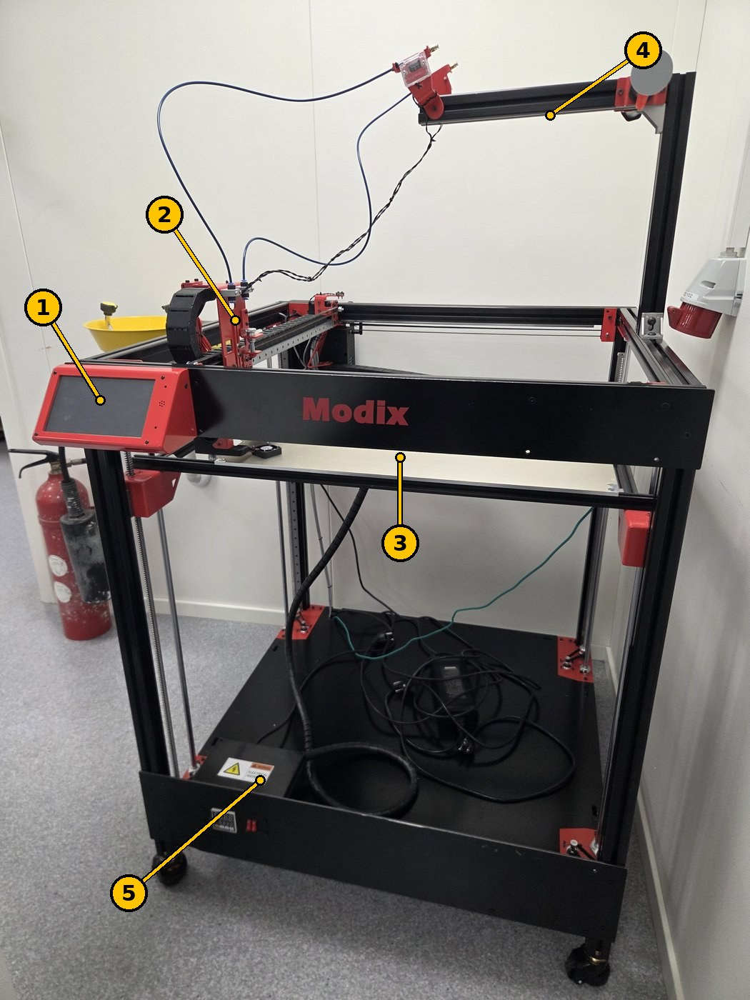

# Modix BIG-60 3D Printer – Connecting, Web Interface and Macros

USN Kongsberg · Metrology lab (Måleteknisk lab) · Updated 12 Nov 2026

> **Norsk versjon:** [README.no.md](README.no.md) · **PDF:** [guide-en.pdf](guide-en.pdf) · **Word:** [guide-en.docx](guide-en.docx) · **Quick card (A4):** [English](quick-card-en.pdf), [Norsk](quick-card-no.pdf)

**Location:** the metrology lab (*Måleteknisk lab*).

> **Health and safety is not fully covered here.** Follow the lab supervisor's instructions, and do not use the printer without training.

> **Warning: do not print PETG.** PETG can bond permanently to the PEI sheet on the build plate and damage it.

Our printer is a Modix BIG-60 **Version 3**, a large FDM 3D printer with **two print heads (2 × Titan Aero)**. It is controlled by a **Duet 2 WiFi** board running **RepRapFirmware 3 (RRF3)**, and you use it either from the **touchscreen (PanelDue i7)** or wirelessly from **Duet Web Control (DWC)** in a browser. This page describes our printer's setup and print settings ([chapters 2](#2-our-big-60) and [3](#3-printing)), and collects the essentials from Modix's guides: connecting for the first time, setting up the network, using the web interface, uploading the configuration and macro files, and using the macros. Links to Modix's own guides and files are in [chapter 9](#9-external-documentation-modix).



*Figure 1. The Modix BIG-60 in the metrology lab. The numbers match the table.*

| No. | Part | What it does |
| --- | --- | --- |
| 1 | Touchscreen (PanelDue i7) | Control the printer, start prints and run macros on the machine itself. The microSD slot is under the screen. |
| 2 | Print heads (2 × Titan Aero with E3D SuperVolcano) | Melt and lay down the filament. Two heads, so two materials or colours can be used in one print. |
| 3 | Build plate with PEI sheet | The part is printed on the PEI sheet. The plate moves up and down (Z). |
| 4 | Arm on top | Guides the filament from the spool down to the print head. |
| 5 | Electronics box | The Duet board and the power supply. **Electrical hazard – do not open it with the power on.** |

## 1. Safety and care

- **Do not print PETG.** PETG can bond permanently to the PEI sheet and damage it.
- The nozzle and the build plate get very hot. Wear **heat-resistant gloves** when changing a nozzle.
- **IPA is flammable** and evaporates quickly: use it only on a cold plate, with protective gloves, and do not spill it towards the heater, the Z motors or the cables. If IPA gets in your eyes, rinse with water for at least 15 minutes and call a doctor.
- **Do not leave the printer unattended** during PID tuning, or when a print is resumed after a power failure.
- **"Allow unhomed moves"** turns off the crash protection. The print head can then be driven into the bed. Use it only for maintenance, and restart the printer afterwards.
- **When connecting by USB, the main power switch must be OFF.** Power from both USB and mains at the same time can cause a ground loop.
- Give the printer's Wi-Fi or access point a **strong password**.

## 2. Our BIG-60

The machine was calibrated (Z offset, tilt and bed compensation) on **19 Oct 2024**.

| Part | Ours |
| --- | --- |
| Model | Modix BIG-60, Version 3 |
| Print heads | 2 × Titan Aero (dual configuration) |
| Hotend | 2 × E3D SuperVolcano (40 W, 24 V); with the silicone sock, up to 260 °C is fine |
| Nozzle | 2 × Ø1.2 mm |
| Thermistor | 2 × PT100 (rated to 500 °C) |
| Main board | Duet 2 WiFi (version 1.05) |
| Screen | PanelDue i7 |

| Software | Version |
| --- | --- |
| RepRapFirmware (Duet 2 WiFi/Ethernet) | 3.4.6 (2023-07-21) |
| PanelDue firmware | 3.4.1 |
| Duet Web Control | 3.4.6 (2023-07-28) |

**The printer's own Wi-Fi (access point, full control):**

| What | Value |
| --- | --- |
| Network (SSID) | **USN BIG-60** |
| Password | Ask Rasmus or Richard |
| Duet Web Control | **http://192.168.0.1** |

**Normally you print from the SD card.** The microSD slot is under the screen.

## 3. Printing

### 3.1 Cura settings

Use **Cura 5.3 or later**, which has ready-made settings for the Modix BIG-60. Change these under *Machine Settings*:

- **Z (Height): 630 mm** (because we have the SuperVolcano).
- **Start G-code:** add, one line per command:

  ```text
  G28           ; home all axes
  M566 E3600
  M572 D0 S0.02 ; pressure advance, found by calibration
  ```

- **End G-code:** only `M0 ;`. **Delete everything else** that was added automatically.
- **Number of Extruders: 2.**
- Under *Right Extruder*: **Cooling Fan Number: 1** (numbering starts at 0).

Set the nozzle to **1.2 mm Nozzle** for the filament, and **disable extruder 2 in Cura** if it will not be used.

### 3.2 Speed and temperature (SuperVolcano, Ø1.2 mm)

| Setting | Value |
| --- | --- |
| Extrusion width | **100 %** (100–110 %) |
| Layer height | **1.0 mm** (0.4–1.0 mm) |
| Print speed | **90 mm/s** |
| Maximum flow | **110 mm³/s** (6600 mm³/min), taken as a safe maximum |
| Example | 1.2 × 1.0 × 1.0 × 90 = **108 mm³/s** |
| **PLA** | **225–250 °C**, recommended **230 °C** |

High flow needs a higher temperature. For a 1.2 mm nozzle: raise the base temperature by **25 °C**, and adjust in steps of **5 °C**. If the plastic looks burnt, go down **10 °C**.

**Temperature limits:** with the stock parts, printing is limited to **285 °C**. The brass nozzle is rated to 300 °C, the aluminium heater block to 320 °C and the silicone sock to 300 °C. Higher temperatures need other parts (plated copper, hardened steel or NozzleX). If you remove the silicone sock, run PID tuning again ([8.3](#83-pid-tuning-macros--pid)). At very high temperatures, remove the part-cooling fan adapter (nylon, rated to 170 °C).

### 3.3 Supports and Z hop

- **Supports:** avoid support structures if possible with such a large nozzle, or expect some work removing them. Set *Support Z distance* to **2–4 mm** for the large layer lines. A larger gap makes removal easier but the underside worse.
- **Fan:** turn the fan on from **layer 2**.
- **Z hop:** **do not use it unless you have to.** It can leave small bumps that the nozzle crashes into and breaks off (this has happened). If you must use it, set *Z Hop Height* to 1–2 mm, and check that the Z offset is calibrated first. Retraction settings make little difference with such a large nozzle.

### 3.4 Before printing: the build plate (PEI)

- The build plate has a **PEI sheet** from Modix, which works for most common materials.
- **Do not print PETG**: it can bond permanently to the PEI sheet and damage it.
- The sheet normally needs no preparation. If prints do not stick, clean the sheet with **IPA (isopropyl alcohol)** on a **cold** plate, wearing protective gloves.

### 3.5 Changing the nozzle

Change the nozzle every **3–6 months**, or when

- the hole looks larger than on a new nozzle,
- the plastic curls around the nozzle instead of going straight down,
- the hotend keeps clogging.

Follow Modix's guide, and wear **heat-resistant gloves**.

### 3.6 After printing

- Turn off the build plate heating, so the print comes loose.
- Remove leftover plastic from the build plate.
- Clean up after yourself.

## 4. Connecting to the Duet board by USB (first time)

The network is set up by sending G-code commands to the Duet board from a terminal program over USB.

1. **First time only:** take the microSD card out of the board. (When you connect later to change something, leave it in.)
2. Close slicers and other programs that may use the COM port (Cura, PrusaSlicer, Simplify3D, Pronterface).
3. Turn the main power switch **off**, and connect the Duet to the PC with a **microUSB cable that carries data** (not a charge-only cable).
4. **Windows:** install the Duet USB driver if the device shows a yellow triangle or "Generic USB" in Device Manager. The Duet appears under *Ports (COM & LPT)* as *USB Serial Device (COM#)*. macOS and Linux need no driver.
5. Start a terminal program and connect to the port:
   - **Windows:** [YAT](https://sourceforge.net/projects/y-a-terminal/). Choose the COM port under *Terminal → Settings*, set *Text Settings → EOL sequence* to `<LF>`, and click the green tick.
   - **macOS:** SerialTools (App Store), 115200 baud, *Local Echo* on. Or `screen /dev/tty.usbmodem… 115200`.
   - **Linux:** CuteCom (`sudo apt install cutecom`), port `/dev/ttyACM0`. Add your user to the `dialout` group first.
6. Messages like "WiFi reported error: no known networks found" are normal.
7. Send `M115`. If the board answers with the firmware version, the connection works.

Use a proper terminal program: some 3D printer host programs send everything in capitals, and the Wi-Fi name and password are case-sensitive. Use straight double quotes (`"`).

## 5. Setting up the network

The Duet board can either join an existing network (**local network**) or create its own Wi-Fi (**access point**). It supports only **2.4 GHz networks with WPA2**. For 5 GHz or enterprise networks (such as eduroam), use the access point.

### 5.1 Local network

```text
M552 S0                                   ; Wi-Fi module to idle mode
M588 S"*"                                 ; delete stored networks
M587 S"network-name" P"password"          ; store the network (add I192.168.x.x for a fixed IP)
M587                                      ; check that the network is stored
M552 S1                                   ; turn the Wi-Fi module on
```

The board replies with its IP address, for example *"WiFi module is connected to access point …, IP address 192.168.68.126"*. **Write it down.** Disconnect the USB, put the microSD card back in and reconnect. Then open the IP address in a browser on a computer on the same network.

### 5.2 Access point (the printer's own Wi-Fi)

```text
M552 S0                                   ; Wi-Fi module to idle mode
M589 S"DuetSSID" P"password" I192.168.0.1 ; name, password (at least 8 characters) and IP
M552 S2                                   ; turn on as an access point
```

**Our printer is set up as an access point** with the network **USN BIG-60** and the address **192.168.0.1** (see [chapter 2](#2-our-big-60)). The steps below are only needed if it has to be set up again.

To make the printer start as an access point every time: open `/sys/config_networking.g` on the microSD card and change `M552 S1` to `M552 S2`. Connect to the printer's Wi-Fi and go to the IP address (here `192.168.0.1`).

The password must be at least 8 characters. You get no error if it is shorter, but the command does not work.

### 5.3 Wi-Fi troubleshooting

1. Send `M552 S1` again.
2. Check the spelling of the network name and password.
3. Restart the printer and wait a few minutes.
4. `M997 S1` resets the Wi-Fi firmware.
5. Check that the Wi-Fi antenna is connected correctly.
6. Try another network, or restart the router.
7. Remember: 2.4 GHz only.
8. Delete the stored networks (`M552 S0`, then `M588 S"*"`) and set up again.

The **MAC address** (if IT needs it) is shown by `M122` from the terminal or the web interface, near the end of the diagnostics. The printer's screen does not show it.

## 6. Duet Web Control (DWC 3.3)

The web interface is similar to the touchscreen. The main parts:

| Area | What it is for |
| --- | --- |
| **Top bar** | The printer's name, a small G-code field, **Upload & Start** (upload a G-code file and start it) and **Emergency Stop** (stops everything immediately). |
| **Status** | Tool position in X/Y/Z, extruder position, speeds, input voltage on the board, board temperature and Z probe. |
| **Tools / Heaters** | Choose the tool (print head), set the active and standby temperatures, and see the heater status. |
| **Machine movement** | Home all axes or one at a time, and move the axes by hand. Extrude and retract filament, and control the fans. |
| **Macros** | Macros for calibration, tuning and other functions (see [chapter 8](#8-macros-rrf3)). |
| **Console** | Send G-code and see the replies. |
| **Height Map** | The bed's height map, after calibration. |
| **Job Status** | Information and control while printing: pause, babystepping (adjust the first layer while printing), speed and extrusion factor, layer chart. |
| **Files → Jobs / Macros / System** | Uploaded G-code files, macro files and the printer's configuration files. |
| **Settings → General / Machine-Specific** | Interface settings, and printer-specific settings, diagnostics and firmware versions. |

## 7. Uploading the configuration and macro files

A new Duet board comes with factory test files, and the printer does not work with them. They have to be replaced with Modix's files, and the firmware must be the right version. The same applies when upgrading from RepRapFirmware 2.05: the old files do not work with RRF3.

The files are in Modix's GitHub repository. Our printer is **Version 3**, so the **Version 3** files apply: **[Modix V3 configuration and macro files, v3.4.5.c](https://github.com/Modix3D/Modix-V3-configuration-and-Macro-files/releases/tag/v3.4.5.c)**.

**Choose the right variant.** The wrong configuration can damage the printer.

- Check the printer's generation and type (Modix has separate files for, among others, Generation 4 IDEX, Generation 4 first batch, the V3–V4 upgrade and Version 3).
- Open the electronics box: **1 board** = regular configuration, **2 boards** = **DUEX** configuration.
- If the printer has a Griffin print head, there are separate Griffin variants.

**Configuration files**

1. Download the right files and unpack them.
2. In DWC: **System → Upload System Files**, select all the files and click *Open*.
3. Answer **Yes** when asked to restart. "Connection is lost" appears, and the interface reconnects when the printer has booted.

If the printer uses the access point: change `M552 S1` to `M552 S2` in `config_networking.g` **before** uploading. If the board has Ethernet (Duet 2 Ethernet): remove the `;` in front of `;M552 P0.0.0.0` in `config.g`.

**Macro files**

1. **Delete all old macro files first.** The upload does not overwrite old files properly, and some have been renamed.
2. Upload the macro zip file under **Macros**. It is unpacked automatically.

The macro files for V4, V4 IDEX and V3 cannot be used on each other's printers.

**Check:** the printer's model name should be shown at the top left of the screen. If it says **DuetTest**, the factory files are still in use. Check that the files are in the root folder of the microSD card, and try again.

## 8. Macros (RRF3)

The macros can be run from the touchscreen and the web interface, and they ask whether to continue before they start. They apply to configuration 3.3 Config B and later.

### 8.1 On the main screen

| Macro | What it does |
| --- | --- |
| **LED Toggle** | Turns the LED light on and off (for printers with an enclosure). |
| **Filament change** | Changes filament during a print: pauses, parks the print head at the front left and unloads the filament. Insert the new filament, click *Continue* and then *Resume*. |
| **Move to the front** | Parks the print head at the front left, for maintenance. |

### 8.2 General macros (Macros → General)

| Macro | What it does |
| --- | --- |
| **Allow cold extrusion** | Allows extrusion below 160 °C, for example when cleaning the nozzle. |
| **Allow unhomed moves (!)** | Allows movement without homing, and outside the print volume. **Risk of a crash.** Restart the printer afterwards. |
| **BLTouch self-test** | Clears BLTouch errors and moves the pin up and down ten times. |
| **Move bed down 50mm** | Lowers the bed 50 mm, also when not homed. Take care near the bottom. |
| **Power out recovery** | Continues a print from the last layer after a power failure. Stay and watch, and abort if anything has shifted. |
| **WiFi reset** | Tries to reconnect to Wi-Fi, and otherwise offers to reset the Wi-Fi firmware. Touchscreen only. |

### 8.3 PID tuning (Macros → PID)

PID tuning finds the best settings for the print head's temperature control by heating up and cooling down several times. It takes about **10 minutes per print head**. **Do not leave the printer.**

1. Get the printer ready as for printing: filament in the nozzle, bed at printing temperature (50–100 °C), lid and doors closed if you print with them closed.
2. Run **PID Tuning E0**. It is done when the console shows *"Auto tune heater 0 completed"*.
3. Repeat with **PID Tuning E1** for the second print head.

With configuration **3.4.1 Config D and later**, the values are saved automatically. With older versions, copy the `M307` line from the console into `config.g` (Settings → System editor), under *Heaters*, without a `;` in front, and click *Save changes*.

The macro tunes at 240 °C with the fan at 100 %. For other temperatures or fan speeds, change the last line of the macro file, for example `M303 H0 T0 P0 S400 F1.0` for 400 °C, or `F0.35` for a 35 % fan.

## 9. External documentation (Modix)

These guides are made by **Modix**, not by USN, and are on [Modix's support site](https://www.support.modix3d.com/). Search for the title there for the latest version, with all pictures.

| Guide (Modix) | What it covers |
| --- | --- |
| *Getting Connected to Duet* (29 Nov 2022) | USB connection, drivers and terminal program for Windows, macOS and Linux ([chapter 4](#4-connecting-to-the-duet-board-by-usb-first-time)) |
| *RRF3 – Duet Networking Setup – Via USB* (29 Nov 2022) | Local network, access point, troubleshooting and MAC address ([chapter 5](#5-setting-up-the-network)) |
| *Duet Web Interface Introduction – DWC3.3* (26 Jan 2022) | A tour of the web interface with screenshots ([chapter 6](#6-duet-web-control-dwc-33)) |
| *Configuration and Macro files upload* (29 Nov 2022) | Choosing the right variant and uploading the files ([chapter 7](#7-uploading-the-configuration-and-macro-files)) |
| *General Macros Guide RRF3* (17 Jan 2022) | All the macros and PID tuning ([chapter 8](#8-macros-rrf3)) |

**Firmware and files:** [Modix V3 configuration and macro files, v3.4.5.c (GitHub)](https://github.com/Modix3D/Modix-V3-configuration-and-Macro-files/releases/tag/v3.4.5.c).
