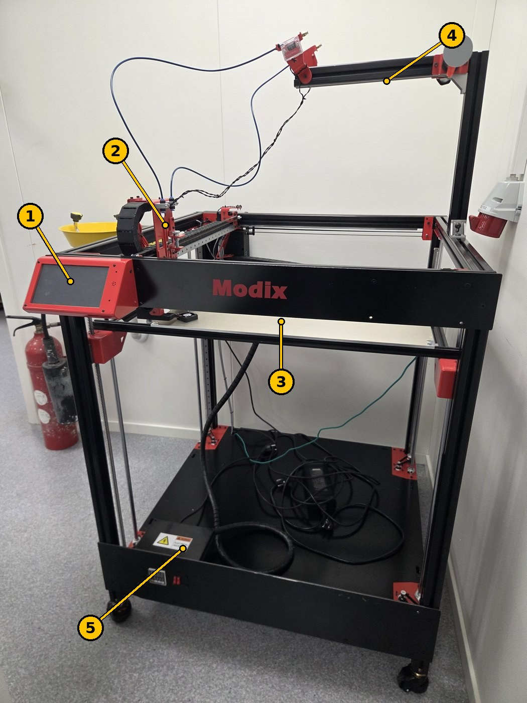

# Modix BIG-60 3D-printer – tilkobling, webgrensesnitt og macroer

USN Kongsberg · Måleteknisk lab · Oppdatert 12. nov. 2026

> **English version:** [README.md](README.md)

**Plassering:** Måleteknisk lab.

> **HMS er ikke dekket fullt ut her.** Følg instruksene fra labansvarlig, og ikke bruk printeren uten opplæring.

Modix BIG-60 er en stor FDM-3D-printer. Den styres av et **Duet 2 WiFi**-kort med **RepRapFirmware 3 (RRF3)**, og du bruker den enten fra **berøringsskjermen** eller trådløst fra **Duet Web Control (DWC)** i nettleseren. Denne siden samler det viktigste fra Modix sine veiledninger: koble til første gang, sette opp nettverk, bruke webgrensesnittet, laste opp konfigurasjons- og macrofiler, og bruke macroene. Lenker til Modix sine egne veiledninger og filer står i [kapittel 7](#7-ekstern-dokumentasjon-modix).



*Figur 1. Modix BIG-60 i Måleteknisk lab. Numrene stemmer med tabellen.*

| Nr. | Del | Funksjon |
| --- | --- | --- |
| 1 | Berøringsskjerm | Styr printeren, start utskrifter og kjør macroer direkte på maskinen. |
| 2 | Skrivehode | Smelter og legger ut filamentet. |
| 3 | Byggeplate (bord) | Delen printes på platen. Den beveger seg opp og ned (Z). |
| 4 | Arm på toppen | Fører filamentet fra rullen ned til skrivehodet. |
| 5 | Elektronikkboks | Duet-kortet og strømforsyningen. **Elektrisk fare – ikke åpne den med strømmen på.** |

## 1. Sikkerhet og forsiktighet

- **Ikke la printeren stå uten tilsyn** under PID-tuning eller når en utskrift gjenopptas etter strømbrudd.
- **«Allow unhomed moves»** slår av beskyttelsen mot kollisjon. Skrivehodet kan da kjøres inn i bordet. Bruk den bare til vedlikehold, og start printeren på nytt etterpå.
- **Ved USB-tilkobling: hovedbryteren skal være AV.** Strøm fra både USB og nettstrøm samtidig kan gi jordsløyfe.
- Gi printerens Wi-Fi eller tilgangspunkt et **sterkt passord**.

## 2. Koble til Duet-kortet med USB (første gang)

Nettverket stilles inn ved å sende G-kode-kommandoer til Duet-kortet fra et terminalprogram over USB.

1. **Bare første gang:** ta ut microSD-kortet fra kortet. (Kobler du til senere for å endre noe, lar du det stå.)
2. Lukk slicere og andre programmer som kan bruke COM-porten (Cura, PrusaSlicer, Simplify3D, Pronterface).
3. Slå **av** hovedbryteren og koble Duet til PC-en med en **microUSB-kabel som overfører data** (ikke bare strøm).
4. **Windows:** installer Duet-USB-driveren hvis enheten vises med gul trekant eller som «Generic USB» i Enhetsbehandling. Duet vises under *Porter (COM & LPT)* som *USB Serial Device (COM#)*. macOS og Linux trenger ingen driver.
5. Start et terminalprogram og koble til porten:
   - **Windows:** [YAT](https://sourceforge.net/projects/y-a-terminal/). Velg COM-porten under *Terminal → Settings*, sett *Text Settings → EOL sequence* til `<LF>`, og trykk den grønne haken.
   - **macOS:** SerialTools (App Store), 115200 baud, *Local Echo* på. Eller `screen /dev/tty.usbmodem… 115200`.
   - **Linux:** CuteCom (`sudo apt install cutecom`), port `/dev/ttyACM0`. Legg brukeren i gruppen `dialout` først.
6. Meldinger som «WiFi reported error: no known networks found» er normale.
7. Send `M115`. Svarer kortet med firmwareversjonen, virker tilkoblingen.

Bruk et ordentlig terminalprogram: noen 3D-printerprogrammer sender alt med store bokstaver, og Wi-Fi-navn og passord skiller mellom store og små bokstaver. Bruk rette anførselstegn (`"`).

## 3. Sette opp nettverket

Duet-kortet kan enten koble seg til et eksisterende nettverk (**lokalt nettverk**) eller lage sitt eget Wi-Fi (**tilgangspunkt**). Kortet støtter bare **2,4 GHz-nettverk med WPA2**. For 5 GHz eller bedriftsnettverk (som eduroam) må du bruke tilgangspunkt.

### 3.1 Lokalt nettverk

```text
M552 S0                                   ; Wi-Fi-modulen i hvilemodus
M588 S"*"                                 ; slett lagrede nettverk
M587 S"nettverksnavn" P"passord"          ; lagre nettverket (legg til I192.168.x.x for fast IP)
M587                                      ; sjekk at nettverket er lagret
M552 S1                                   ; slå på Wi-Fi-modulen
```

Kortet svarer med IP-adressen, for eksempel *«WiFi module is connected to access point …, IP address 192.168.68.126»*. **Skriv den ned.** Koble fra USB, sett microSD-kortet inn igjen og koble til på nytt. Åpne så IP-adressen i en nettleser på en PC i samme nettverk.

### 3.2 Tilgangspunkt (printerens eget Wi-Fi)

```text
M552 S0                                   ; Wi-Fi-modulen i hvilemodus
M589 S"DuetSSID" P"passord" I192.168.0.1  ; navn, passord (minst 8 tegn) og IP
M552 S2                                   ; slå på som tilgangspunkt
```

For at printeren skal starte som tilgangspunkt hver gang: åpne `/sys/config_networking.g` på microSD-kortet og endre `M552 S1` til `M552 S2`. Koble deg til printerens Wi-Fi og gå til IP-adressen (her `192.168.0.1`).

Passordet må ha minst 8 tegn. Du får ingen feilmelding hvis det er kortere, men kommandoen virker ikke.

### 3.3 Feilsøking for Wi-Fi

1. Send `M552 S1` igjen.
2. Sjekk stavingen av nettverksnavn og passord.
3. Start printeren på nytt og vent noen minutter.
4. `M997 S1` tilbakestiller Wi-Fi-firmwaren.
5. Sjekk at Wi-Fi-antennen er riktig tilkoblet.
6. Prøv et annet nettverk, eller start ruteren på nytt.
7. Husk: bare 2,4 GHz.
8. Slett lagrede nettverk (`M552 S0`, så `M588 S"*"`) og sett opp på nytt.

**MAC-adressen** (hvis IT trenger den) får du med `M122` fra terminalen eller webgrensesnittet. Den står nær slutten av diagnoseutskriften. Skjermen på printeren viser den ikke.

## 4. Duet Web Control (DWC 3.3)

Webgrensesnittet ligner berøringsskjermen. Det viktigste:

| Område | Hva det er til |
| --- | --- |
| **Topplinjen** | Printerens navn, et lite G-kode-felt, **Upload & Start** (last opp og start en G-kode-fil) og **Emergency Stop** (stopper alt umiddelbart). |
| **Status** | Posisjonen til verktøyet i X/Y/Z, ekstruderposisjon, hastigheter, spenning inn på kortet, temperaturen på kortet og Z-probe. |
| **Tools / Heaters** | Velg verktøy (skrivehode), sett aktiv temperatur og standby-temperatur, og se status for varmeelementene. |
| **Machine movement** | Kjør hjem alle akser eller én og én, og flytt aksene manuelt. Ekstruder og trekk tilbake filament, og styr viftene. |
| **Macros** | Macroer for kalibrering, tuning og andre funksjoner (se [kapittel 6](#6-macroer-rrf3)). |
| **Console** | Send G-kode og se svarene. |
| **Height Map** | Høydekartet for bordet, etter at kalibreringen er gjort. |
| **Job Status** | Informasjon og kontroll under utskrift: pause, babystepping (juster første lag mens den printer), hastighets- og ekstruderingsfaktor, lagdiagram. |
| **Files → Jobs / Macros / System** | Opplastede G-kode-filer, macrofiler og printerens konfigurasjonsfiler. |
| **Settings → General / Machine-Specific** | Innstillinger for grensesnittet, og printerspesifikke innstillinger, diagnose og firmwareversjoner. |

## 5. Laste opp konfigurasjons- og macrofiler

Et nytt Duet-kort har testfiler fra fabrikken, og printeren virker ikke med dem. Filene må byttes ut med Modix sine, og firmwaren må ha riktig versjon. Det samme gjelder ved oppgradering fra RepRapFirmware 2.05: de gamle filene virker ikke med RRF3.

Filene ligger i Modix sitt GitHub-repository. Versjonen for vår printer: **[Modix V3 configuration and macro files, v3.4.5.c](https://github.com/Modix3D/Modix-V3-configuration-and-Macro-files/releases/tag/v3.4.5.c)**.

**Velg riktig variant.** Feil konfigurasjon kan skade printeren.

- Sjekk generasjon og type printer (Modix har egne filer for blant annet Generation 4 IDEX, Generation 4 første serie, oppgradering V3–V4 og Version 3).
- Åpne elektronikkboksen: **1 kort** = vanlig konfigurasjon, **2 kort** = **DUEX**-konfigurasjon.
- Har printeren Griffin-skrivehode, finnes egne Griffin-varianter.

**Konfigurasjonsfiler**

1. Last ned riktige filer og pakk dem ut.
2. I DWC: **System → Upload System Files**, velg alle filene og trykk *Open*.
3. Svar **Yes** når du blir bedt om å starte på nytt. «Connection is lost» vises, og grensesnittet kobler seg til igjen når printeren har startet.

Bruker printeren tilgangspunkt: endre `M552 S1` til `M552 S2` i `config_networking.g` **før** du laster opp. Har kortet Ethernet (Duet 2 Ethernet): fjern `;` foran `;M552 P0.0.0.0` i `config.g`.

**Macrofiler**

1. **Slett alle gamle macrofiler først.** Opplastingen overskriver ikke gamle filer riktig, og noen har fått nye navn.
2. Last opp macro-zip-filen under **Macros**. Den pakkes ut automatisk.

Macrofilene for V4, V4 IDEX og V3 kan ikke brukes på hverandres printere.

**Kontroll:** øverst til venstre på skjermen skal printerens modellnavn stå. Står det **DuetTest**, er fabrikkfilene fortsatt i bruk. Sjekk da at filene ligger i rotmappen på microSD-kortet, og prøv på nytt.

## 6. Macroer (RRF3)

Macroene kan kjøres fra berøringsskjermen og fra webgrensesnittet, og de spør om du vil fortsette før de starter. De gjelder konfigurasjon 3.3 Config B og nyere.

### 6.1 På hovedskjermen

| Macro | Hva den gjør |
| --- | --- |
| **LED Toggle** | Slår LED-lyset av og på (for printere med kabinett). |
| **Filament change** | Bytter filament under utskrift: pauser, parkerer skrivehodet foran til venstre og trekker ut filamentet. Sett inn nytt filament, trykk *Continue* og så *Resume*. |
| **Move to the front** | Parkerer skrivehodet foran til venstre, for vedlikehold. |

### 6.2 Generelle macroer (Macros → General)

| Macro | Hva den gjør |
| --- | --- |
| **Allow cold extrusion** | Tillater ekstrudering under 160 °C, for eksempel ved rengjøring av dysen. |
| **Allow unhomed moves (!)** | Tillater bevegelse uten at aksene er kjørt hjem, og utenfor printvolumet. **Fare for kollisjon.** Start printeren på nytt etterpå. |
| **BLTouch self-test** | Nullstiller feil i BLTouch og kjører pinnen opp og ned ti ganger. |
| **Move bed down 50mm** | Senker bordet 50 mm, også uten at aksene er kjørt hjem. Vær forsiktig nær bunnen. |
| **Power out recovery** | Fortsetter en utskrift fra siste lag etter strømbrudd. Bli stående og følg med, og avbryt hvis noe har forskjøvet seg. |
| **WiFi reset** | Prøver å koble til Wi-Fi på nytt og tilbyr ellers å tilbakestille Wi-Fi-firmwaren. Bare fra berøringsskjermen. |

### 6.3 PID-tuning (Macros → PID)

PID-tuning finner de beste innstillingene for temperaturreguleringen av skrivehodet ved å varme opp og kjøle ned flere ganger. Det tar ca. **10 minutter per skrivehode**. **Ikke gå fra printeren.**

1. Gjør printeren klar som for utskrift: filament i dysen, bordet varmet til utskriftstemperatur (50–100 °C), lokk og dører lukket hvis du printer med dem lukket.
2. Kjør **PID Tuning E0**. Når konsollen viser *«Auto tune heater 0 completed»*, er den ferdig.
3. Gjenta med **PID Tuning E1** for det andre skrivehodet.

Med konfigurasjon **3.4.1 Config D og nyere** lagres verdiene automatisk. Med eldre versjoner kopierer du `M307`-linjen fra konsollen inn i `config.g` (Settings → System editor), under *Heaters*, uten `;` foran, og trykker *Save changes*.

Macroen tuner på 240 °C og 100 % vifte. For andre temperaturer eller viftehastigheter endrer du siste linje i macrofilen, for eksempel `M303 H0 T0 P0 S400 F1.0` for 400 °C, eller `F0.35` for 35 % vifte.

## 7. Ekstern dokumentasjon (Modix)

Disse veiledningene er laget av **Modix**, ikke av USN, og ligger på [Modix sin supportside](https://www.support.modix3d.com/). Søk etter tittelen der for nyeste versjon, med alle bilder.

| Veiledning (Modix) | Innhold |
| --- | --- |
| *Getting Connected to Duet* (29.11.2022) | USB-tilkobling, drivere og terminalprogram for Windows, macOS og Linux ([kapittel 2](#2-koble-til-duet-kortet-med-usb-første-gang)) |
| *RRF3 – Duet Networking Setup – Via USB* (29.11.2022) | Lokalt nettverk, tilgangspunkt, feilsøking og MAC-adresse ([kapittel 3](#3-sette-opp-nettverket)) |
| *Duet Web Interface Introduction – DWC3.3* (26.01.2022) | Gjennomgang av webgrensesnittet med skjermbilder ([kapittel 4](#4-duet-web-control-dwc-33)) |
| *Configuration and Macro files upload* (29.11.2022) | Valg av riktig variant og opplasting av filer ([kapittel 5](#5-laste-opp-konfigurasjons--og-macrofiler)) |
| *General Macros Guide RRF3* (17.01.2022) | Alle macroene og PID-tuning ([kapittel 6](#6-macroer-rrf3)) |

**Firmware og filer:** [Modix V3 configuration and macro files, v3.4.5.c (GitHub)](https://github.com/Modix3D/Modix-V3-configuration-and-Macro-files/releases/tag/v3.4.5.c).
