# Stepcraft M700 CNC Mill – UCCNC and SolidWorks CAM – User Manual

Mechanical engineering, product development · USN Kongsberg · Author: Rasmus Ullestad Relling · Updated 25 Feb 2026

> **Norsk versjon:** [README.no.md](README.no.md) · **PDF:** [guide-en.pdf](guide-en.pdf) · **Word:** [guide-en.docx](guide-en.docx) · **Quick card (A4):** [English](quick-card-en.pdf), [Norsk](quick-card-no.pdf)

**Used in:** student projects (parts from SolidWorks milled on the Stepcraft M700). The machine is in the **composites lab** (*Komposittlabben*).

> **Health and safety (HMS) is not covered in this manual.** Follow the lab supervisor's instructions, and do not use the machine without training.

*Translated from the Norwegian original. The Norwegian version is the master copy.*

## 1. About this document

**Scope.** This document shows how

- **students** set up a part in SolidWorks and make it ready for SolidWorks CAM ([chapter 2](#2-solidworks-cam--students));
- **teachers** post-process G-code (NC code) from SolidWorks for use in UCCNC ([3.04](#304-making-a-toolpath-in-solidworks-cam), [3.07](#307-post-processing-to-nc-code-for-uccnc));
- **teachers and students** export a DXF file from SolidWorks for use in UCCNC CAM ([3.05](#305-making-a-toolpath-in-uccnc-cam-from-a-dxf-file));
- **teachers** start the Stepcraft M700, set it up for normal use and shut it down ([3.01](#301-starting-up-the-cnc), [3.08](#308-shutting-down-the-cnc), [chapter 4](#4-getting-the-stepcraft-ready--teachers));
- **teachers** use a 3D Touch Probe with the Stepcraft M700 and UCCNC ([4.03](#403-calibrating-the-3d-touch-probe-in-the-tool-magazine-z));
- **teachers** edit a post-processor for the Stepcraft M700 in SolidWorks ([chapter 5](#5-editing-the-post-processor--teachers)).

**Audience.** Students and teachers at USN Kongsberg.

**Location.** The Stepcraft M700 is in the **composites lab** (*Komposittlabben*).

**Limitations.**

- The document does not cover health and safety. That has to be considered separately.
- It does not cover the changes made earlier to the Stepcraft M700 macro codes.
- It does not cover what to do if the machine loses its zero point while milling, which can happen. A technical fix is to upgrade the Stepcraft M700 with a digital counter for planned steps: [Semi-Closed Loop System for M-series till 04/2025](https://shop.stepcraft-systems.com/Semi-Closed-Loop-System-for-M-Series-till-04-2025).

**Prerequisites.** The document is for students and teachers in mechanical engineering, product development. You should know SolidWorks and have taken DAK 1 and DAK 2 (CAD 1 and 2). Product Development 1 helps but is not required.

## 2. SolidWorks CAM | Students

### 2.01 Adding a coordinate system to a part

It is important to add a coordinate system for milling. It becomes the starting point (zero point) of the part. The coordinate system **must** be parallel to the surface. A teacher should also be able to find the zero point again on the real part with a *3D Touch Probe*. If the zero point is lost during milling and the job has to start again, the part can then be "rescued", and less material is wasted.

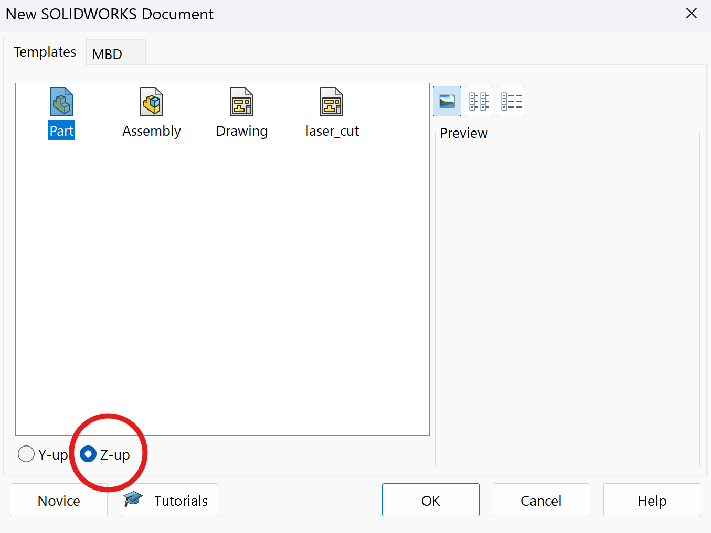

Think about a natural place for the zero point before you model the part. That saves a lot of time adjusting the coordinate system later. It also saves time to set Z up, not Y (the usual), because the CNC machine uses a coordinate system with Z up, which has to be defined in SolidWorks CAM anyway.

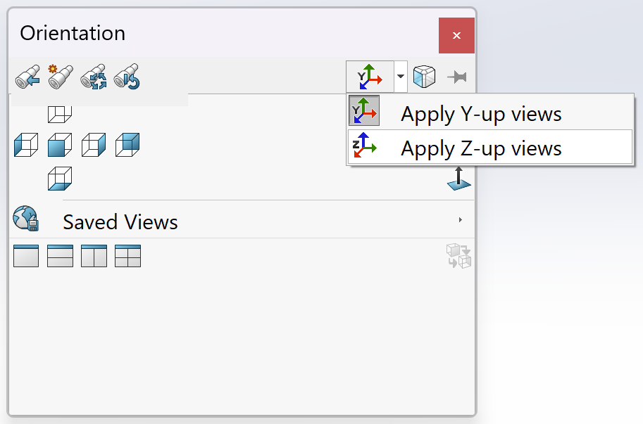

#### (a) The milling area of the Stepcraft M700

Setting the X and Y axes to match how the part will be milled in the machine also saves time later. You need a clamping margin of about **50 mm on each side** of, for example, a carbon fibre plate or a 3 mm aluminium plate, so the machine does not crash.

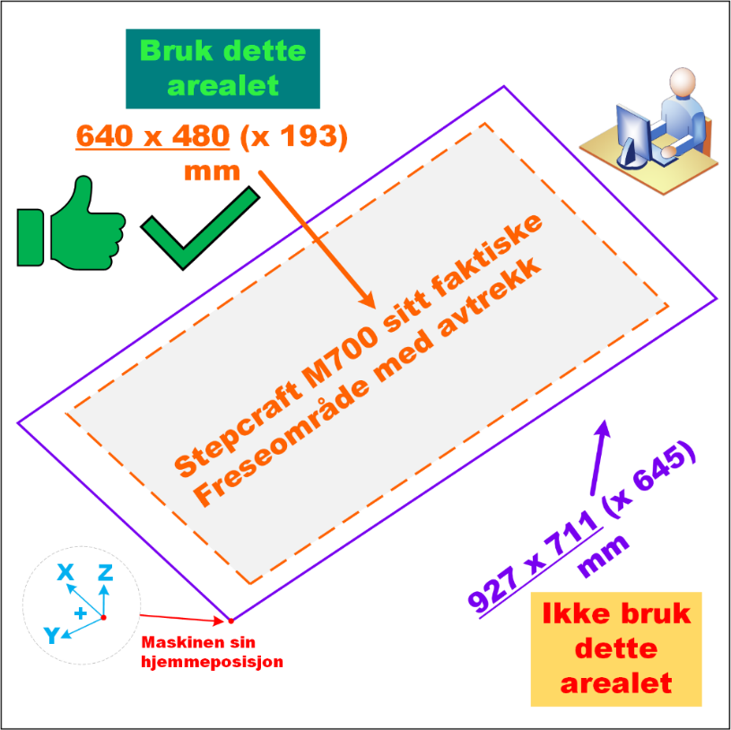

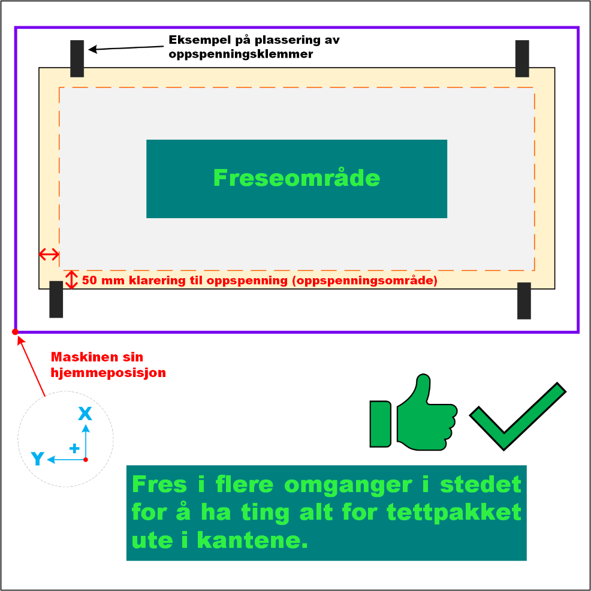

**Remember <u>not</u> to design parts too large!**

#### (b) Designing a good coordinate system for milling

A part drawn with a coordinate system for 3D printing can be hard to mill on a CNC. A 3D printer does not care about the coordinate system, and the G-code is made in a separate program, often called a *slicer*.

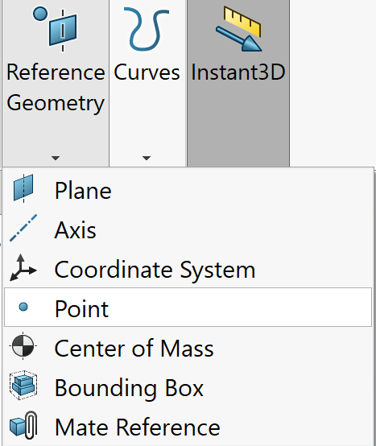

A coordinate system made for a CNC mill, on the other hand, is usually easy to 3D print, because you can rotate the part and choose how it is printed in the slicer.

As an example, the author wants the origin at the centre of a circular feature. That is because the *3D Touch Probe* can find the centre of circles and squares/rectangles, both inside and outside.

Click **"Reference Geometry"** → **"Point"**.

Click the top edge (contour line) of the feature. It will also be parallel to the Z axis.

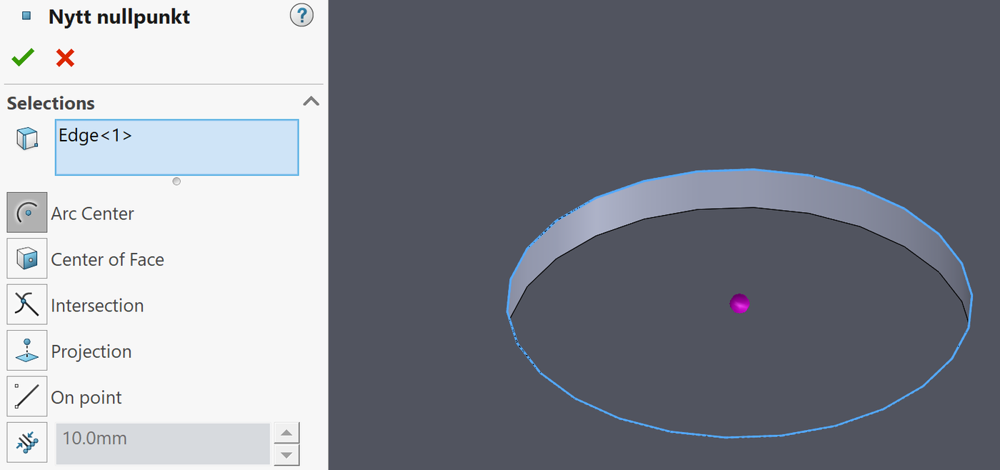

Then click **"Reference Geometry"** → **"Coordinate System"** and select the new point ("Nytt nullpunkt").

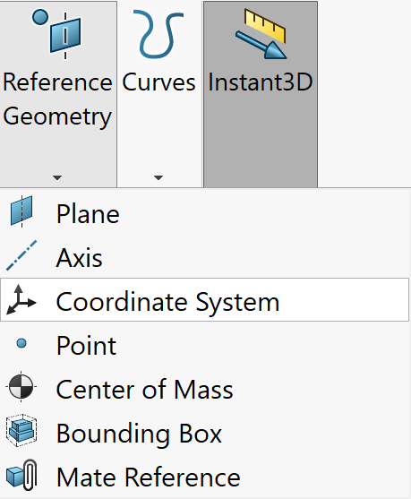

Check that the X and Y axes match how the part will be milled in the machine. If they are wrong, flip the X and/or Y axis under **"Orientation"** by clicking, for example, a straight edge.

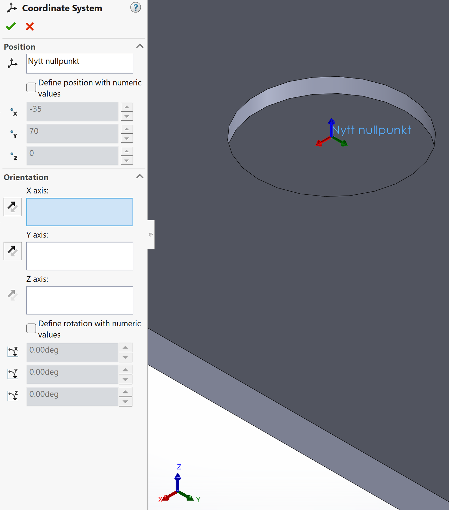

Click **"OK"** and check that the coordinate system looks right. *Well done, your part now has a coordinate system!*

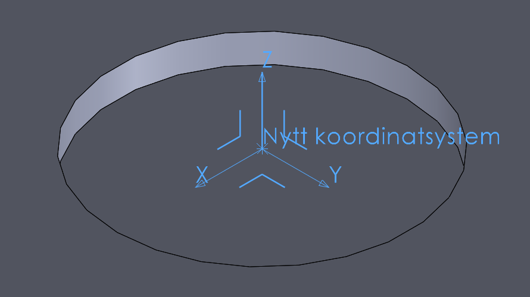

### 2.02 Making sketch(es) for CAMWorks

To mill a part efficiently, you have to prepare its features. This matters especially on a small, light CNC machine like the Stepcraft M700.

The features are holes, pockets or other shapes where all the material inside has to go. You can either mill away everything inside into dust, or cut around it (like a saw), leaving a piece that can be thrown away. You can also add "tabs" that stop the scrap piece from going astray (does not happen often).

Cutting around is the better choice in **almost** every case: it is faster, wears the cutter less, and the home position is less likely to be lost. As an engineer you have to judge this yourself, and the person responsible for production may question your choice.

***Before you use one of the methods below:*** *You can also make a DXF file (as for laser cutting) and import it into the UCCNC M.700 software on the computer at the CNC. Then you can skip the steps below. See [3.05](#305-making-a-toolpath-in-uccnc-cam-from-a-dxf-file).*

#### (a) Method 1: Offset Loop (*boss* toolpath)

With a *boss* toolpath in SolidWorks (SW) CAM you have to make an offset curve, because a boss in SW CAM is locked to the **outside** of the contour line.

To use the "saw method" and cut around, make a 2 mm offset sketch from the contour line of the original feature. Right-click the contour line and click **"Select loop"**.

Then click **"Convert Entities"**, or go straight to **"Offset Entities"**.

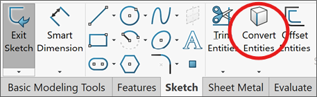

Select the new contour line in the sketch, tick **"For construction"** and close the dialog.

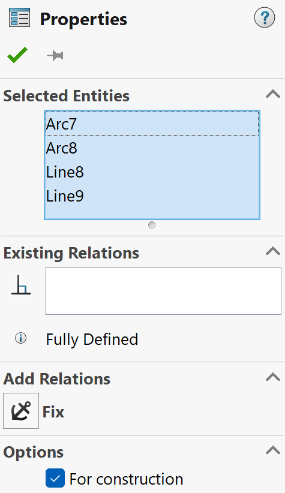

Select the new construction lines. Click **"Offset Entities"**, tick **"Reverse"** and use an offset of **<u>2 mm</u>**.

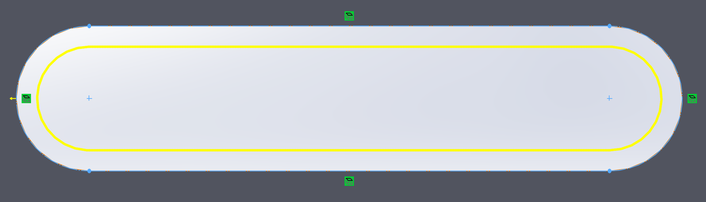

Now a 2 mm cutter can "saw" out the shape with boss programming in SolidWorks CAM.

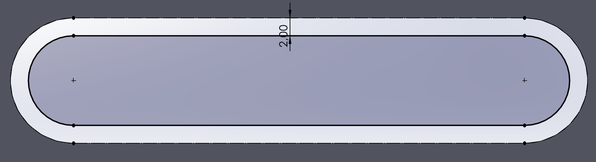

**Remember to make several sketches**, for example one for Ø4 mm holes, one for Ø6 mm holes and one for pockets of another shape. SolidWorks CAM has to tell holes of different shape and depth apart.

#### (b) Method 2 (**recommended**): Without Offset Loop (*pocket* toolpath)

With a *pocket* (Contour) toolpath in SW CAM you do **not** need an offset curve. A pocket (Contour) runs on the **inside** of the contour line and does not mill out everything inside.

Remember: a *Contour Mill* (made with, for example, the *Finish* or *Fine* strategy) only mills around the contour line, while a *Rough Mill* (made with, for example, the *Rough* strategy) mills out **everything** inside. That is usually **only needed** if you are not cutting all the way through, or the stock is so high that the cutter could crash into it. It wears the tool a lot.

You can leave the features as drawn (with a Ø2 mm cutter in mind), or, as **recommended**, make sketches if you want the features milled in a particular order.

#### (c) **Important** about circular holes with a given diameter

It can be a good idea to set all holes to Ø2 mm for milling, and drill them out to the exact diameter afterwards with a hand drill. ***All* holes smaller than Ø6 mm** have to be drilled out by hand afterwards (drill bits are in the prototype lab – ask for access to the lock).

The engineer/designer must either change these holes to Ø2 mm before production or, as **<u>recommended</u>**, make a new sketch (often easier) on the same plane with Ø2 mm holes at the centres of the holes. Give the sketches clear names, so the person responsible for production can see what they are **for**.

## 3. UCCNC for Stepcraft | Teachers

### 3.01 Starting up the CNC

1. Turn on the compressed air to the machine.
2. Turn on the vacuum (dust extraction) – switch it on with the switch above the mill when needed.
3. Release the emergency stops on the outside and the inside of the door.
4. Start UCCNC on the local computer.
5. Turn on the spindle switch (it should flash blue/red when no program is running).
6. Click **"Reset"** in the bottom right corner.

When you are done, shut down in the reverse order: see [3.08](#308-shutting-down-the-cnc).

### 3.02 Exporting a Technology Database for import

Do this **before** you update SolidWorks to a new version, so the database is not lost!

Go to **"Tools"** → **"SOLIDWORKS CAM"** → **"Technology Database…"** to open the Technology Database (TechDB).

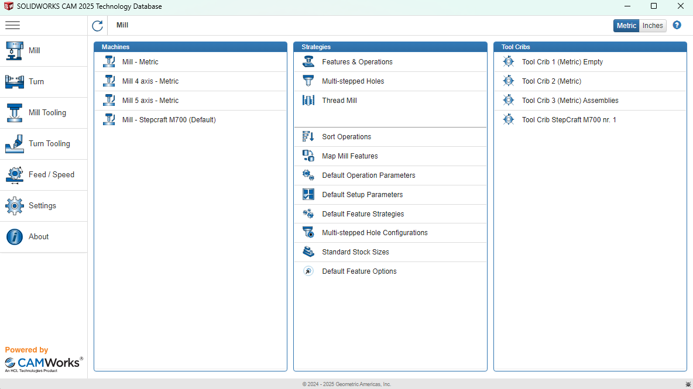

Click **"Settings"** in the menu on the left.

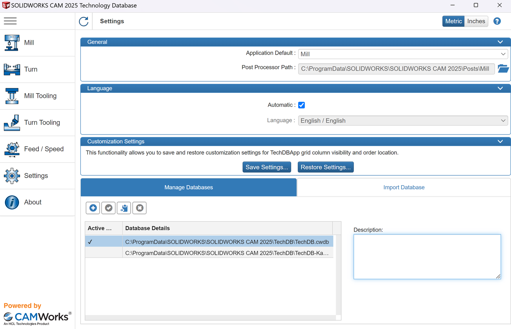

The **"Manage Databases"** tab shows where the databases linked to TechDB are stored. Click the database you want to keep and click **"Copy"**.

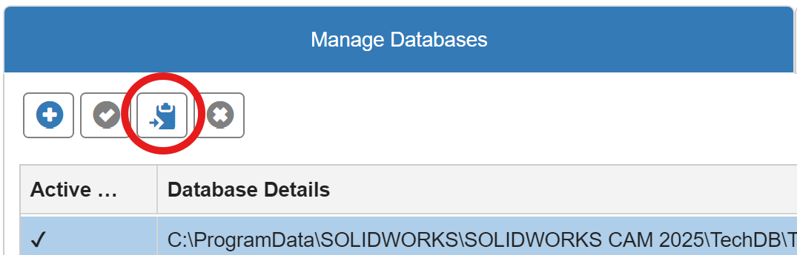

Choose where to save the copy. This is **<u>strongly recommended</u>** before you upgrade to a new version of SolidWorks!

After the new SolidWorks version is installed, go to the **"Import Database"** tab, click **"Browse"**, choose the exported database and import it. **<u>Remember to close SolidWorks</u>** (but not TechDB) before you start the import!

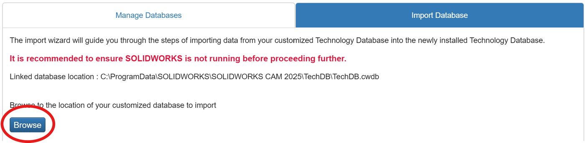

### 3.03 Adding a new tool to TechDB (example)

Tools are edited in the SolidWorks CAM Technology Database. If possible, use only one tool at a time. The Stepcraft tool holder tends to jam when dust or chips get in during use. *See [4.05](#405-releasing-a-stuck-tool) for how to release a stuck tool.*

Open the Technology Database: **"Tools"** → **"SOLIDWORKS CAM"** → **"Technology Database…"**.

Choose the tool type, for example *Flat End Mill* (at the bottom of the picture).

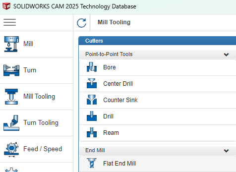

You now get a long list of tools that come with SolidWorks.

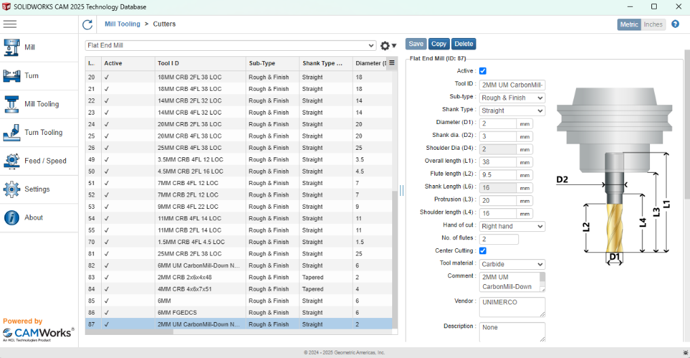

Find a tool similar to the one you want to add, and copy it.

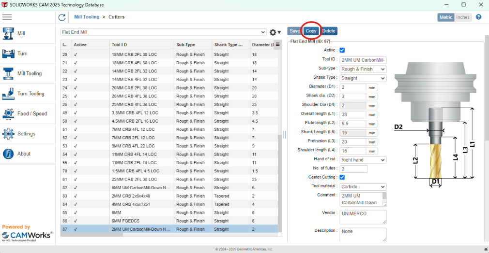

Fix your tool in the tool holder and measure it. Adjust the lengths to match.

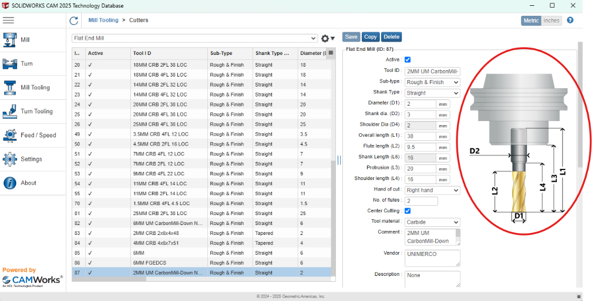

Scroll down and adjust the allowed speeds. **These are the speeds that can reach the Stepcraft M700, so it is important that they are correct and as expected.**

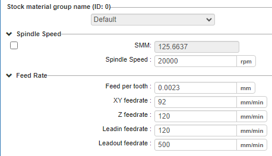

When you are done, click **"Save"** (to the left of **"Copy"**) and close TechDB.

### 3.04 Making a toolpath in SOLIDWORKS CAM

***Before you use one of the methods below:*** *You can also make a DXF file and import it into UCCNC M.700. See [3.05](#305-making-a-toolpath-in-uccnc-cam-from-a-dxf-file).*

How the part is prepared for each method is described in [2.02](#202-making-sketches-for-camworks) (students).

#### (a) Method 1: Offset Loop (*boss* toolpath)

**Milling on the outside.** A *boss* strategy is often used to mill out a part at the end. **Choose a new *2.5 Axis Feature* with *Type* = *Boss*.** Then choose the offset sketch of the feature(s).

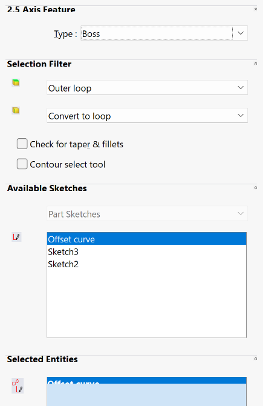

You can now add a *Contour Mill*. Click **OK** when you have set the cutting depth.

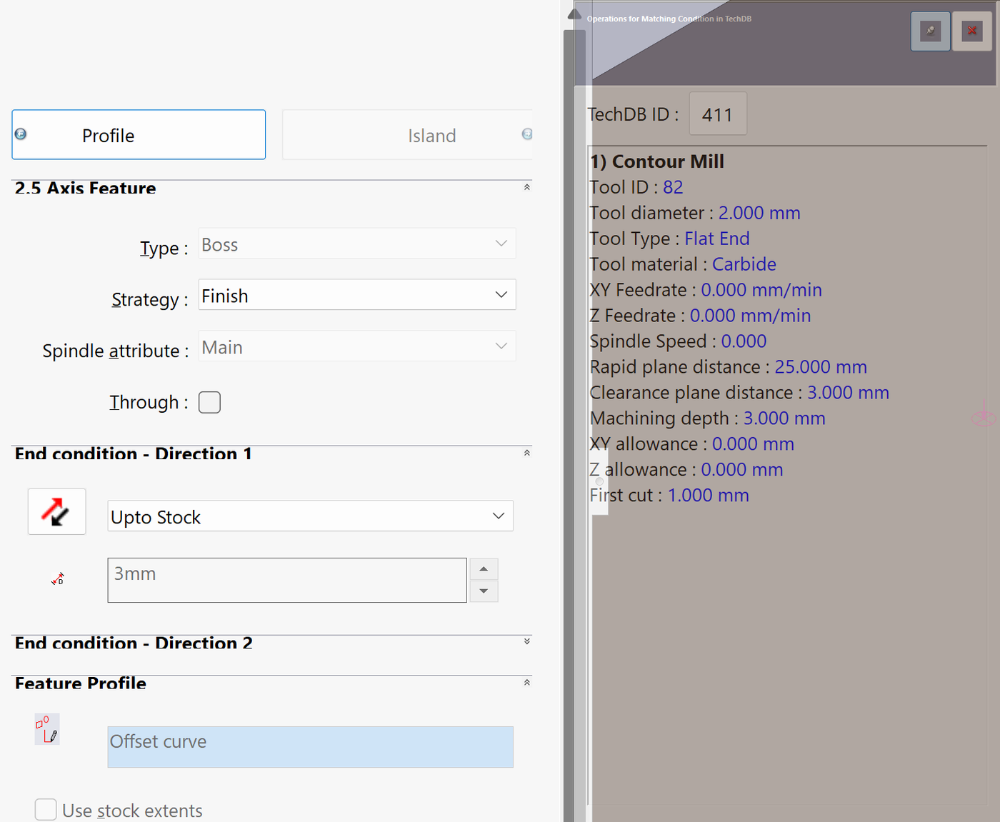

Click **"Generate Operation Plan"**. If everything is defined correctly, the text turns from **blue** to **black**, and the view switches from the **"SOLIDWORKS CAM Feature Tree"** tab to the **"SOLIDWORKS CAM Operation Tree"**.

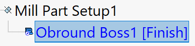

Click **"Generate Toolpath"** to make the toolpath. The text again turns from **blue** to **black**.

*The next step is to simulate the toolpath with **"Simulate Toolpath"** and post-process it into G-code (NC code) that can be imported into UCCNC.*

**Example** of a simulation with boss (outside cut). An <u>inside</u> cut is often wanted here, but a 2 mm inward offset contour with a Ø2 mm cutter gives the same result:

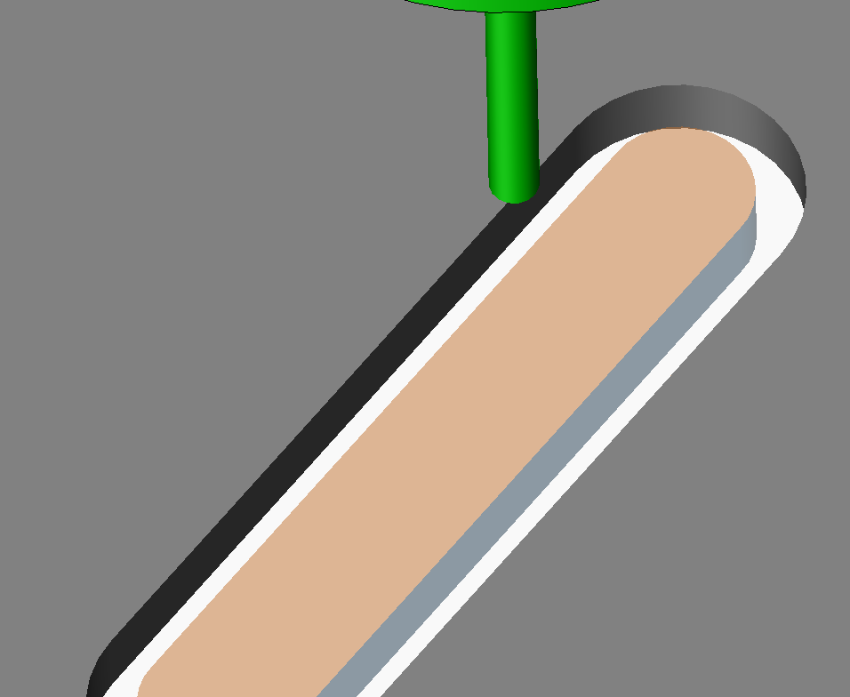

#### (b) Method 2 (**recommended**): Without Offset Loop (*pocket* toolpath)

**Pocket without tabs or bridges (milling on the inside).** First define each edge or sketch in the pocket to be milled out. **Choose a new *2.5 Axis Feature* with *Type* = *Pocket*.**

Click **"End Condition"** to continue.

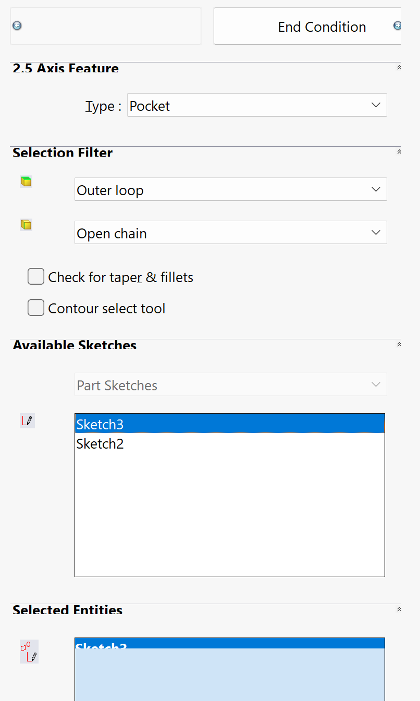

Choosing the strategy matters now. Set **"Strategy"** to, for example, *Finish* or *Fine*, so you get a **"Contour Mill"** and <u>not</u> a **"Rough Mill"**. This decides whether you can add tabs.

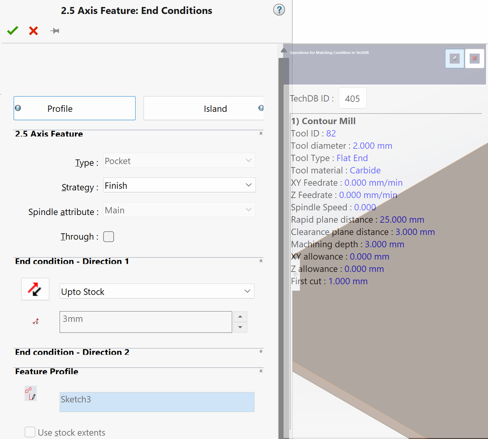

Click **OK** and then **"Generate Operation Plan"**. If everything is defined correctly, the text turns from **blue** to **black**, and the view switches from the **"SOLIDWORKS CAM Feature Tree"** to the **"SOLIDWORKS CAM Operation Tree"**.

Click **"Generate Toolpath"**. The text again turns from **blue** to **black**.

*The next step is to simulate the toolpath with **"Simulate Toolpath"** and post-process it into G-code for UCCNC.*

**Example** of a simulation with pocket (inside cut):

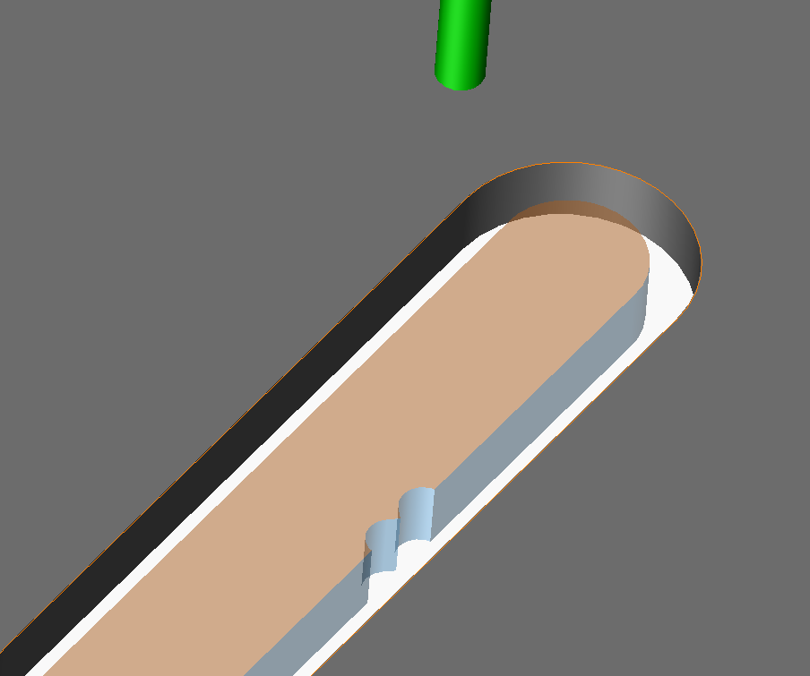

**Pocket with tabs or bridges (milling on the inside).** If you want to hold the scrap piece with "tabs", SolidWorks CAM can make them **automatically**. Normally a pocket toolpath mills away everything along the contour line, but with tabs the scrap piece is held in place while the inside is milled. See examples of tabs and bridges in [this video (0:46)](https://www.youtube.com/watch?v=2L0SmbIvFTA&t=46s).

Do the same steps as above: a new *2.5 Axis Feature* with *Type* = *Pocket*, **"End Condition"**, **"Strategy"** = *Finish* or *Fine* (**not** Rough), **OK**, **"Generate Operation Plan"** and **"Generate Toolpath"**.

Right-click the new *Contour Mill* operation, choose **"Edit Definition…"**, go to the **Contour** tab and tick **"Tab cutting"** in the bottom right corner.

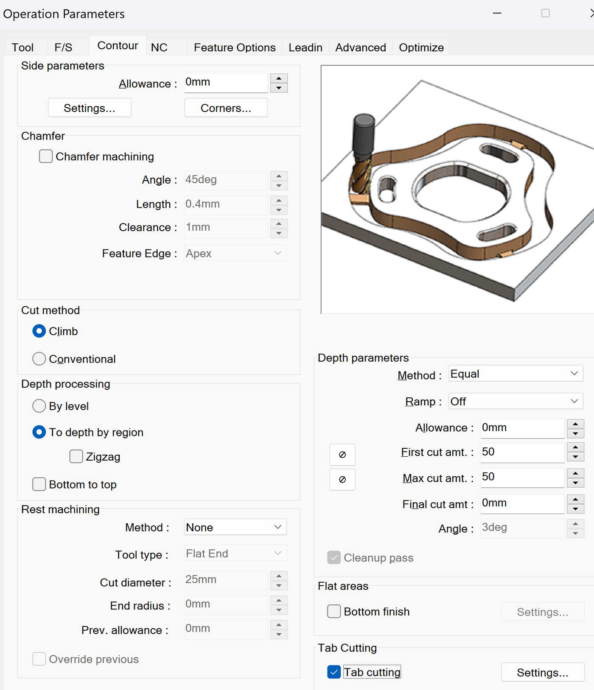

Under Tab cutting, choose **"Settings…"**. Adjust the number of tabs, length, thickness, lead-in/lead-out etc., and click **OK**.

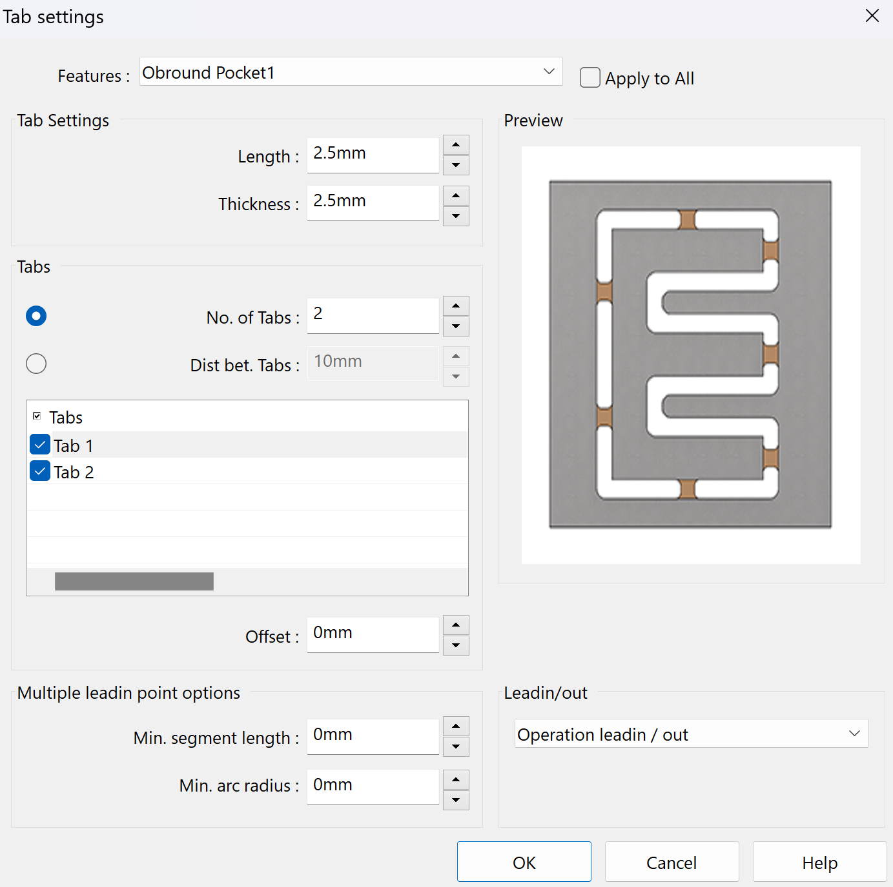

***Now make the toolpath as usual. The tabs hold the scrap piece in place.***

*The next step is to simulate the toolpath with **"Simulate Toolpath"** and post-process it into G-code for UCCNC.*

**Example** of a simulation with pocket (inside cut) with four tabs, 2.5 mm long and 1.5 mm thick:

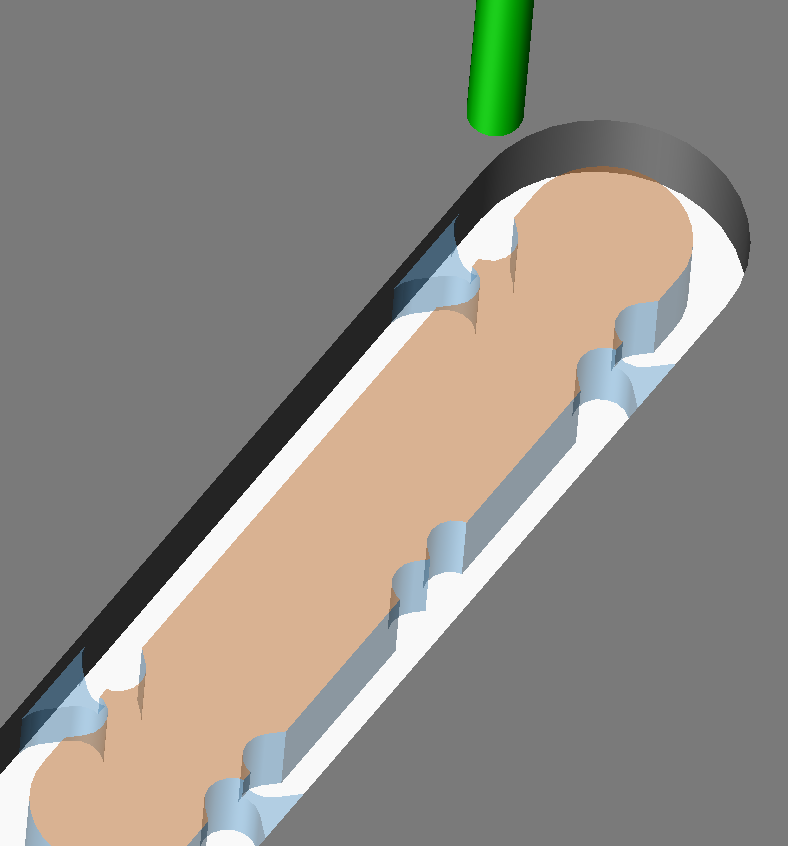

### 3.05 Making a toolpath in UCCNC CAM from a DXF file

You can also make G-code from a DXF file in UCCNC CAM. It works very well for simpler parts, prototypes, or when the work does not all need to be documented. It is a bit more manual, but works very well.

Find a view of the part (usually from the top) that gives the right contour lines for the DXF file.

Choose **File** → **Save As…**, set the file type to **Dxf (\*.dxf)** and click **Save**.

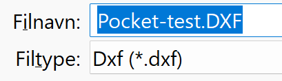

Choose the view you want to export and click **OK**.

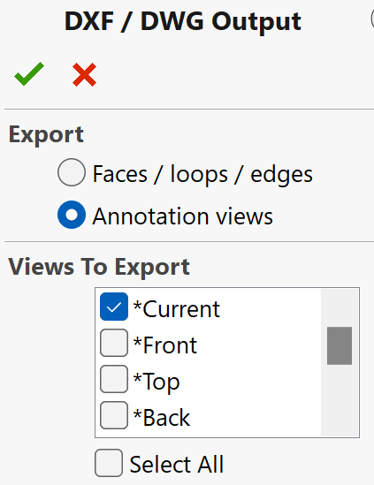

Click **"Save"**. Do not worry about the zero point or the coordinate system – they are defined in UCCNC.

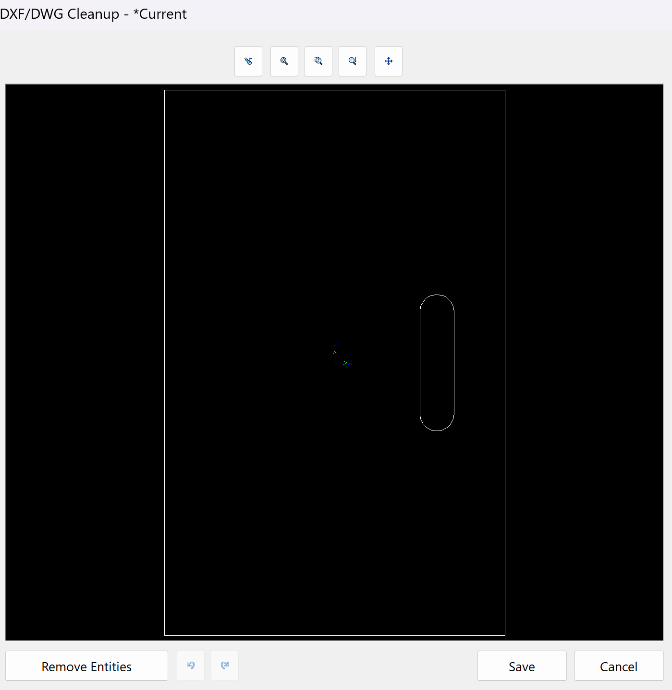

With a student licence the DXF file has to be cleaned up (the unwanted text removed). You can also add layers to the DXF file (as in a drawing program) to separate what is milled on the inside or outside, depths etc. **The free program [QCAD](https://www.qcad.org/en/) is recommended for this.**

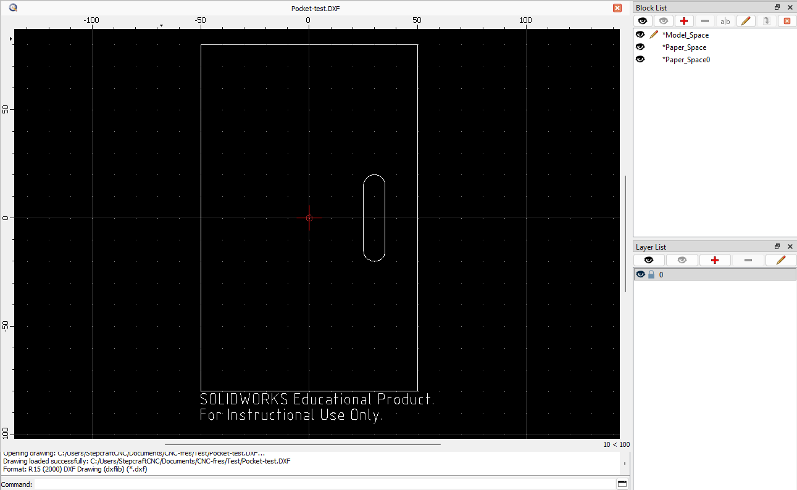

The DXF import in UCCNC is strict – for example, you cannot use any layer names you like. **Layer no. 1 <u>must</u> be named `0`. Layer no. 2 <u>must</u> be named `11`. The layers after that <u>must</u> be named `12`, `13`, `14` and so on.**

When you have finished editing, save the file (**Ctrl+S**).

Move features that will get a different strategy later to a new layer.

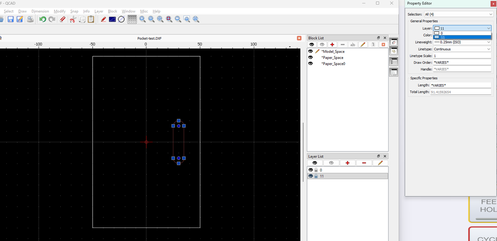

Open UCCNC and go to the **CAM tab**.

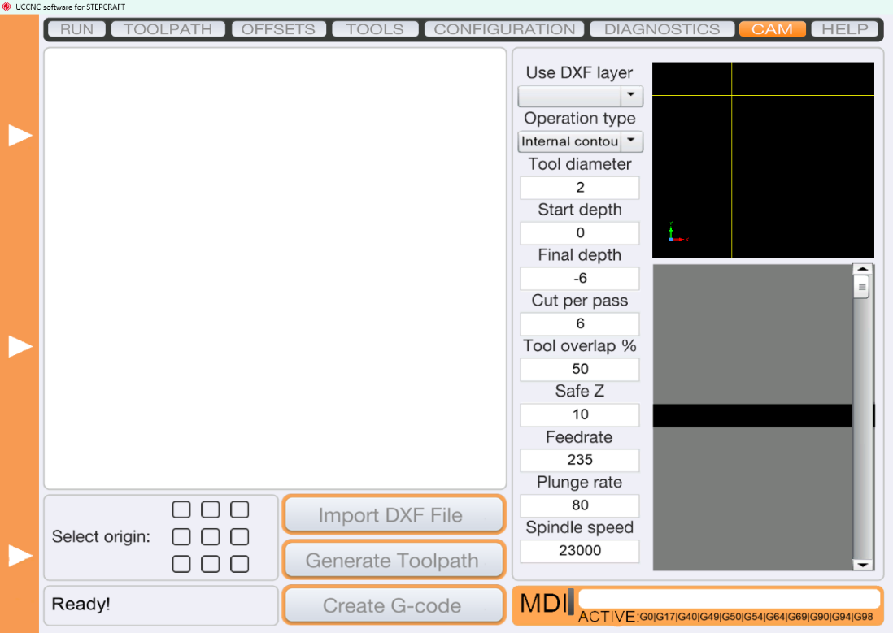

Import the file into UCCNC. Here you choose **which DXF layers to make G-code for**.

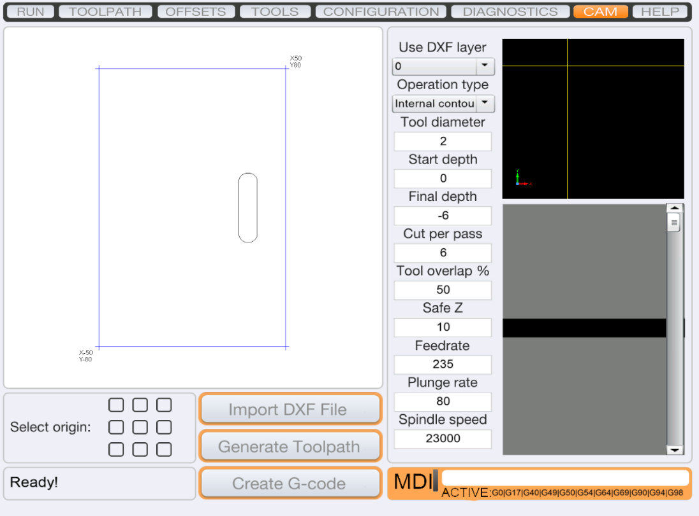

In this example there are two layers: one for the outer contour (outside cut) and one for the features (inside cut).

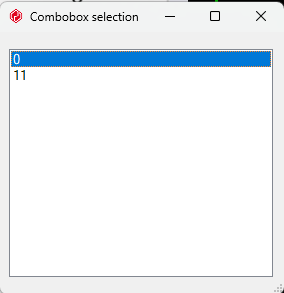

Choose where the **zero point** should be.

Choose the strategy ("Operation Type"), for example inside or outside.

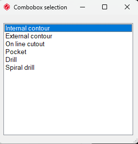

**Example** of settings that work with the Stepcraft M700:

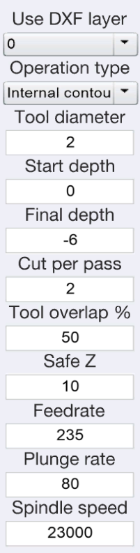

Make G-code for each layer you want to mill, with different strategies if needed (inside/outside): **1. "Generate Toolpath"**, **2. "Create G-code"**. The result looks like this:

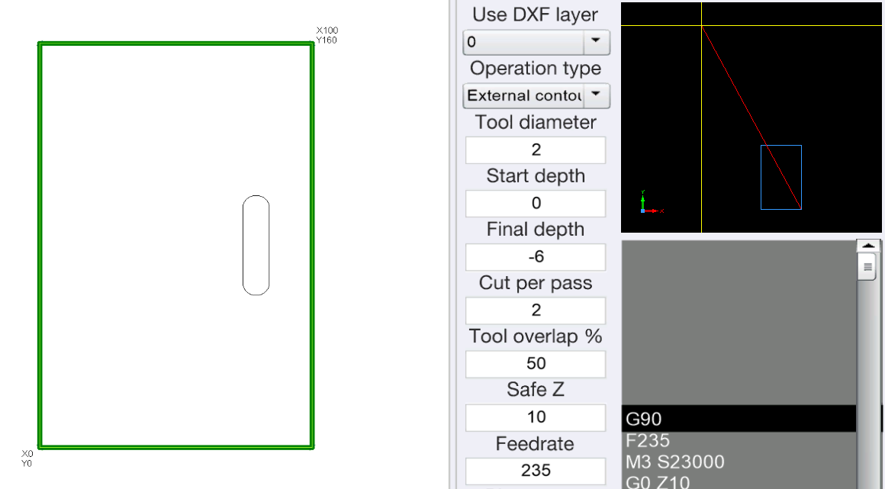

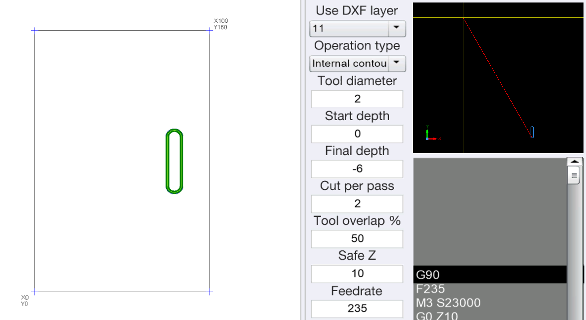

### 3.06 Changing the lead-in/-out (holes over Ø4 mm can be milled out)

To change the lead-in/-out, you must first have clicked **"Generate Toolpath"** and got a *Contour Mill*. Right-click the Contour Mill, click **"Edit Definition…"** and go to the **"Leadin"** tab.

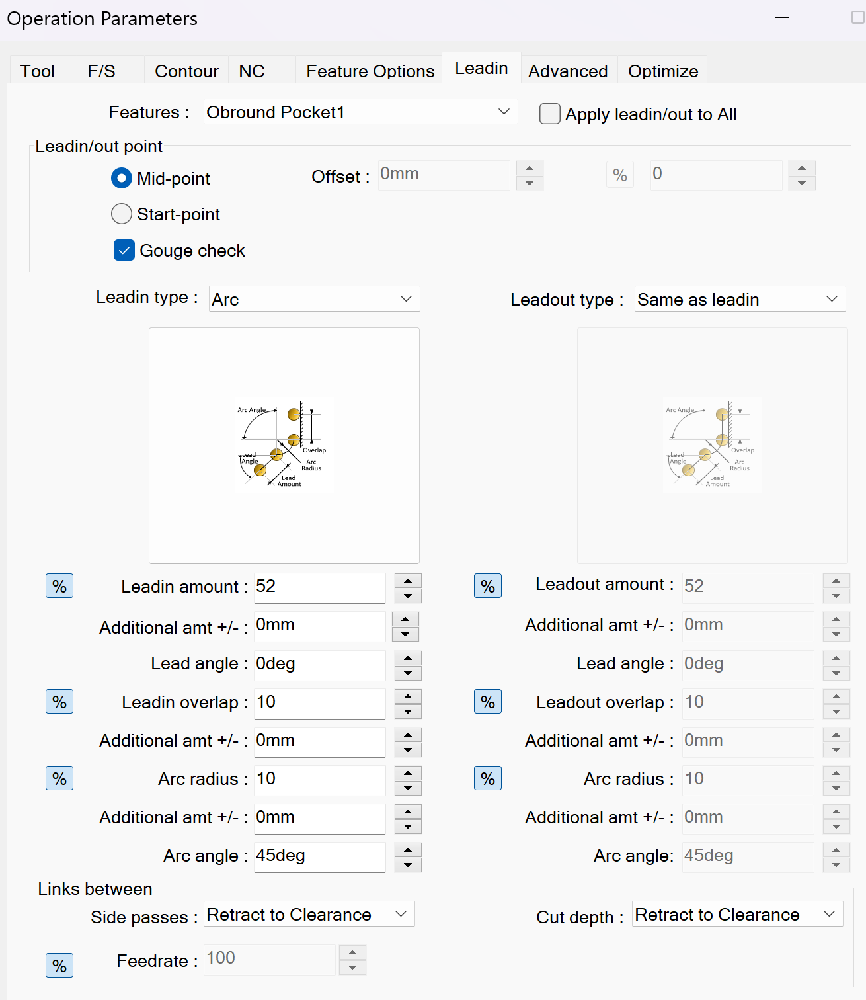

Here you can change the *Leadin amount* and the *Leadin/out point*, which you often want in special cases – for example when you mill out holes and do not want a "Mickey Mouse" shape with two "ears".

### 3.07 Post-processing to NC code for UCCNC

If UCCNC does not make the right toolpath from the imported NC code, first try restarting the program (close and open it). That often solves the problem if everything is fine in the SolidWorks CAM simulation.

A dedicated post-processor for the Stepcraft has been made with [Universal Post Generator](https://camworks.com/universal-post-generator/) (based on **FANUC11M**). It is defined for the machine in SolidWorks (Technology Database/TechDB). *For programs such as Fusion, Stepcraft already provides a post-processor that can be downloaded.*

### 3.08 Shutting down the CNC

Shut down in the reverse order of the start-up ([3.01](#301-starting-up-the-cnc)):

1. Wait until the program has finished and the spindle has stopped.
2. Put the tool back in the magazine (**M6**) and move the machine to its home position.
3. Turn off the spindle switch.
4. Close UCCNC.
5. Press in the emergency stops (outside and inside the door).
6. Turn off the vacuum (the switch above the mill).
7. Turn off the compressed air.
8. Vacuum chips and dust from the table and the tool holder (see [4.04](#404-preventing-tools-from-sticking-during-a-tool-change)).

## 4. Getting the Stepcraft ready | Teachers

### 4.01 Adding a new tool to the tool magazine

Clamp the tool in a free holder, or replace a tool. Remember to add the tool in SolidWorks ([3.03](#303-adding-a-new-tool-to-techdb-example)) if you want to use and simulate it there.

Then go to [4.02](#402-calibrating-the-offsets-of-the-tools-in-the-tool-magazine) to calibrate the tool's offset.

### 4.02 Calibrating the offsets of the tools in the tool magazine

First click **"DOUBLE HOME ALL"**. Then calibrate the offsets of all the tools in the magazine – **eight at most**, because no. 9 (disabled) and no. 10 are set to the 3D Touch Probe – by clicking **"OFFSETS"**.

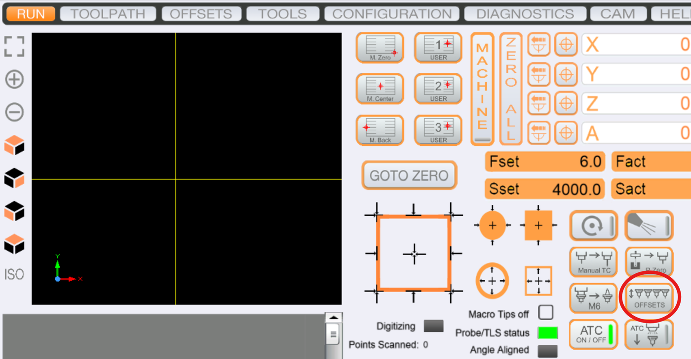

### 4.03 Calibrating the 3D Touch Probe in the tool magazine (Z)

To use the **3D Touch Probe** to set the zero point on the Z axis, its offset has to be calibrated against **tool no. 1 in the magazine**. This is the standard for all tools on the Stepcraft M700 in UCCNC.

*Note: tool 1 is shorter than tool 10 in the example below.*

Start UCCNC and go to **"TOOLS"**. Tool no. 9 is disabled in a custom M6 macro. Scroll down to tool no. 10, set its offset to **0** and press **Enter** on the keyboard.

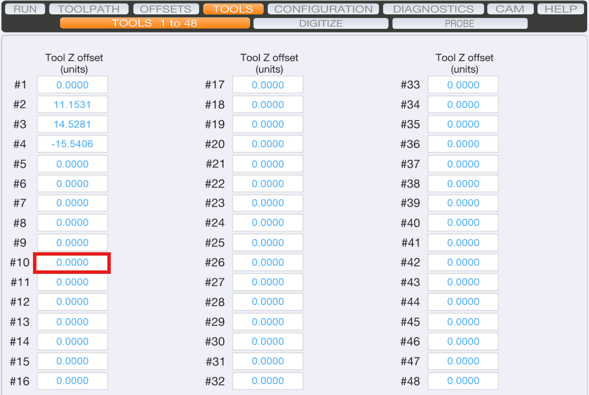

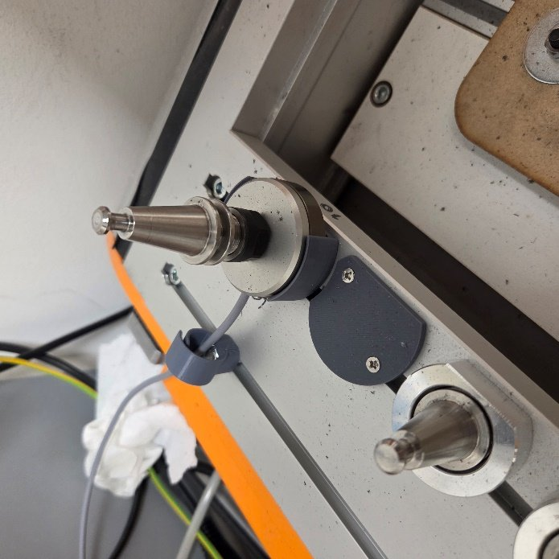

Click **"DOUBLE HOME ALL"** and calibrate the offsets of the tools in the magazine with **"OFFSETS"**, as in [4.02](#402-calibrating-the-offsets-of-the-tools-in-the-tool-magazine).

Change to the 3D Touch Probe by clicking **"M6"** and typing *10*. When the probe is in, move to an X/Y position where the probe is directly above a fairly flat piece of material (10 mm thick at most). You will put a piece of tape there later.

Zero X and Y with the buttons marked in the picture below, so the position is saved until you press **"GOTO ZERO"** later.

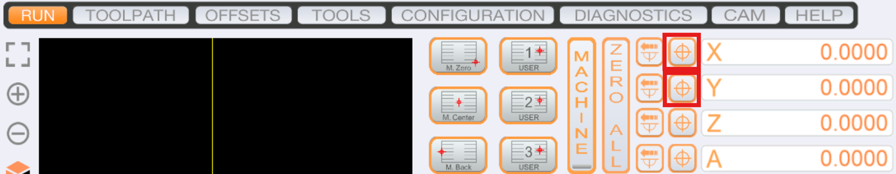

Go to **"TOOLS"** → **"PROBE"**. Check that the right settings are set under **"SETUP"** and **"PAGE 1"**.

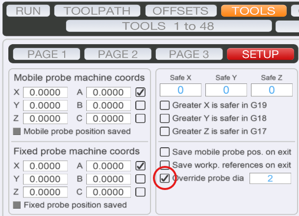

Set **"P1"** to -50 (the probe goes down 50 mm at most before it hits a surface), and enable only **"Z"** to measure the Z axis. Also make sure **"Simple probe"** is enabled.

Turn on **"ZERO PROBED AXES"**, **"AXIS COUNT GAGE"** and **"AXIS 1 COUNT DIA."**, and set the values in the red frames as in the picture below.

Press **"START PROBING"** to set a new zero point for the 3D Touch Probe (tool no. 10).

Click **"M6"** again and change to **tool 1**, since it is the reference. Then click **"GOTO ZERO"** to move to the zero point.

Stick a piece of tape on the surface where you set the zero point for the 3D Touch Probe.

Move tool 1 down until it just scratches the tape. Use **Page Up** and **Page Down** on the keyboard. If you hold **Ctrl**, it moves in steps (the step size can be set in the orange panel on the left).

When you have found a suitable offset, enter the *opposite* value as the **offset for tool 10**, for example (−25.1219) × (−1) = **25.1219**, and press **Enter**.

Refine the value by changing to **tool 10** again, setting the zero point and changing to **tool 1**. Check whether the gap between the tape and the tool is OK. Adjust, for example, by adding (−0.6906) × (−1); the total offset then becomes **25.8125 mm** in this **example**.

### 4.04 Preventing tools from sticking during a tool change

Dust or chips can get into the tool holder. Keep the chuck clean during service: vacuum it, and polish off any burnt-on dust.

### 4.05 Releasing a stuck tool

If a tool does not release during a tool change, release it by hand:

- Press in the chuck lock on the spindle.
- Put the spanner on the chuck and turn until it comes loose.

### 4.06 Finding the X and Y zero point with the probe

*Coming soon.*

### 4.07 Setting the Z zero point with the tool length sensor (TLS)

The TLS (Tool Length Sensor) is used every time you mill stock of a new thickness. It can also be done by hand, but with the TLS it is automatic.

1. Clamp the stock.
2. With the **"M6"** macro, change to the tool that is used first in the milling program.
3. Move the spindle with the tool above one of the highest points of the stock.
4. Put the TLS on the stock, under the tool.
5. Move the tool up/down with **Page Up** or **Page Down** until it is just above, but not touching, the TLS.
6. Press the TLS button in UCCNC and wait until the procedure has finished.

*The Z zero point is now set with the selected tool.*

### 4.08 Updating SolidWorks (and keeping the database)

Before you update SolidWorks, for example from the 2021 to the 2025 version, the Technology database has to be exported, and imported again after the update. The procedure is in [3.02](#302-exporting-a-technology-database-for-import).

## 5. Editing the post-processor | Teachers

### 5.01 Universal Post Generator (CAMWorks)

*Coming soon.*
