# Stepcraft M700 CNC-fres – UCCNC og SolidWorks CAM – Brukermanual

Maskiningeniør, produktutvikling · USN Kongsberg · Forfatter: Rasmus Ullestad Relling · Oppdatert 25. feb. 2026

> **English version:** [README.md](README.md) · **PDF:** [guide-no.pdf](guide-no.pdf) · **Word:** [guide-no.docx](guide-no.docx) · **Hurtigkort (A4):** [norsk](quick-card-no.pdf), [engelsk](quick-card-en.pdf) · **Originale Word-dokumenter:** [brukermanual (rev. 1.1)](brukermanual-original.docx), [maskinkoordinater (engelsk)](machine-coordinates-original.docx)

**Brukes i:** studentprosjekter (deler fra SolidWorks frest ut på Stepcraft M700). Maskinen står i **Komposittlabben**.

> **HMS er ikke dekket i denne manualen.** Følg instruksene fra labansvarlig, og ikke bruk maskinen uten opplæring.

## 1. Om dokumentet

**Omfang.** Dokumentet viser hvordan

- **studenter** setter opp en del i SolidWorks og gjør den klar for SolidWorks CAM ([kapittel 2](#2-solidworks-cam--studenter));
- **lærere** post-prosesserer G-kode (NC-kode) fra SolidWorks til bruk i UCCNC ([3.04](#304-lage-verktøybane-i-solidworks-cam), [3.07](#307-post-prosessere-til-nc-kode-for-uccnc));
- **lærere og studenter** eksporterer en DXF-fil fra SolidWorks til bruk i UCCNC CAM ([3.05](#305-lage-verktøybane-i-uccnc-cam-fra-en-dxf-fil));
- **lærere** starter, setter opp og slår av Stepcraft M700 for vanlig bruk ([3.01](#301-koble-opp-cnc), [3.08](#308-slå-av-cnc), [kapittel 4](#4-gjøre-stepcraft-klar-for-bruk--lærere));
- **lærere** bruker en 3D Touch Probe sammen med Stepcraft M700 og UCCNC ([4.03](#403-kalibrere-3d-touch-probe-i-verktøymagasinet-z));
- **lærere** redigerer en post-prosessor for Stepcraft M700 i SolidWorks ([kapittel 5](#5-redigere-post-prosessor--lærere));
- **lærere** finner maskinkoordinatene og kalibreringsverdiene til vår M700 ([kapittel 6](#6-maskinkoordinater-og-kalibrering-av-vår-m700--lærere)) og Stepcrafts egne manualer ([kapittel 7](#7-ekstern-dokumentasjon-stepcraft)).

**Målgruppe.** Studenter og lærere ved USN Kongsberg.

**Plassering.** Stepcraft M700 står i **Komposittlabben** (se [labkartet](../../labs/map/README.md)).

**Begrensninger.**

- Dokumentet tar ikke for seg HMS. Det må tenkes på i tillegg.
- Det tar ikke for seg endringer i macro-kodene til Stepcraft M700 som er gjort tidligere.
- Det tar ikke for seg hva en gjør hvis maskinen mister nullpunktet under fresing, noe som kan skje. En teknisk løsning er å oppgradere Stepcraft M700 med en digital teller for planlagte steg: [Semi-Closed Loop System for M-series till 04/2025](https://shop.stepcraft-systems.com/Semi-Closed-Loop-System-for-M-Series-till-04-2025).

**Forkunnskaper.** Dokumentet er for studenter og lærere på maskiningeniør, produktutvikling. Leseren bør kunne bruke SolidWorks og ha tatt DAK 1 og DAK 2. Kunnskap fra Produktutvikling 1 hjelper, men er ikke nødvendig.

## 2. SolidWorks CAM | Studenter

### 2.01 Legge til koordinatsystem for en del

Det er viktig å legge til et koordinatsystem som brukes til fresingen. Det blir startpunktet (nullpunktet) for delen. Koordinatsystemet **skal** ligge parallelt med overflaten. Nullpunktet bør også kunne finnes igjen fysisk av en lærer med en *3D Touch Probe*. Mistes nullpunktet under fresing og prosessen må startes på nytt, kan delen da «reddes», og det blir mindre kast.

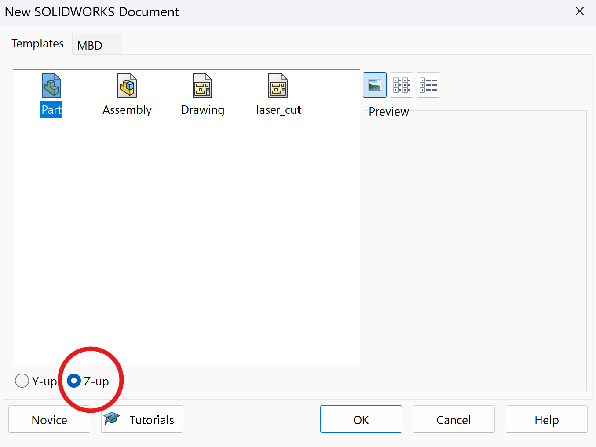

Tenk på en naturlig plassering av nullpunktet før du modellerer delen. Da sparer du mye tid på å justere koordinatsystemet senere. Det sparer også tid å sette Z opp, ikke Y (som er vanlig), siden CNC-maskinen bruker et koordinatsystem med Z opp, som uansett må defineres i SolidWorks CAM.

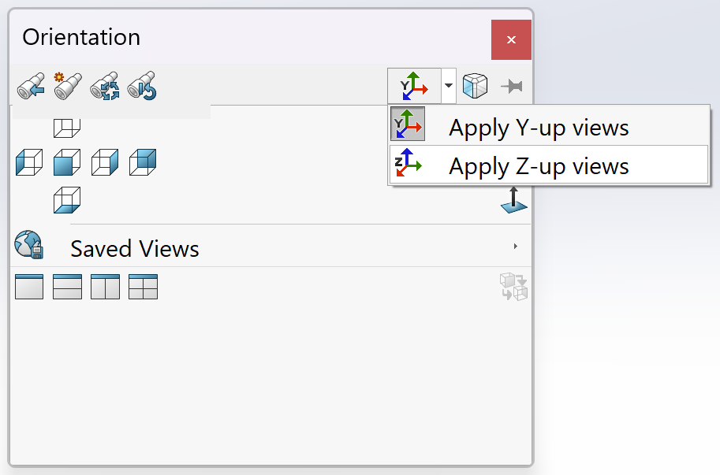

#### (a) Freseområdet til Stepcraft M700

Setter du X- og Y-koordinatene riktig i forhold til hvordan delen skal freses ut i maskinen, sparer du også tid senere. Du trenger et oppspenningsområde på ca. **50 mm fra hver side** av for eksempel en karbonfiberplate eller en 3 mm tykk aluminiumsplate, så maskinen ikke krasjer.

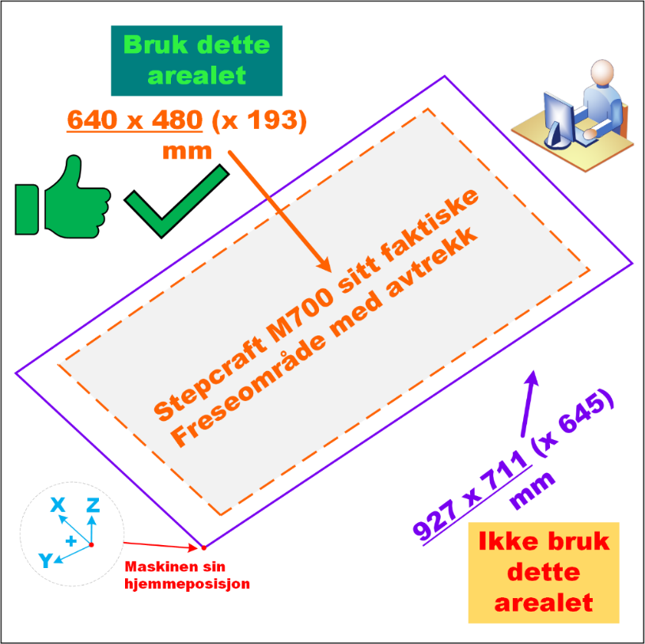

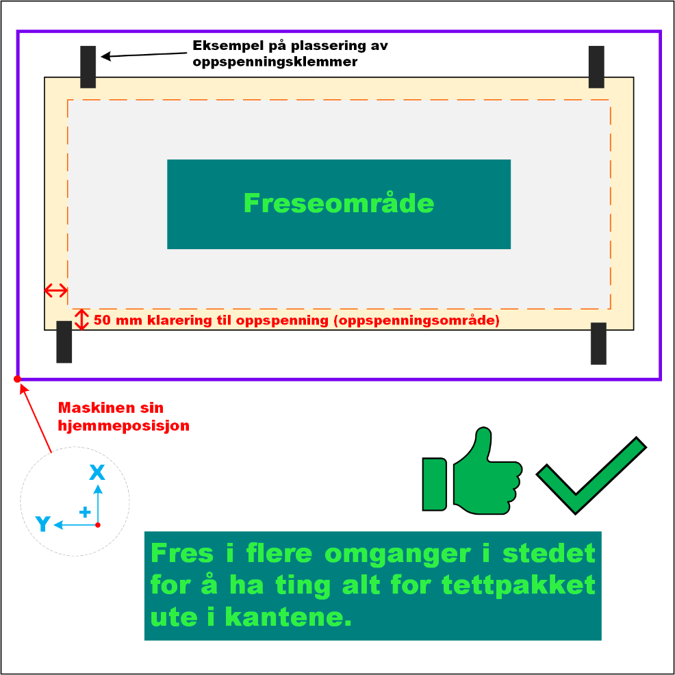

**Husk å <u>ikke</u> designe deler for store!**

#### (b) Designe et godt koordinatsystem for fresing

En del som er tegnet med et koordinatsystem for 3D-printing, kan være vanskelig å frese med en CNC. En 3D-printer bryr seg ikke om koordinatsystemet, og G-koden lages i et eget program i tillegg, ofte kalt en *slicer*.

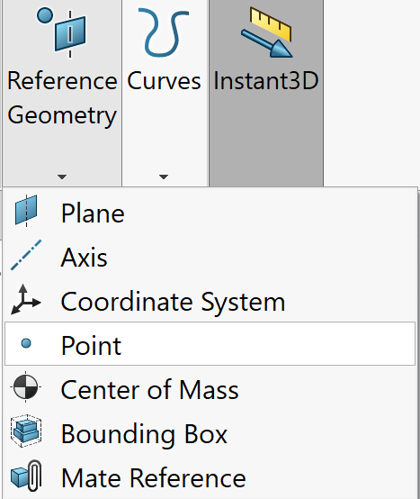

Et koordinatsystem laget for en CNC-fres er derimot som regel lett å 3D-printe, siden du kan rotere og velge hvordan delen skal skrives ut i sliceren.

Som eksempel ønsker forfatteren at origo skal være i senter av en sirkulær egenskap. Det er fordi *3D Touch Probe* kan finne senter av sirkler og firkanter/rektangler, både innvendig og utvendig.

Klikk på **«Reference Geometry»** → **«Point»**.

Klikk på øvre kant (konturlinje) av egenskapen. Den blir også parallell med Z-aksen.

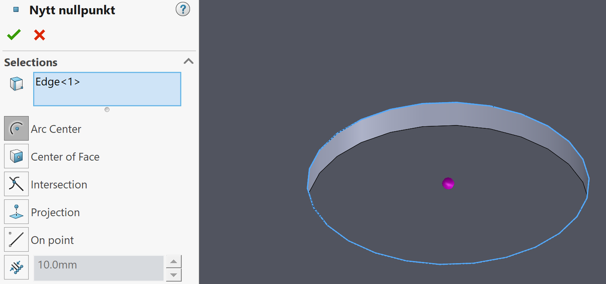

Klikk så på **«Reference Geometry»** → **«Coordinate System»**, og velg det nye punktet («Nytt nullpunkt»).

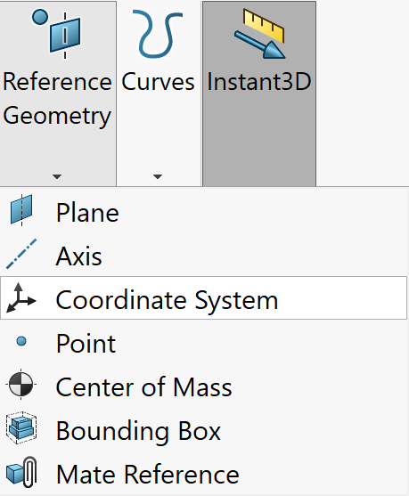

Sjekk at X- og Y-aksene stemmer med hvordan delen skal freses ut i maskinen. Er de feil, kan du snu X- og/eller Y-aksen under **«Orientation»** ved å klikke på for eksempel en rett konturlinje.

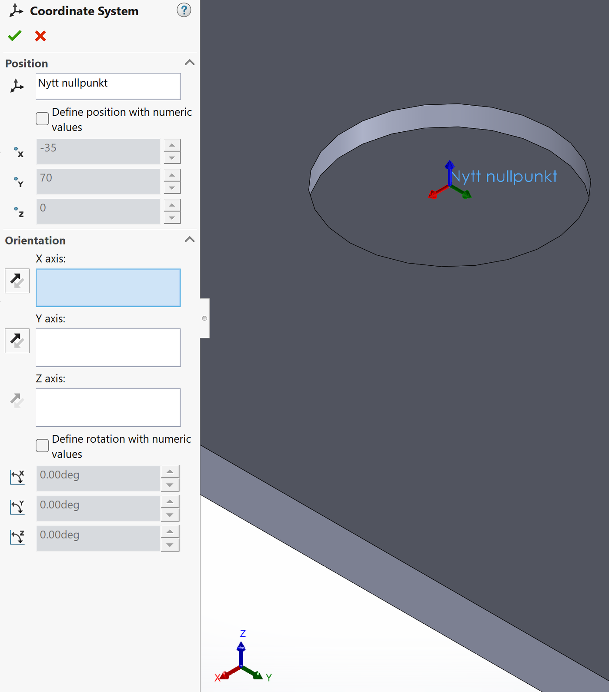

Klikk **«OK»**, og sjekk at koordinatsystemet ser riktig ut. *Bra jobbet, nå har delen din et koordinatsystem!*

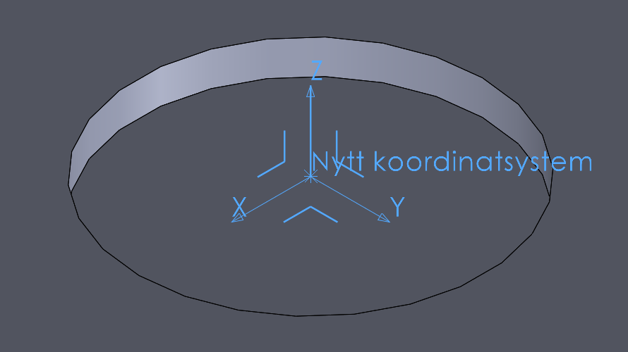

### 2.02 Lage skisse(r) til CAMWorks

For å kunne frese ut en del effektivt må du forberede egenskapene (features) til delen. Dette er spesielt viktig på en liten og svak CNC-maskin som Stepcraft M700.

Egenskapene er hull, lommer eller andre former der alt materialet inni skal bort. Du kan enten frese bort alt inni til støv, eller kutte rundt (som med en sag), så det blir igjen en bit som kan kastes. Du kan også legge til «tabs» som hindrer at kastebiten kommer på avveie (skjer ikke så ofte).

Å kutte rundt er ønskelig i de **aller** fleste tilfeller: det tar kortere tid, sliter mindre på fresen, og det er mindre sjanse for at hjemmeposisjonen mistes. Dette må du som ingeniør vurdere selv, og produksjonsansvarlig kan komme til å stille spørsmål ved valget.

***Før du bruker en av metodene under:*** *Du kan også lage en DXF-fil (som ved laserkutting) og importere den i UCCNC M.700-programvaren på datamaskinen ved CNC-en. Da slipper du stegene under. Se [3.05](#305-lage-verktøybane-i-uccnc-cam-fra-en-dxf-fil).*

#### (a) Metode 1: Offset Loop (*boss*-verktøybane)

Med *boss*-verktøybane i SolidWorks (SW) CAM må du lage en offset-kurve, fordi boss i SW CAM er låst til å gå på **utsiden** av konturlinjen.

For å bruke «sagmetoden» og kutte rundt lager du en 2 mm offset-skisse fra konturlinjen til den opprinnelige egenskapen. Høyreklikk på konturlinjen og klikk **«Select loop»**.


Klikk så **«Convert Entities»**, eller gå rett til **«Offset Entities»**.

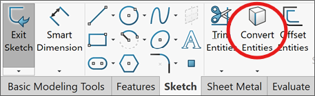

Marker den nye konturlinjen i skissen, huk av for **«For construction»** og lukk dialogen.

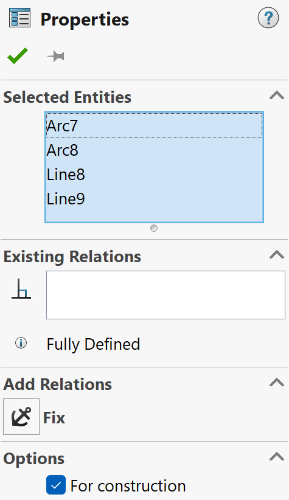

Marker de nye konstruksjonslinjene. Klikk **«Offset Entities»**, huk av for **«Reverse»** og bruk en offset på **<u>2 mm</u>**.

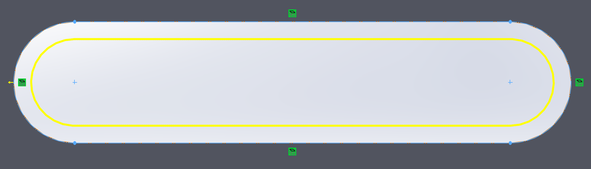

Nå kan en 2 mm fres «sage» ut formen med boss-programmering i SolidWorks CAM.

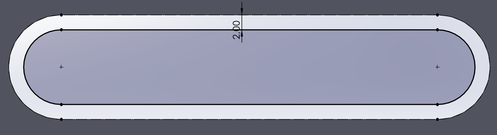

**Husk å lage flere skisser**, for eksempel én for Ø4 mm hull, én for Ø6 mm hull og én for lommer med en annen form. SolidWorks CAM må kunne skille mellom hull med ulik form og dybde.

#### (b) Metode 2 (**anbefalt**): Uten Offset Loop (*pocket*-verktøybane)

Med *pocket*-verktøybane (Contour) i SW CAM trenger du **ikke** å lage en offset-kurve. En pocket (Contour) går på **innsiden** av konturlinjen og freser ikke ut alt inni.

Husk: en *Contour Mill* (laget med for eksempel strategien *Finish* eller *Fine*) freser bare rundt konturlinjen, mens en *Rough Mill* (laget med for eksempel strategien *Rough*) freser ut **alt** inni. Det siste er som regel **bare nødvendig** hvis du ikke skal gå helt gjennom emnet, eller emnet er så høyt at fresen kan krasje i det. Det sliter mye på verktøyet.

Her kan du la egenskapene være som de er tegnet (med tanke på Ø2 mm fres), eller, som **anbefalt**, lage skisser hvis du ønsker en bestemt rekkefølge for egenskapene.

#### (c) **Viktig** om sirkulære hull med en bestemt diameter

Det kan være lurt å sette alle hull til Ø2 mm for fresing, og etterpå bore dem ut til nøyaktig diameter med en hånddrill. ***Alle* hull mindre enn Ø6 mm** må bores ut for hånd etterpå (bor finnes i prototypelabben – spør om tilgang til låsen).

Ingeniøren/designeren må enten endre disse hullene til Ø2 mm før produksjon, eller, som **<u>anbefalt</u>**, lage en ny skisse (ofte enklere) på samme plan med Ø2 mm hull i senter av hullene. Gi skissene tydelige navn, så produksjonsansvarlig ser hva de er **til**.

## 3. UCCNC for Stepcraft | Lærere

### 3.01 Koble opp CNC

1. Skru på trykkluft til maskinen.
2. Slå på vakuumanlegget (støvsugeren) – slå det på med bryteren over fresen når det trengs.
3. Løs ut nødstoppene på utsiden og innsiden av døra.
4. Start UCCNC på den lokale datamaskinen.
5. Skru på bryteren for spindelen (den skal blinke blått/rødt når ingen program kjører).
6. Klikk **«Reset»** nede i høyre hjørne.

Når du er ferdig, slår du av i motsatt rekkefølge: se [3.08](#308-slå-av-cnc).

### 3.02 Eksportere en Technology Database for import

Gjøres **før** du eventuelt oppdaterer SolidWorks til en ny versjon, så databasen ikke går tapt!

Gå til **«Tools»** → **«SOLIDWORKS CAM»** → **«Technology Database…»** for å åpne Technology Database (TechDB).

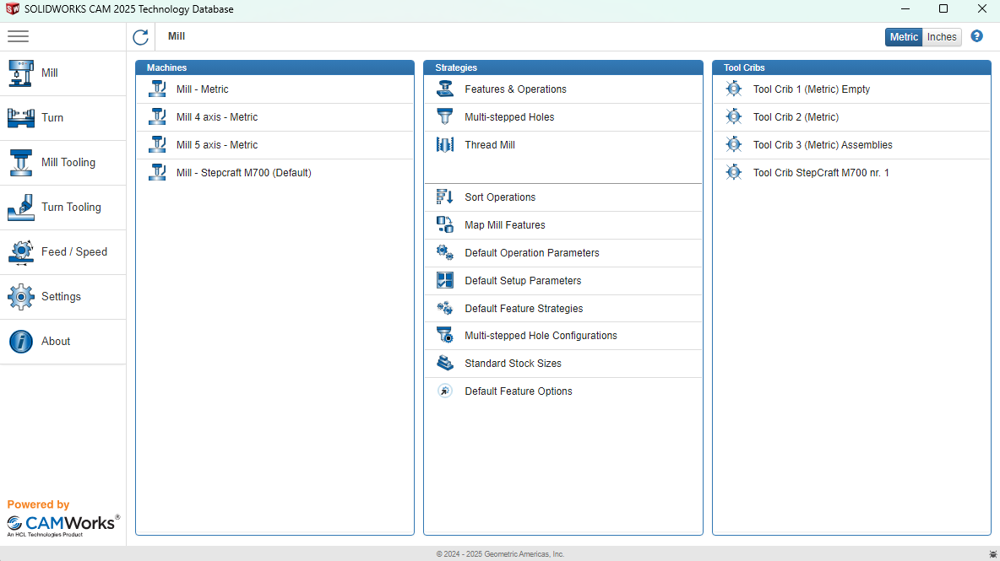

Klikk **«Settings»** i menyen til venstre.

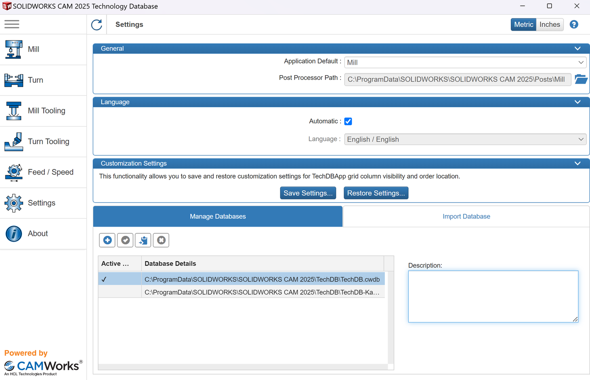

Under fanen **«Manage Databases»** står plasseringen til databasene som er knyttet til TechDB. Klikk på databasen du vil ta vare på, og klikk **«Copy»**.

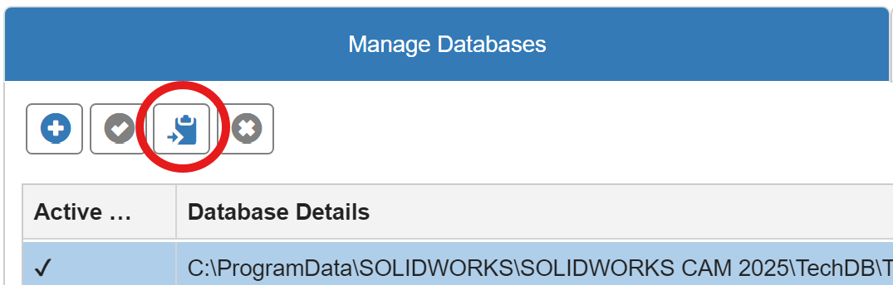

Velg hvor du vil lagre kopien. Dette er **<u>sterkt anbefalt</u>** før du oppgraderer til en ny versjon av SolidWorks!

Etter at den nye SolidWorks-versjonen er installert, går du til fanen **«Import Database»**, klikker **«Browse»**, velger den eksporterte databasen og importerer den. **<u>Husk å lukke SolidWorks</u>** (men ikke TechDB) før du starter importen!

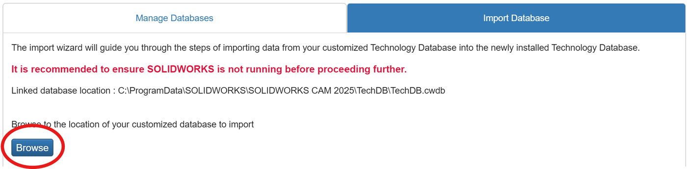

### 3.03 Legge til et nytt verktøy i TechDB (eksempel)

Verktøy redigeres i SolidWorks CAM Technology Database. Bruk helst bare ett verktøy om gangen hvis mulig. Verktøyholderen på Stepcraft har en tendens til å låse seg fast når det kommer støv eller spon inn under bruk. *Se [4.05](#405-løsne-et-fastlåst-verktøy) om hvordan du løsner et fastlåst verktøy.*

Åpne Technology Database: **«Tools»** → **«SOLIDWORKS CAM»** → **«Technology Database…»**.

Velg verktøytypen, for eksempel *Flat End Mill* (nederst i bildet).

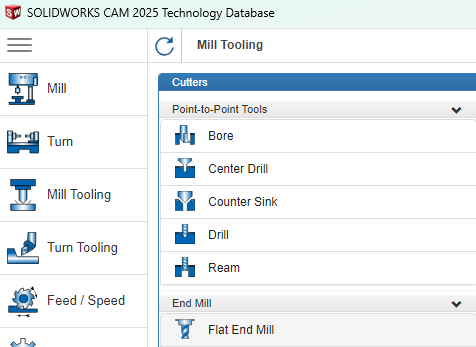

Du får nå en lang liste med verktøy som følger med SolidWorks.

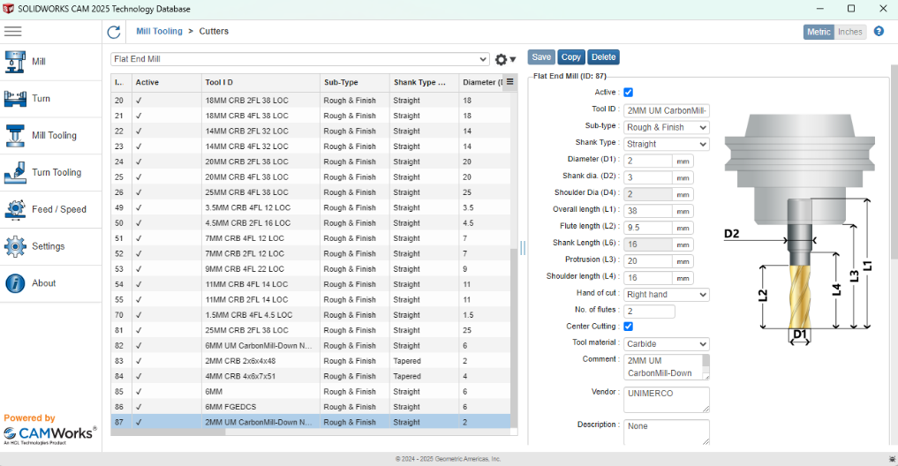

Finn et verktøy som ligner det du vil legge til, og kopier det.

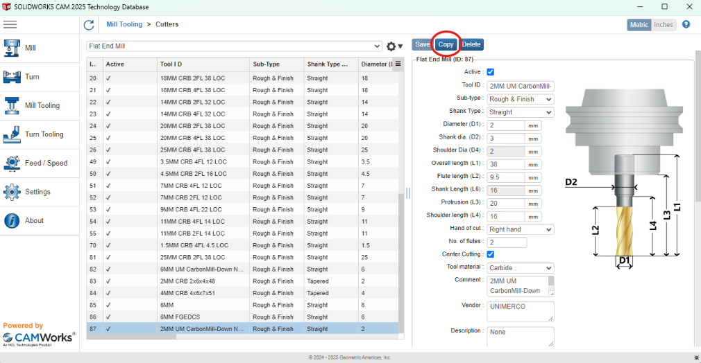

Sett verktøyet fast i verktøyholderen og mål det. Juster lengdene tilsvarende.

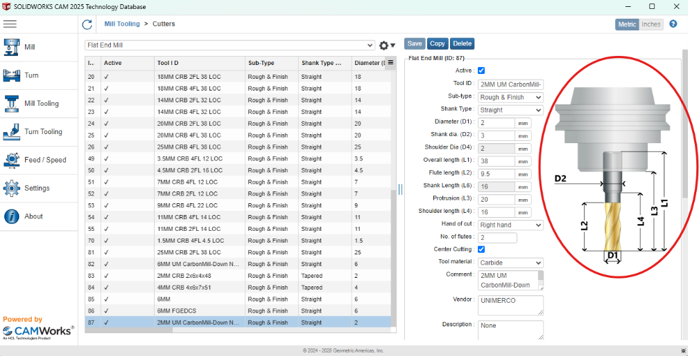

Bla nedover og juster hastighetene som skal være lov. **Dette er hastighetene som kan komme i Stepcraft M700, så det er viktig at de er riktige og som forventet.**

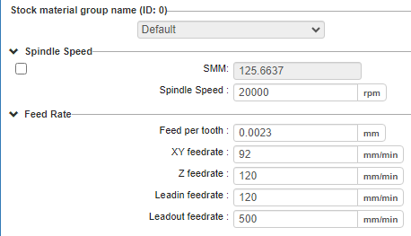

Når du er ferdig, klikker du **«Save»** (til venstre for **«Copy»**) og lukker TechDB.

### 3.04 Lage verktøybane i SOLIDWORKS CAM

***Før du bruker en av metodene under:*** *Du kan også lage en DXF-fil og importere den i UCCNC M.700. Se [3.05](#305-lage-verktøybane-i-uccnc-cam-fra-en-dxf-fil).*

Hvordan delen forberedes for hver metode, står i [2.02](#202-lage-skisser-til-camworks) (studenter).

#### (a) Metode 1: Offset Loop (*boss*-verktøybane)

**Fresing på utsiden.** For å frese ut en del til slutt brukes ofte en *boss*-strategi. **Velg en ny *2.5 Axis Feature* med *Type* = *Boss*.** Velg så offset-skissen av egenskapen(e).

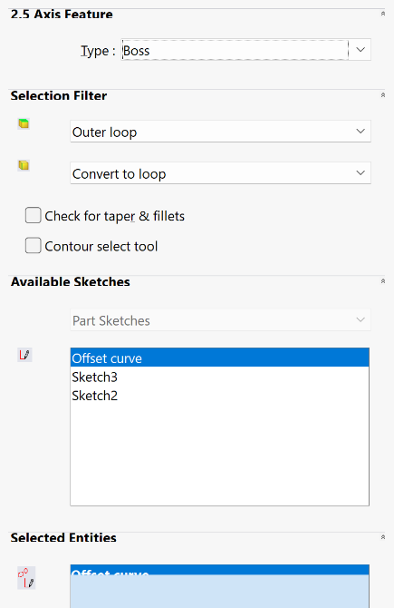

Nå kan du legge til en *Contour Mill*. Klikk **OK** når du har satt kuttedybden.

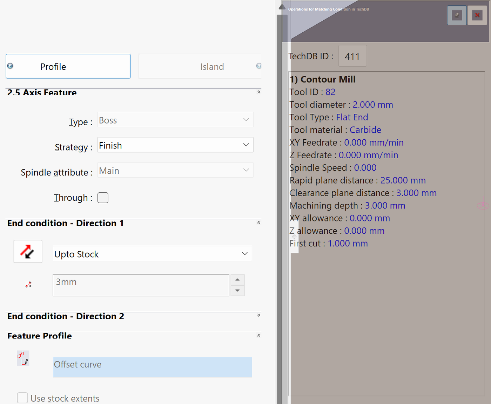

Klikk **«Generate Operation Plan»**. Er alt riktig definert, går teksten fra **blå** til **svart**, og visningen bytter fra fanen **«SOLIDWORKS CAM Feature Tree»** til **«SOLIDWORKS CAM Operation Tree»**.

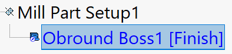


Klikk **«Generate Toolpath»** for å lage verktøybanen. Teksten går igjen fra **blå** til **svart**.


*Neste steg er å simulere verktøybanen med **«Simulate Toolpath»** og post-prosessere for å lage G-kode (NC-kode) som kan importeres i UCCNC.*

**Eksempel** på simulering med boss (utvendig kutt). Her ønskes ofte <u>innvendig</u> kutt, men en innvendig offset-konturlinje på 2 mm med en Ø2 mm fres gir samme resultat:

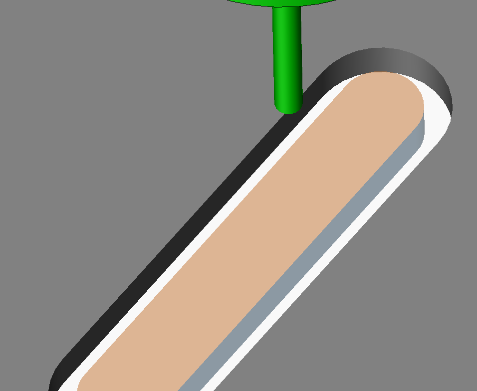

#### (b) Metode 2 (**anbefalt**): Uten Offset Loop (*pocket*-verktøybane)

**Pocket uten tabs eller bridges (fresing på innsiden).** Først definerer du hver kant (edge) eller skisse (sketch) i lommen som skal freses ut. **Velg en ny *2.5 Axis Feature* med *Type* = *Pocket*.**

Klikk **«End Condition»** for å gå videre.

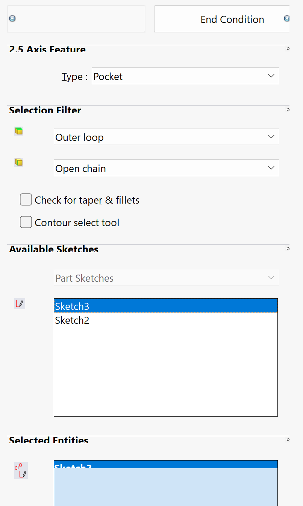

Nå er det viktig å velge strategi. Sett **«Strategy»** til for eksempel *Finish* eller *Fine*, så du får en **«Contour Mill»** og <u>ikke</u> en **«Rough Mill»**. Dette avgjør om du kan legge til tabs.

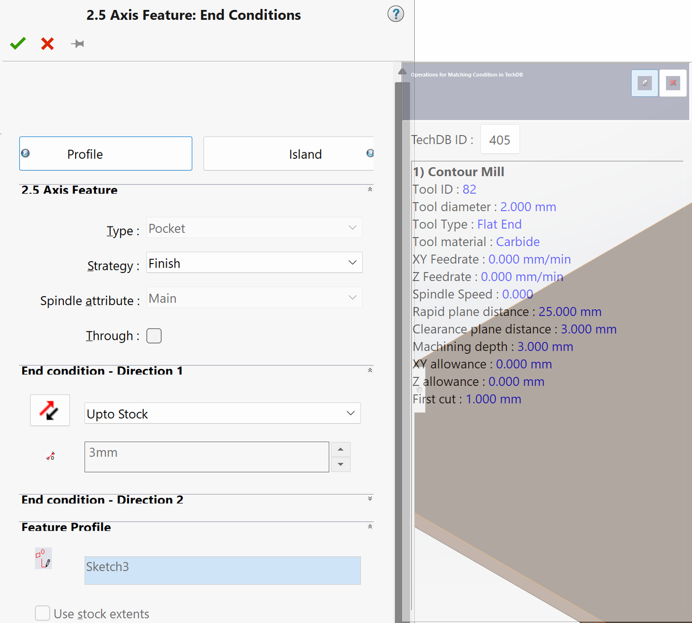

Klikk **OK** og så **«Generate Operation Plan»**. Er alt riktig definert, går teksten fra **blå** til **svart**, og visningen bytter fra **«SOLIDWORKS CAM Feature Tree»** til **«SOLIDWORKS CAM Operation Tree»**.


Klikk **«Generate Toolpath»**. Teksten går igjen fra **blå** til **svart**.


*Neste steg er å simulere verktøybanen med **«Simulate Toolpath»** og post-prosessere til G-kode for UCCNC.*

**Eksempel** på simulering med pocket (innvendig kutt):

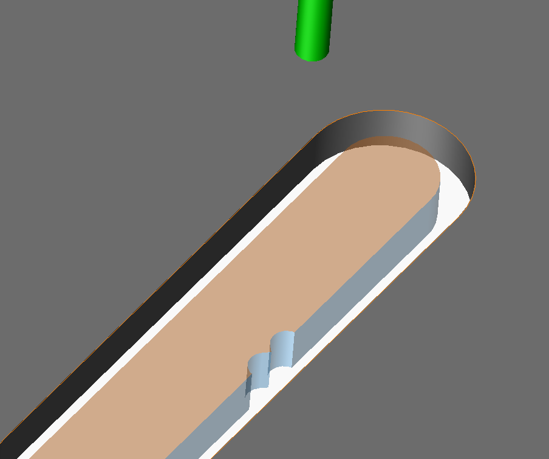

**Pocket med tabs eller bridges (fresing på innsiden).** Vil du holde igjen kastebiten med «tabs», kan SolidWorks CAM lage dem **automatisk**. Vanligvis freser en pocket-verktøybane bort alt langs konturlinjen, men med tabs holdes kastebiten fast mens det freses på **innsiden**. Se eksempler på tabs og bridges i [denne videoen (0:46)](https://www.youtube.com/watch?v=2L0SmbIvFTA&t=46s).

Gjør de samme stegene som over: ny *2.5 Axis Feature* med *Type* = *Pocket*, **«End Condition»**, **«Strategy»** = *Finish* eller *Fine* (**ikke** Rough), **OK**, **«Generate Operation Plan»** og **«Generate Toolpath»**.

Høyreklikk på den nye *Contour Mill*-operasjonen, velg **«Edit Definition…»**, gå til fanen **Contour** og huk av for **«Tab cutting»** nede i høyre hjørne.

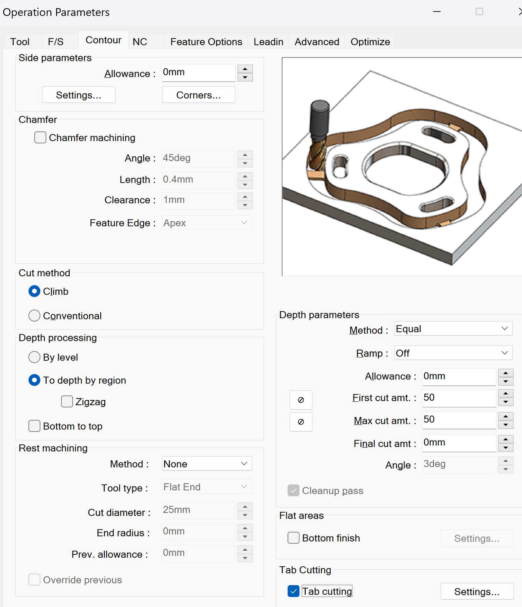

Under Tab cutting velger du **«Settings…»**. Juster antall tabs, lengde, tykkelse, lead-in/lead-out osv., og klikk **OK**.

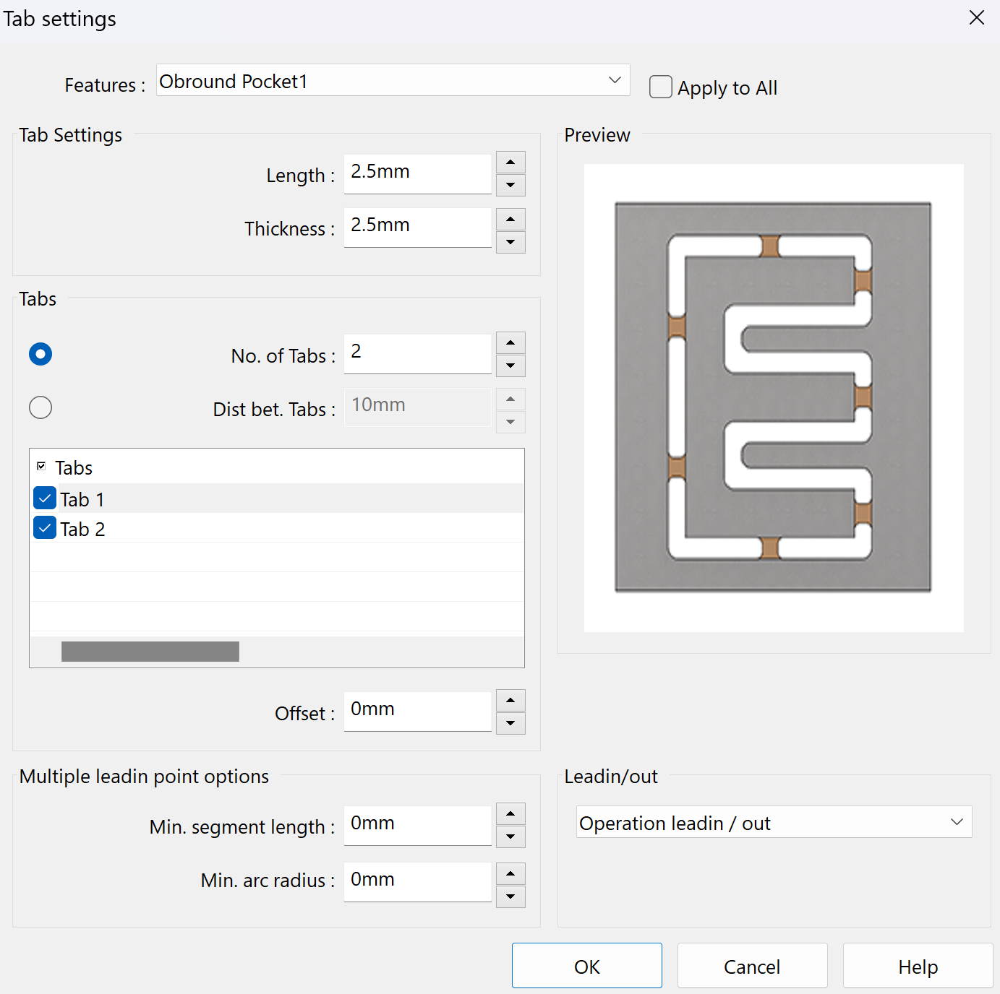

***Lag så verktøybanen som vanlig. Tabs holder nå kastebiten igjen.***

*Neste steg er å simulere verktøybanen med **«Simulate Toolpath»** og post-prosessere til G-kode for UCCNC.*

**Eksempel** på simulering med pocket (innvendig kutt) med fire tabs, 2,5 mm lange og 1,5 mm tykke:

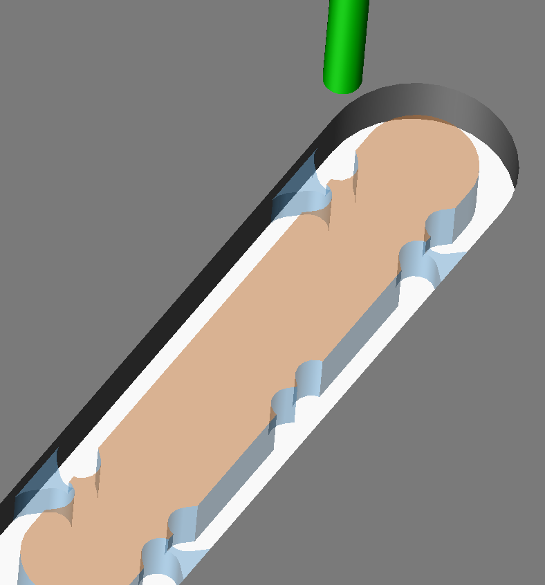

### 3.05 Lage verktøybane i UCCNC CAM fra en DXF-fil

Du kan også lage G-kode fra en DXF-fil i UCCNC CAM. Det fungerer utmerket for enklere deler, prototyper, eller når alt arbeidet ikke trenger å dokumenteres. Det er litt mer manuelt, men fungerer utmerket.

Finn en visning av emnet (som oftest fra toppen) som gir riktige konturlinjer for DXF-filen.


Velg **File** → **Save As…**, sett *Filtype* til **Dxf (\*.dxf)** og klikk **Lagre**.

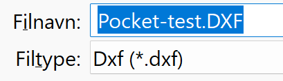

Velg visningen du vil eksportere, og klikk **OK**.

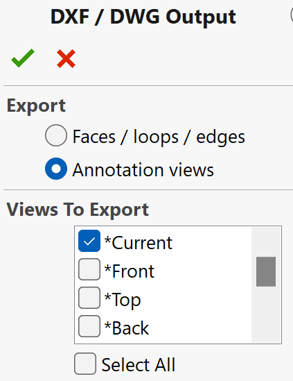

Klikk **«Save»**. Ikke tenk på nullpunkt eller koordinatsystem – det defineres i UCCNC.

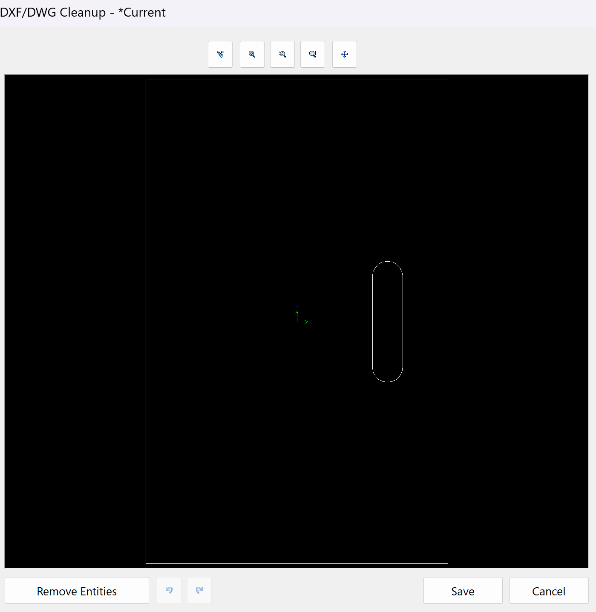

Med studentlisens må DXF-filen ryddes (den uønskede teksten fjernes). Du kan også legge til lag i DXF-filen (som i et tegneprogram) for å skille hva som skal freses på innsiden eller utsiden, dybder osv. **Til dette anbefales det gratis programmet [QCAD](https://www.qcad.org/en/).**

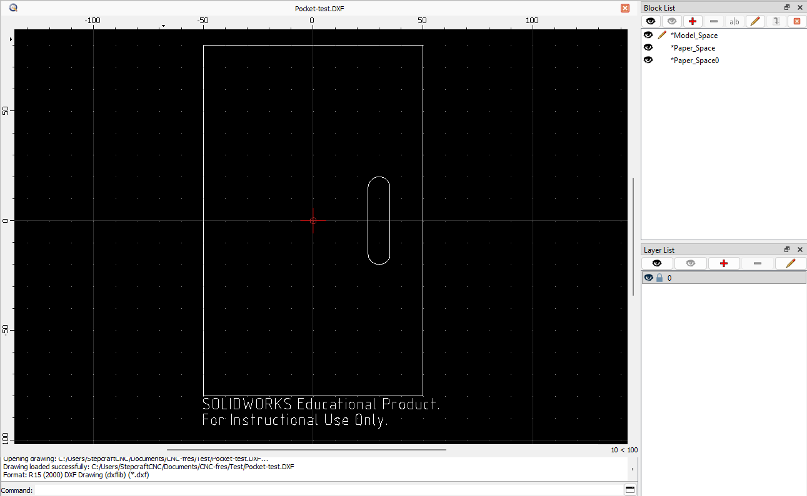

Import av DXF i UCCNC er streng – du kan for eksempel ikke bruke hvilke lagnavn som helst. **Lag nr. 1 <u>må</u> hete `0`. Lag nr. 2 <u>må</u> hete `11`. Lagene etter det <u>må</u> hete `12`, `13`, `14` osv.**


Når du er ferdig med å redigere, lagrer du filen (**Ctrl+S**).

Flytt egenskaper som skal ha en annen strategi senere, til et nytt lag.

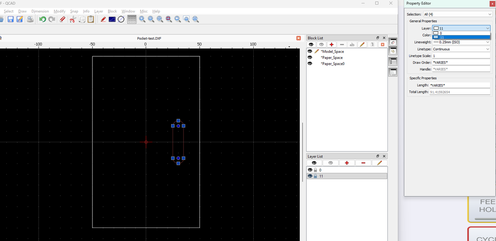

Åpne UCCNC og gå til **CAM-fanen**.

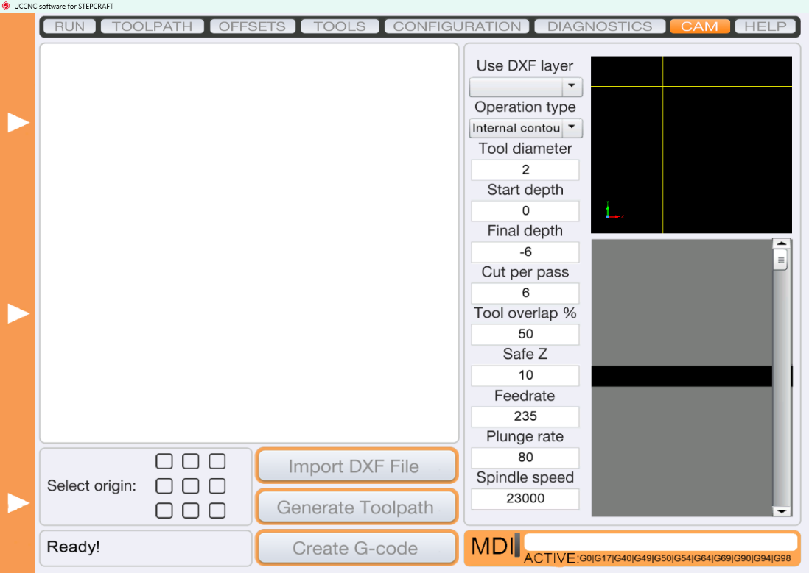

Importer filen i UCCNC. Her velger du **hvilke DXF-lag du vil lage G-kode for**.

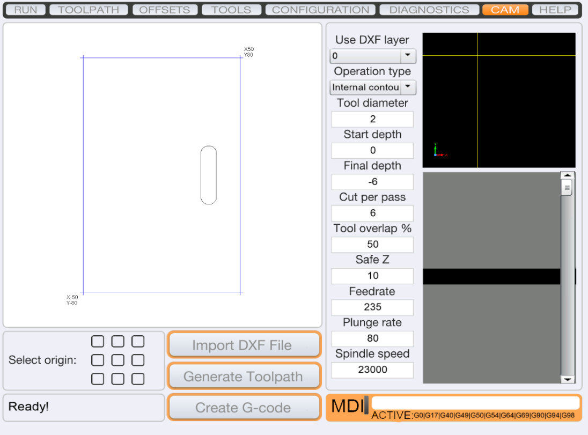

I dette eksempelet er det to lag: ett for den ytre konturlinjen (utvendig kutt) og ett for egenskapene (innvendig kutt).

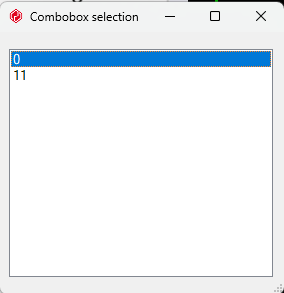

Velg hvor **nullpunktet** skal være.


Velg strategi («Operation Type»), for eksempel innvendig eller utvendig.

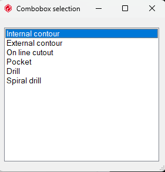

**Eksempel** på innstillinger som fungerer med Stepcraft M700:

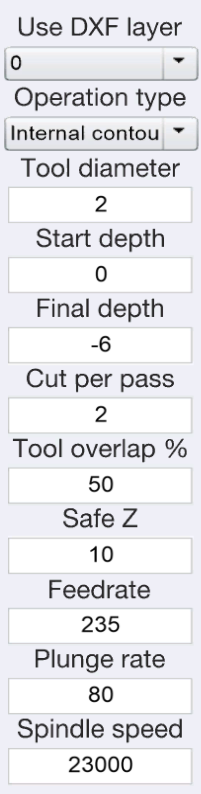

Lag G-kode for hvert lag du vil frese ut, eventuelt med ulike strategier (innvendig/utvendig): **1. «Generate Toolpath»**, **2. «Create G-code»**. Resultatet ser slik ut:

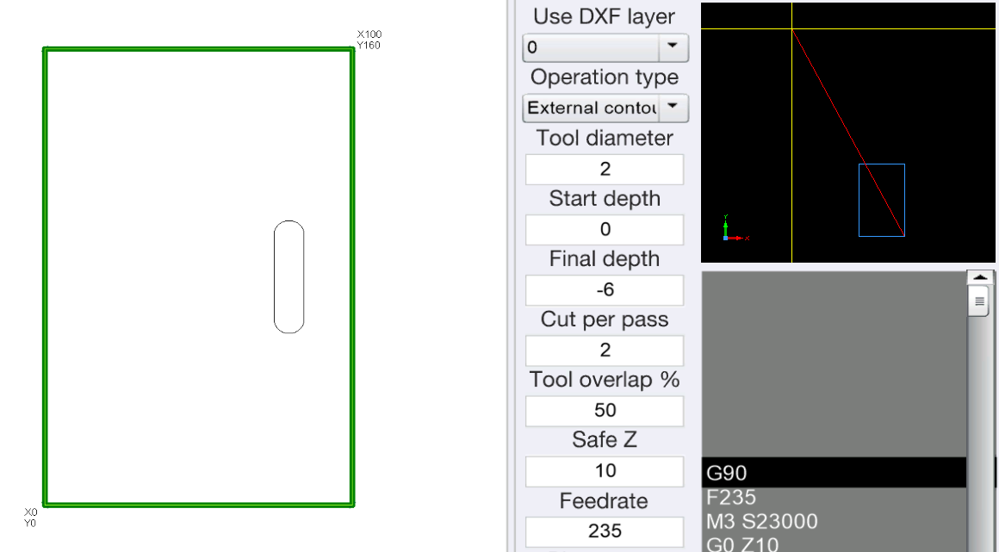

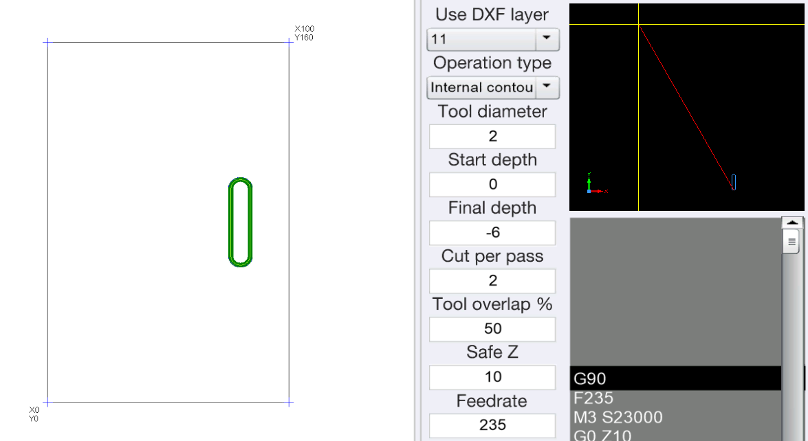

### 3.06 Endre lead-in/-out (hull over Ø4 mm kan freses ut)

For å endre lead-in/-out må du først ha klikket **«Generate Toolpath»** og fått en *Contour Mill*. Høyreklikk på Contour Mill, klikk **«Edit Definition…»** og gå til fanen **«Leadin»**.

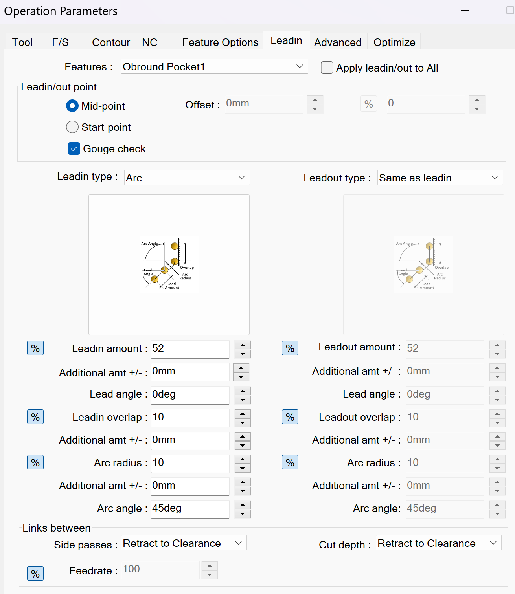

Her kan du endre *Leadin amount* og *Leadin/out point*, noe du ofte vil gjøre i spesielle tilfeller – for eksempel når du freser ut hull og ikke vil lage en «Mikke Mus» med to «ører».

### 3.07 Post-prosessere til NC-kode for UCCNC

Lager ikke UCCNC riktig verktøybane fra den importerte NC-koden, prøv først å starte programmet på nytt (lukk og åpne). Det løser ofte problemet hvis alt er greit i simuleringen i SolidWorks CAM.

Det er laget en egen post-prosessor for Stepcraft med programmet [Universal Post Generator](https://camworks.com/universal-post-generator/) (med **FANUC11M** som grunnlag). Den ligger definert for maskinen i SolidWorks (Technology Database/TechDB). *For programmer som Fusion har Stepcraft allerede laget en post-prosessor som kan lastes ned.*

### 3.08 Slå av CNC

Slå av i motsatt rekkefølge av oppstarten ([3.01](#301-koble-opp-cnc)):

1. Vent til programmet er ferdig og spindelen har stoppet.
2. Sett verktøyet tilbake i magasinet (**M6**) og kjør maskinen til hjemmeposisjon.
3. Skru av bryteren for spindelen.
4. Lukk UCCNC.
5. Trykk inn nødstoppene (utsiden og innsiden av døra).
6. Slå av vakuumanlegget (bryteren over fresen).
7. Skru av trykkluften.
8. Støvsug spon og støv fra bordet og verktøyholderen (se [4.04](#404-unngå-at-verktøy-henger-fast-under-bytte)).

## 4. Gjøre Stepcraft klar for bruk | Lærere

### 4.01 Legge til nytt verktøy i verktøymagasinet

Spenn verktøyet i en ledig holder, eller bytt ut et verktøy. Husk å legge verktøyet til i SolidWorks ([3.03](#303-legge-til-et-nytt-verktøy-i-techdb-eksempel)) hvis du vil bruke og simulere det der.

Gå så til [4.02](#402-kalibrere-offset-for-verktøy-i-verktøymagasinet) for å kalibrere offset for verktøyet.

### 4.02 Kalibrere offset for verktøy i verktøymagasinet

Klikk først **«DOUBLE HOME ALL»**. Kalibrer så offset for alle verktøyene i magasinet – **maks åtte**, siden nr. 9 (deaktivert) og nr. 10 er satt til 3D Touch Probe – ved å klikke **«OFFSETS»**.

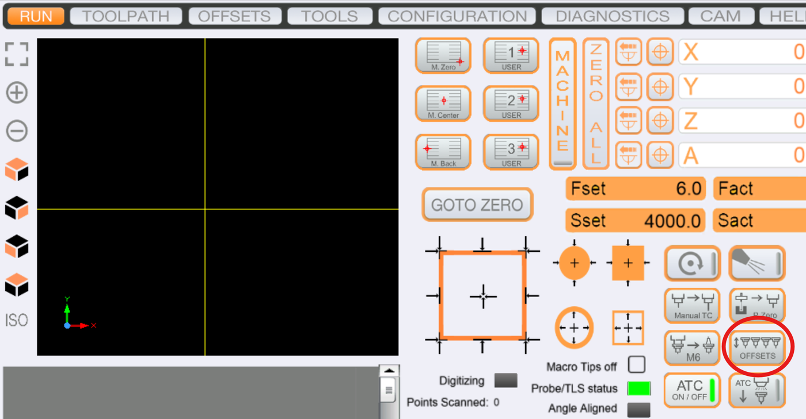

### 4.03 Kalibrere 3D Touch Probe i verktøymagasinet (Z)

For å kunne bruke **3D Touch Probe** til å sette nullpunkt i Z-aksen må offset kalibreres i forhold til **verktøy nr. 1 i magasinet**. Dette er standard for alle verktøy på Stepcraft M700 i UCCNC.

*Merk: verktøy 1 er kortere enn verktøy 10 i eksempelet under.*

Start UCCNC og gå til **«TOOLS»**. Verktøy nr. 9 er deaktivert i en egendefinert M6-macro. Bla ned til verktøy nr. 10, sett offset til **0** og trykk **Enter** på tastaturet.

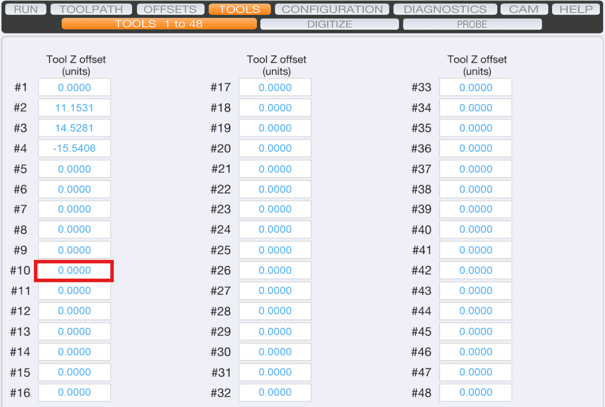

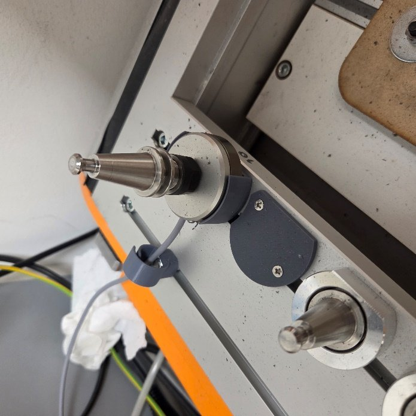

Klikk **«DOUBLE HOME ALL»** og kalibrer offset for verktøyene i magasinet med **«OFFSETS»**, som i [4.02](#402-kalibrere-offset-for-verktøy-i-verktøymagasinet).

Bytt til 3D Touch Probe ved å klikke **«M6»** og skrive *10*. Når proben er byttet inn, kjører du til en X/Y-posisjon der proben står rett over et relativt flatt stykke materiale (maks 10 mm tykt). Her skal du senere feste en teipbit.


Nullstill X og Y med knappene som er merket på bildet under, så posisjonen er lagret til du senere trykker **«GOTO ZERO»**.

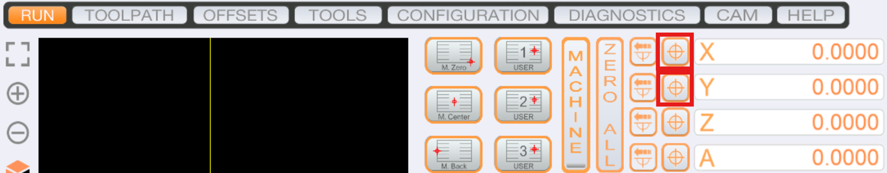

Gå til **«TOOLS»** → **«PROBE»**. Sjekk at riktige innstillinger er satt under **«SETUP»** og **«PAGE 1»**.

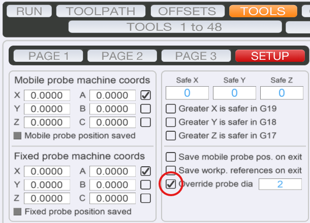

Sett **«P1»** til -50 (proben går maks 50 mm ned før den eventuelt treffer en overflate), og aktiver bare **«Z»** for å måle Z-aksen. Pass også på at **«Simple probe»** er aktivert.


Slå på **«ZERO PROBED AXES»**, **«AXIS COUNT GAGE»** og **«AXIS 1 COUNT DIA.»**, og sett verdiene i de røde rammene som på bildet under.


Trykk **«START PROBING»** for å sette nytt nullpunkt for 3D Touch Probe (verktøy nr. 10).


Klikk **«M6»** igjen og bytt til **verktøy 1**, siden det er referansen. Klikk så **«GOTO ZERO»** for å kjøre til nullpunktet.


Fest en teipbit på overflaten der du satte nullpunktet for 3D Touch Probe.


Kjør verktøy 1 ned til det så vidt skraper borti teipbiten. Bruk **Page Up** og **Page Down** på tastaturet. Holder du inne **Ctrl**, går det stegvis (stegene kan justeres i det oransje panelet til venstre).


Når passende offset er funnet, skriver du inn den *motsatte* verdien som **offset for verktøy 10**, for eksempel (−25,1219) × (−1) = **25,1219**, og trykker **Enter**.

Juster verdien ved å bytte til **verktøy 10** igjen, sette nullpunkt og bytte til **verktøy 1**. Sjekk om avstanden mellom teipbiten og verktøyet er OK. Juster for eksempel med (−0,6906) × (−1); da blir total offset **25,8125 mm** i dette **eksempelet**.


### 4.04 Unngå at verktøy henger fast under bytte

Det kan komme støv eller spon i verktøyholderen. Hold chucken ren ved service: støvsug den, og puss eventuelt bort fastbrent støv.

### 4.05 Løsne et fastlåst verktøy

Løsner ikke et verktøy ved verktøybytte, må du løsne det manuelt:

- Trykk inn chuck-låsen på spindelen.
- Sett fastnøkkelen på chucken og vri til den løsner.

### 4.06 Finne nullpunkt i X og Y med probe

*Kommer.*

### 4.07 Sette nullpunkt i Z med verktøylengdesensor (TLS)

TLS (Tool Length Sensor) brukes hver gang du skal frese et emne med en ny tykkelse. Det kan også gjøres manuelt, men med TLS går det automatisk.

1. Spenn fast emnet.
2. Bytt med **«M6»**-macroen til verktøyet som brukes først i freseprogrammet.
3. Kjør spindelen med verktøyet til et punkt over et av de høyeste punktene på emnet.
4. Legg TLS oppå emnet, under verktøyet.
5. Kjør verktøyet opp/ned med **Page Up** eller **Page Down** til det står rett over, men ikke borti, TLS.
6. Trykk på TLS-knappen i UCCNC og vent til prosedyren er ferdig.

*Nå er nullpunktet for Z-aksen satt med det valgte verktøyet.*

### 4.08 Oppdatere SolidWorks (og bevare databasen)

Før du oppdaterer SolidWorks, for eksempel fra 2021- til 2025-versjonen, må Technology-databasen eksporteres, og den må importeres igjen etter oppdateringen. Fremgangsmåten står i [3.02](#302-eksportere-en-technology-database-for-import).

## 5. Redigere post-prosessor | Lærere

### 5.01 Universal Post Generator (CAMWorks)

*Kommer.*

## 6. Maskinkoordinater og kalibrering av vår M700 | Lærere

Verdiene under ble funnet da verktøymagasinet (automatisk verktøyveksler, ATC) ble kalibrert på Stepcraft M700 ved USN. Ta vare på dem, så maskinen kan settes opp igjen etter en programvareoppdatering eller ny installasjon. De følger Stepcrafts fremgangsmåte i *Quick Start Guide UCCNC v3.6*, side 11, «M6 Macro: A New Way of Changing Tools in UCCNC» (se [kapittel 7](#7-ekstern-dokumentasjon-stepcraft)). Kalibreringen gjøres ved å redigere macro-filene **M6** og **M20204**.

*Oversatt fra det engelske notatet «Stepcraft CNC Machine Coordinates», som kan lastes ned som Word-fil: [machine-coordinates-original.docx](machine-coordinates-original.docx) (bilder fra Stepcrafts manualer er byttet ut med korte merknader).*

### 6.01 Oppsummering av kalibreringen

| Trinn | Spørsmål / innstilling | Verdi på vår M700 |
| --- | --- | --- |
| 1 | Hvilken automatisk verktøyveksler brukes? | **SK15 med pneumatisk løft** |
| 2 | Hvor lang tid bruker spindelen på å stoppe helt? | **7 sekunder** |
| 3 | Hvor er magasinet montert (1–4)? | **1 (bak)** |
| 4 | Hvilket verktøy er T1? | **Det lengst til venstre, ved siden av verktøylengdesensoren (WLS)** |
| 5 | Finn koordinatene til T1. | OK (se [6.02](#602-plasseringen-av-t1-og-sk15-adapteren)) |
| 6 | Regn ut koordinatene til de andre verktøyene. | OK: **+45 mm per verktøy** i X (se [6.03](#603-verktøyposisjoner-i-magasinet)) |
| 7 | Bestem Z-offset. | OK |
| 8 | Åpne `M6.txt` og sett variablene: | |
| | `WaitSpin` | **7000** |
| | `Xtooloffset` | **50** |
| | `Ytooloffset` | **50** |
| | `Ztooloffset` | **70.5** |
| | `ToolRackHeight` | **-84.3156** |
| | `ToolRackPosition` | **1** |
| | `ToolRackType` | **1** |
| | `ToolX` (T1) | **60.2281** |
| | `ToolY` (T1) | **742.850** |
| | `UsedToolRack` | **1** |

`WaitSpin` er stopptiden til spindelen i millisekunder (7 s × 1000).

### 6.02 Plasseringen av T1 og SK15-adapteren

**Bruk maskinkoordinater** når du måler. T1 er den første verktøyholderen til venstre, ved siden av verktøylengdesensoren (WLS) i magasinet. Finn den slik Stepcraft beskriver: kjør maskinen hjem, før verktøyholderen (uten verktøy) sakte ned i senter av holderingen til T1 ovenfra, og bruk et papirark for å finne Z-høyden der holderen treffer det. Med SK15-adapteren er det derfra ca. **6 mm** igjen til holderen sitter riktig.


`Ztooloffset` ses lettest med vanlige koordinater (arbeidskoordinater) etter at nullpunktet er satt. På vår maskin måtte Z-posisjonen senkes 1,5 mm ekstra og offseten økes med 1,5 mm for at SK15 skulle gå helt ned.

| Målt verdi | Verdi |
| --- | --- |
| `ToolX[1]` | 60.2281 |
| `ToolY[1]` | 742.850 |
| `ToolRackHeight[1]` | -84.3156 |
| `Ztooloffset` | 70.5 |
| `WaitSpin` | 7000 |

### 6.03 Verktøyposisjoner i magasinet

Holderne i SK15-magasinet med pneumatisk løft (in-table) står **45 mm** fra hverandre, så X øker med 45 mm per verktøy mens Y er den samme.

| Verktøy | X (maskin) | Y (maskin) |
| --- | --- | --- |
| T1 | 60.2281 | 742.850 |
| T2 | 105.2281 | 742.850 |
| T3 | 150.2281 | 742.850 |
| T4 | 195.2281 | 742.850 |
| T5 | 240.2281 | 742.850 |
| T6 | 285.2281 | 742.850 |
| T7 | 330.2281 | 742.850 |
| T8 | 375.2281 | 742.850 |
| T9 | 420.2281 | 742.850 |
| T10 | 465.2281 | 742.850 |

I UCCNC er verktøy 9 deaktivert i vår M6-macro, og verktøy 10 er 3D Touch Probe (se [4.02](#402-kalibrere-offset-for-verktøy-i-verktøymagasinet)).

### 6.04 Teste verktøyveksleren

Klikk **M6** og skriv **0** (ingen verktøy). Skriv så **`m6t1`** i **MDI**-feltet og trykk **Enter** for verktøy 1. Gjenta for verktøy 2 (**`m6t2`**), verktøy 3 (**`m6t3`**) osv. ved behov.

### 6.05 Verktøylengdesensor og probe

Under **TOOLS** → **DIGITIZE** sjekker du at høyden på verktøylengdesensoren er satt. Standardverdier:

- Probe radius: **2**
- Tool length sensor height: **32,5 mm**
- Nøyaktighet: **0,07 mm**


### 6.06 Spindel

**Starte spindelen (MM-1000 DI):** klikk **«Single Line»** for å starte spindelen med innstilt turtall (**Sset**). Med G-kode starter `M03 S5000` spindelen med klokka på 5000 o/min, og `M05` stopper den.

For MM-1000 DI oppgir Stepcraft disse turtallene for innstillingene på spindelen:

| Innstilling | 1 | 2 | 3 | 4 | 5 | 6 |
| --- | --- | --- | --- | --- | --- | --- |
| Turtall (o/min) | 4 000 | 8 200 | 12 400 | 16 600 | 20 800 | 25 000 |

**Spindelinnstillinger i UCCNC:** under **CONFIGURATION** → **AXIS SETUP** → **SPINDLE** settes turtallet til **min. 4000** og **maks. 25000** o/min.


### 6.07 Oppvarming

For å varme opp steppermotorene klikker du **Warmup** på RUN-skjermen.


For å varme opp spindelen kan du kjøre den på ca. **10 000 o/min** en liten stund hvis den ikke har vært brukt på lenge.

### 6.08 M6-macroen under kalibrering

Under **CONFIGURATION** → **GENERAL SETTINGS** må «On tool change code (M6) do the following» stå på **Run the tool change macro (M6)**. Da tas hver endring du lagrer i M6-filen under kalibreringen, i bruk med en gang.


### 6.09 Diagnose, støttede koder og hurtigtaster

**Diagnose:** fanen **DIAGNOSTICS** viser om alt virker, for eksempel grensebryterne.


**Støttede G- og M-koder:** en oversikt finnes under fanen **HELP**.


**Hurtigtaster:** egne hurtigtaster legges til under **CONFIGURATION** → **I/O TRIGGER** → **HOTKEYS**. Vanlige taster for å kjøre maskinen er **piltastene** for X og Y og **Page Up/Down** for Z. Hold inne **Shift** for rask bevegelse eller **Ctrl** for å gå stegvis. **Tab** bytter mellom mus- og tastaturstyring.


### 6.10 Verktøyoffset for verktøyveksleren

Når du legger til nye verktøy, må Z-offset for hvert verktøy oppdateres. Knappen **OFFSETS** gjør dette automatisk og bruker resultatet midlertidig eller permanent, som du velger (se [4.02](#402-kalibrere-offset-for-verktøy-i-verktøymagasinet)).

### 6.11 Plugins

Plugins som webkamera, Xbox 360-kontroller eller AutoLevelerCA slås på under **CONFIGURATION** → **GENERAL SETTINGS** → **Configure plugins**. Der kan du aktivere og vise plugins og la dem starte sammen med UCCNC.


### 6.12 Z-offset fra et referansepunkt på delen

For å legge til en fast offset når Z-nullpunktet settes fra et referansepunkt (datum), redigerer du **M31**-macroen:

1. Ta en kopi av `M31.txt` som sikkerhetskopi, og rediger originalen.
2. Legg til disse linjene **under linje 28**:

   ```text
   // Add an offset (mm). Positive is up, negative is down:
   double ZOffset = 0.335;
   newZ = newZ-ZOffset;
   ```

3. **Juster `ZOffset`** etter behov, lagre filen og test. Gjenta til det stemmer.


For å sette et nytt Z-nullpunkt fra et referansepunkt legger du kalibreringsverktøyet for simple probe på referansepunktet, rett under verktøyet, og klikker **TLS**-knappen. **GOTO ZERO** kjører da til det nye Z-nullpunktet.

## 7. Ekstern dokumentasjon (Stepcraft)

Disse manualene er laget av **STEPCRAFT**, ikke av USN, og er © STEPCRAFT, så de ligger ikke på denne siden. Last dem ned i nyeste versjon fra Stepcrafts side for manualer: **[stepcraft-systems.com/en/services/manuals](https://stepcraft-systems.com/en/services/manuals)**.

| Dokument | Innhold |
| --- | --- |
| *Quick Start Guide – UCCNC STEPCRAFT OEM Version 3.6* (06/23, engelsk) | Installasjon av UCCNC, lisens og maskinprofil, feilsøking, og M6-macroen for verktøymagasiner (side 11), brukt i [kapittel 6](#6-maskinkoordinater-og-kalibrering-av-vår-m700--lærere) |
| *First Steps – Tool Magazine M-Series, UCCNC v3.4* (engelsk) | Oppsett av verktøymagasinet i UCCNC: klargjøring av verktøyveksleren og redigering av macroene |
| *Operating Manual – Tool Magazine incl. pneumatic lifting function, M-Series* (01/22, engelsk) | Selve verktøymagasinet: sikkerhet, installasjon (stempel i Z-aksen, magasin, elektrisk tilkobling), bruk (bryter for verktøyveksler, programoppsett, verktøylengdesensor, verktøyoffset i UCCNC) og tekniske data |
| *Operating Manual – Tool Length Sensor TS-32 and TS-39* (engelsk) | Sikkerhet, montering og tilkobling av verktøylengdesensoren (TLS), og oppsett i UCCNC; sensoren brukes til å sette nullpunkt i Z ([4.07](#407-sette-nullpunkt-i-z-med-verktøylengdesensor-tls), [6.05](#605-verktøylengdesensor-og-probe)) |
| *User's manual – UCR200 USB wireless jog pendant* (plugin V1.032, engelsk) | Den trådløse håndkontrollen (jog pendant). Merk: manualen beskriver håndkontrollen sammen med programmet Mach3 |
| *Milling parameters* (engelsk) | Hvordan regne ut turtall og matehastighet (n = v<sub>c</sub> · 1000 / (π · d), v<sub>f</sub> = n · z · f<sub>z</sub>) med et regneeksempel, og veiledende turtall og mating etter materiale og freesdiameter |
| *Milling* (engelsk) | Fresetyper (2-skjærs, diamant, ettskjærs, spiral, radius, V-fres) og hva de brukes til, og skjæredata (inndybde, turtall, mating) for Ø1–3 mm fres i tre, plast, kompositt, aluminium og messing |
