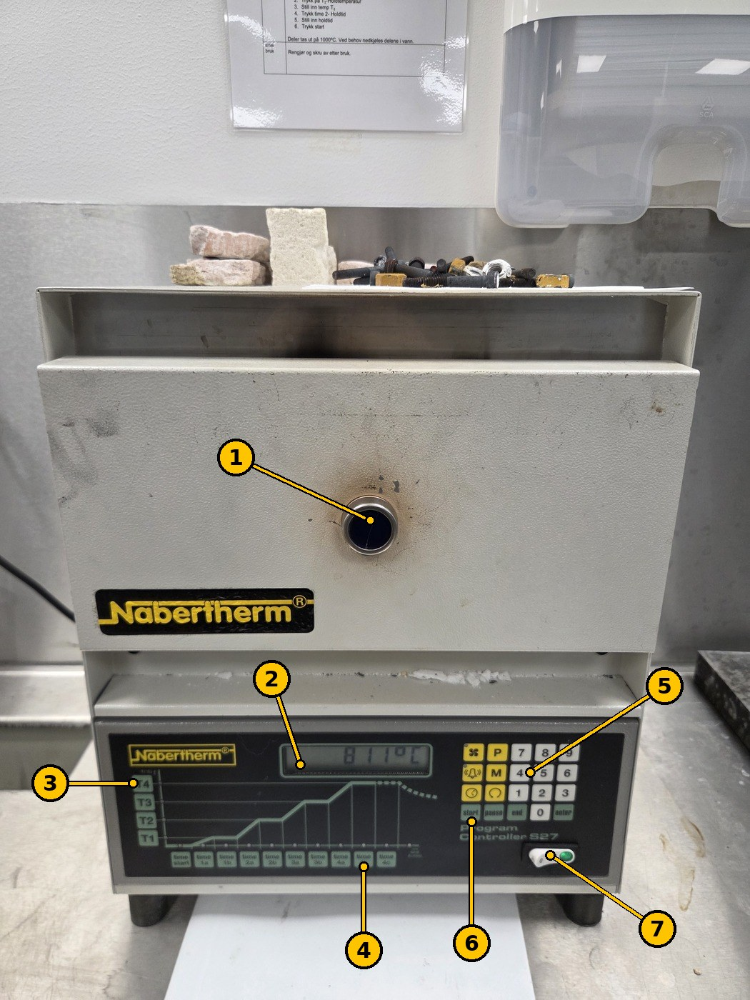
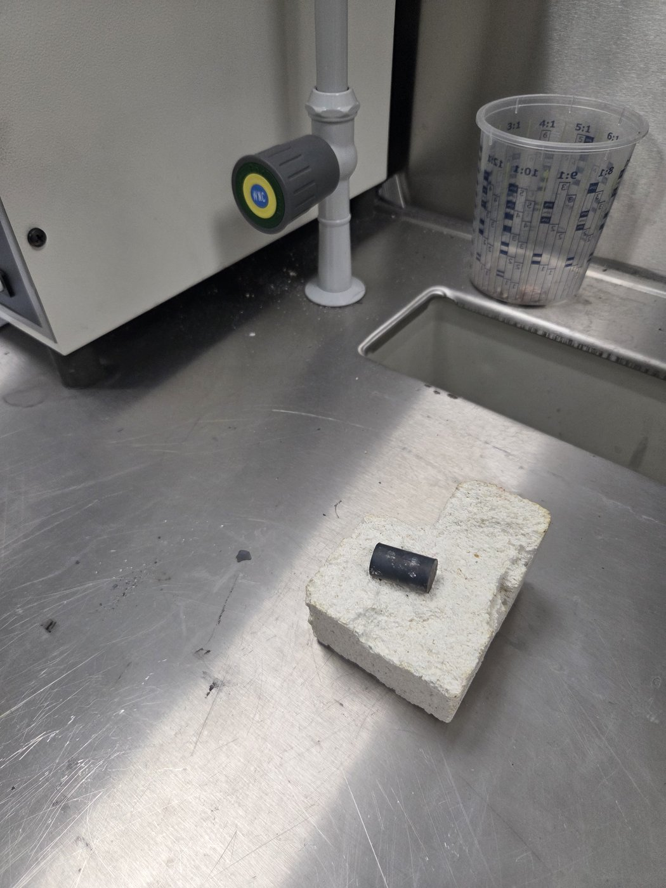
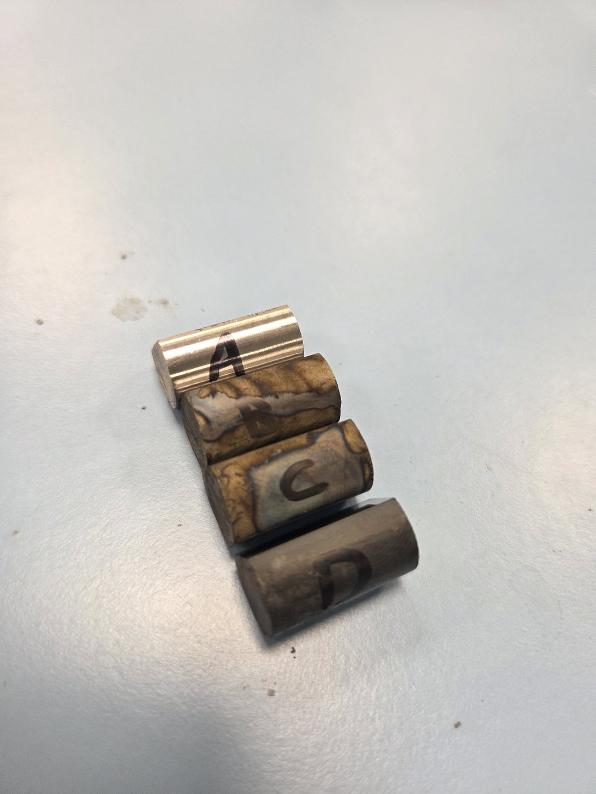
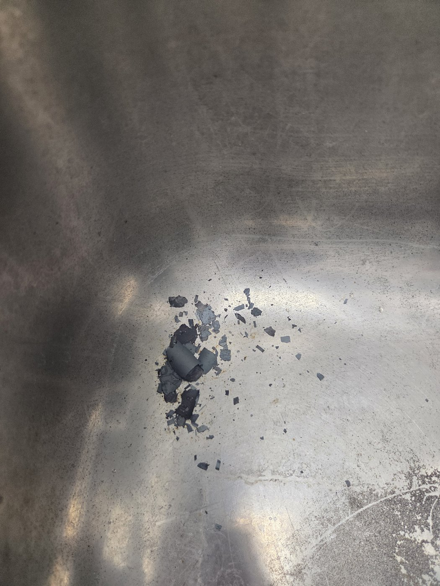

# Lab furnaces and quenching (Nabertherm)

TSM2370 Materialteknikk · USN Kongsberg · Updated 11 Nov 2026

> **Norsk versjon:** [README.no.md](README.no.md)

**Used in:** [TSM2370 Lab 2 – Thermal processing and quench severity](../../labs/tsm2370-materialteknikk/README.md#lab-2--thermal-processing-and-quench-severity)

There are **two Nabertherm lab furnaces** (up to 1000 °C). In TSM2370 Lab 2 one is set to **810 °C** to austenitize the samples before quenching, and the other to **600 °C** for the isothermal treatment of sample D. The lab supervisor normally sets the furnaces before the session.

## 1. Safety (HMS)

- **Do not use the furnaces before you have been shown how** by the lab supervisor.
- **Wear safety glasses and heat-resistant gloves.** Use **tongs** for everything that goes in or out of a furnace. A face shield and lab coat are recommended at the quench baths. Closed-toe shoes.
- **Hot steel looks exactly like cold steel.** Never pick up a sample with bare hands until you know it has cooled. Hot samples always go on the **insulating brick** (Figure 2), never straight on the bench.
- Keep the floor clear of chips and offcuts so you do not slip or trip, and stand steady when you work at the furnace.
- Open the door only as long as you need. The air from the furnace is very hot.
- **Quenching oil can catch fire.** Keep the lid of the oil bath within reach and put it on if the oil burns. **Never use water on an oil fire.**
- High-carbon steel can **crack** in a cold-water quench. Do not stand over the bath.

## 2. The furnace controller (Nabertherm Program Controller S27)

*Figure 1. Nabertherm furnace with the Program Controller S27. Here it holds 811 °C. The numbers match the table.*

| No. | Part | What it does |
| --- | --- | --- |
| 1 | Door with sight glass | Load and unload samples here. The sight glass lets you look in without opening. |
| 2 | Display | Shows the temperature in the furnace. |
| 3 | T1–T4 keys | Temperatures in the program. **T4 = holding temperature.** |
| 4 | Time keys (time start, 1a … 4c) | Times in the program. **4b = holding time.** |
| 5 | Keypad (0–9) and function keys | Enter values. |
| 6 | start · pause · end · enter | Start the program, pause it, end it, confirm a value. |
| 7 | Main switch (0 / I) | Turns the furnace on (green light). |

**Setting the furnace** (from the posted instruction, "new type" furnace, which is the S27 in Figure 1):

1. Turn on the main switch (7).
2. Press **T4** (holding temperature).
3. Type the temperature, for example **810**.
4. Press **enter**.
5. Press **4b** (holding time).
6. Type the holding time.
7. Press **enter**.
8. Press **start**.

The other furnace is the "old type" in the posted instruction: turn the key, press **T2** (holding temperature), set the temperature, press **time 2** (holding time), set the time, press **start**.

## 3. Heat treatment in TSM2370 Lab 2

Four samples of Sølvstål 2210 per group:

| Sample | Route |
| --- | --- |
| A | Untreated (baseline). Not in the furnace. |
| B | 810 °C for 15–30 min → quench in **20 °C water** |
| C | 810 °C for 15–30 min → quench in **70 °C water or oil** |
| D | 810 °C for 15–30 min → **600 °C furnace** for 15–30 min → **air cool** on the brick to about 20 °C |

Mark the samples **A, B, C, D** with a permanent marker once they are cold (Figure 3), and keep track of which is which while they are in the furnace.

**Quenching (B and C)**

1. Have the bath ready and the tongs in your hand before you open the furnace.
2. Take the sample out with the tongs and put it in the bath **straight away**. Every second in air lets it cool before the quench.
3. Move the sample around in the bath with the tongs until it stops bubbling, so fresh liquid reaches the surface.
4. Take it out and put it on the brick.

**Air cooling (D)**

Move sample D with the tongs from the 810 °C furnace to the 600 °C furnace. After 15–30 min, take it out and put it on the insulating brick to cool in air (Figure 2). The brick shows everyone that the sample is hot. Leave it until it is at room temperature.

*Figure 2. Sample D cooling in air on the insulating brick. Hot samples always go on the brick, never straight on the steel bench.*

*Figure 3. The four samples after heat treatment, marked A–D. A is still bright, B and C have coloured oxide from the quench, D is covered in dark scale.*

## 4. After quenching: clean up the scale

When hot steel is quenched, the dark oxide layer (scale) flakes off. The flakes end up in the bath and in the sink.

*Figure 4. Scale flakes left in the sink after quenching.*

- **Wipe up the flakes with a paper towel (wet it if needed) and put them in the bin.**
- **Do not rinse them down the drain.**

## 5. When you are finished

- [ ] Samples cooled on the brick, marked, and handed in or put in your group's box.
- [ ] Scale wiped up from the sink and the bench, not rinsed down the drain.
- [ ] Oil bath lid on.
- [ ] Furnace cleaned and switched off, unless the lab supervisor says to leave it on for the next group.

## 6. Posted instruction at the furnaces

This official USN instruction hangs on the wall by the furnaces (in Norwegian; translated here).

**Instruction for hardening furnace 1000 °C** (*Instruks for herdeovn 1000 °C*; USN / Fagskolen i Viken, Kvalitet/HMS, version 002, valid from 10.09.2022)

| When | Instruction |
| --- | --- |
| Safety | Do not use this machine before you have had sufficient training. Protective equipment: **wear safety glasses and heat-resistant gloves.** |
| Before use | Keep the floor clear of chips and offcuts so you do not slip or trip. Stand steady when you work. |
| During use | **New type furnace:** 1. Press the on switch. 2. Press T4 (holding temperature). 3. Set the holding temperature. 4. Press enter. 5. Press 4b (holding time). 6. Set the holding time. 7. Press enter. 8. Press start. **Old type furnace:** 1. Turn the key. 2. Press T2 (holding temperature). 3. Set T2. 4. Press time 2 (holding time). 5. Set the holding time. 6. Press start. Parts are taken out at 1000 °C. If needed, the parts are cooled in water. |
| After use | Clean and switch off after use. |

The posted instruction says 1000 °C. In TSM2370 Lab 2 we use **810 °C** for Sølvstål 2210, as given in the lab protocol.

<!-- TODO (from Rasmus): photo of the second ("old type") furnace and its controller; quench bath photos; confirm where samples are handed in. -->
