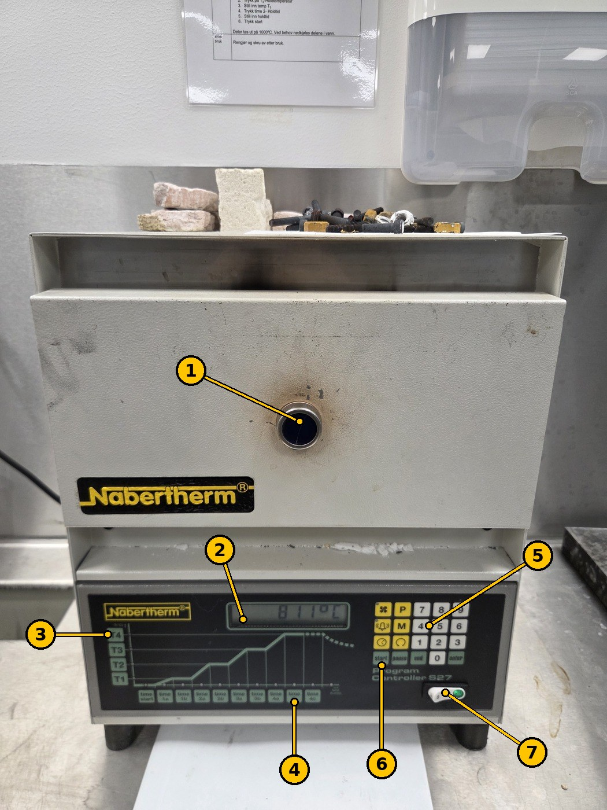
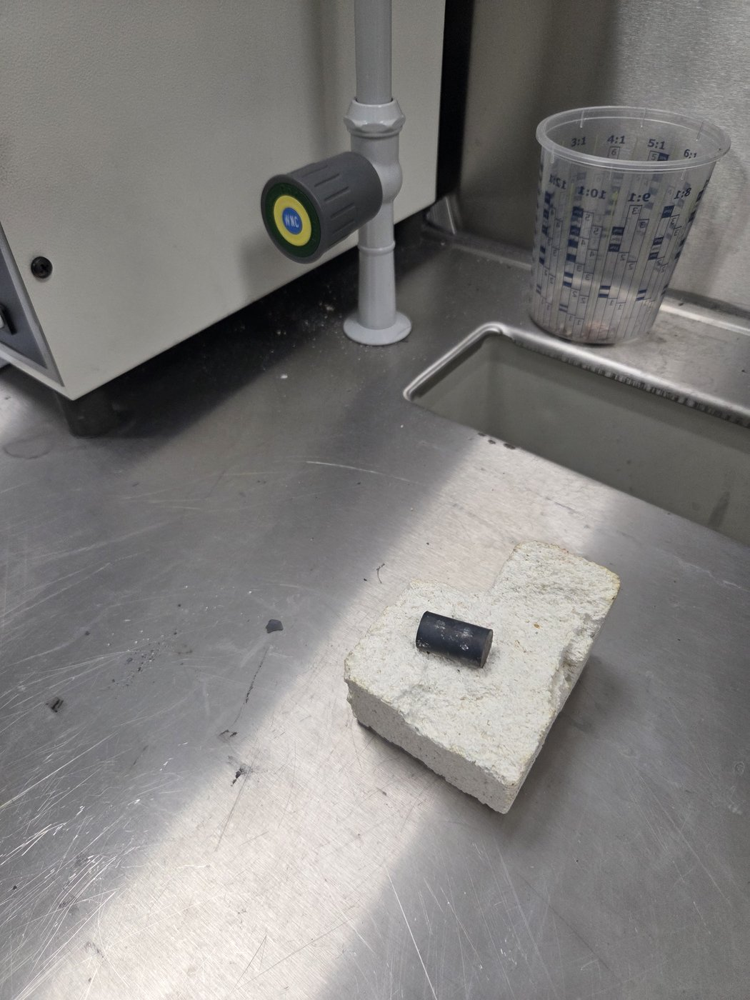
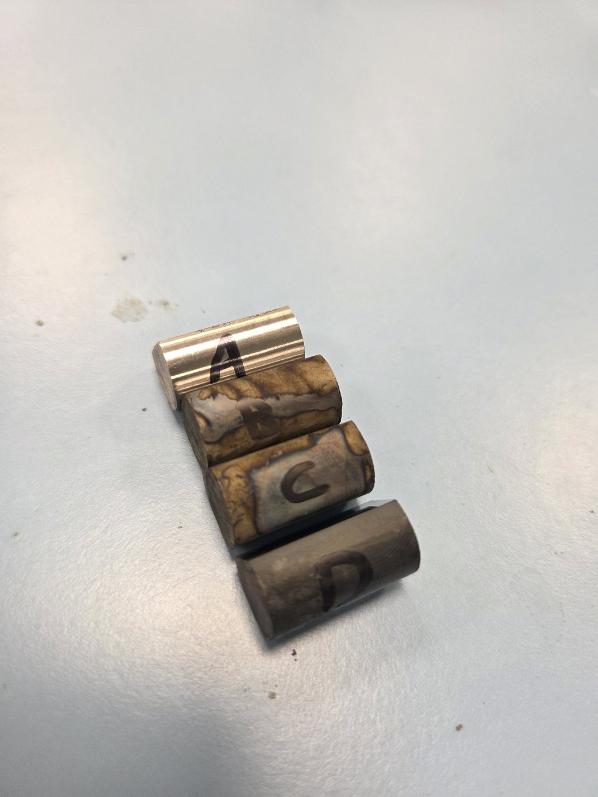
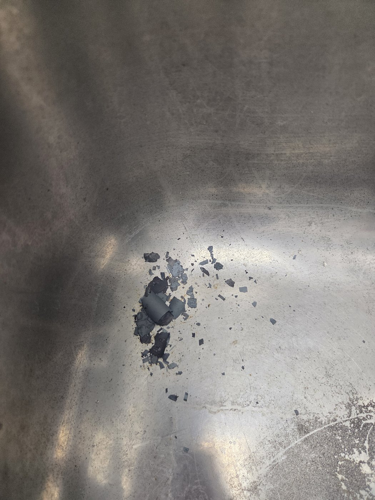

# Labovner og bråkjøling (Nabertherm)

TSM2370 Materialteknikk · USN Kongsberg · Oppdatert 11. nov. 2026

> **English version:** [README.md](README.md)

**Brukes i:** [TSM2370 Lab 2 – Thermal processing and quench severity](../../labs/tsm2370-materialteknikk/README.md#lab-2--thermal-processing-and-quench-severity)

Det er **to Nabertherm-labovner** (opptil 1000 °C). I TSM2370 Lab 2 står den ene på **810 °C** for å austenittisere prøvene før bråkjøling, og den andre på **600 °C** for den isoterme behandlingen av prøve D. Labansvarlig stiller normalt inn ovnene før økten.

## 1. Sikkerhet (HMS)

- **Ikke bruk ovnene før du har fått opplæring** av labansvarlig.
- **Bruk vernebriller og varmebestandige hansker.** Bruk **tang** til alt som skal inn i eller ut av en ovn. Ansiktsskjerm og labfrakk anbefales ved kjølebadene. Lukkede sko.
- **Varmt stål ser helt likt ut som kaldt stål.** Ta aldri opp en prøve med bare hender før du vet at den er avkjølt. Varme prøver legges alltid på **isolasjonssteinen** (figur 2), aldri rett på benken.
- Hold gulvet fritt for flis og kapp, så du ikke sklir eller snubler, og stå stødig når du jobber ved ovnen.
- Ha døra åpen bare så lenge du må. Lufta fra ovnen er svært varm.
- **Herdeolje kan ta fyr.** Ha lokket til oljebadet innen rekkevidde og legg det på hvis oljen brenner. **Bruk aldri vann på en oljebrann.**
- Høykarbonstål kan **sprekke** ved bråkjøling i kaldt vann. Ikke stå bøyd over badet.

## 2. Ovnsstyringen (Nabertherm Program Controller S27)

*Figur 1. Nabertherm-ovn med Program Controller S27. Her holder den 811 °C. Numrene stemmer med tabellen.*

| Nr. | Del | Funksjon |
| --- | --- | --- |
| 1 | Dør med kikkeglass | Her legges prøvene inn og tas ut. Gjennom kikkeglasset ser du inn uten å åpne. |
| 2 | Display | Viser temperaturen i ovnen. |
| 3 | T1–T4-tastene | Temperaturer i programmet. **T4 = holdetemperatur.** |
| 4 | Tidstastene (time start, 1a … 4c) | Tider i programmet. **4b = holdetid.** |
| 5 | Talltaster (0–9) og funksjonstaster | Skriv inn verdier. |
| 6 | start · pause · end · enter | Start programmet, sett det på pause, avslutt, bekreft en verdi. |
| 7 | Hovedbryter (0 / I) | Slår på ovnen (grønt lys). |

**Slik stiller du inn ovnen** (fra den oppslåtte instruksen, «ny type» varmeovn, som er S27 i figur 1):

1. Slå på hovedbryteren (7).
2. Trykk **T4** (holdetemperatur).
3. Skriv inn temperaturen, for eksempel **810**.
4. Trykk **enter**.
5. Trykk **4b** (holdetid).
6. Skriv inn holdetiden.
7. Trykk **enter**.
8. Trykk **start**.

Den andre ovnen er «gammel type» i den oppslåtte instruksen: vri om nøkkelen, trykk **T2** (holdetemperatur), still inn temperaturen, trykk **time 2** (holdetid), still inn tiden, trykk **start**.

## 3. Varmebehandling i TSM2370 Lab 2

Fire prøver av Sølvstål 2210 per gruppe:

| Prøve | Behandling |
| --- | --- |
| A | Ubehandlet (referanse). Skal ikke i ovnen. |
| B | 810 °C i 15–30 min → bråkjøl i **20 °C vann** |
| C | 810 °C i 15–30 min → bråkjøl i **70 °C vann eller olje** |
| D | 810 °C i 15–30 min → **600 °C-ovnen** i 15–30 min → **luftkjøl** på steinen til ca. 20 °C |

Merk prøvene **A, B, C, D** med permanent tusj når de er kalde (figur 3), og hold styr på hvilken som er hvilken mens de er i ovnen.

**Bråkjøling (B og C)**

1. Ha badet klart og tangen i hånden før du åpner ovnen.
2. Ta prøven ut med tangen og legg den i badet **med en gang**. Hvert sekund i luft kjøler den før bråkjølingen.
3. Beveg prøven rundt i badet med tangen til det slutter å boble, så ny væske kommer til overflaten.
4. Ta den opp og legg den på steinen.

**Luftkjøling (D)**

Flytt prøve D med tangen fra 810 °C-ovnen til 600 °C-ovnen. Etter 15–30 min tar du den ut og legger den på isolasjonssteinen for å kjøles i luft (figur 2). Steinen viser alle at prøven er varm. La den ligge til den har romtemperatur.

*Figur 2. Prøve D luftkjøles på isolasjonssteinen. Varme prøver legges alltid på steinen, aldri rett på stålbenken.*

*Figur 3. De fire prøvene etter varmebehandling, merket A–D. A er fortsatt blank, B og C har fargede oksider fra bråkjølingen, D er dekket av mørk glødeskall.*

## 4. Etter bråkjøling: rydd opp glødeskallet

Når varmt stål bråkjøles, flasser det mørke oksidlaget (glødeskallet) av. Flakene havner i badet og i vasken.

*Figur 4. Glødeskall som ligger igjen i vasken etter bråkjøling.*

- **Tørk opp flakene med papir (fuktet ved behov) og kast dem i søpla.**
- **Ikke skyll dem ned i sluket.**

## 5. Når du er ferdig

- [ ] Prøvene er avkjølt på steinen, merket, og levert eller lagt i gruppens eske.
- [ ] Glødeskall er tørket opp fra vasken og benken, ikke skylt ned i sluket.
- [ ] Lokket er på oljebadet.
- [ ] Ovnen er rengjort og slått av, med mindre labansvarlig sier at den skal stå på for neste gruppe.

## 6. Oppslått instruks ved ovnene

Denne offisielle USN-instruksen henger på veggen ved ovnene.

**Instruks for herdeovn 1000 °C** (USN / Fagskolen i Viken, Kvalitet/HMS, versjon 002, gyldig fra 10.09.2022)

| Når | Instruks |
| --- | --- |
| Sikkerhet | Ikke bruk denne maskinen før du har fått tilstrekkelig opplæring. Verneutstyr/arbeidstøy: **bruk vernebriller og hansker mot varme.** |
| Før bruk | Hold gulvet fritt for flis og kapp, slik at du unngår å gli eller snuble. Pass på å stå stødig når du jobber. |
| Under bruk | **Ny type varmeovn:** 1. Trykk på på-bryter. 2. Trykk knapp T4 – holdtemperatur. 3. Still inn holdtemperatur. 4. Trykk enter. 5. Trykk knapp 4b – holdtid. 6. Still inn holdtid. 7. Trykk enter. 8. Trykk start. **Gammel type varmeovn:** 1. Vri om nøkkel. 2. Trykk på T2 – holdtemperatur. 3. Still inn temp T2. 4. Trykk time 2 – holdtid. 5. Still inn holdtid. 6. Trykk start. Deler tas ut på 1000 °C. Ved behov nedkjøles delene i vann. |
| Etter bruk | Rengjør og skru av etter bruk. |

Den oppslåtte instruksen sier 1000 °C. I TSM2370 Lab 2 bruker vi **810 °C** for Sølvstål 2210, slik labprotokollen sier.
