# Matsuzawa MXT50 Vickers Hardness Tester – Student Guide

TSM2370 Materialteknikk · USN Kongsberg · Updated 10 Nov 2026

> **Norsk versjon:** [README.no.md](README.no.md) · **PDF:** [guide-en.pdf](guide-en.pdf) · **Word:** [guide-en.docx](guide-en.docx) · **Quick card (A4, Norwegian):** [quick-card-no.pdf](quick-card-no.pdf)

**Used in:** [TSM2370 Lab 2 – Thermal processing and quench severity](../../labs/tsm2370-materialteknikk/README.md#lab-2--thermal-processing-and-quench-severity)

You will measure Vickers hardness at HV1 (1 kgf). First you check the machine on the reference block, then you test your own samples. One indent takes about 2 minutes once you know the routine.

## 1. Before you start

**The machine:** Matsuzawa MXT50 digital microhardness tester, serial no. MX2294, built December 1992. Spare parts no longer exist, so treat it gently.

**Safety and care rules**

- **Never let the diamond or the objective touch the sample.** The diamond tip is small, brittle and expensive. Before you turn the turret, check that nothing on the stage is taller than your sample surface.
- **Never press START while the turret is on an objective.** START only when the diamond is clicked into position over the sample.
- **Never turn the turret while the LOADING lamp is lit.** Wait until the lamp is off and the indenter has lifted.
- **Raise the stage very slowly when you bring the diamond close.** Watch from the side: the tip must almost touch, but never touch, the sample before START.
- **Do not touch the diamond or the lens glass** with fingers or cloth.
- **Do not turn the load dial** while a test is running.

**What you need**

- Your polished sample. The surface must be flat, parallel to the bottom and polished to at least a fine finish (1 µm diamond or better). A scratched or rough surface makes the corners of the indent impossible to see.
- The **HMV700 reference block** (black box marked *Standard Block for Hardness Test*, Yamamoto, Japan).
- The **rechargeable flashlight** kept next to the machine. It is the light source for the microscope. **Charge it after use** so the next group can work.
- Lint-free tissue and ethanol to clean the sample surface.
- The results table at the end of this guide.

**Support blocks:** put one or two of the steel support blocks kept by the machine in the V-block holder, under the sample or the reference block. They lift it high enough to reach focus.

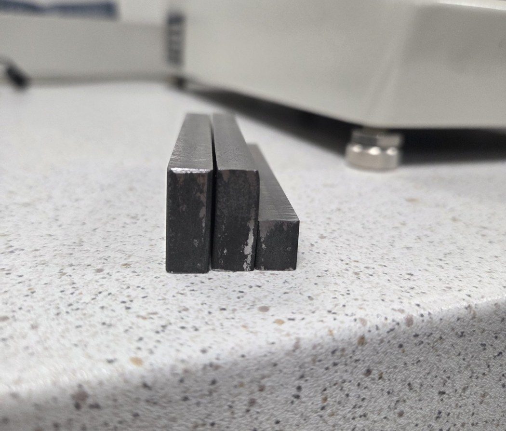

*Support blocks. Use one or two under the sample or the reference block.*

**Sample rules (ISO 6507-1)**

- Sample thickness must be at least 1.5 × the indent diagonal. At HV1 any sample thicker than 0.5 mm is fine.
- The centre of an indent must be at least **2.5 × d** from the sample edge (steel).
- The centres of two indents must be at least **3 × d** apart (steel).
- At HV1, d is 50–110 µm on steels, so keep **0.5 mm** between indents and from the edge. One full turn of a stage micrometer = 0.5 mm.

## 2. Machine overview

The numbers in the tables match the numbered labels on the photos below.

**Front and sides (Figures 1 and 2)**

| No. | Part | What it does |
| --- | --- | --- |
| 1 | Eyepiece (WF10X Micro) | Look through here to focus and measure. Contains two measuring lines. |
| 2 | Left measuring knob (marked 0) | Moves the measuring lines sideways across the view. |
| 3 | Right measuring knob with **READ** button | Turning it (direction marked OPEN ▲) opens or closes the gap between the two lines. Pressing READ stores the measured length. |
| 4 | Light tube with flashlight | The flashlight slides into this tube and lights the sample. |
| 5 | Turret | Holds the **orange-ring objective**, the **green-ring objective** and the **diamond indenter**. Turn it by hand until it clicks into place. |
| 6 | Stage with V-block holder | Holds the sample or the reference block. |
| 7 | X micrometer | Moves the stage left–right. 0.01 mm per mark, 0.5 mm per turn. |
| 8 | Y micrometer | Moves the stage forward–back. 0.01 mm per mark, 0.5 mm per turn. |
| 9 | Elevating handwheel | Raises and lowers the stage to focus. |
| 10 | Load selector dial | Sets the test force. Turn it so **1 Kgf** lines up with the pin. |
| 11 | LIGHT knob | Brightness of the built-in lamp. Not used when the flashlight is in. |
| 12 | BACKUP lamp | Memory backup indicator. No action needed. |
| 13 | ON / OFF switch | Turns the machine on and off. |

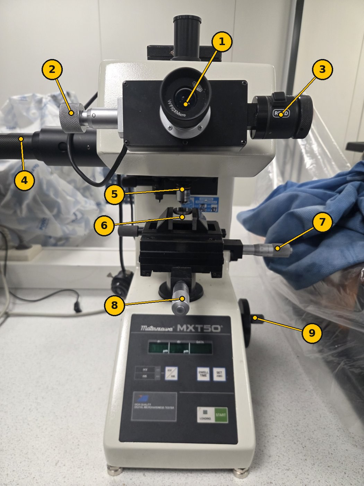

*Figure 1. Front view.*

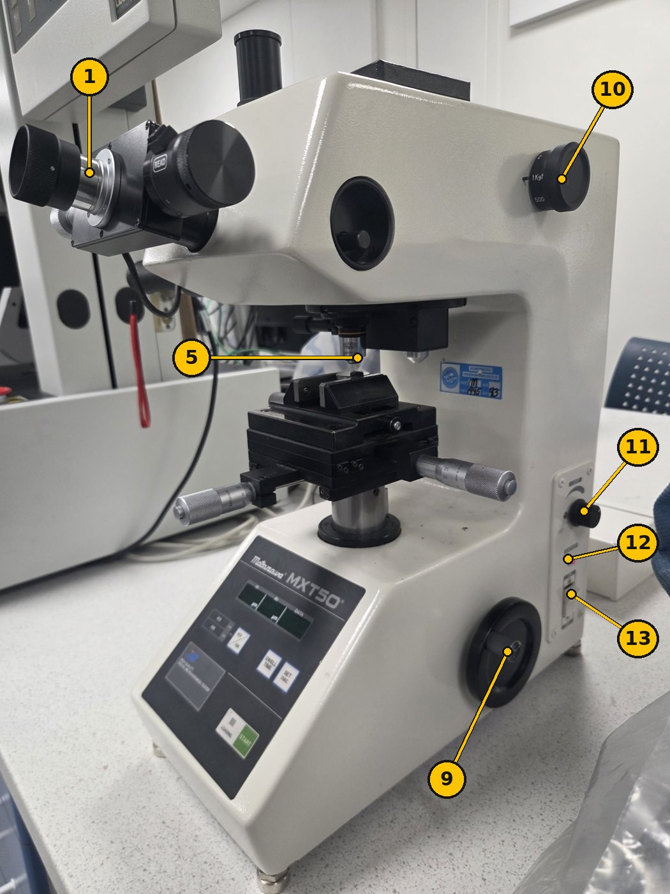

*Figure 2. Right side: load dial (10), side panel (11–13) and elevating handwheel (9).*

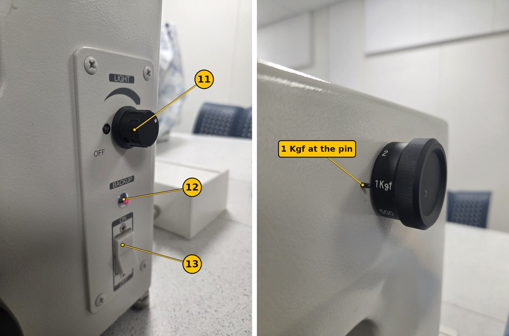

*Figure 2b. Side panel close-up (left) and the load dial set to 1 Kgf (right).*

The **MAIN POWER** switch is on the back. Leave it ON. Use switch 13 on the right side every day.

The **shutter pin** sits inside the round opening on the right side of the head. It must be **pushed in**. If it is pulled out, it blocks the view in the eyepiece.

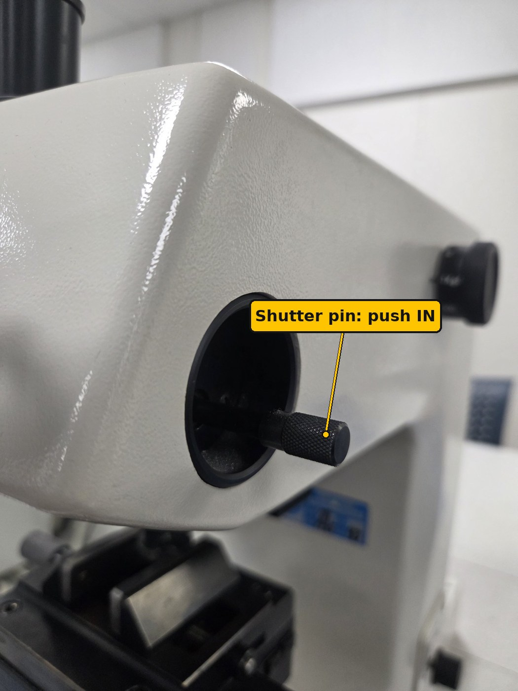

*Figure 2c. Shutter pin. Push it in before you look through the eyepiece.*

**Turret positions (Figure 3)**

| Position | Use it for |
| --- | --- |
| Orange-ring objective | Finding a spot and focusing (wide view). Do not measure with it: the readout then shows only about 1/4 of the real length. |
| Green-ring objective | Measuring the indent (higher magnification). The digital readout is set up for this objective. Refocus slightly after switching. |
| Diamond indenter | Making the indent. Only press START in this position. |

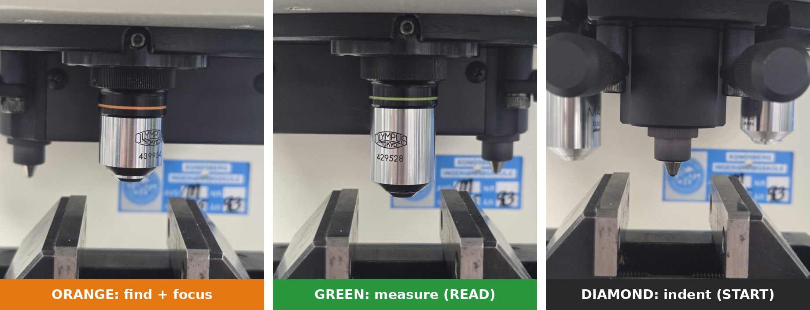

*Figure 3. The three turret positions: find and focus with orange, indent with the diamond, measure with green. Turn the turret by hand until it clicks.*

**Control panel (Figure 4)**

| Control | What it does |
| --- | --- |
| Display **d1** (µm) | First diagonal, after you press READ the first time. |
| Display **d2** (µm) | Second diagonal, after you press READ the second time. |
| Display **DATA** | The calculated hardness value. |
| **HV / HK** key and lamps | Switches between Vickers (HV) and Knoop (HK). The **HV** lamp must be lit green. |
| **DWELL TIME** key | Sets how long the full load is held. Each press steps to the next value shown on the display. |
| **SET 2SEC** key | Hold for 2 seconds to confirm a setting or zero the measuring lines. |
| **START** key | Starts the indent: load on, hold for the dwell time, load off. |
| **LOADING** lamp | Lit while the indenter is loading the sample. Do not touch anything while it is lit. |

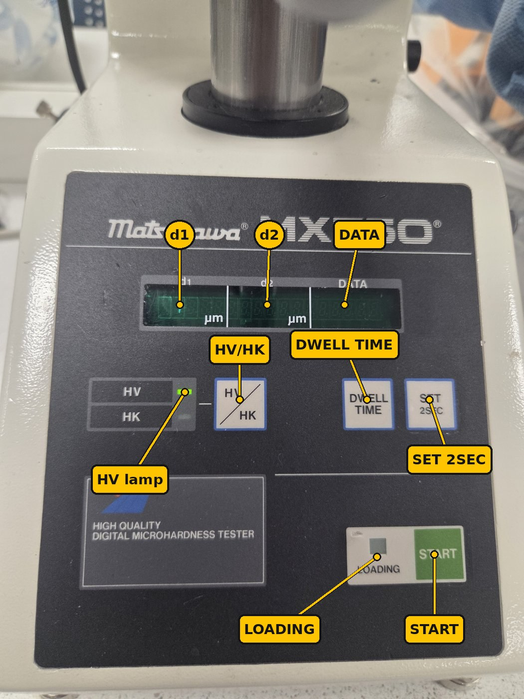

*Figure 4. Control panel. The HV lamp is lit green.*

## 3. Start-up

1. **Power on.** Flip the **ON/OFF switch (13)** on the right side to ON. The display lights up green. If nothing happens, check that MAIN POWER on the back is ON.
2. **Insert the light.** Switch on the charged flashlight and push it fully into the **light tube (4)** on the left side. Then check that the shutter pin on the right side of the head is pushed in (Figure 2c).
3. **Select Vickers.** Check that the **HV** lamp is lit. If HK is lit, press **HV / HK** once.
4. **Set the load.** Turn the **load selector dial (10)** until **1 Kgf** lines up with the pin. Your results are then reported as **HV1**.
5. **Set the dwell time.** Press **DWELL TIME** until the display shows **15** seconds. Then hold **SET 2SEC** for 2 seconds to store it. ISO 6507-1 requires 10–15 s.
6. **Lower the stage.** Turn the **elevating handwheel (9)** to lower the stage, so there is room to place the block without hitting the turret.

## 4. Check the machine on the reference block

Make 3 indents on the HMV700 block. If their mean is within ±5 % of 700 HV (665–735 HV), the machine is OK and you can test your samples. This is a daily check (indirect verification, ISO 6507-1 Annex), not a full calibration.

**A. Zero the measuring lines** (once per session)

1. Look through the **eyepiece (1)**. You see two vertical lines.
2. Turn the **right measuring knob (3)** to close the lines until they almost touch. Stop when only a **very thin gap of light** is left between them.
3. Hold **SET 2SEC** for 2 seconds. The **d1** display should now read **0**.

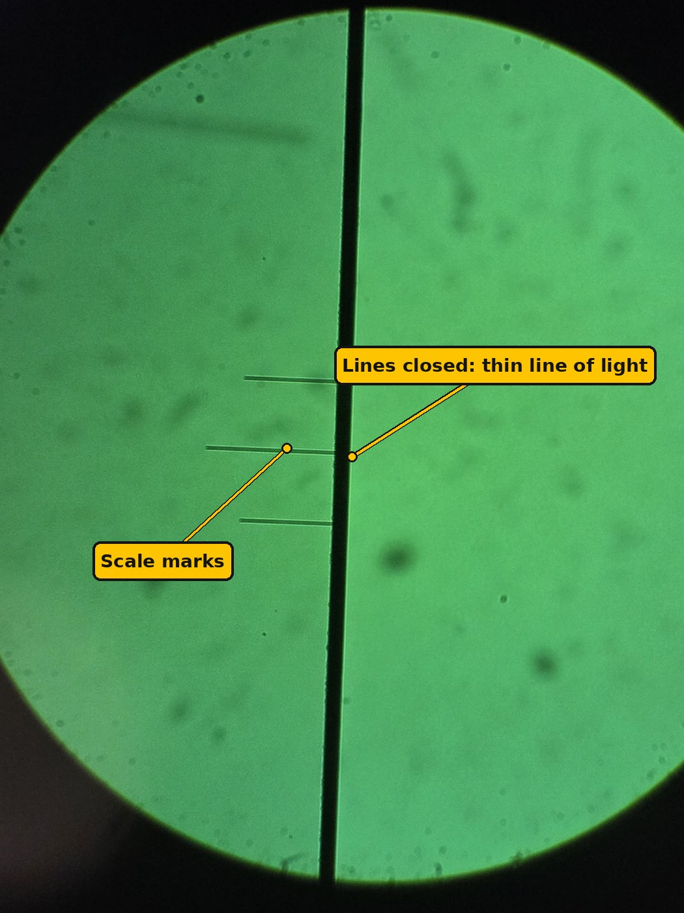

*Figure 5. Lines closed for zeroing: the two lines form one dark band with only a thin line of light left.*

**B. Focus on the block**

1. Put one or two **support blocks** in the V-block holder (6). Place the reference block on top, polished face up. Do not touch the polished face.
2. Turn the turret to the **orange-ring objective** until it clicks.
3. Look through the eyepiece. Slowly raise the stage with the **elevating handwheel (9)** until the surface is sharp. Raise it slowly: the objective must never touch the block.
4. Use the **X and Y micrometers (7, 8)** to find a clean spot at least 0.5 mm from the edge and from old indents.

The block already has many old indents. Find a clean area between them before you indent.

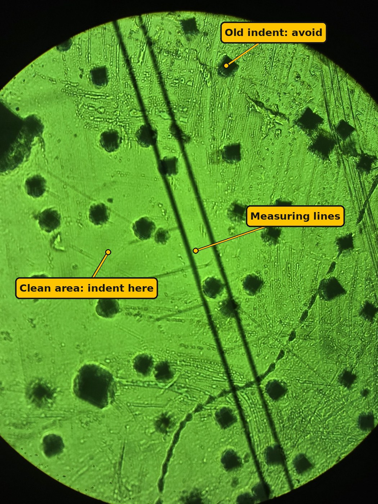

*Figure 6. The reference block through the eyepiece. The dark squares are old indents. Choose a clean area at least 0.5 mm from them.*

**C. Make the indent**

1. Turn the turret to the **diamond indenter** until it clicks.
2. **Bring the tip close.** Watch from the side at eye level. Raise the stage **very slowly** with the handwheel until the tip **almost touches** the surface: the tip and its reflection in the polished surface nearly meet (Figure 7). It must **not** touch.
3. Press **START**. The **LOADING** lamp lights. Do not touch the machine or table.
4. Wait until the LOADING lamp goes off (about 25 s with 15 s dwell).
5. **Lower the stage** a few turns with the handwheel. The objectives reach lower than the diamond tip, so they would hit the sample if you turned the turret without lowering.
6. Turn the turret to the **green-ring objective** (measuring objective). Raise the stage slowly again until the indent is sharp.

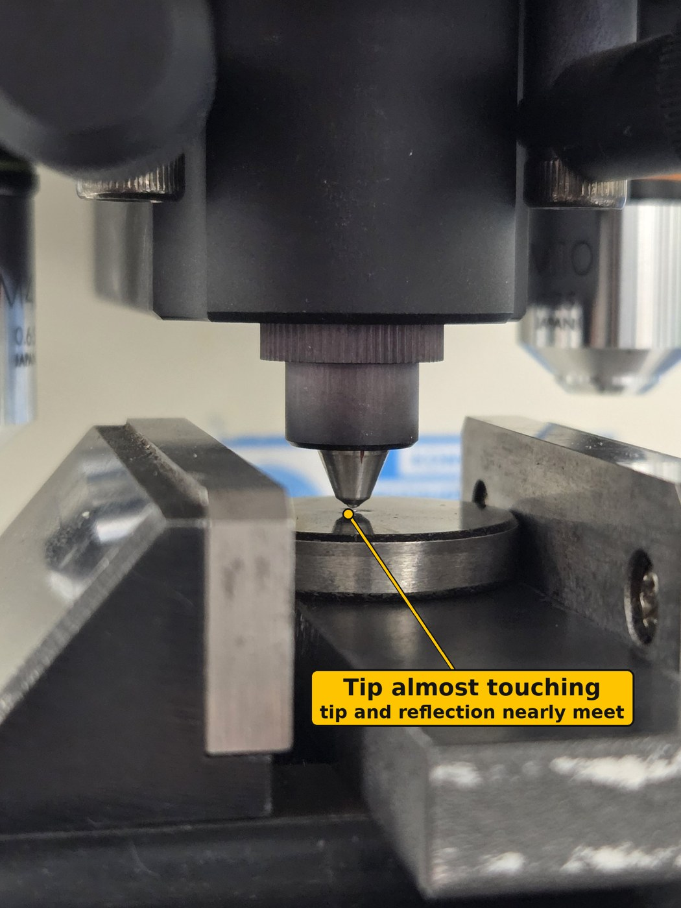

*Figure 7. The diamond brought close before START: the tip and its reflection nearly meet, with a tiny gap between them.*

**D. Measure the indent**

1. Look through the eyepiece. You see a dark square (a diamond shape). Refocus slightly with the handwheel if the corners are not sharp. Always measure with the green-ring objective.
2. **Diagonal 1:** Use the **left knob (2)** to put one line on the left corner of the square. Use the **right knob (3)** to move the other line to the right corner. The lines should just touch the tips of the corners.
3. Press **READ**. The length appears under **d1**.
4. **Diagonal 2:** Turn the eyepiece measuring head 90° so the lines are horizontal. Frame the top and bottom corners the same way.
5. Press **READ** again. The length appears under **d2**, and the hardness appears under **DATA**.
6. Write d1, d2 and HV in the results table.

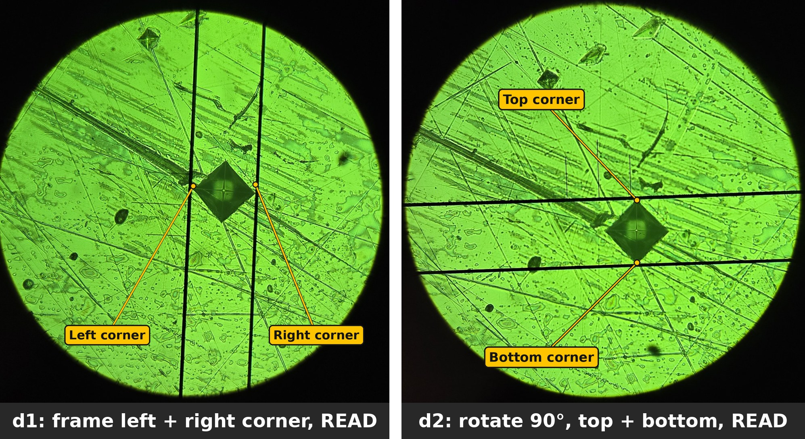

*Figure 8. Measuring an indent on the HMV700 block with the green objective. Left: d1, the lines on the left and right corners. Right: d2, the eyepiece turned 90° and the lines on the top and bottom corners. Result: d1 = 51.5 µm, d2 = 50.7 µm, 710 HV1.*

**E. Accept or reject**

1. Repeat B–D for 3 indents, 0.5 mm apart.
2. Calculate the mean HV of the 3 indents.
3. Mean between 665 and 735 HV: the machine is OK. Continue to section 5.
4. Outside 665–735 HV: re-zero the lines (A), check the load dial and dwell time, and measure again. Still outside: **stop and tell the lab supervisor.**

For an HMV700 block at HV1, each diagonal should be about **51 µm**. If you read something very different (for example 25 µm or 100 µm), check the load dial. If you read about 13 µm, you are measuring with the orange objective: switch to green.

## 5. Test your sample

The routine is the same as on the block: focus, indent, measure. Make **at least 3 indents per sample** and report the mean.

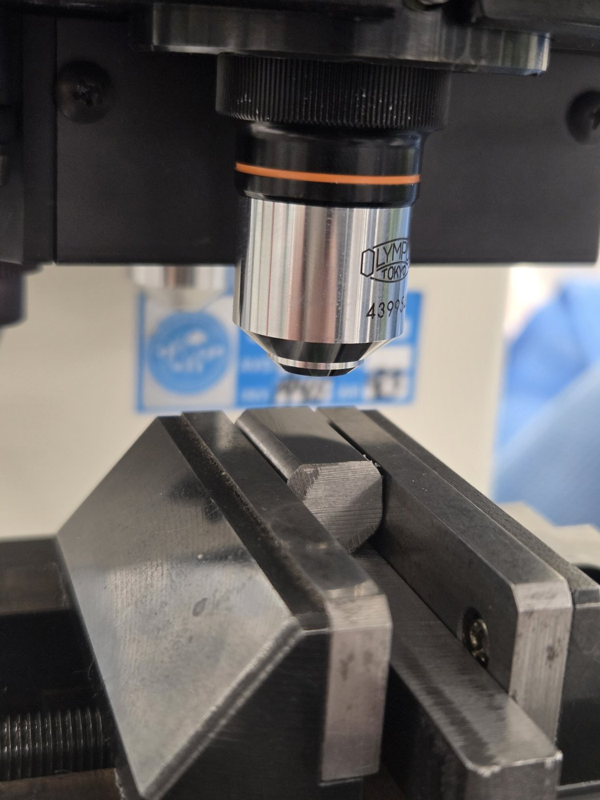

*Figure 9. A Sølvstål 2210 sample in the V-block holder (6), polished face up, under the orange-ring objective. This is how it should look before you focus.*

1. Lower the stage and take the reference block out. Put it back in its box.
2. Clean the sample surface with ethanol and tissue. Put one or two **support blocks** in the V-block holder (6) and place the sample on top, polished face up and level (Figure 9).
3. Check the **HV** lamp, **1 Kgf** on the load dial and the dwell time. These must be the same as for the block check.
4. Turn the turret to the **orange-ring objective**. Raise the stage slowly until the surface is sharp.
5. Choose a spot with the **X and Y micrometers**, at least 0.5 mm from the edge.
6. Turn the turret to the **diamond** (click). Raise the stage **very slowly** until the tip **almost touches** the surface (Figure 7).
7. Press **START**. Wait for the **LOADING** lamp to go off.
8. **Lower the stage** a few turns. Turn the turret to the **green-ring objective** and refocus.
9. Measure **d1**, press **READ**. Turn the measuring head 90°, measure **d2**, press **READ**. Read the HV value under **DATA**.
10. Write d1, d2 and HV in the results table.
11. Move the stage **one full turn (0.5 mm)** on the X micrometer for the next indent. Repeat steps 4–10.

**What a good indent looks like:** a sharp, dark square with straight edges and pointed corners. If the two diagonals differ by more than 5 %, the sample is probably not level. Re-seat it and make a new indent.

## 6. Results, troubleshooting and shutdown

**Check the display by hand.** The machine calculates HV from the mean diagonal d = (d1 + d2) / 2:

**HV = 1.8544 × F / d²**   (F in kgf, d in mm)

or, with F in newtons: **HV = 0.1891 × F / d²**

Example: d1 = 51.5 µm and d2 = 50.7 µm (measured on the HMV700 block) give d = 0.0511 mm. HV = 1.8544 × 1 / 0.0511² = 710 HV1. Check one of your own indents this way in your report.

**Results table**

| Sample | Indent | d1 (µm) | d2 (µm) | HV1 |
| --- | --- | --- | --- | --- |
| HMV700 block | 1 |  |  |  |
| HMV700 block | 2 |  |  |  |
| HMV700 block | 3 |  |  |  |
| Sample ___ | 1 |  |  |  |
| Sample ___ | 2 |  |  |  |
| Sample ___ | 3 |  |  |  |

Report results as, for example, **450 HV1** (mean of 3 indents, with the standard deviation).

**Troubleshooting**

| Problem | Likely cause | What to do |
| --- | --- | --- |
| View is dark | Flashlight off, flat or not pushed in, or shutter pin pulled out | Switch it on, push it fully in, or charge it. Push the shutter pin in |
| Cannot focus | Stage too low or too high | Lower the stage fully, then raise slowly while looking through the eyepiece |
| Indent corners blurry | Surface scratched or rough | Polish the sample again (1 µm or finer) |
| d1 and d2 differ a lot | Sample not level | Re-seat the sample flat in the holder |
| No indent visible | Diamond not brought close enough, turret not clicked, or wrong spot | Check the turret click, search around the spot with X/Y |
| HV far off on the block | Measured with the orange objective, wrong load, lines not zeroed, or HK selected | Measure with green, check 1 Kgf and the HV lamp, re-zero the lines |
| d1 is not 0 after zeroing | SET 2SEC released too early | Close the lines again and hold SET 2SEC a full 2 seconds |

**Shutdown**

- [ ] Turn the turret to the orange-ring objective and lower the stage.
- [ ] Remove your sample. Put the reference block back in its box.
- [ ] Take out the flashlight, switch it off and **put it on charge**.
- [ ] Flip the ON/OFF switch on the right side to OFF.
- [ ] Clean the stage and put the dust cover over the machine.
