# Matsuzawa MXT50 Vickers hardhetsmåler – Studentveiledning

TSM2370 Materialteknikk · USN Kongsberg · Oppdatert 10. nov. 2026

> **English version:** [README.md](README.md) · **PDF:** [guide-no.pdf](guide-no.pdf) · **Word:** [guide-no.docx](guide-no.docx) · **Hurtigkort (A4):** [norsk](quick-card-no.pdf), [engelsk](quick-card-en.pdf)

**Brukes i:** [TSM2370 Lab 2 – Thermal processing and quench severity](../../labs/tsm2370-materialteknikk/README.md#lab-2--thermal-processing-and-quench-severity)

Du skal måle Vickers-hardhet ved HV1 (1 kgf). Først kontrollerer du maskinen på referanseblokken, deretter tester du dine egne prøver. Ett inntrykk tar ca. 2 minutter når du kan rutinen.

## 1. Før du starter

**Maskinen:** Matsuzawa MXT50 digital mikrohardhetsmåler, serienr. MX2294, produsert desember 1992. Det finnes ikke lenger reservedeler, så vær forsiktig.

**Sikkerhet og forsiktighetsregler**

- **La aldri diamanten eller objektivet treffe prøven.** Diamantspissen er liten, sprø og dyr. Sjekk at ingenting på bordet er høyere enn prøveoverflaten før du dreier revolveren.
- **Trykk aldri START når revolveren står på et objektiv.** START kun når diamanten har klikket på plass over prøven.
- **Drei aldri revolveren mens LOADING-lampen lyser.** Vent til lampen er slukket og diamanten har løftet seg.
- **Hev bordet veldig sakte når du fører diamanten nær.** Se fra siden: spissen skal nesten berøre, men aldri berøre, prøven før START.
- **Ikke ta på diamanten eller linseglasset** med fingre eller klut.
- **Ikke vri på lasthjulet** mens en test pågår.

**Dette trenger du**

- Den polerte prøven din. Overflaten må være plan, parallell med undersiden og polert til minst 1 µm diamant. En ripete eller ru overflate gjør hjørnene på inntrykket umulige å se.
- **HMV700-referanseblokken** (svart eske merket *Standard Block for Hardness Test*, Yamamoto, Japan).
- Den **oppladbare lommelykten** som ligger ved maskinen. Den er lyskilden til mikroskopet. **Lad den etter bruk** slik at neste gruppe kan jobbe.
- Lofritt papir og etanol til å rengjøre prøveoverflaten.
- Resultattabellen bakerst i veiledningen.

**Støtteklosser:** legg én eller to av stålklossene som ligger ved maskinen i V-blokk-holderen, under prøven eller referanseblokken. De løfter den høyt nok til å få fokus.

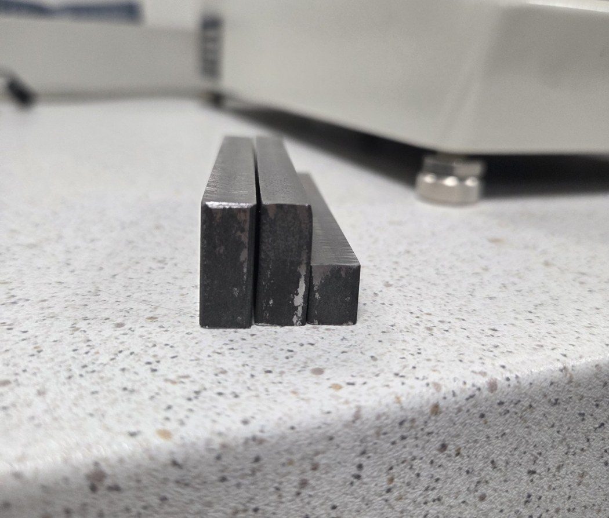

*Støtteklosser. Bruk én eller to under prøven eller referanseblokken.*

**Regler for prøven (ISO 6507-1)**

- Prøvetykkelsen må være minst 1,5 × diagonalen. Ved HV1 holder det med over 0,5 mm.
- Senter av inntrykket må være minst **2,5 × d** fra prøvekanten (stål).
- Senter av to inntrykk må være minst **3 × d** fra hverandre (stål).
- Ved HV1 er d 50–110 µm på stål, så hold **0,5 mm** mellom inntrykkene og fra kanten. Én hel omdreining på en mikrometerskrue = 0,5 mm.

## 2. Oversikt over maskinen

Numrene i tabellene stemmer med de nummererte merkene på bildene.

**Front og sider (figur 1 og 2)**

| Nr. | Del | Funksjon |
| --- | --- | --- |
| 1 | Okular (WF10X Micro) | Se gjennom her for å fokusere og måle. Inneholder to målelinjer. |
| 2 | Venstre målehjul (merket 0) | Flytter målelinjene sideveis i synsfeltet. |
| 3 | Høyre målehjul med **READ**-knapp | Vri (retning merket OPEN ▲) for å åpne eller lukke avstanden mellom linjene. Trykk READ for å lagre målt lengde. |
| 4 | Lysrør med lommelykt | Lommelykten skyves inn i dette røret og lyser opp prøven. |
| 5 | Revolver | Har **objektiv med oransje ring**, **objektiv med grønn ring** og **diamanten**. Drei for hånd til den klikker på plass. |
| 6 | Bord med V-blokk-holder | Holder prøven eller referanseblokken. |
| 7 | X-mikrometer | Flytter bordet høyre–venstre. 0,01 mm per strek, 0,5 mm per omdreining. |
| 8 | Y-mikrometer | Flytter bordet fram–tilbake. 0,01 mm per strek, 0,5 mm per omdreining. |
| 9 | Håndhjul for høyde | Hever og senker bordet for å fokusere. |
| 10 | Lastvelger | Stiller inn prøvelasten. Vri til **1 Kgf** står ved pinnen. |
| 11 | LIGHT-bryter | Lysstyrke på den innebygde lampen. Brukes ikke når lommelykten står i. |
| 12 | BACKUP-lampe | Indikator for minnebackup. Ingen handling nødvendig. |
| 13 | ON / OFF-bryter | Slår maskinen av og på. |

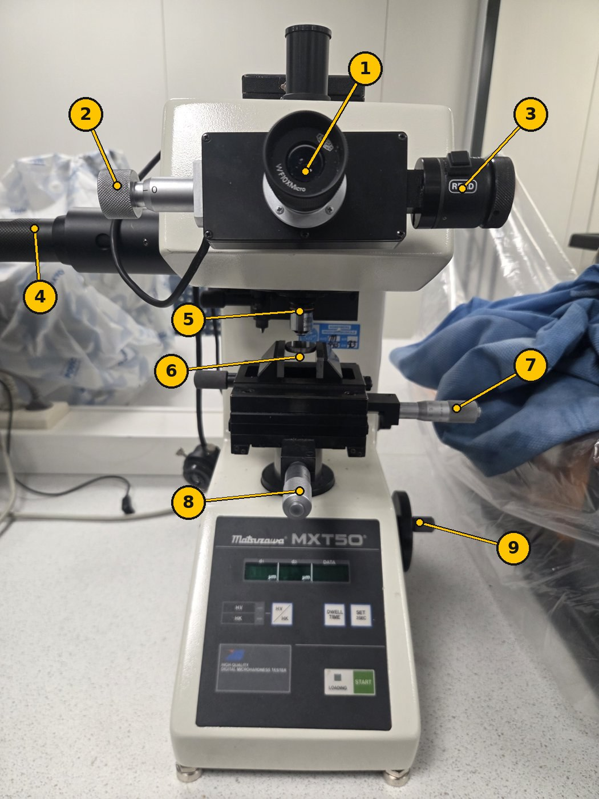

*Figur 1. Maskinen forfra.*

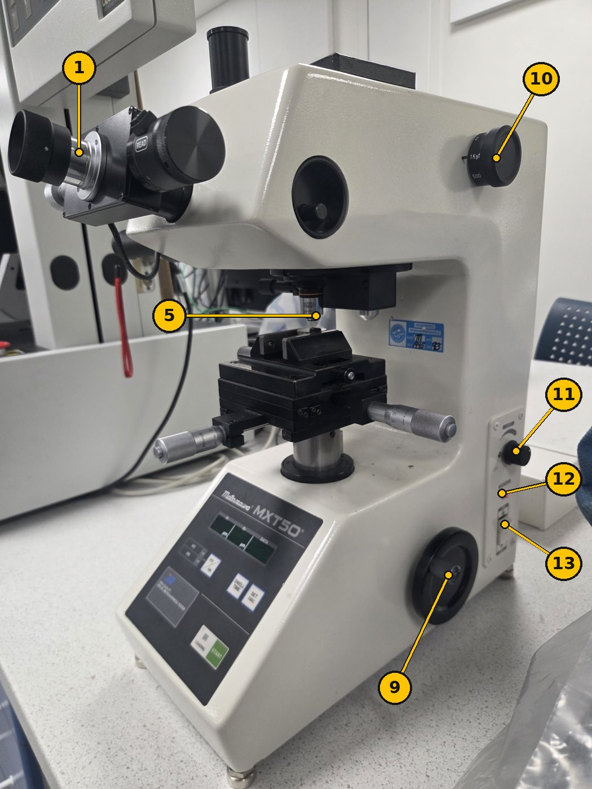

*Figur 2. Høyre side: lastvelger (10), sidepanel (11–13) og håndhjul (9).*

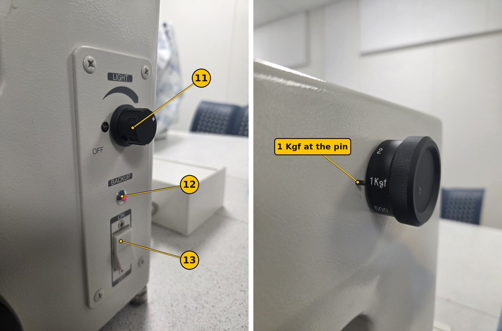

*Figur 2b. Sidepanelet (venstre) og lastvelgeren satt på 1 Kgf (høyre).*

**MAIN POWER**-bryteren sitter bak. La den stå på ON. Bruk bryter 13 på høyre side til daglig.

**Lukkerpinnen** sitter inne i den runde åpningen på høyre side av hodet. Den må være **skjøvet inn**. Er den trukket ut, blokkerer den synet i okularet.

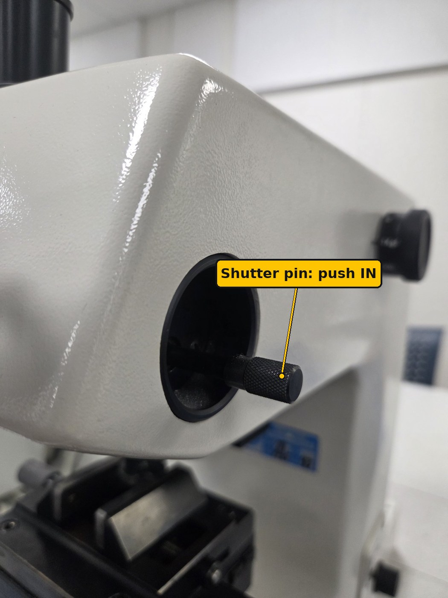

*Figur 2c. Lukkerpinnen. Skyv den inn før du ser i okularet.*

**Revolverposisjoner (figur 3)**

| Posisjon | Brukes til |
| --- | --- |
| Objektiv med oransje ring | Finne et sted og fokusere (bredt synsfelt). Ikke mål med det: avlesningen viser da bare ca. 1/4 av riktig lengde. |
| Objektiv med grønn ring | Måle inntrykket (større forstørrelse). Den digitale avlesningen er satt opp for dette objektivet. Juster fokus litt etter byttet. |
| Diamant | Lage inntrykket. Trykk START kun i denne posisjonen. |

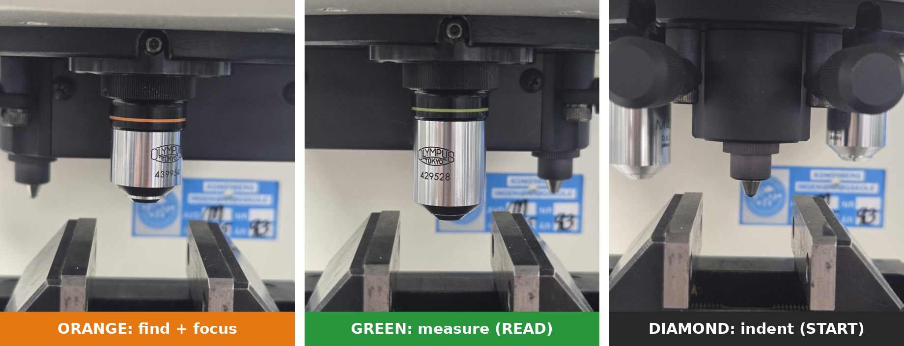

*Figur 3. De tre revolverposisjonene: finn og fokuser med oransje, lag inntrykk med diamanten, mål med grønt. Drei revolveren for hånd til den klikker.*

**Kontrollpanel (figur 4)**

| Kontroll | Funksjon |
| --- | --- |
| Display **d1** (µm) | Første diagonal, etter første trykk på READ. |
| Display **d2** (µm) | Andre diagonal, etter andre trykk på READ. |
| Display **DATA** | Beregnet hardhetsverdi. |
| **HV / HK**-knapp og lamper | Bytter mellom Vickers (HV) og Knoop (HK). **HV**-lampen må lyse grønt. |
| **DWELL TIME**-knapp | Stiller inn hvor lenge full last holdes. Hvert trykk går til neste verdi på displayet. |
| **SET 2SEC**-knapp | Hold inne i 2 sekunder for å bekrefte en innstilling eller nullstille målelinjene. |
| **START**-knapp | Starter inntrykket: last på, hold i valgt tid, last av. |
| **LOADING**-lampe | Lyser mens diamanten belaster prøven. Ikke rør noe mens den lyser. |

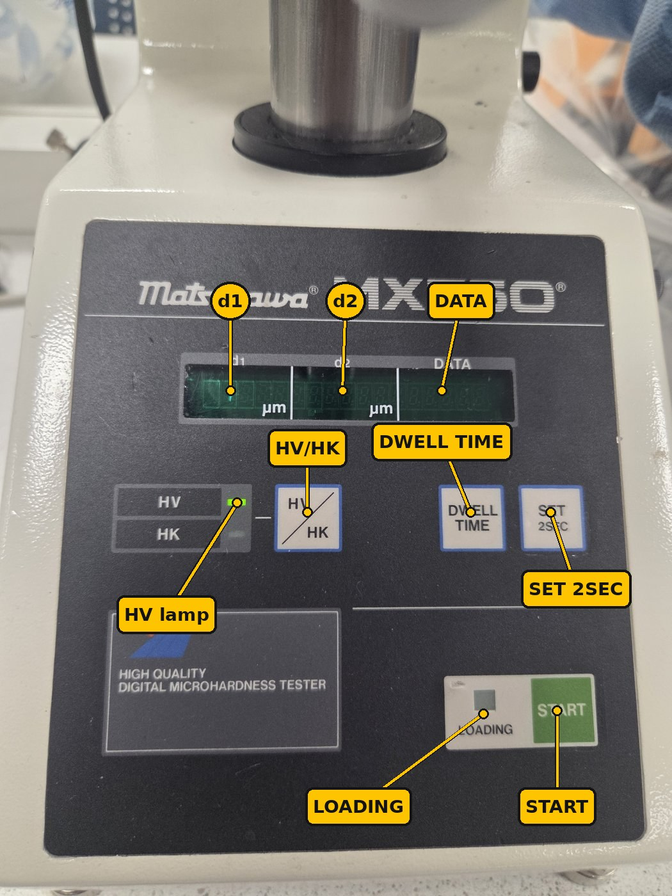

*Figur 4. Kontrollpanelet. HV-lampen lyser grønt.*

## 3. Oppstart

1. **Slå på.** Sett **ON/OFF-bryteren (13)** på høyre side til ON. Displayet lyser grønt. Skjer det ingenting, sjekk at MAIN POWER bak står på ON.
2. **Sett inn lyset.** Slå på den oppladede lommelykten og skyv den helt inn i **lysrøret (4)** på venstre side. Sjekk deretter at lukkerpinnen på høyre side av hodet er skjøvet inn (figur 2c).
3. **Velg Vickers.** Sjekk at **HV**-lampen lyser. Lyser HK, trykk **HV / HK** én gang.
4. **Still inn lasten.** Vri **lastvelgeren (10)** til **1 Kgf** står ved pinnen. Resultatene oppgis da som **HV1**.
5. **Still inn holdetiden.** Trykk **DWELL TIME** til displayet viser **15** sekunder. Hold deretter **SET 2SEC** inne i 2 sekunder for å lagre. ISO 6507-1 krever 10–15 s.
6. **Senk bordet.** Bruk **håndhjulet (9)** til å senke bordet slik at det er plass til blokken uten å treffe revolveren.

## 4. Kontroller maskinen på referanseblokken

Lag 3 inntrykk i HMV700-blokken. Er snittet innenfor ±5 % av 700 HV (665–735 HV), er maskinen OK og du kan teste prøvene dine. Dette er en daglig kontroll (indirekte verifisering, ISO 6507-1 vedlegg), ikke en full kalibrering.

**A. Nullstill målelinjene** (én gang per økt)

1. Se gjennom **okularet (1)**. Du ser to loddrette linjer.
2. Vri **høyre målehjul (3)** for å lukke linjene til de nesten møtes. Stopp når det bare er en **veldig tynn lysspalte** igjen mellom dem.
3. Hold **SET 2SEC** inne i 2 sekunder. **d1**-displayet skal nå vise **0**.

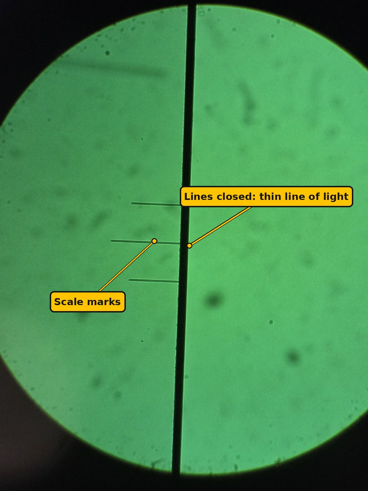

*Figur 5. Linjene lukket for nullstilling: de to linjene danner ett mørkt bånd med bare en tynn lysstripe igjen.*

**B. Fokuser på blokken**

1. Legg én eller to **støtteklosser** i V-blokk-holderen (6). Legg referanseblokken oppå, polert side opp. Ikke ta på den polerte flaten.
2. Drei revolveren til **objektivet med oransje ring** til den klikker.
3. Se gjennom okularet. Hev bordet sakte med **håndhjulet (9)** til overflaten er skarp. Hev sakte: objektivet må aldri treffe blokken.
4. Bruk **X- og Y-mikrometrene (7, 8)** til å finne et rent sted minst 0,5 mm fra kanten og fra gamle inntrykk.

Blokken har allerede mange gamle inntrykk. Finn et rent område mellom dem før du lager inntrykk.

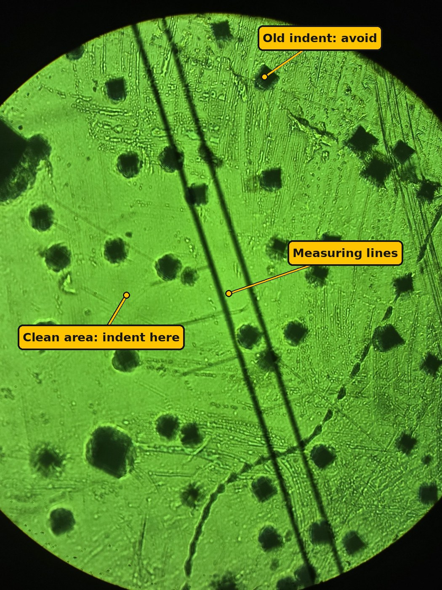

*Figur 6. Referanseblokken gjennom okularet. De mørke firkantene er gamle inntrykk. Velg et rent område minst 0,5 mm fra dem.*

**C. Lag inntrykket**

1. Drei revolveren til **diamanten** til den klikker.
2. **Før spissen nær.** Se fra siden i øyehøyde. Hev bordet **veldig sakte** med håndhjulet til spissen **nesten berører** overflaten: spissen og speilbildet i den polerte flaten møtes nesten (figur 7). Den må **ikke** berøre.
3. Trykk **START**. **LOADING**-lampen lyser. Ikke rør maskinen eller bordet.
4. Vent til LOADING-lampen slukker (ca. 25 s med 15 s holdetid).
5. **Senk bordet** noen omdreininger med håndhjulet. Objektivene går lenger ned enn diamantspissen, så de ville truffet prøven hvis du dreide revolveren uten å senke.
6. Drei revolveren til **objektivet med grønn ring** (måleobjektivet). Hev bordet sakte igjen til inntrykket er skarpt.

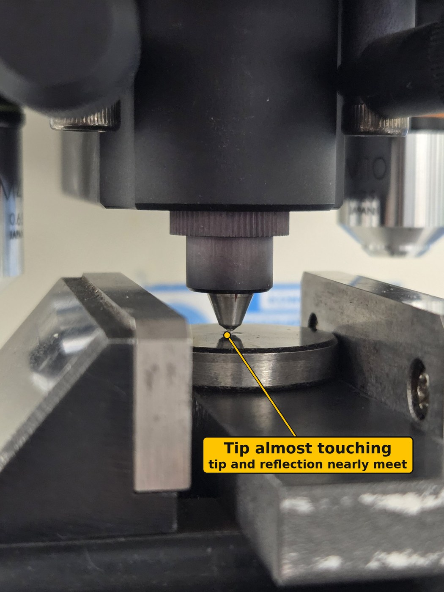

*Figur 7. Diamanten ført nær før START: spissen og speilbildet møtes nesten, med en bitte liten spalte mellom.*

**D. Mål inntrykket**

1. Se gjennom okularet. Du ser en mørk firkant (rombe). Juster fokus litt med håndhjulet hvis hjørnene ikke er skarpe. Mål alltid med objektivet med grønn ring.
2. **Diagonal 1:** Bruk **venstre hjul (2)** til å sette én linje på venstre hjørne. Bruk **høyre hjul (3)** til å flytte den andre linjen til høyre hjørne. Linjene skal så vidt berøre spissene.
3. Trykk **READ**. Lengden vises under **d1**.
4. **Diagonal 2:** Drei målehodet på okularet 90° slik at linjene blir vannrette. Ramme inn øvre og nedre hjørne på samme måte.
5. Trykk **READ** igjen. Lengden vises under **d2**, og hardheten vises under **DATA**.
6. Skriv d1, d2 og HV i resultattabellen.

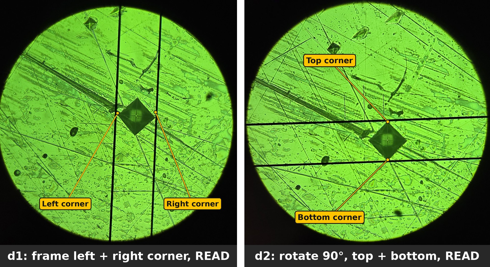

*Figur 8. Måling av et inntrykk på HMV700-blokken med det grønne objektivet. Venstre: d1, linjene på venstre og høyre hjørne. Høyre: d2, okularet dreid 90° og linjene på øvre og nedre hjørne. Resultat: d1 = 51,5 µm, d2 = 50,7 µm, 710 HV1.*

**E. Godkjenn eller forkast**

1. Gjenta B–D for 3 inntrykk, 0,5 mm fra hverandre.
2. Regn ut snitt-HV for de 3 inntrykkene.
3. Snitt mellom 665 og 735 HV: maskinen er OK. Gå videre til del 5.
4. Utenfor 665–735 HV: nullstill linjene igjen (A), sjekk lastvelger og holdetid, og mål på nytt. Fortsatt utenfor: **stopp og si fra til labansvarlig.**

For en HMV700-blokk ved HV1 skal hver diagonal være ca. **51 µm**. Leser du noe helt annet (f.eks. 25 µm eller 100 µm), sjekk lastvelgeren. Leser du ca. 13 µm, måler du med det oransje objektivet: bytt til grønt.

## 5. Test prøven din

Rutinen er den samme som på blokken: fokuser, lag inntrykk, mål. Lag **minst 3 inntrykk per prøve** og oppgi snittet.

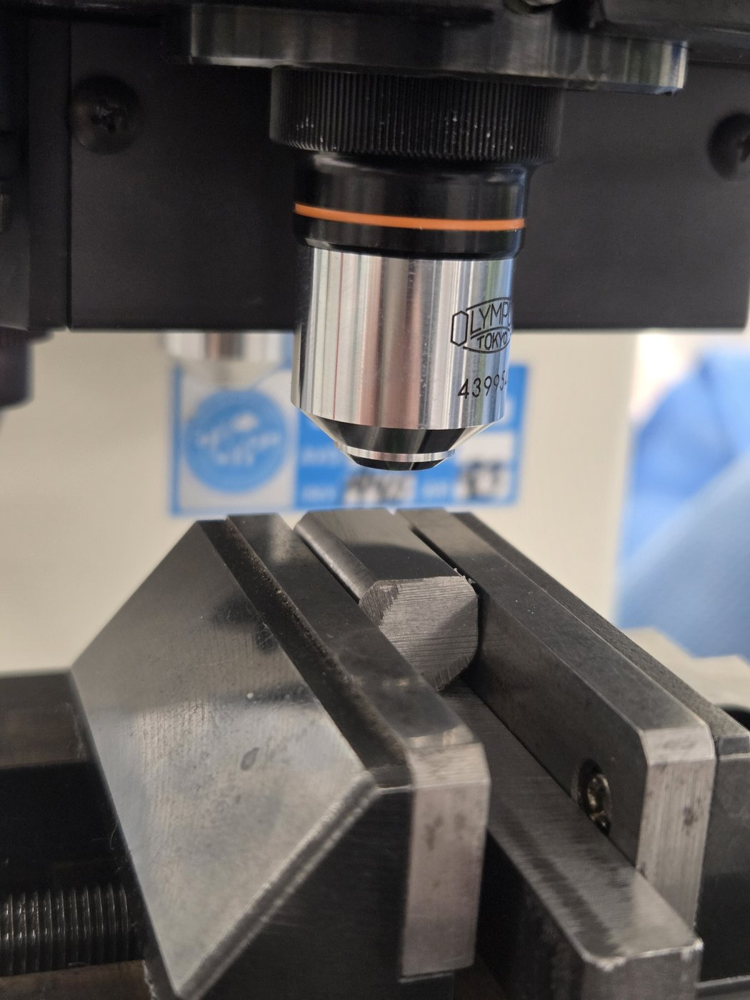

*Figur 9. En prøve av Sølvstål 2210 i V-blokk-holderen (6), polert side opp, under objektivet med oransje ring. Slik skal det se ut før du fokuserer.*

1. Senk bordet og ta ut referanseblokken. Legg den tilbake i esken.
2. Rengjør prøveoverflaten med etanol og papir. Legg én eller to **støtteklosser** i V-blokk-holderen (6) og prøven oppå, polert side opp og i vater (figur 9).
3. Sjekk **HV**-lampen, **1 Kgf** på lastvelgeren og holdetiden. Disse må være de samme som ved blokkontrollen.
4. Drei revolveren til **objektivet med oransje ring**. Hev bordet sakte til overflaten er skarp.
5. Velg et sted med **X- og Y-mikrometrene**, minst 0,5 mm fra kanten.
6. Drei revolveren til **diamanten** (klikk). Hev bordet **veldig sakte** til spissen **nesten berører** overflaten (figur 7).
7. Trykk **START**. Vent til **LOADING**-lampen slukker.
8. **Senk bordet** noen omdreininger. Drei til **objektivet med grønn ring** og fokuser.
9. Mål **d1**, trykk **READ**. Drei målehodet 90°, mål **d2**, trykk **READ**. Les HV-verdien under **DATA**.
10. Skriv d1, d2 og HV i resultattabellen.
11. Flytt bordet **én hel omdreining (0,5 mm)** på X-mikrometeret til neste inntrykk. Gjenta trinn 4–10.

**Slik ser et godt inntrykk ut:** en skarp, mørk firkant med rette kanter og spisse hjørner. Er de to diagonalene mer enn 5 % forskjellige, ligger prøven trolig ikke i vater. Legg den på plass igjen og lag et nytt inntrykk.

## 6. Resultater, feilsøking og avslutning

**Kontroller displayet for hånd.** Maskinen regner ut HV fra middeldiagonalen d = (d1 + d2) / 2:

**HV = 1,8544 × F / d²**   (F i kgf, d i mm)

eller, med F i newton: **HV = 0,1891 × F / d²**

Eksempel: d1 = 51,5 µm og d2 = 50,7 µm (målt på HMV700-blokken) gir d = 0,0511 mm. HV = 1,8544 × 1 / 0,0511² = 710 HV1. Kontroller ett av dine egne inntrykk på denne måten i rapporten.

**Resultattabell**

| Prøve | Inntrykk | d1 (µm) | d2 (µm) | HV1 |
| --- | --- | --- | --- | --- |
| HMV700-blokk | 1 |  |  |  |
| HMV700-blokk | 2 |  |  |  |
| HMV700-blokk | 3 |  |  |  |
| Prøve ___ | 1 |  |  |  |
| Prøve ___ | 2 |  |  |  |
| Prøve ___ | 3 |  |  |  |

Oppgi resultatet for eksempel som **450 HV1** (snitt av 3 inntrykk, med standardavvik).

**Feilsøking**

| Problem | Sannsynlig årsak | Tiltak |
| --- | --- | --- |
| Mørkt bilde | Lommelykten er av, tom eller ikke skjøvet inn, eller lukkerpinnen er trukket ut | Slå den på, skyv den helt inn eller lad den. Skyv lukkerpinnen inn |
| Får ikke fokus | Bordet står for lavt eller for høyt | Senk bordet helt, hev så sakte mens du ser i okularet |
| Uskarpe hjørner | Ripete eller ru overflate | Poler prøven på nytt (1 µm eller finere) |
| d1 og d2 er svært ulike | Prøven ligger ikke i vater | Legg prøven plant i holderen |
| Ser ikke inntrykket | Diamanten ikke nær nok, revolveren ikke klikket, eller feil sted | Sjekk klikket, søk rundt stedet med X/Y |
| HV langt unna på blokken | Målt med oransje objektiv, feil last, linjene ikke nullstilt, eller HK valgt | Mål med grønt, sjekk 1 Kgf og HV-lampen, nullstill linjene |
| d1 viser ikke 0 etter nullstilling | SET 2SEC sluppet for tidlig | Lukk linjene igjen og hold SET 2SEC i hele 2 sekunder |

**Avslutning**

- [ ] Drei revolveren til objektivet med oransje ring og senk bordet.
- [ ] Ta ut prøven. Legg referanseblokken tilbake i esken.
- [ ] Ta ut lommelykten, slå den av og **sett den til lading**.
- [ ] Sett ON/OFF-bryteren på høyre side til OFF.
- [ ] Rengjør bordet og legg støvtrekket over maskinen.
