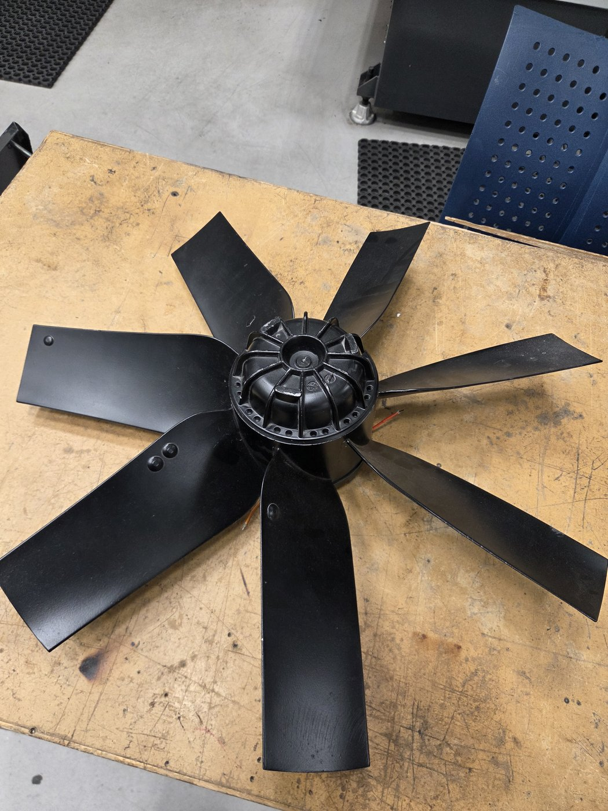
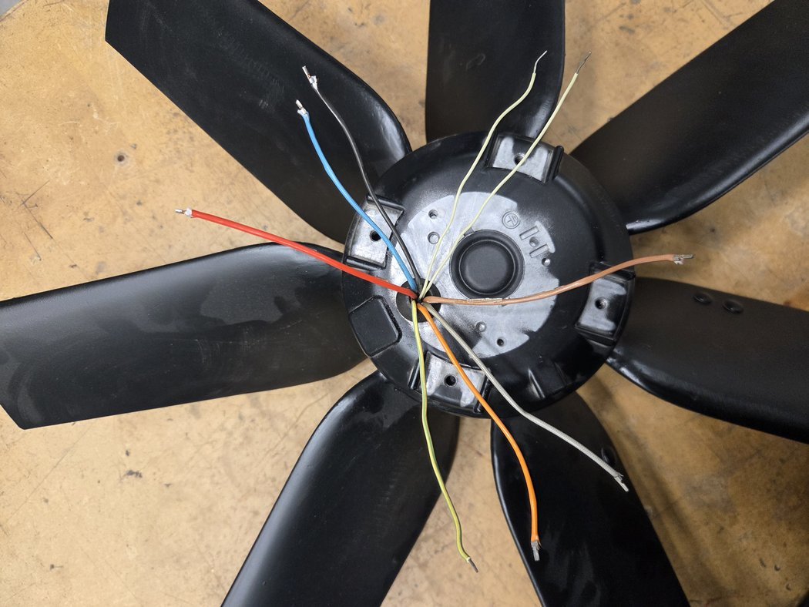
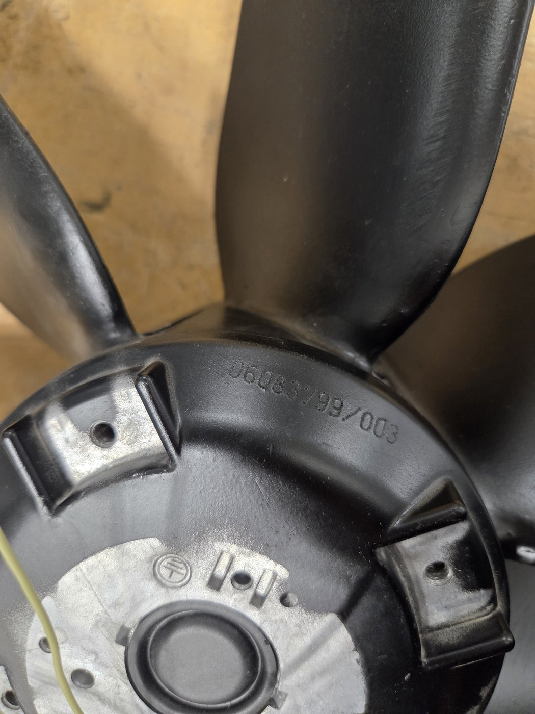
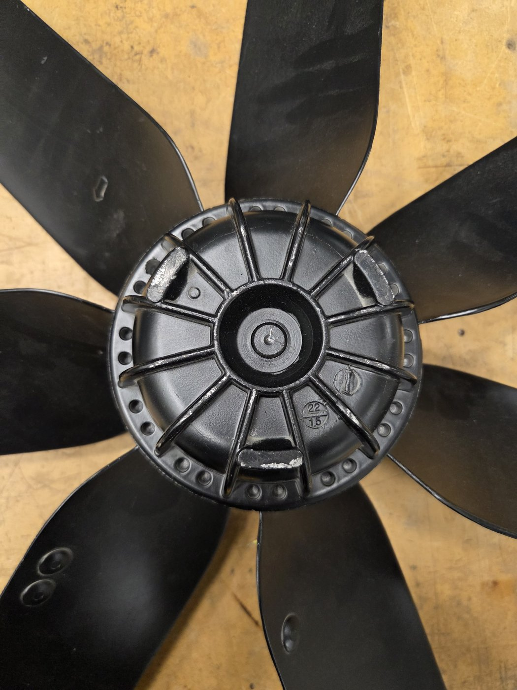
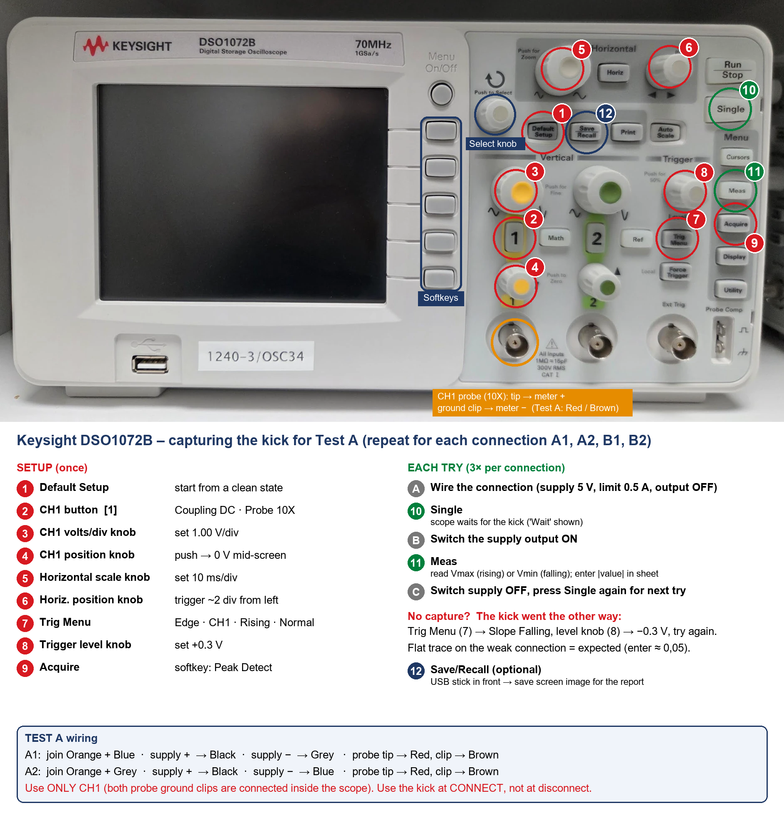
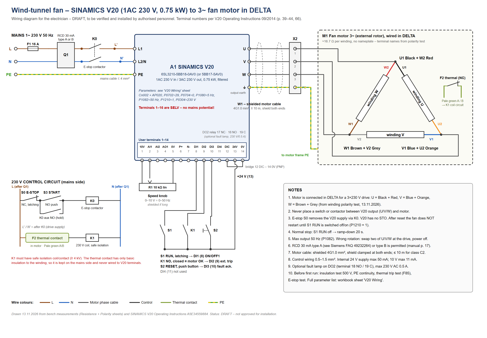

# Wind-tunnel fan – motor identification and V20 drive wiring

Other lab equipment · USN Kongsberg · Updated 13 November 2026

> **Norsk versjon:** [README.no.md](README.no.md) · **Measurement workbook:** [fan-motor-measurements.xlsx](fan-motor-measurements.xlsx) · **Wiring diagram:** [PDF (A3)](wiring-diagram-v20.pdf), [PNG](wiring-diagram-v20.png), [SVG (editable)](wiring-diagram-v20.svg)

**Status:** in progress. The motor has been identified and the drive wiring is drawn, but nothing has been connected to mains yet. The wiring diagram is a **draft** that must be checked and approved by authorised personnel before installation.

This page documents the axial fan from the old wind tunnel, which is being reused in a new small wind tunnel. The fan had no nameplate and nine unmarked leads. The measurements below show what kind of motor it is, which lead is which, and how to run it from a Siemens SINAMICS V20 frequency converter with a speed knob.

## 1. Before you start

**Safety rules**

- **Never connect the motor to mains** to "see what happens". Every test on this page is done with the motor disconnected and only a current-limited DC supply (max 0.5 A).
- Clamp the fan before spinning it by hand, and keep hands and cables clear of the blades.
- Mains wiring (drive supply, E-stop, thermal relay) is done **only by authorised personnel**.
- Do not run the fan above **50 Hz**. The blades and bearings are not rated for higher speed.

**What you need for the measurements**

- Multimeter (resistance, DC volts)
- Lab DC power supply with current limit
- Oscilloscope (we used a Keysight DSO1072B) and a 10X probe
- The measurement workbook: [fan-motor-measurements.xlsx](fan-motor-measurements.xlsx)

## 2. The fan

*Figure 1. The fan on the bench. The blades are fixed to the outer rotor (external-rotor motor).*

| Item | Value |
| --- | --- |
| Type | Axial fan with external-rotor motor, 6 blades |
| Marking | 06083799/003 (no other nameplate found) |
| Casting date stamp | 22/15 (probably week 22, 2015) |
| Leads | 9: black, blue, red, orange, grey (braided), brown (braided), 2 × pale green (thin), green/yellow |

*Figure 2. The nine leads coming out of the stator flange.*

*Figure 3. The only marking on the motor: 06083799/003.*

*Figure 4. Rotor hub with the date stamp 22/15.*

## 3. What the motor is (resistance test)

All 45 lead pairs were measured with a multimeter, with the motor disconnected. Sheet **Resistance** in the workbook.

| Leads | Resistance | Meaning |
| --- | --- | --- |
| Black – Orange | 16.3 Ω | Winding 1 |
| Blue – Grey | 16.5 Ω | Winding 2 |
| Red – Brown | 17.2 Ω | Winding 3 |
| Pale green A – B | 0.3 Ω, isolated from everything else | Thermal contact (opens when the motor overheats) |
| Green/yellow – frame | 0.3 Ω | Protective earth (PE) |
| Any winding – frame | open (OL) | Insulation OK at multimeter level |

All other pairs read open. The rotor turns smoothly by hand with no magnetic "notches" (cogging).

**Result:** a **three-phase induction motor with all six winding ends brought out**, about 16.7 Ω per winding (balanced within 5.4 %), plus a thermal contact. It can be run from a frequency converter, which gives smooth speed control.

## 4. Which end is which (polarity test)

For star or delta wiring, all three windings must point the same way. The start and end of each winding were found with a DC "kick" test (sheet **Polarity**):

1. Two windings are connected in series and a 5 V DC supply (current limit 0.5 A) is switched on.
2. The oscilloscope records the voltage induced in the third winding, 20–40 ms after switch-on.
3. If the two windings point the same way, the third winding gets a large kick (about 5 V). If they point opposite ways, it gets almost nothing.

This compares sizes, not signs, so the result does not depend on how the probe is connected.

*Figure 5. Oscilloscope settings and wiring for the kick test.*

| Test | Connection | Level 20–40 ms (average) | Ratio |
| --- | --- | --- | --- |
| A1 | Orange + Blue joined | 5.1 V | 10.7 → clear |
| A2 | Orange + Grey joined | 0.48 V | |
| B1 | Orange + Red joined | 0.07 V | 78 → clear |
| B2 | Orange + Brown joined | 5.75 V | |

**Terminal names**

| Terminal | Lead |
| --- | --- |
| U1 / U2 | Black / Orange |
| V1 / V2 | Blue / Grey |
| W1 / W2 | Brown / Red |

**Tips from the measurements**

- Use **5 V/div** on the oscilloscope. At 1 V/div the signal clips and every peak looks the same.
- Do **not** read the peak (Vmax). Switch-on bounce gives spikes of ±9 V on every test. Read the level 20–40 ms after switch-on instead.
- Switch on with the power supply's output button, not by clipping on a lead.
- Save each capture as CSV and check that the file is not 0 bytes before you leave the lab.

## 5. Drive and wiring

The motor is connected in **delta** to a **Siemens SINAMICS V20, 1AC 230 V in / 3AC 230 V out, 0.75 kW, filtered** (6SL3210-5BB18-0AV0 or 5BB17-5AV0). In delta, each winding gets at most 230 V. That is safe whether the windings are rated 230 V or 400 V.

*Figure 6. Wiring diagram (draft). Download the [A3 PDF](wiring-diagram-v20.pdf) for printing.*

| V20 output | Motor leads |
| --- | --- |
| U | Black + Red |
| V | Blue + Orange |
| W | Brown + Grey |
| Output earth | Green/yellow |

**Control terminals (connection macro Cn002, PNP, internal 24 V)**

| Terminal | Connected to | Function |
| --- | --- | --- |
| 1 (10V), 2 (AI1), 5 (0V) | Speed knob, 10 kΩ linear | 0–10 V = 0–50 Hz |
| 8 (DI1) | RUN switch, latching | Start / stop with ramp |
| 9 (DI2) | Contact of relay K1 (closed = motor OK) | External trip, fault F85 (P0702 = 29) |
| 10 (DI3) | RESET push button | Fault acknowledge |
| 12 (DIC) – 14 (0V) | Bridge | PNP mode |
| 13 (24V) | Common for the switches | Internal 24 V |

The **thermal contact** is wired through relay K1 on the 230 V side, because it sits inside the winding with only basic insulation. The **E-stop** removes the drive supply through contactor K0. The V20 has no built-in safety stop (STO).

**Key parameters.** The full list, in order, is on sheet **V20 Wiring** in the workbook.

| Parameter | Value | Why |
| --- | --- | --- |
| Application macro | AP020 (fan) | Quadratic V/f curve, reverse inhibited |
| P0304 | 230 V | Delta on 3 × 230 V |
| P0702 / P0704 | 29 / 0 | DI2 = thermal trip, DI4 off |
| P1080 | 5 Hz | AP020 sets 20 Hz, which is too high for low tunnel speeds |
| P1082 | 50 Hz | Never faster than the design speed |
| P1210 | 1 | AP020 sets 2, which restarts the fan by itself after a power cut or E-stop |
| P0305, P0307, P0311 | 2.0 A, 0.55 kW, 1400 rpm | **Estimates** – correct after the first run |

## 6. Next steps and open questions

- [ ] Insulation test with a megger at 500 V
- [ ] Electrician checks and approves the wiring diagram (E-stop circuit, relay K1)
- [ ] First run at low frequency: check rotation direction, current (r0027) and motor temperature
- [ ] Update the estimated motor data (current, power, speed) in the drive and on this page
- [ ] Measure the air speed in the tunnel against drive frequency

**Files on this page**

| File | Contents |
| --- | --- |
| [fan-motor-measurements.xlsx](fan-motor-measurements.xlsx) | Guide, resistance matrix, spin and DC test, polarity test, V20 wiring and parameters |
| [wiring-diagram-v20.pdf](wiring-diagram-v20.pdf) / [.png](wiring-diagram-v20.png) / [.svg](wiring-diagram-v20.svg) | Wiring diagram for the electrician (draft) |

Source for terminal numbers and parameters: *SINAMICS V20 Inverter Operating Instructions*, 09/2014, A5E34559884 (Siemens). Page numbers are given in the workbook.
