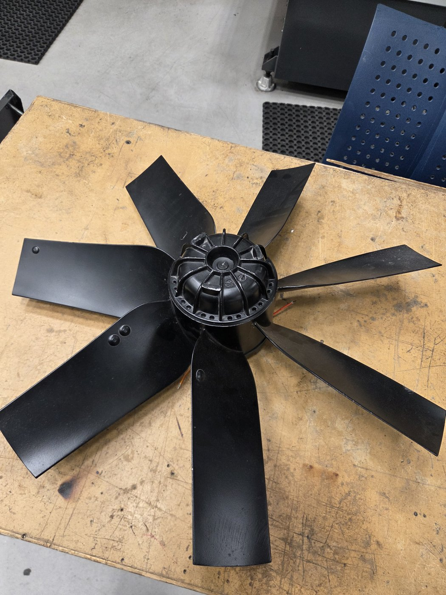
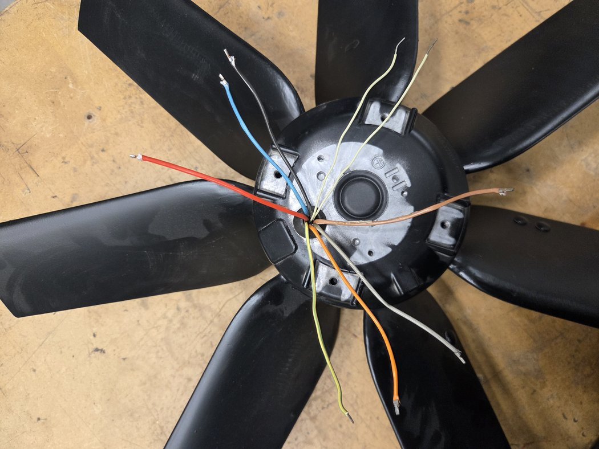
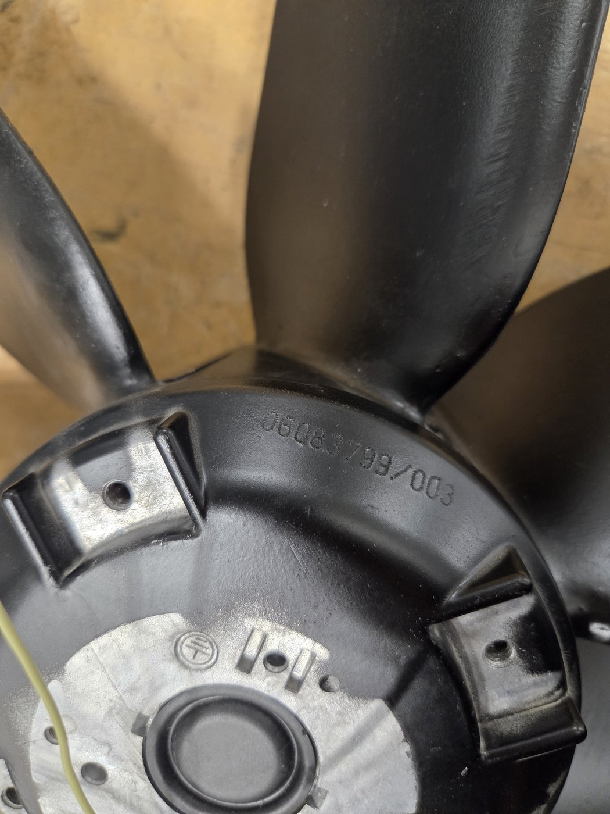
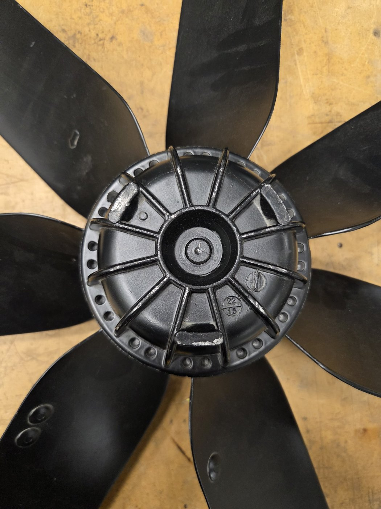
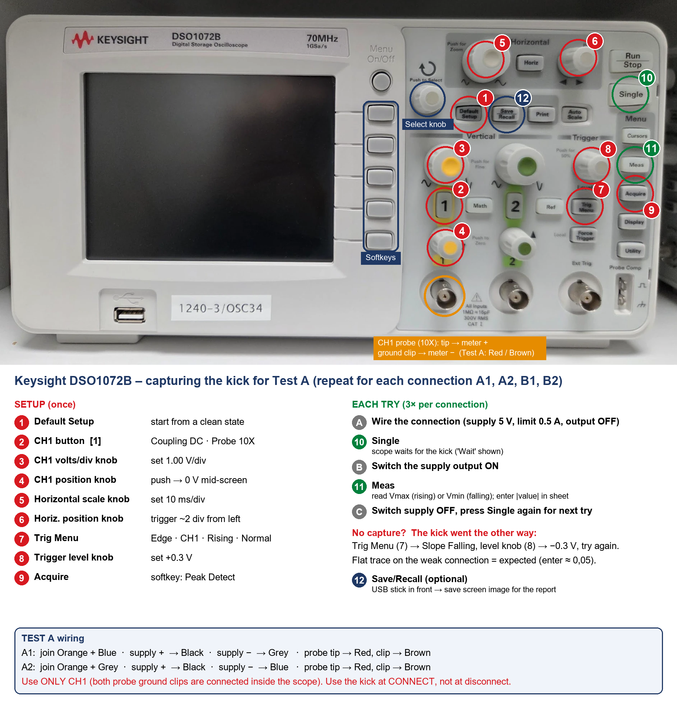
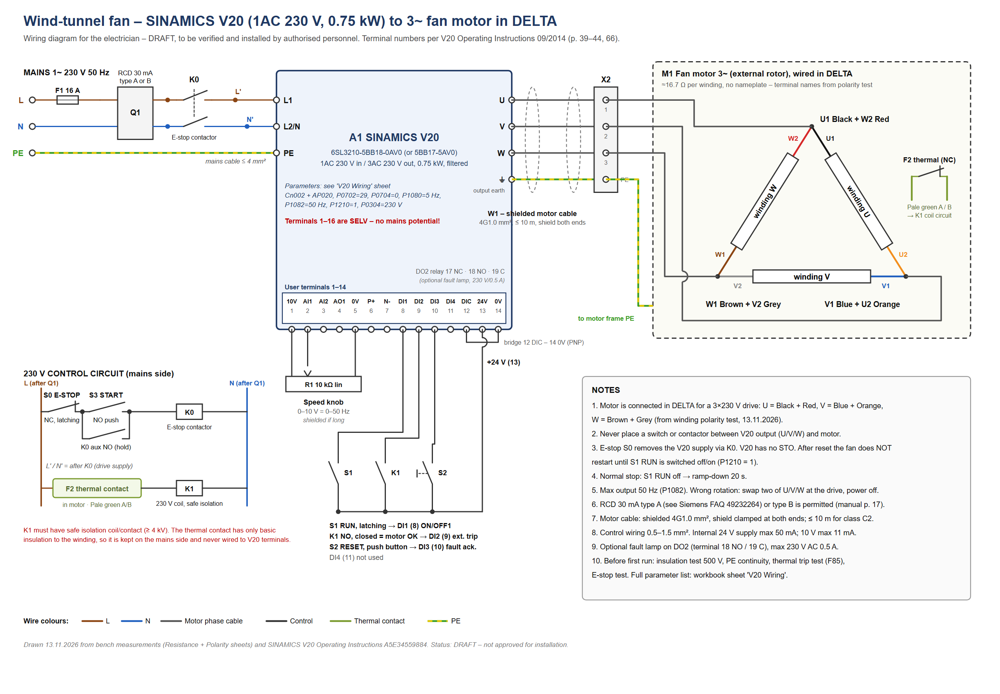

# Vindtunnelvifte – identifisering av motoren og kobling til V20

Annet labutstyr · USN Kongsberg · Oppdatert 13. november 2026

> **English version:** [README.md](README.md) · **Måleark:** [fan-motor-measurements.xlsx](fan-motor-measurements.xlsx) (på engelsk) · **Koblingsskjema:** [PDF (A3)](wiring-diagram-v20.pdf), [PNG](wiring-diagram-v20.png), [SVG (redigerbar)](wiring-diagram-v20.svg) · **Hurtigkort (A4):** [NO](quick-card-no.pdf), [EN](quick-card-en.pdf)

**Status:** under arbeid. Motoren er identifisert og koblingen til frekvensomformeren er tegnet, men ingenting er koblet til nettspenning ennå. Koblingsskjemaet er et **utkast**. Det må kontrolleres og godkjennes av autorisert personell før installasjon.

Denne siden dokumenterer aksialviften fra den gamle vindtunnelen, som skal brukes i en ny, liten vindtunnel. Viften hadde ikke typeskilt og ni umerkede ledninger. Målingene under viser hva slags motor det er, hvilken ledning som er hva, og hvordan den kan kjøres fra en Siemens SINAMICS V20 frekvensomformer med en turtallsknapp.

## 1. Før du begynner

**Sikkerhetsregler**

- **Koble aldri motoren til nettspenning** for å «se hva som skjer». Alle målinger på denne siden gjøres med motoren frakoblet og bare med en DC-forsyning med strømbegrensning (maks 0,5 A).
- Spenn fast viften før du snurrer den for hånd, og hold hender og kabler unna bladene.
- Nettsiden (forsyning til omformeren, nødstopp, termorelé) kobles **bare av autorisert personell**.
- Kjør aldri viften over **50 Hz**. Bladene og lagrene er ikke laget for høyere turtall.

**Det du trenger til målingene**

- Multimeter (motstand, DC-spenning)
- DC-labforsyning med strømbegrensning
- Oscilloskop (vi brukte Keysight DSO1072B) og en 10X-probe
- Målearket: [fan-motor-measurements.xlsx](fan-motor-measurements.xlsx)

## 2. Viften

*Figur 1. Viften på arbeidsbenken. Bladene sitter på den utvendige rotoren (motor med ytre rotor).*

| Punkt | Verdi |
| --- | --- |
| Type | Aksialvifte med ytre rotor, 6 blader |
| Merking | 06083799/003 (fant ikke noe annet typeskilt) |
| Datostempel i støpegodset | 22/15 (trolig uke 22, 2015) |
| Ledninger | 9: svart, blå, rød, oransje, grå (flettet), brun (flettet), 2 × lysegrønn (tynne), gul/grønn |

*Figur 2. De ni ledningene ut av statorflensen.*

*Figur 3. Den eneste merkingen på motoren: 06083799/003.*

*Figur 4. Rotornavet med datostempelet 22/15.*

## 3. Hva slags motor (motstandsmåling)

Alle 45 ledningspar ble målt med multimeter, med motoren frakoblet. Se arket **Resistance** i målearket.

| Ledninger | Motstand | Betydning |
| --- | --- | --- |
| Svart – oransje | 16,3 Ω | Vikling 1 |
| Blå – grå | 16,5 Ω | Vikling 2 |
| Rød – brun | 17,2 Ω | Vikling 3 |
| Lysegrønn A – B | 0,3 Ω, isolert fra alt annet | Termokontakt (åpner når motoren blir for varm) |
| Gul/grønn – ramme | 0,3 Ω | Jord (PE) |
| Alle viklinger – ramme | åpen (OL) | Isolasjonen er i orden på multimeternivå |

Alle andre par viste åpen krets. Rotoren går lett rundt for hånd uten magnetiske «hakk» (cogging).

**Resultat:** en **trefase asynkronmotor med alle seks viklingsender ført ut**, ca. 16,7 Ω per vikling (innenfor 5,4 % av hverandre), pluss en termokontakt. Den kan kjøres fra en frekvensomformer, som gir trinnløs turtallsregulering.

## 4. Hvilken ende er hvilken (polaritetstest)

For stjerne- eller trekantkobling må alle tre viklingene vende samme vei. Start og slutt på hver vikling ble funnet med en DC-«kick»-test (arket **Polarity**):

1. To viklinger kobles i serie, og en 5 V DC-forsyning (strømbegrensning 0,5 A) slås på.
2. Oscilloskopet måler spenningen som induseres i den tredje viklingen, 20–40 ms etter innkobling.
3. Hvis de to viklingene vender samme vei, får den tredje et kraftig utslag (ca. 5 V). Hvis de vender motsatt, blir det nesten ingenting.

Metoden sammenligner størrelser, ikke fortegn, så resultatet avhenger ikke av hvordan proben er koblet.

*Figur 5. Oscilloskopinnstillinger og kobling for kick-testen (på engelsk).*

| Test | Kobling | Nivå 20–40 ms (snitt) | Forhold |
| --- | --- | --- | --- |
| A1 | Oransje + blå sammen | 5,1 V | 10,7 → tydelig |
| A2 | Oransje + grå sammen | 0,48 V | |
| B1 | Oransje + rød sammen | 0,07 V | 78 → tydelig |
| B2 | Oransje + brun sammen | 5,75 V | |

**Navn på tilkoblingene**

| Tilkobling | Ledning |
| --- | --- |
| U1 / U2 | Svart / oransje |
| V1 / V2 | Blå / grå |
| W1 / W2 | Brun / rød |

**Tips fra målingene**

- Bruk **5 V/div** på oscilloskopet. Med 1 V/div klippes signalet, og alle toppene ser like ut.
- Les **ikke** av toppverdien (Vmax). Prell ved innkobling gir spisser på ±9 V i alle testene. Les heller av nivået 20–40 ms etter innkobling.
- Slå på med utgangsknappen på forsyningen, ikke ved å klipse på en ledning.
- Lagre hver måling som CSV, og sjekk at filen ikke er 0 byte før du forlater laben.

## 5. Omformer og kobling

Motoren kobles i **trekant** til en **Siemens SINAMICS V20, 1AC 230 V inn / 3AC 230 V ut, 0,75 kW, med filter** (6SL3210-5BB18-0AV0 eller 5BB17-5AV0). I trekant får hver vikling høyst 230 V. Det er trygt enten viklingene er laget for 230 V eller 400 V.

*Figur 6. Koblingsskjema (utkast, på engelsk). Last ned [A3-PDF](wiring-diagram-v20.pdf) for utskrift.*

| V20-utgang | Motorledninger |
| --- | --- |
| U | Svart + rød |
| V | Blå + oransje |
| W | Brun + grå |
| Jord på utgangen | Gul/grønn |

**Styreklemmer (koblingsmakro Cn002, PNP, intern 24 V)**

| Klemme | Koblet til | Funksjon |
| --- | --- | --- |
| 1 (10V), 2 (AI1), 5 (0V) | Turtallsknapp, 10 kΩ lineært potmeter | 0–10 V = 0–50 Hz |
| 8 (DI1) | RUN-bryter (låsende) | Start / stopp med rampe |
| 9 (DI2) | Kontakt på relé K1 (lukket = motoren i orden) | Ekstern feil, feilkode F85 (P0702 = 29) |
| 10 (DI3) | RESET-trykknapp | Kvittering av feil |
| 12 (DIC) – 14 (0V) | Bro | PNP-modus |
| 13 (24V) | Felles for bryterne | Intern 24 V |

**Termokontakten** kobles via relé K1 på 230 V-siden, fordi den sitter inne i viklingen med bare enkel isolasjon. **Nødstoppen** bryter forsyningen til omformeren via kontaktor K0. V20 har ingen innebygd sikker stopp (STO).

**Viktige parametere.** Hele listen, i riktig rekkefølge, står på arket **V20 Wiring** i målearket.

| Parameter | Verdi | Hvorfor |
| --- | --- | --- |
| Applikasjonsmakro | AP020 (vifte) | Kvadratisk U/f-kurve, revers sperret |
| P0304 | 230 V | Trekant på 3 × 230 V |
| P0702 / P0704 | 29 / 0 | DI2 = termofeil, DI4 av |
| P1080 | 5 Hz | AP020 setter 20 Hz, som er for høyt for lave vindhastigheter |
| P1082 | 50 Hz | Aldri raskere enn konstruksjonsturtallet |
| P1210 | 1 | AP020 setter 2, som starter viften av seg selv etter strømbrudd eller nødstopp |
| P0305, P0307, P0311 | 2,0 A, 0,55 kW, 1400 o/min | **Anslag** – rettes etter første kjøring |

## 6. Neste steg og åpne spørsmål

- [ ] Isolasjonstest med megger ved 500 V
- [ ] Elektriker kontrollerer og godkjenner koblingsskjemaet (nødstoppkrets, relé K1)
- [ ] Første kjøring på lav frekvens: sjekk rotasjonsretning, strøm (r0027) og motortemperatur
- [ ] Oppdater de anslåtte motordataene (strøm, effekt, turtall) i omformeren og på denne siden
- [ ] Mål lufthastigheten i tunnelen mot frekvensen på omformeren

**Filer på denne siden**

| Fil | Innhold |
| --- | --- |
| [fan-motor-measurements.xlsx](fan-motor-measurements.xlsx) | Veiledning, motstandsmatrise, spinn- og DC-test, polaritetstest, V20-kobling og parametere (på engelsk) |
| [wiring-diagram-v20.pdf](wiring-diagram-v20.pdf) / [.png](wiring-diagram-v20.png) / [.svg](wiring-diagram-v20.svg) | Koblingsskjema til elektrikeren (utkast, på engelsk) |
| [quick-card-no.pdf](quick-card-no.pdf) / [quick-card-en.pdf](quick-card-en.pdf) | A4-hurtigkort til å ha ved viften: start, stopp, feil, sjekkliste før første kjøring (kilde: `quick-card-*.html`) |

Kilde for klemmenumre og parametere: *SINAMICS V20 Inverter Operating Instructions*, 09/2014, A5E34559884 (Siemens). Sidetall står i målearket.
