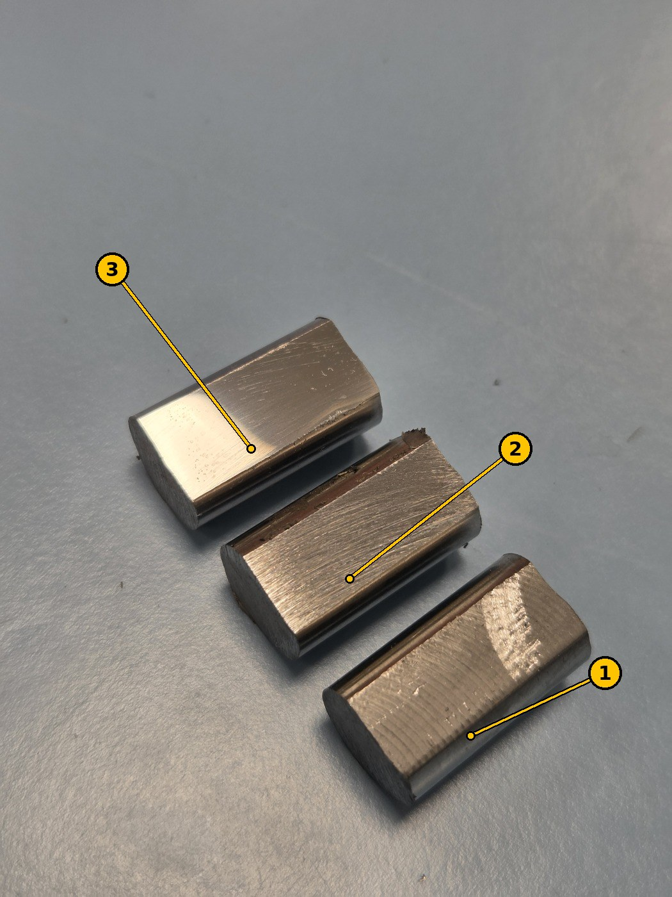
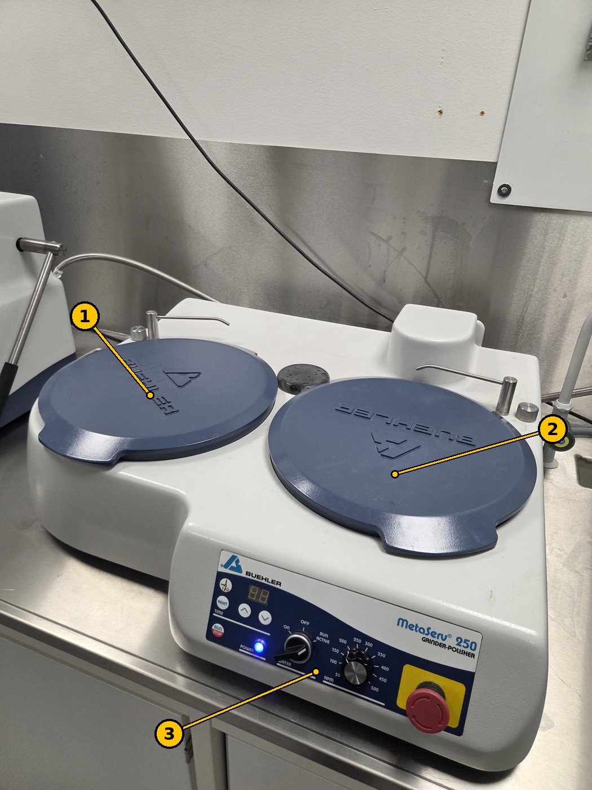
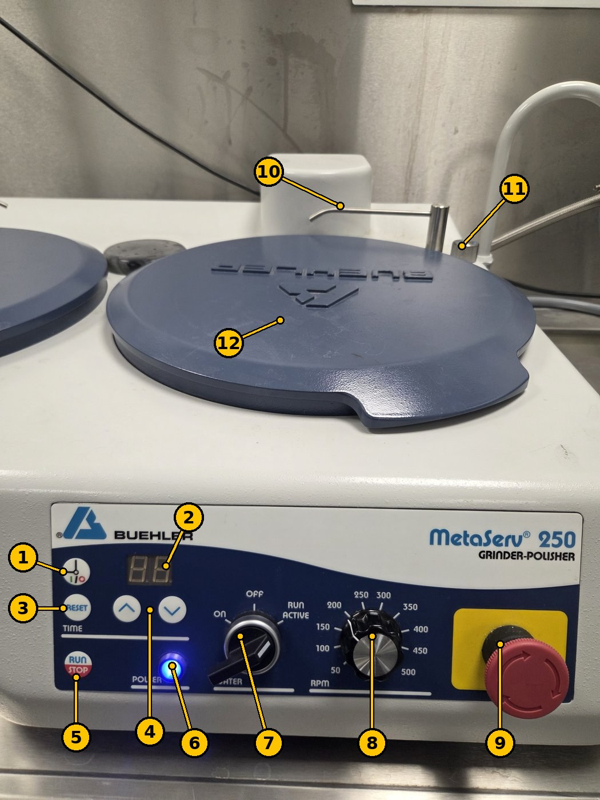
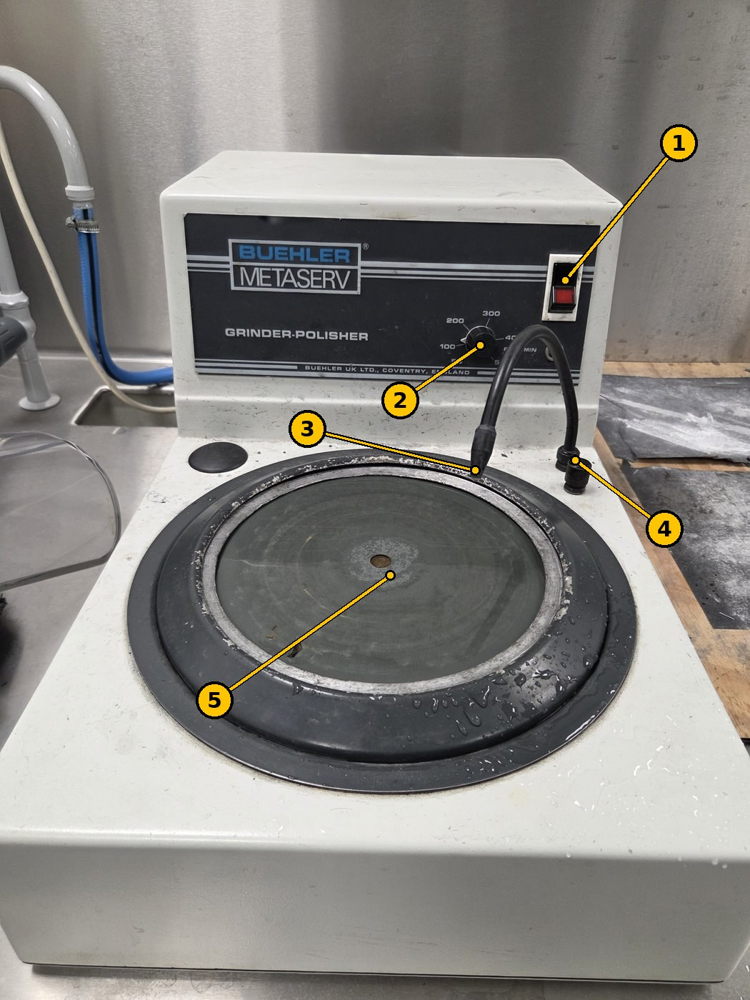
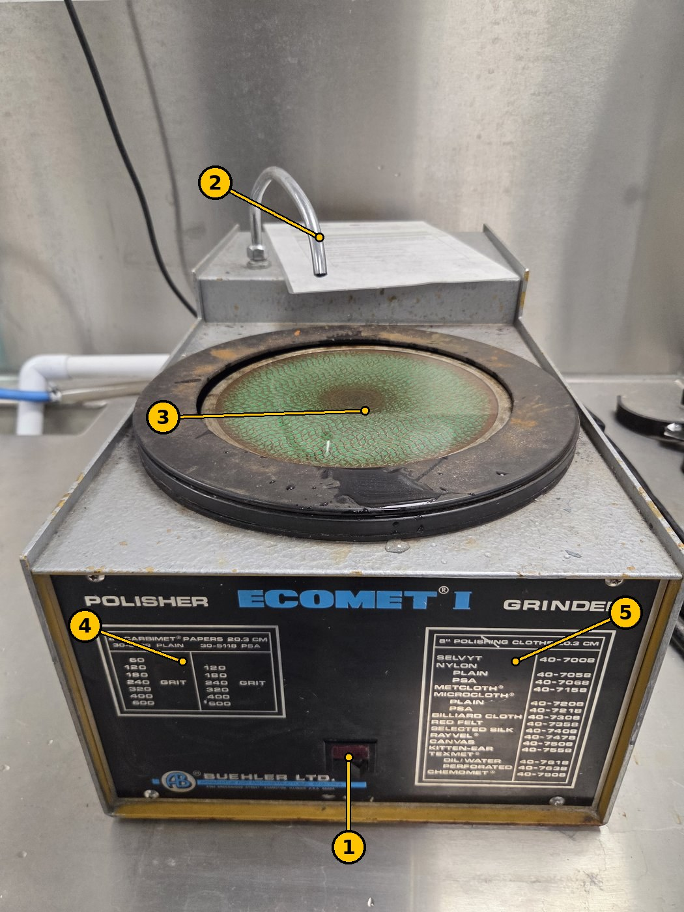
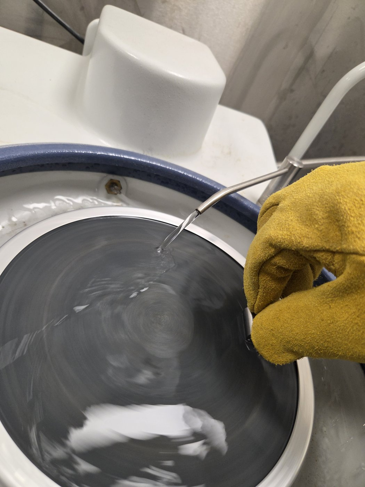

# Grinding and polishing machines (metallographic sample preparation)

TSM2370 Materialteknikk · USN Kongsberg · Updated 12 Nov 2026

> **Norsk versjon:** [README.no.md](README.no.md) · **PDF:** [guide-en.pdf](guide-en.pdf) · **Word:** [guide-en.docx](guide-en.docx)

**Used in:** [TSM2370 Lab 2 – Thermal processing and quench severity](../../labs/tsm2370-materialteknikk/README.md#lab-2--thermal-processing-and-quench-severity)

Before you can measure hardness on the [MXT50](../hardness-vickers-matsuzawa-mxt50/README.md), the sample surface must be flat and polished. On a scratched surface you cannot see the corners of the Vickers indent. The lab has three Buehler machines for this, used one after the other: first to grind away the worst scratches, then to polish the surface to a mirror finish.

## 1. What you are aiming for

*Figure 1. Three Sølvstål 2210 samples: (1) as milled, with circular tool marks; (2) after rough grinding, with straight, even scratches; (3) after final polishing, shiny and almost mirror-like.*

| Stage | What the surface looks like | Ready for the next step when… |
| --- | --- | --- |
| 1. As milled | Circular marks from the milling cutter, rough to the touch | – |
| 2. Ground | Straight, parallel scratches in one direction; the milling marks are gone | all scratches point the same way and no older, deeper scratches are left |
| 3. Polished | Shiny, almost a mirror; no scratches visible by eye | you can see a clear reflection and no scratches under the MXT50 orange objective |

## 2. Safety and care

- **Do not use the machines before you have been shown how** by the lab supervisor.
- **Wear safety glasses.** Closed shoes and proper lab clothing.
- **Keep hair, sleeves, gloves and jewellery away from the rotating disc.** Tie back long hair.
- Hold the sample firmly with your fingers flat on top. If it is pulled out of your hand, let it go and stop the machine; do not grab for it while the disc turns.
- **Use water on grinding paper.** It cools the sample and washes away the grinding dust. Heating a hardened sample can soften it and change your hardness result.
- Clean the sample and your hands between steps, so that grit from a coarse step does not scratch the next, finer step.
- Turn the water off and wipe the machine when you are done. Put the lids back on.
- On the MetaServ 250, the **red emergency stop** (9 in Figure 3) stops everything.

### Posted instructions at the machines

These official USN instructions hang on the wall by the machines (in Norwegian; translated here).

**Instruction for the fine wet grinder, Buehler Metaserv** (*Instruks for fin-våtsliper, Buehler Metaserv*; USN / Fagskolen i Viken, Kvalitet/HMS, version 002, valid from 10.09.2022)

| When | Instruction |
| --- | --- |
| Safety | Do not use this machine before you have had sufficient training. Protective equipment: **wear safety glasses**. |
| Before use | Turn on the water. Check the grinding paper for damage. |
| During use | Press lightly on the workpiece. Put the workpiece down on the disc rear (trailing) edge first. |
| After use | Tidy up and wipe up the water. |

**Instruction for the grinding station (emery and polisher)** (*Instruks for slipestasjon (smergel og poler)*; USN / Fagskolen i Viken, Kvalitet/HMS, version 002, valid from 10.09.2022)

| When | Instruction |
| --- | --- |
| Safety | Do not use this machine before you have had sufficient training. Protective equipment: **approved work clothes, safety shoes and safety glasses are required.** Recommended when needed: dust mask, face shield and/or hearing protection. Never wear loose clothing, long jewellery or loose hair when using the machines. |
| Before use | Check that the spindle runs freely. Check that the rest is fixed at the right angle. Clean the protective glass if needed. Make a test grind to check the angle. |
| During use | Grind carefully. Check the grinding angle on your workpiece regularly. |
| After use | Clean the machine after use. |

## 3. The machines

### Buehler MetaServ 250 (twin-station grinder-polisher)

The newest machine. It has two discs (platens) side by side, so two steps can be set up at once, for example two different papers or a paper and a polishing cloth.

*Figure 2. MetaServ 250: (1) left station, (2) right station, both with their covers on, (3) control panel.*

*Figure 3. MetaServ 250 controls. The numbers match the table.*

| No. | Part | What it does |
| --- | --- | --- |
| 1 | Timer mode button (clock symbol) | Switches between running on the timer and running continuously. |
| 2 | Time display | Shows the set or remaining time. |
| 3 | RESET | Resets the timer. |
| 4 | ▲ / ▼ | Set the time. |
| 5 | RUN / STOP | Starts and stops the disc. |
| 6 | POWER lamp | Lit (blue) when the machine is switched on. |
| 7 | WATER switch: ON · OFF · RUN ACTIVE | **ON:** water runs all the time. **RUN ACTIVE:** water runs only while the disc turns. **OFF:** no water. |
| 8 | RPM dial (50–500 rpm) | Disc speed. |
| 9 | Emergency stop | Press to stop everything. Twist to release. |
| 10 | Water nozzle | Drips water onto the disc. |
| 11 | Knob by the nozzle | Adjusts the water flow. |
| 12 | Cover | Protects the paper or cloth. Take it off before use and put it back afterwards. |

### Buehler Metaserv (single-station grinder-polisher)

An older, smaller machine with one disc.

*Figure 4. Buehler Metaserv (Buehler UK, Coventry).*

| No. | Part | What it does |
| --- | --- | --- |
| 1 | Power switch (red) | Starts and stops the disc. |
| 2 | Speed dial (50–500 rpm) | Disc speed. |
| 3 | Water nozzle (flexible) | Bend it so the water lands on the disc. |
| 4 | Water knob | Turns the water on and off and sets the flow. |
| 5 | Disc (platen) | Holds the grinding paper or polishing cloth. |

### Buehler Ecomet I (grinder)

An older machine used for grinding: removing the worst scratches and milling marks first.

*Figure 5. Buehler Ecomet I.*

| No. | Part | What it does |
| --- | --- | --- |
| 1 | Power switch (red) | Starts and stops the disc. One fixed speed (no speed dial). |
| 2 | Water spout | Water onto the disc. |
| 3 | Disc (8 in / 20.3 cm) | Holds the grinding paper. |
| 4 | Paper list | Carbimet grinding papers that fit the disc: grit 60, 120, 180, 240, 320, 400, 600 (higher number = finer). |
| 5 | Cloth list | Polishing cloths that fit the disc. |

## 4. Step-by-step procedure

### 4.1 Overview

| Step | Machine | Paper | Water | Speed | Time |
| --- | --- | --- | --- | --- | --- |
| 1. Rough grinding | Ecomet I | Coarse grinding paper (grit: ask the lab supervisor) | Flowing | 200–400 rpm where the speed can be set | about **1 minute** |
| 2. Polishing | MetaServ 250 or Metaserv | **600** silicon carbide (SiC) for metallography | Flowing | **200–400 rpm** | **1–2 minutes** |

See [chapter 1](#1-what-you-are-aiming-for) for what the surface should look like after each step.

### 4.2 How to hold the sample

- Use **two fingers** with a **leather or rubber glove**.
- Hold the flat surface **parallel to the rotating disc**, so the sample is not caught and thrown off.
- Press **lightly**, and put the sample down on the disc **rear edge first** (as in the posted instruction).

*Figure 6. The sample held with two fingers in a leather glove, flat side parallel to the disc, with water flowing from the nozzle (MetaServ 250).*

### 4.3 Procedure

1. Put on **safety glasses** and a **glove** (leather or rubber).
2. Rough grinding on the **Ecomet I**: turn on the water so it **flows evenly** over the paper, and start the disc.
3. Hold the sample flat against the disc (see 4.2) for about **1 minute**, until the milling marks are gone and all scratches run the same way.
4. Rinse the sample and the gloves, so grit from rough grinding does not reach the next step.
5. Polish on **600 SiC paper** with flowing water, **200–400 rpm**, for **1–2 minutes**.
6. Rinse and check the surface: it should be shiny and almost a mirror, with no visible scratches. If not, polish a little more.
7. Clean the sample with ethanol and dry it, and mark it (A–D) again if the mark has been ground off.
8. Check the surface in the orange objective of the [MXT50](../hardness-vickers-matsuzawa-mxt50/README.md) before you measure.

## 5. When you are finished

- [ ] Turn off the water and the machine.
- [ ] Rinse and wipe the discs and the bowl.
- [ ] Put the covers back on the MetaServ 250.
- [ ] Clean the sample with ethanol and dry it, so it does not rust before you test it.

<!-- TODO (from Rasmus): rough grinding grit; which machine is used for polishing; confirm timer mode button (1), WATER positions (7) and knob (11) on the MetaServ 250, whether one panel runs both stations, and that the Ecomet I has a single speed. -->
