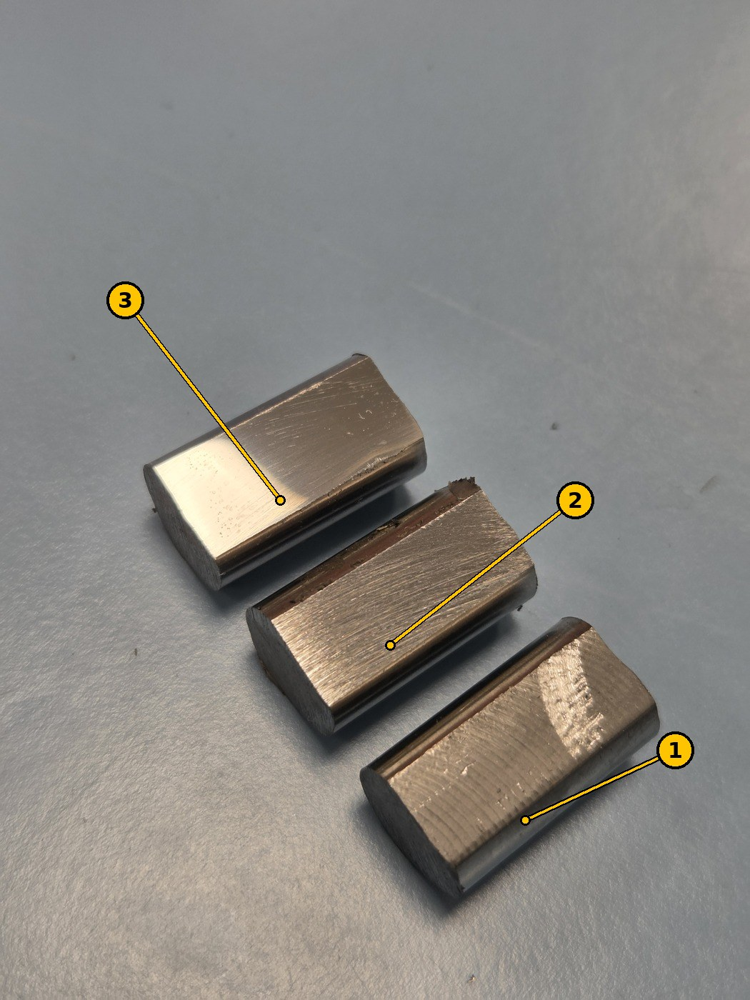
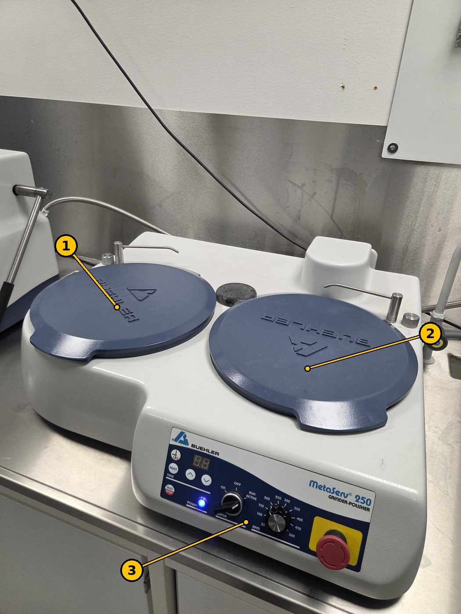
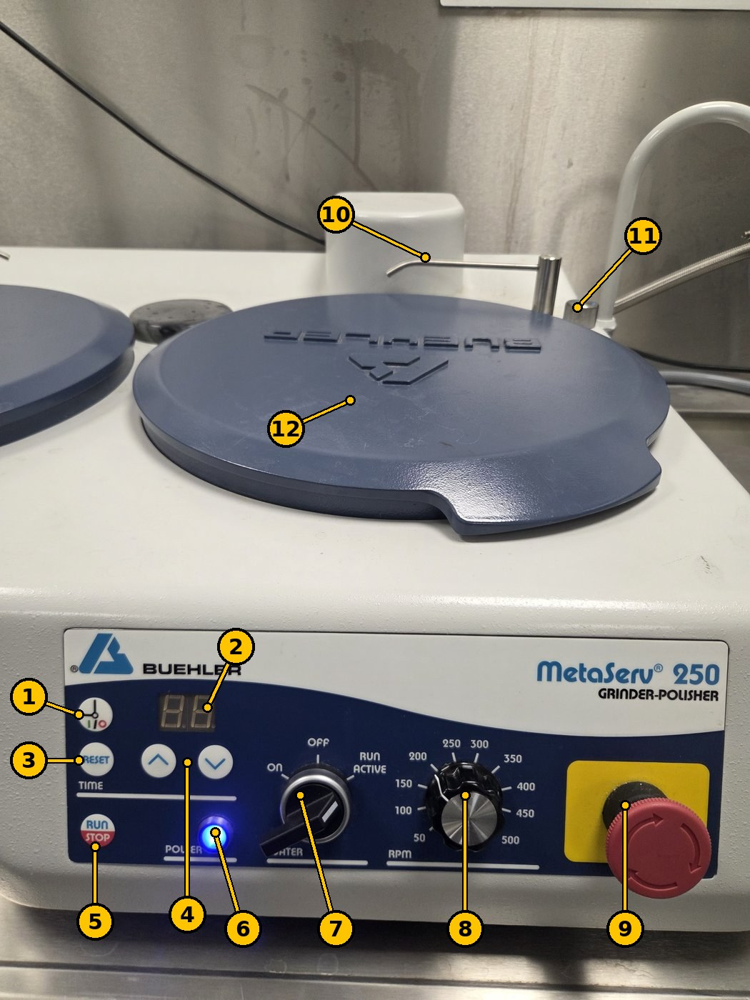
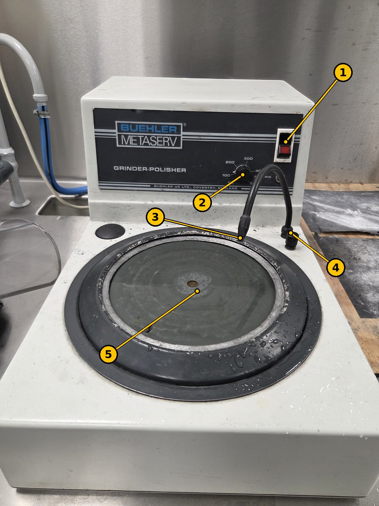
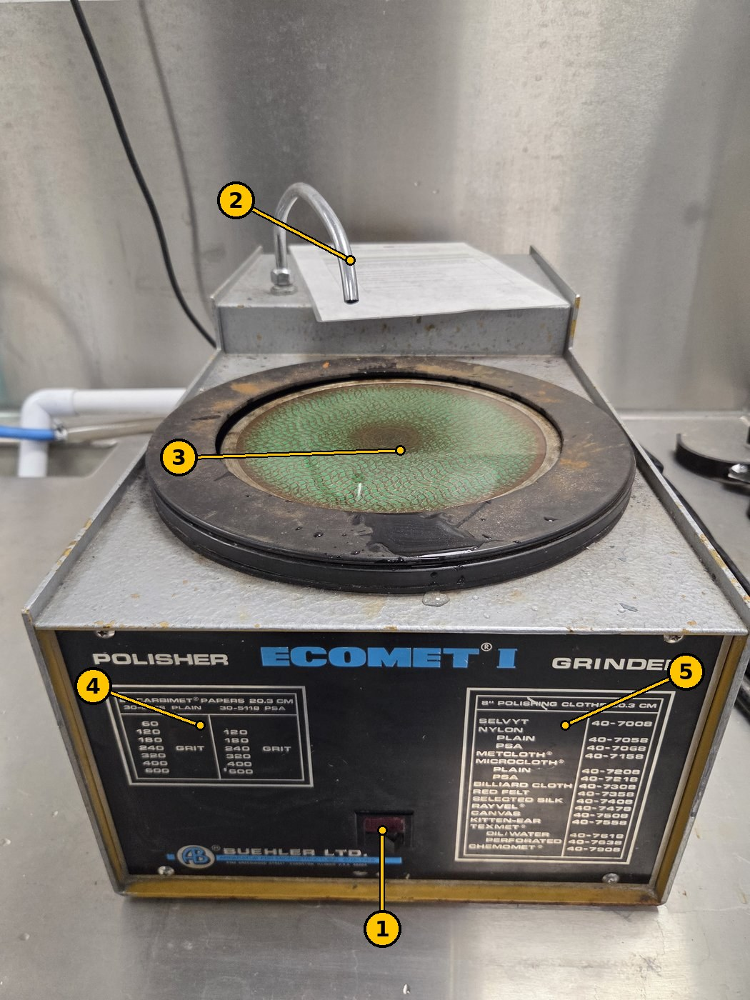

# Slipe- og poleremaskiner (metallografisk prøvepreparering)

TSM2370 Materialteknikk · USN Kongsberg · Oppdatert 11. nov. 2026

> **English version:** [README.md](README.md) · **Veiledning under arbeid:** maskinene og betjeningen er beskrevet under. Trinn-for-trinn-prosedyren (hvilken maskin, korning og tid i hvilken rekkefølge) kommer snart. Inntil da: følg instruksjonene fra labansvarlig.

**Brukes i:** [TSM2370 Lab 2 – Thermal processing and quench severity](../../labs/tsm2370-materialteknikk/README.md#lab-2--thermal-processing-and-quench-severity)

Før du kan måle hardhet på [MXT50](../hardness-vickers-matsuzawa-mxt50/README.no.md), må prøveoverflaten være plan og polert. På en ripete overflate ser du ikke hjørnene i Vickers-inntrykket. Laben har tre Buehler-maskiner til dette, som brukes etter hverandre: først slipes de verste ripene bort, deretter poleres overflaten til speilblank.

## 1. Dette skal du oppnå

*Figur 1. Tre prøver av Sølvstål 2210: (1) som frest, med runde spor fra freseverktøyet; (2) etter grovsliping, med rette, jevne riper; (3) etter sluttpolering, blank og nesten speilende.*

| Trinn | Slik ser overflaten ut | Klar for neste trinn når … |
| --- | --- | --- |
| 1. Som frest | Runde spor fra fresen, ru å ta på | – |
| 2. Slipt | Rette, parallelle riper i én retning; fresesporene er borte | alle ripene går samme vei og ingen eldre, dypere riper er igjen |
| 3. Polert | Blank, nesten et speil; ingen riper synlige med øyet | du ser et klart speilbilde og ingen riper i det oransje objektivet på MXT50 |

## 2. Sikkerhet og forsiktighet

- **Ikke bruk maskinene før du har fått opplæring** av labansvarlig.
- **Bruk vernebriller.** Lukkede sko og egnede arbeidsklær.
- **Hold hår, ermer, hansker og smykker unna den roterende skiven.** Sett opp langt hår.
- Hold prøven godt med fingrene flatt oppå. Rives den ut av hånden, slipp den og stopp maskinen; ikke grip etter den mens skiven går.
- **Bruk vann på slipepapiret.** Vannet kjøler prøven og skyller bort slipestøvet. Blir en herdet prøve varm, kan den bli mykere og gi feil hardhet.
- Rengjør prøven og hendene mellom hvert trinn, så korn fra et grovt trinn ikke riper opp neste, finere trinn.
- Skru av vannet og tørk av maskinen når du er ferdig. Sett lokkene på igjen.
- På MetaServ 250 stopper den **røde nødstoppen** (9 i figur 3) alt.

### Oppslåtte instrukser ved maskinene

Disse offisielle USN-instruksene henger på veggen ved maskinene.

**Instruks for fin-våtsliper, Buehler Metaserv** (USN / Fagskolen i Viken, Kvalitet/HMS, versjon 002, gyldig fra 10.09.2022)

| Når | Instruks |
| --- | --- |
| Sikkerhet | Ikke bruk denne maskinen før du har fått tilstrekkelig opplæring. Verneutstyr/arbeidstøy: **bruk vernebriller**. |
| Før bruk | Åpne for vann. Sjekk slipe-bånd for skader. |
| Under bruk | Bruk lett press på arbeidsstykket. Sett arbeidsstykket først ned i bakkant. |
| Etter bruk | Rydd og tørk opp vann. |

**Instruks for slipestasjon (smergel og poler)** (USN / Fagskolen i Viken, Kvalitet/HMS, versjon 002, gyldig fra 10.09.2022)

| Når | Instruks |
| --- | --- |
| Sikkerhet | Ikke bruk denne maskinen før du har fått tilstrekkelig opplæring. Verneutstyr/arbeidstøy: **påbudt med godkjent arbeidstøy, vernesko og vernebriller.** Anbefalt ved behov: støvmaske, ansiktsskjerm og/eller hørselsvern. Bruk aldri løstsittende klær, lange smykker og løst hår ved bruk av maskinene. |
| Før bruk | Sjekk at spindelen går fritt. Sjekk at anlegget er festet i riktig vinkel. Rengjør beskyttelsesglassene om nødvendig. Ta en slipeprøve for å teste vinkelen. |
| Under bruk | Slip forsiktig. Sjekk slipevinkelen jevnlig på ditt emne. |
| Etter bruk | Rengjør maskinen etter bruk. |

## 3. Maskinene

### Buehler MetaServ 250 (slipe-/polermaskin med to stasjoner)

Den nyeste maskinen. Den har to skiver ved siden av hverandre, så to trinn kan settes opp samtidig, for eksempel to ulike papirer eller et papir og en polerduk.

*Figur 2. MetaServ 250: (1) venstre stasjon, (2) høyre stasjon, begge med lokk på, (3) kontrollpanel.*

*Figur 3. Betjening av MetaServ 250. Numrene stemmer med tabellen.*

| Nr. | Del | Funksjon |
| --- | --- | --- |
| 1 | Tidsmodus (klokkesymbol) | Bytter mellom kjøring på tid og kontinuerlig kjøring. |
| 2 | Tidsvisning | Viser innstilt eller gjenværende tid. |
| 3 | RESET | Nullstiller tiden. |
| 4 | ▲ / ▼ | Stiller inn tiden. |
| 5 | RUN / STOP | Starter og stopper skiven. |
| 6 | POWER-lampe | Lyser blått når maskinen er på. |
| 7 | WATER-bryter: ON · OFF · RUN ACTIVE | **ON:** vannet renner hele tiden. **RUN ACTIVE:** vannet renner bare mens skiven går. **OFF:** ikke vann. |
| 8 | RPM-hjul (50–500 o/min) | Turtall på skiven. |
| 9 | Nødstopp | Trykk for å stoppe alt. Vri for å løse ut. |
| 10 | Vanndyse | Drypper vann på skiven. |
| 11 | Hjul ved dysen | Stiller vannmengden. |
| 12 | Lokk | Beskytter papiret eller duken. Ta det av før bruk og sett det på igjen etterpå. |

### Buehler Metaserv (slipe-/polermaskin med én stasjon)

En eldre, mindre maskin med én skive.

*Figur 4. Buehler Metaserv (Buehler UK, Coventry).*

| Nr. | Del | Funksjon |
| --- | --- | --- |
| 1 | Strømbryter (rød) | Starter og stopper skiven. |
| 2 | Turtallshjul (50–500 o/min) | Turtall på skiven. |
| 3 | Vanndyse (bøyelig) | Bøy den så vannet treffer skiven. |
| 4 | Vannkran | Slår vannet av og på og stiller mengden. |
| 5 | Skive | Holder slipepapiret eller polerduken. |

### Buehler Ecomet I (slipemaskin)

En eldre maskin som brukes til sliping: først fjernes de verste ripene og fresesporene.

*Figur 5. Buehler Ecomet I.*

| Nr. | Del | Funksjon |
| --- | --- | --- |
| 1 | Strømbryter (rød) | Starter og stopper skiven. Fast turtall (ikke noe turtallshjul). |
| 2 | Vanntut | Vann på skiven. |
| 3 | Skive (8 tommer / 20,3 cm) | Holder slipepapiret. |
| 4 | Papirliste | Carbimet-slipepapir som passer skiven: korning 60, 120, 180, 240, 320, 400, 600 (høyere tall = finere). |
| 5 | Dukliste | Polerduker som passer skiven. |

## 4. Trinn for trinn

*Kommer snart:* hvilken maskin, korning eller duk, turtall og tid du skal bruke i hvilken rekkefølge, hvordan du holder prøven, og hvordan du sjekker overflaten mellom trinnene.

## 5. Når du er ferdig

- [ ] Skru av vannet og maskinen.
- [ ] Skyll og tørk av skivene og karet.
- [ ] Sett lokkene på MetaServ 250 igjen.
- [ ] Rengjør prøven med etanol og tørk den, så den ikke ruster før du tester den.
