# HM EMS-1250 – Plate shear (guillotine) – Machine and maintenance

Workshop · USN Kongsberg · Updated 13 November 2026

> **Norsk versjon:** [README.no.md](README.no.md)

**Status:** machine page and maintenance log. **Repaired 15 November 2026:** single-stroke and continuous mode both work again. The fault was the roller-lever head of the top-of-stroke switch, which had been mounted the wrong way round, see [the fault log](#52-fault-log). There is no student operating guide yet: follow the posted instruction on the machine and ask the lab supervisor before use.

**Location:** not yet on the [lab map](../../labs/map/README.md).

An electric plate shear (guillotine) for cutting sheet metal up to 1250 mm wide and 4.0 mm thick. This page records what we know about the machine and its electrics, and the measurements made while repairing it, so the next person does not have to start from scratch.

## 1. Before you start

**Safety rules**

- **Only trained users.** Ask the lab supervisor before you use the shear for the first time.
- Never put your hands under the hold-downs or behind the finger guard (the yellow grid). Only one person operates the machine.
- Do not exceed the capacity on the nameplate: **4.0 mm** (the rating is normally for mild steel; harder material such as stainless steel must be thinner). Never cut rod, wire or hardened material.
- **Before opening any cover or the electrical box:** switch off the main isolator, lock it and check that the machine is dead. The motor runs on 400 V three-phase.
- Work inside the electrical box is done **only by authorised personnel** (fagperson). The relay tests in [5.3](#53-how-to-test-the-one-shot-relay) are done on the bench, with the relay out of the machine and only 24 V.

## 2. The machine

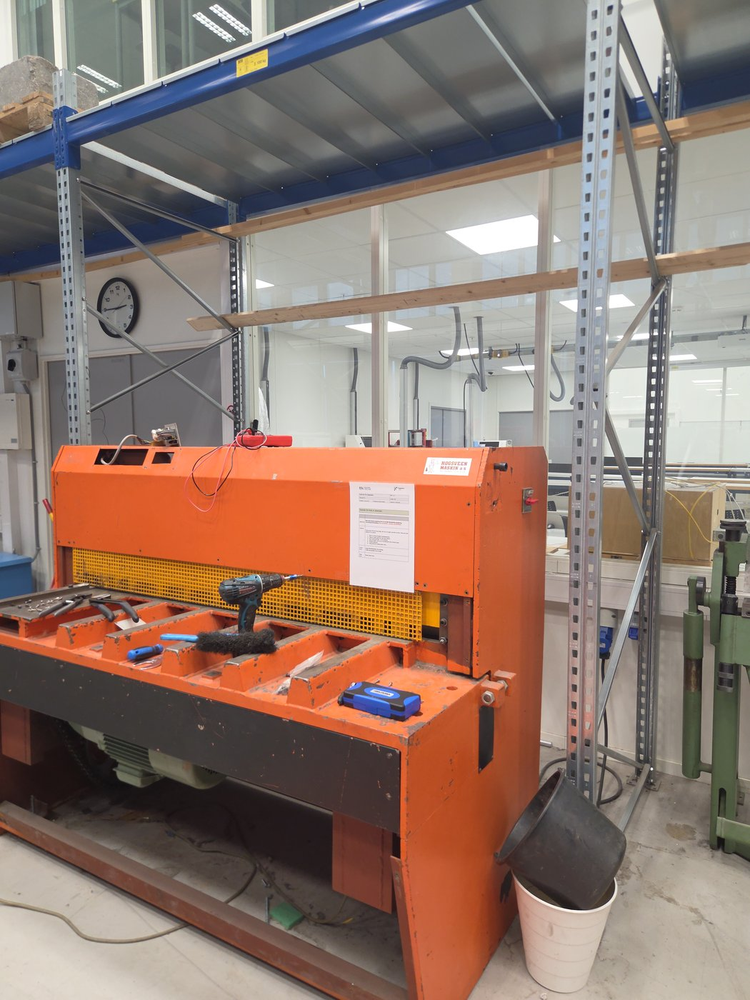

*Figure 1. The HM EMS-1250. The finger guard (yellow grid) is in front of the knife; the motor is under the table.*

| Item | Value |
| --- | --- |
| Make | H.M. Production A/S, 7700 Thisted, Denmark |
| Type | EMS-1250 (electric, motor-driven plate shear) |
| Serial no. | 180886 |
| Capacity | 1250 × 4.0 mm (from the nameplate) |
| Supplied by | Hogsveen Maskin a/s |
| Age | About 1990 (1992 or older) |
| Control voltage | 24 VAC, from a transformer in the electrical box |
| Modes | Single stroke (one-shot) and continuous |

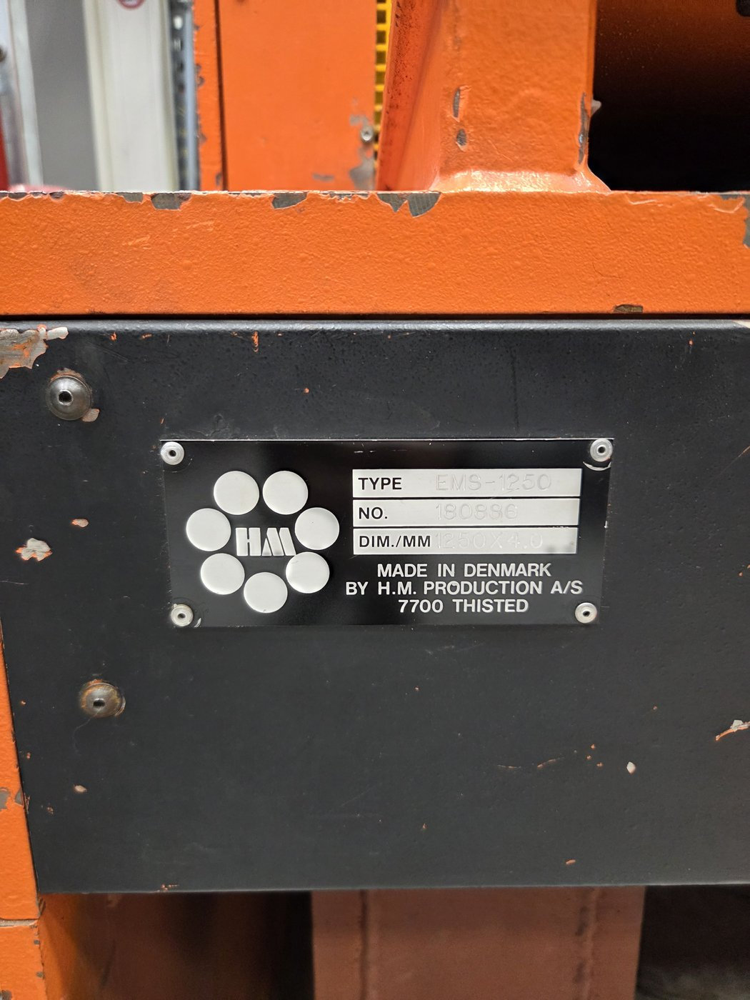

*Figure 2. The nameplate: type EMS-1250, no. 180886, 1250 × 4.0 mm.*

We have not found a manual or wiring diagram for the EMS model. If you find one (for example in a pocket inside a cover), please scan it and add it here.

## 3. The electrical box

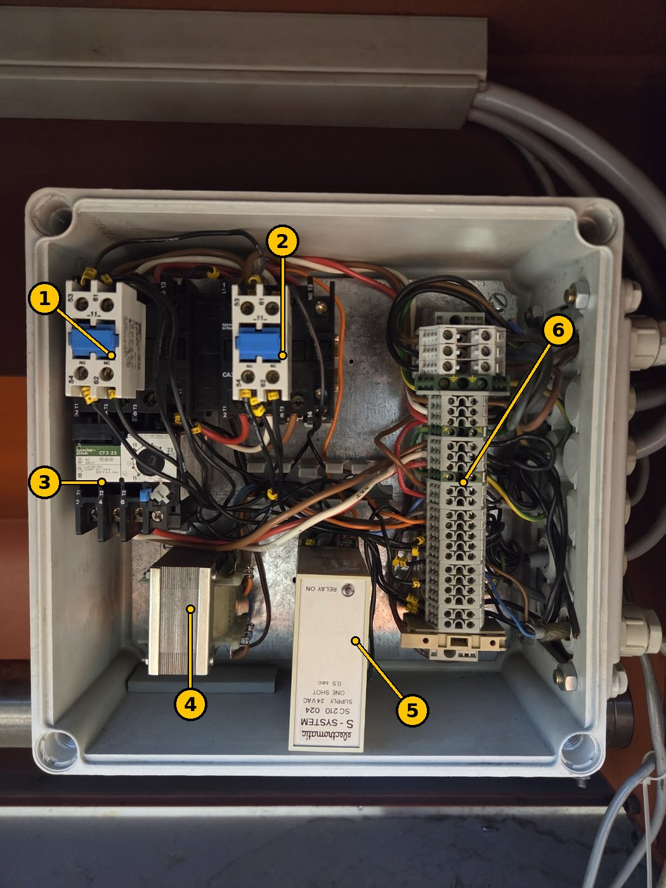

*Figure 3. The electrical box. The numbers match the table.*

| No. | Part | What it does |
| --- | --- | --- |
| 1 | Sprecher+Schuh CA3 contactor with auxiliary contact block (53-54 NO, 61-62 NC) | Switches the motor |
| 2 | Sprecher+Schuh CA3 contactor with auxiliary contact block | Second motor contactor (exact role not confirmed without the wiring diagram) |
| 3 | Sprecher+Schuh CT3-23 thermal overload relay | Protects the motor against overload |
| 4 | Control transformer | Makes the 24 VAC control voltage |
| 5 | **Electromatic S-System SC210 024, one-shot 0.5 s** | Gives one 0.5 s pulse per start in single-stroke mode, see [5.1](#51-the-one-shot-relay-electromatic-sc210-024) |
| 6 | Terminal strip | Connections to the motor, switches and control panel |

## 4. The control panel

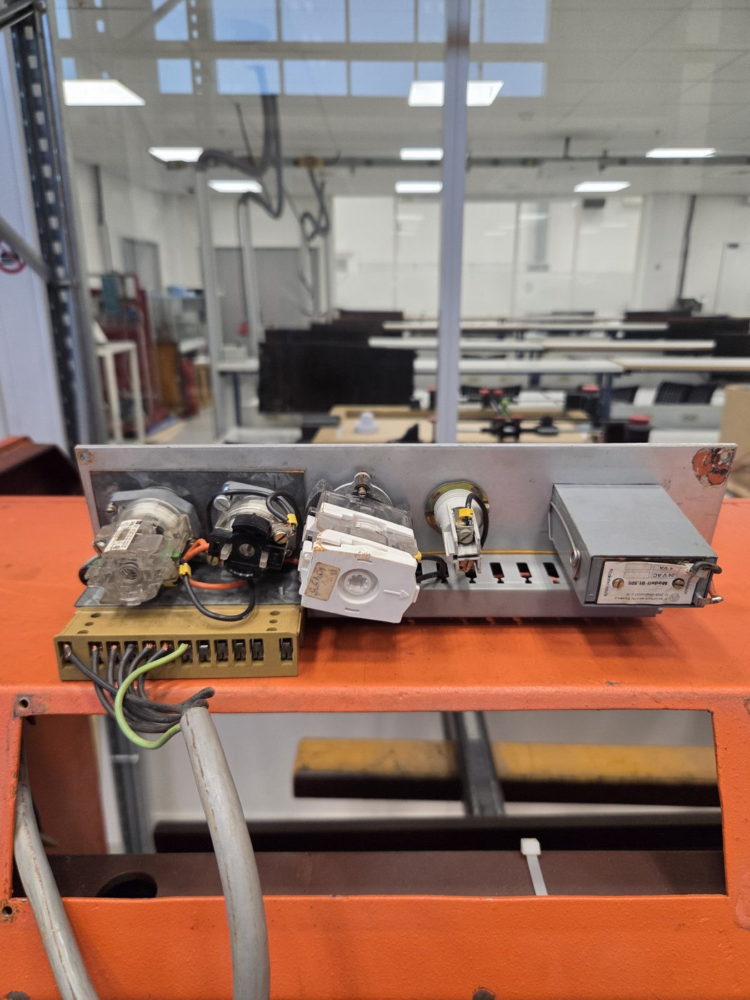

*Figure 4. The back of the control panel, taken out of the machine: selector switches, a cam switch, the pilot lamp holder and (right) a Feinwerkbau Modell 01.505, 24 VAC 4 VA, with "Rückstellspule" (reset coil).*

- The Feinwerkbau unit is probably the **stroke counter** with electric reset (not yet confirmed).
- **Pilot lamp:** BA9s bayonet base, tubular (T10), **24 V 2 W**. A BA9s LED lamp marked "24 V AC/DC" also fits.

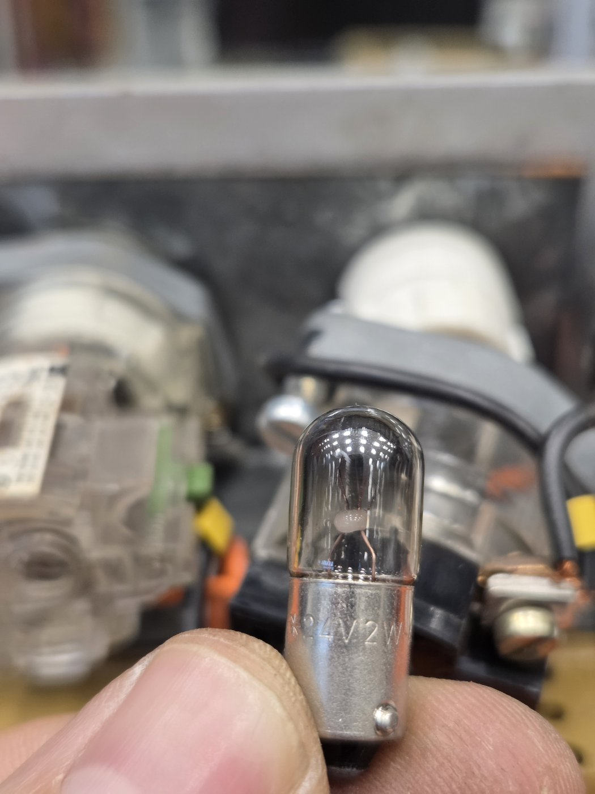

*Figure 5. The pilot lamp: BA9s base, 24 V 2 W. Check it with a multimeter on Ω between the bottom contact and the metal side: a few tens of ohms is OK, OL means the filament is broken.*

## 5. Maintenance

### 5.1 The one-shot relay (Electromatic SC210 024)

In **single-stroke mode** the start signal switches the 24 VAC supply onto this relay. The relay then closes its output contacts **once, for 0.5 s**, which starts one stroke. It does not pulse again until its supply has been switched off and on, so holding the start signal does not give more strokes. In **continuous mode** the relay is bypassed, which is why continuous mode still works when the relay is faulty.

Electromatic (Denmark) later became part of Carlo Gavazzi. The S-System range has been discontinued.

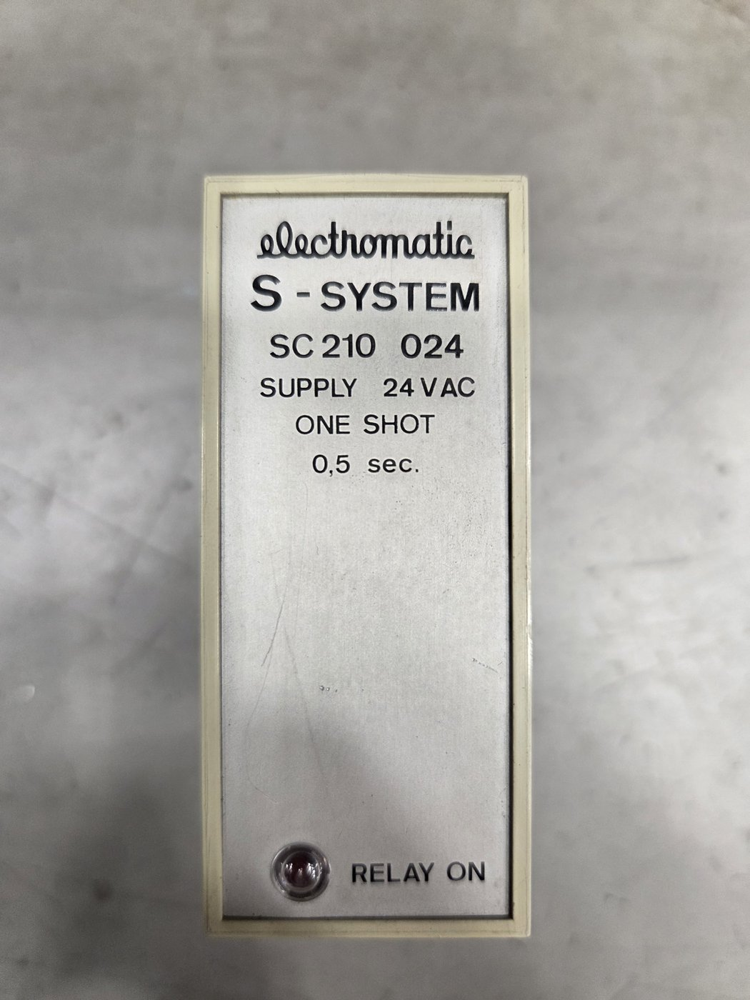

*Figure 6. Electromatic S-System SC210 024: supply 24 VAC, one shot 0.5 s. The "RELAY ON" LED lights while the output is on.*

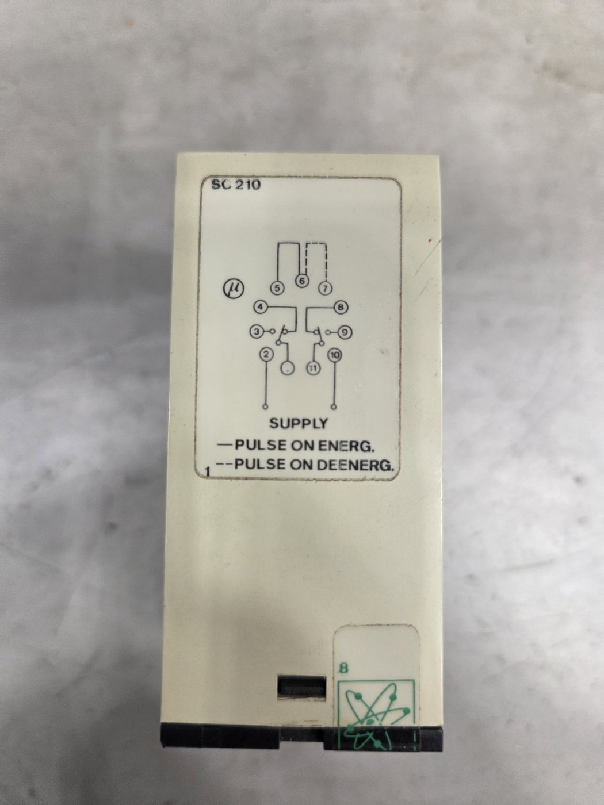

*Figure 7. The pin diagram on the side of the relay.*

It plugs into an **11-pin round socket** (undecal):

| Pins | Function |
| --- | --- |
| 2 – 10 | Supply, 24 VAC |
| 1 – 3 – 4 | Changeover contact 1: **1 = common, 3 = NO, 4 = NC** |
| 11 – 9 – 8 | Changeover contact 2: **11 = common, 9 = NO, 8 = NC** |
| 5 – 6 bridged | Pulse on energization (pulse when the supply is switched on) |
| 6 – 7 bridged | Pulse on de-energization (pulse when the supply is switched off) |

NO and NC were confirmed by measurement (see [5.2](#52-fault-log)).

**Inside the relay** (circuit board marked EM-1 / SC110-D): a small transformer, a rectifier, two Frako 220 µF 40 V electrolytic capacitors, two smaller electrolytic capacitors, transistors, the red LED and an output relay **Electromatic ER23002L** (coil 23.6 V DC, contacts 8 A).

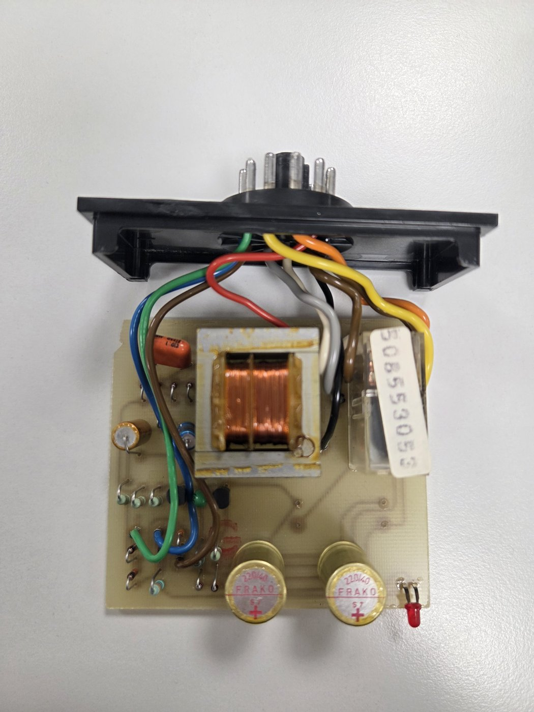

*Figure 8. Inside the SC210: transformer (middle), output relay ER23002L (right), the two 220 µF capacitors (bottom) and the LED.*

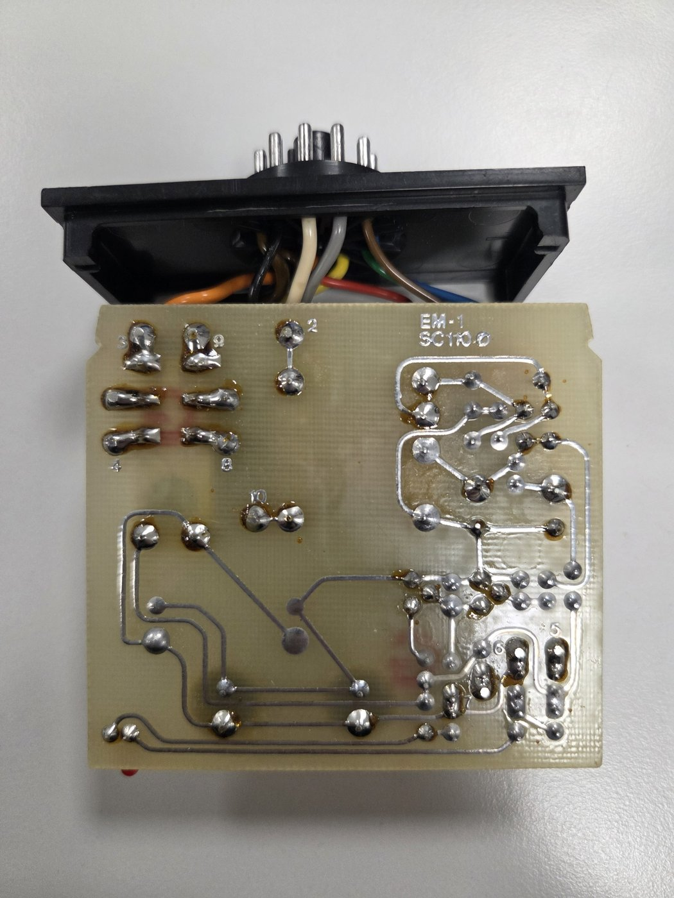

*Figure 9. Solder side. The large pads at top left marked 3, 9, 4 and 8 are the output relay's contact pins. The two round pads just below them, with thin tracks, are the relay coil.*

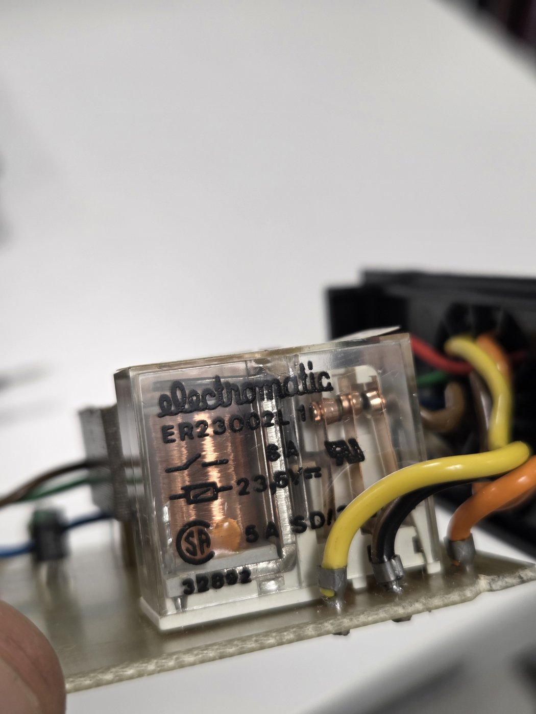

*Figure 10. The output relay inside the SC210: Electromatic ER23002L, coil 23.6 V DC, contacts 8 A.*

### 5.2 Fault log

**November 2026: single-stroke mode does not work, continuous mode works.**

Measurements on the SC210, taken out of the machine (13 November 2026):

| Test | Reading | Meaning |
| --- | --- | --- |
| 1 – 4, unpowered | Beeps; 2.0 Ω, then 1.0 Ω | NC contact closes, but the resistance is high and unstable (should be well under 0.5 Ω): worn contacts |
| 1 – 3, unpowered | Open | NO contact open, not welded: OK |
| 11 – 8, unpowered | Beeps; 0.8 Ω, then 0.2 Ω | NC contact OK |
| 11 – 9, unpowered | Open | NO contact OK |
| 2 – 10 (transformer primary) | 35.2 Ω | Winding intact |
| Output relay coil | 716 Ω | Coil intact (about 33 mA, 0.8 W at 23.6 V) |
| Output relay coil on 24 V DC from a lab supply | Clicks | The relay pulls in |
| 1 – 3 and 11 – 9, relay pulled in | 0.2 – 0.5 Ω, but sometimes jumps around | NO contacts close, but the reading is unstable: worn or oxidised contacts |

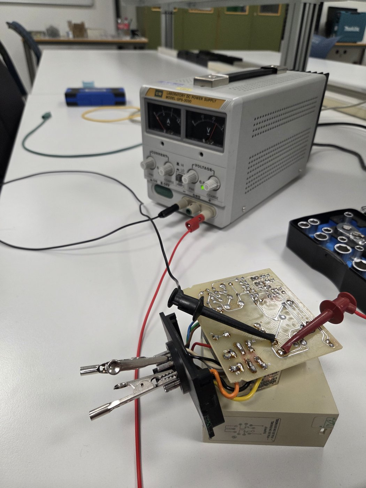

*Figure 11. Testing the output relay coil: a lab power supply (24 V DC, current limit set low) clipped onto the two coil pads, and the multimeter on the socket pins.*

**Conclusion so far:** the transformer and the relay coil are OK. The output relay's contacts are worn (high and unstable resistance), and the electrolytic capacitors are about 35 years old. Either can stop the 0.5 s pulse from getting through. The whole relay has **not yet** been tested with 24 VAC on pins 2–10 ([test D](#53-how-to-test-the-one-shot-relay)).

**Planned repair:** replace the two 220 µF capacitors and, if needed, the output relay ER23002L (see [5.4](#54-spare-parts)), then run test D and test the machine.

**13 November 2026:** the two Frako 220 µF 40 V capacitors were replaced with FMZ 220 µF 50 V 105 °C (10 × 13 mm). The output relay has not been replaced yet.

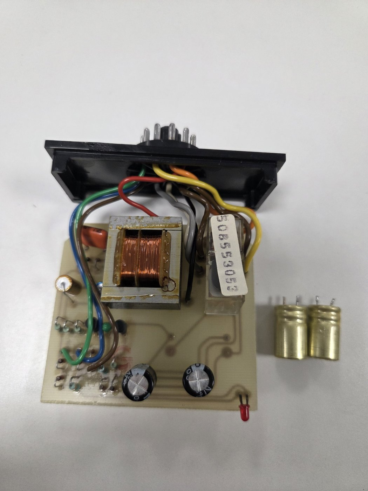

*Figure 12. The SC210 board with the two new 220 µF 50 V capacitors (bottom). The old Frako capacitors are on the right.*

After the capacitor change, the board was fed with about 30 V DC directly on one of the 220 µF capacitors. The output relay pulled in and **stayed on** for as long as the DC was connected (no 0.5 s pulse). This test bypasses the transformer and rectifier, and without a circuit diagram we do not know which capacitor was fed, so the result is **not conclusive**. If the relay also stays on with 24 VAC on pins 2–10, that would explain the fault: a relay that stays on makes single-stroke mode behave like continuous mode.

**13 November 2026, test in the machine (test F), with the new capacitors:** in single-stroke mode the "RELAY ON" LED lights when the pedal is pressed, **stays on for as long as the pedal is held**, and goes off when it is released. The knife keeps cycling while the pedal is held. The pedal and the 24 VAC supply work; **the SC210 does not time out after 0.5 s**, so single-stroke mode behaves like continuous mode. This is the fault.

Possible causes, cheapest check first:

1. The **5–6 bridge** in the machine's socket (or the wires to pins 5 and 6 inside the relay) is broken, so the relay is not set to "pulse on energization".
2. The **timing part of the circuit**: the two small electrolytic capacitors (same age as the big ones) or a transistor.
3. If neither helps: replace the whole SC210 with a modern 11-pin timer (see [5.4](#54-spare-parts)).

**14 November 2026, component tests on the SC210 board** (multimeter; capacitors and transistors measured out of the board, resistors on the board):

| Part | Marking | Measured | Verdict |
| --- | --- | --- | --- |
| 5–6 bridge (socket and wires to the board) | – | Continuity | OK |
| Electrolytic capacitor, gold (Roederstein) | 10 µF 63 V | 11.4 µF | OK (probably the timing capacitor) |
| Electrolytic capacitor, blue | 1 µF 100 V | 0.9 µF | OK |
| Tantalum capacitor, green bead | 0,1 µF 35 V | 88.1 nF | OK |
| Film capacitor, orange (Philips MKT) | 0.1 µF 250 V ±10 % | – | Not tested (rarely fails) |
| 2 × transistor, Philips BC547B (NPN, legs C–B–E with the flat side towards you) | C547B | B–C 0.687 / 0.697 V, B–E 0.693 / 0.702 V | OK |
| Diodes 1N4148 | 4148 | Forward and reverse | OK |
| Resistor | brown-blue-brown (160 Ω) or brown-black-brown (100 Ω) | 99.6 Ω | Check the colour code with one leg lifted |
| Resistor | red-red-orange (22 kΩ) | 21 kΩ | OK |
| Resistor | yellow-violet-red (4.7 kΩ) | 4 kΩ (coarse range) | Probably OK, re-measure on the 20 kΩ range |
| Resistor | orange-orange-red (3.3 kΩ) | 2 kΩ (coarse range) | Lower on the board is normal (parallel parts), re-measure on the 20 kΩ range |
| Resistor | red-violet-orange (27 kΩ) | 26 kΩ | OK |
| Resistor | brown-black-brown (100 Ω) | 99 Ω | OK |

No part has failed a static test so far. Still to do: the leak test on the 10 µF and tantalum capacitors (highest Ω range, the reading must climb towards MΩ), and re-measuring the 3.3 kΩ and 4.7 kΩ resistors. A fault that only shows with power on cannot be found with these tests; then the Finder 88.02 (see [5.4](#54-spare-parts)) is the practical fix.

Leak tests (highest Ω range): the 10 µF, 1 µF and 0.1 µF capacitors all climb to OL, so none of them leaks. The resistor first read as brown-blue-brown is brown-black-brown (100 Ω), so all six resistors are OK.

**15 November 2026, test D with the machine's own 24 VAC:** two leads were fitted to socket terminals 2 and 10 (power off and locked while connecting), and the SC210 was tested on a rubber mat on the table, with 5–6 bridged and the multimeter (continuity) on 1–3. Measured on the leads without the relay: **29.9 VAC with the pedal down** (no load) and 9.9 VAC with the pedal up (probably a ghost voltage on an open wire; check with a load). With the relay connected and the pedal **held down**, the multimeter beeped for **about 0.5 s and then stopped**: **the SC210 now works correctly on the bench.**

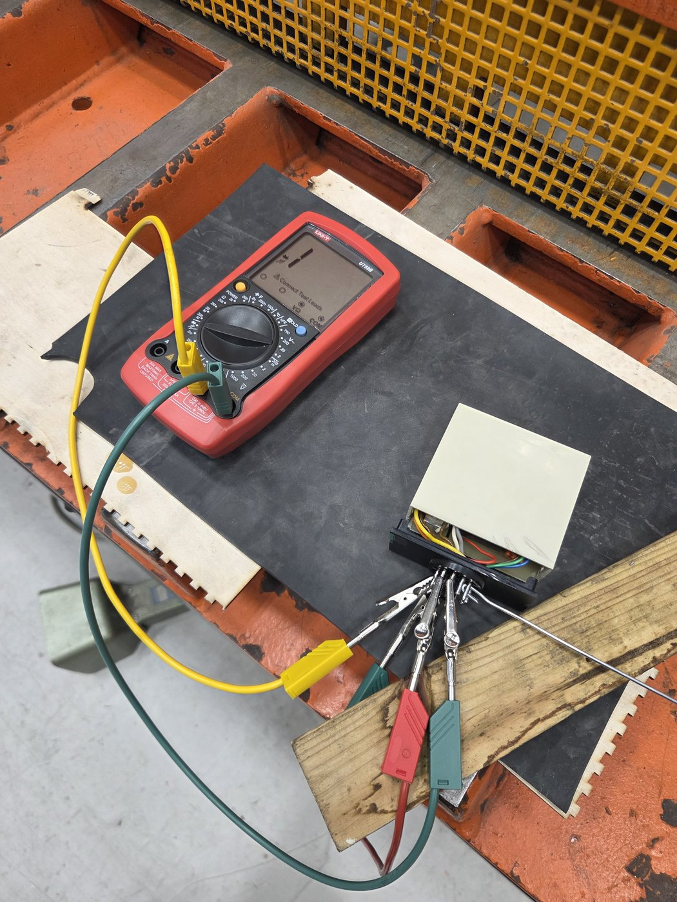

*Figure 13. Test D with the machine's 24 VAC: leads from socket terminals 2 and 10 (red, green) clipped to the relay's pins 2 and 10, a wire bridge on 5–6, and the multimeter on 1–3.*

Since the last test in the machine, the board has been worked on: the transistors were desoldered and soldered back, and capacitors were replaced. A cracked solder joint fixed by resoldering is a possible explanation.

**15 November 2026, test F again (SC210 back in its socket):** single-stroke mode still runs continuously. So the SC210 works on the bench but not in the machine: the fault is **in the machine around the relay**.

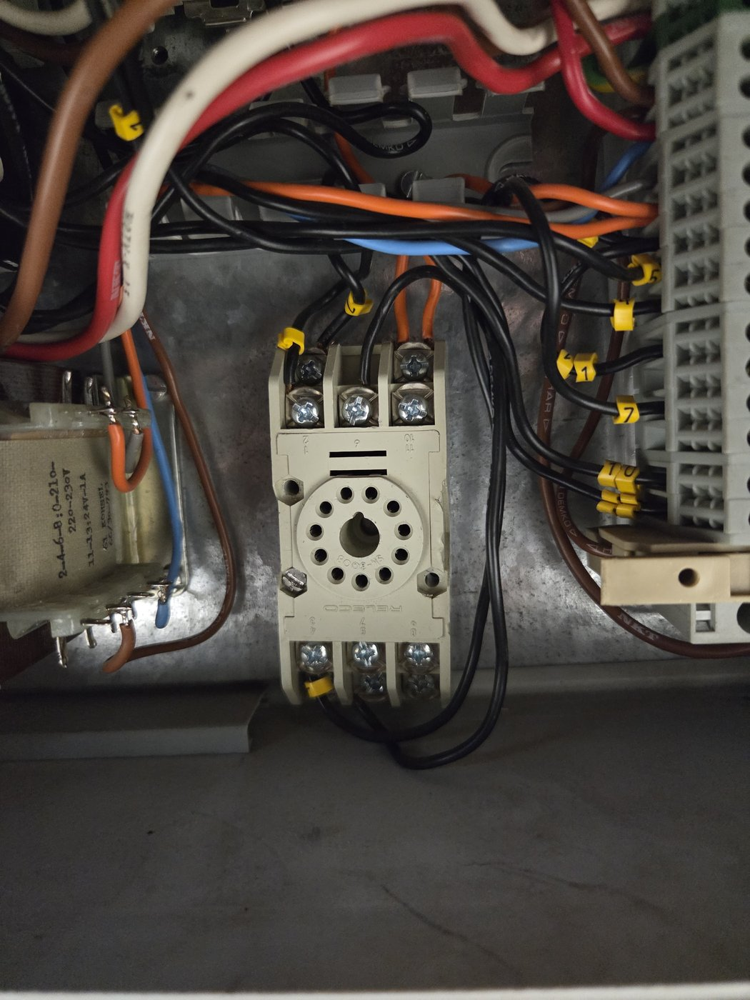

*Figure 14. The SC210 socket (Releco, 11-pin). Wires are connected to terminals 1, 2, 3, 5, 6 and 10. Terminals 4, 7, 8, 9 and 11 are empty, so only contact 1 (1 = common, 3 = NO) is used. The control transformer (left) is marked 11–13: 24 V 1 A.*

Two possible causes, told apart by the "RELAY ON" LED while the pedal is held:

| LED while the pedal is held | Likely cause | Check |
| --- | --- | --- |
| **Stays on** | The 5–6 link is not made in the machine. Terminals 5 and 6 are wired out of the socket, possibly through the mode selector (single-stroke / continuous) on the control panel; a worn selector contact would leave the relay without its "pulse" setting | Power off and locked, relay out: measure continuity between socket terminals **5 and 6** with the selector in **single-stroke** and in **continuous**, turning the selector a few times |
| **Goes out after 0.5 s**, but the knife keeps cycling | The relay is fine; the stroke is kept going by the hold circuit (contactor auxiliary contact and the switch that stops the knife at the top) | Find and check the top-of-stroke switch (cam or limit switch) |

Check of the first cause (power off, relay out): socket terminals 5 and 6 beep **in both selector positions**. The 5–6 link is permanent and the selector does not switch it, so the relay is always set to "pulse on energization", as it should be. The selector must act somewhere else, probably on the hold circuit.

**LED test in the machine:** with the pedal held, the "RELAY ON" LED goes out after **about 0.5 s** in **both** selector positions, but the knife keeps cycling. With the pedal up the LED glows faintly, so the 9.9 VAC measured earlier on terminals 2–10 is a real (weak) voltage, not only a ghost voltage. **The SC210 works correctly in the machine.** The stroke is kept going by something else, and the selector makes no difference: either the selector is stuck in "continuous", or the switch that should stop the knife at the top does not open.

**Mode selector, first contact block** (power off, relay out, measured on the board): one terminal goes via the blue wire to the **pedal**, whose black return wire goes to socket terminal **2** (relay supply). The other terminal has continuity to socket terminals 1, 3 and 10. **Single-stroke: closed. Continuous: 140–180 Ω.** So this contact switches, and in single-stroke it lets the pedal feed the relay. The 140–180 Ω is most likely a coil or lamp elsewhere in the circuit measured in parallel, not a leaking switch; lift one wire off the contact to confirm OL.

**Top-of-stroke switch found:** a **Bernstein "classic" roller-lever limit switch** (10 A, 500 V AC, IP65), mounted above the main shaft so that a cam on the shaft can press the roller once per revolution. Its two wires are marked **1** and **4**: wire 1 goes to socket terminal **3** (the relay's NO output), and wire 4 goes to the **second contact block of the mode selector**. So the switch and the selector contact form a path in parallel with the relay contact: once the relay's 0.5 s pulse has started the stroke, this path keeps the motor running until the cam opens the switch at the top. If the switch never opens, the knife never stops.

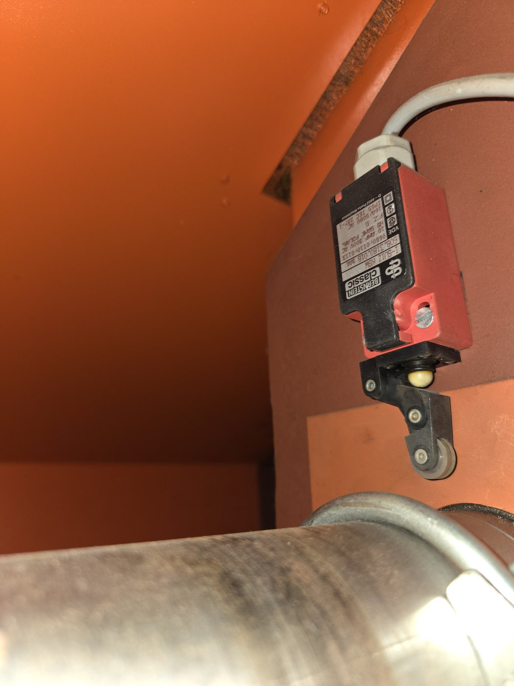

*Figure 15. The top-of-stroke switch (Bernstein classic, roller lever) above the main shaft.*

**15 November 2026: cause found. It is mechanical, not electrical.** The cam that should press the top-of-stroke switch is **home-made**: a U-bolt pipe clamp around the main shaft with a short pin welded to its saddle (Figure 16). The pin **does not reach the roller**, so the switch is never opened at the top and the hold path keeps the motor running.

With the clamp removed and the roller pressed by hand with a wooden stick at the right moment, everything worked as designed:

- **Single-stroke:** with the pedal held, the knife made one stroke and stopped when the switch was pressed.
- **Continuous:** with the pedal held, the switch did not stop the machine; releasing the pedal stopped it.

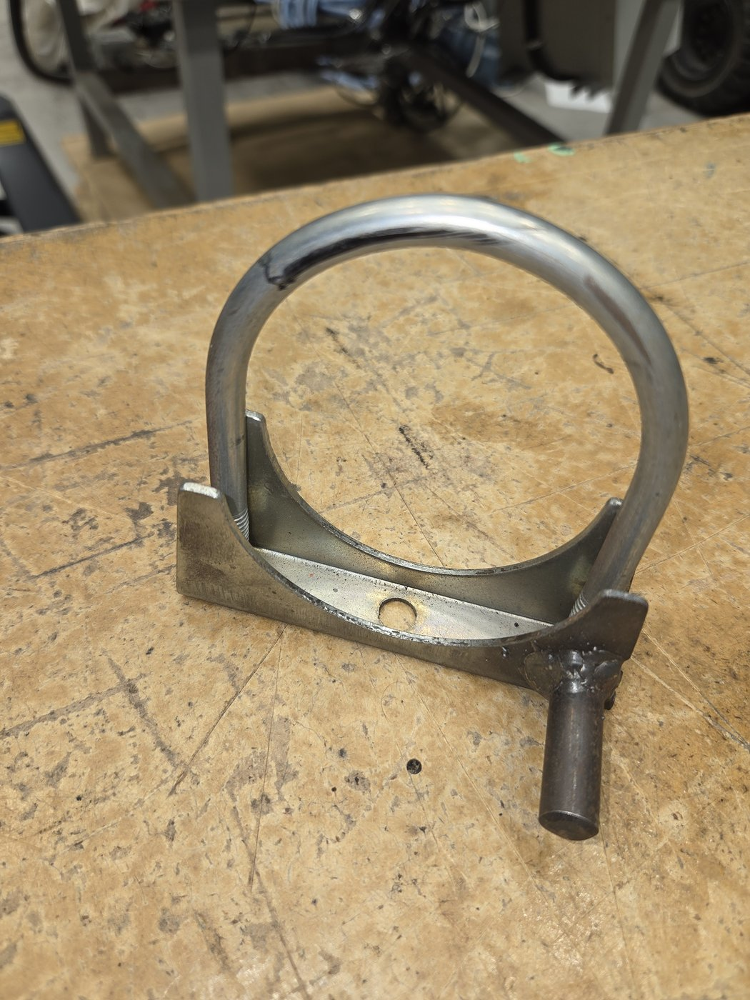

*Figure 16. The home-made switch actuator, taken off the shaft: a U-bolt pipe clamp with a saddle plate and a welded pin. Held only by clamping friction, and the pin does not reach the roller of the limit switch.*

**Lesson:** the relay, capacitors, transistors, selector and limit switch were all fine. Before measuring electronics, check that the **mechanical parts that operate the switches** actually operate them: watch the cam and the roller through one revolution. (The SC210 did once stay on in the machine on 13 November; after its transistors were resoldered on 14 November it always pulsed correctly.)

**Repair: a new cam (actuator) for the top-of-stroke switch.** Requirements:

| Requirement | Why |
| --- | --- |
| **Fixed to the shaft so it cannot slip:** a split shaft collar with two clamping screws, plus a set screw or pin into a shallow spot-drilling in the shaft | A friction clamp that slips moves the stop position, or stops pressing the switch at all |
| **A lobe that lifts the roller radially**, with a gentle ramp (about 30° or less) on the leading side | The roller lever is made to be pushed outwards by a cam turning under it, not knocked sideways |
| **Lift:** enough to operate the switch fully, but less than the switch's maximum travel | Too little and the contact does not open; too much and the plunger or lever is damaged. Check the travel on the Bernstein data sheet for the switch type on its label |
| **Lobe length (angle):** the switch must stay pressed where the knife comes to rest at the top, but the lobe must end soon enough that the 0.5 s relay pulse turns the shaft off it | If the lobe is too short, the knife can coast past and the switch closes again (a second stroke). If it is too long, the hold path is still open when the 0.5 s pulse ends and the stroke stops after a short movement. |
| **Adjustable angle on the shaft** (the collar can be turned before tightening) | So the stop position can be set to the top of the stroke |

**Later on 15 November:** the actuator presses the switch correctly only if the shaft turns the **other way**. Either the switch was mounted the wrong way round, or the **motor runs in reverse**. A three-phase motor reverses if two phases are swapped, for example when the machine is moved and connected to a different socket or plug. **Check the direction before changing the switch:**

1. Look for a **rotation arrow** on the motor, fan cover, gearbox or flywheel guard.
2. Watch one stroke with no sheet in the shear: the **hold-downs must clamp before the knife reaches the table**. If the knife reaches the table first, the sequence is wrong and the motor is probably running in reverse.
3. If the motor runs in reverse, have an **electrician swap two phases in the machine's plug** (not in the wall socket), then check with a phase-sequence tester. The original switch orientation may then be right again.

Only if the direction is correct should the switch be turned around or the actuator be remade.

**Power terminals in the electrical box** (terminal strip, top to bottom): **R, S, T** (incoming three-phase supply) · earth bar · **R1, S1, T1** · **J** (earth; "jord" in Danish/Norwegian = protective earth, PE) · **U, V, W** (motor) · **J** (motor earth) · SF, 0, F24, 024, 1 … (control circuit; 024/F24 are probably the 24 V control voltage). The motor leads run through contactor 1 and the CT3-23 overload relay (scale 16–23 A) to U, V, W. The terminals do not show which way the motor turns: that is set by the phase sequence of the supply at R, S, T. Swapping any two motor leads, or any two supply phases, reverses the motor. This is 400 V work for an electrician only.

**Direction check (15 November 2026):** in one stroke the **hold-downs clamp first, then the knife cuts**, so the motor most likely runs in the right direction. (If the hold-downs are spring-loaded and pushed by the knife beam itself, they clamp first in either direction; a rotation arrow on the motor or gearbox would confirm it.) Conclusion: the switch or its actuator was fitted for the wrong direction. Fix: turn the switch around or remake the actuator, then test as below.

**Final cause (15 November 2026): the roller-lever head was mounted the wrong way round.** The head of the Bernstein switch is held by four screws and can be mounted in different directions. Its lever is **hinged with a spring (a one-way lever)**: pushed from one side it presses the plunger and opens the switch; pushed from the other side it just folds away and the switch does nothing. Someone had taken the head off and put it back **180° the wrong way**, so the actuator on the shaft folded the lever away on every turn. Fix: turn the head 180° so that the actuator pushes the lever in the direction that presses the plunger.

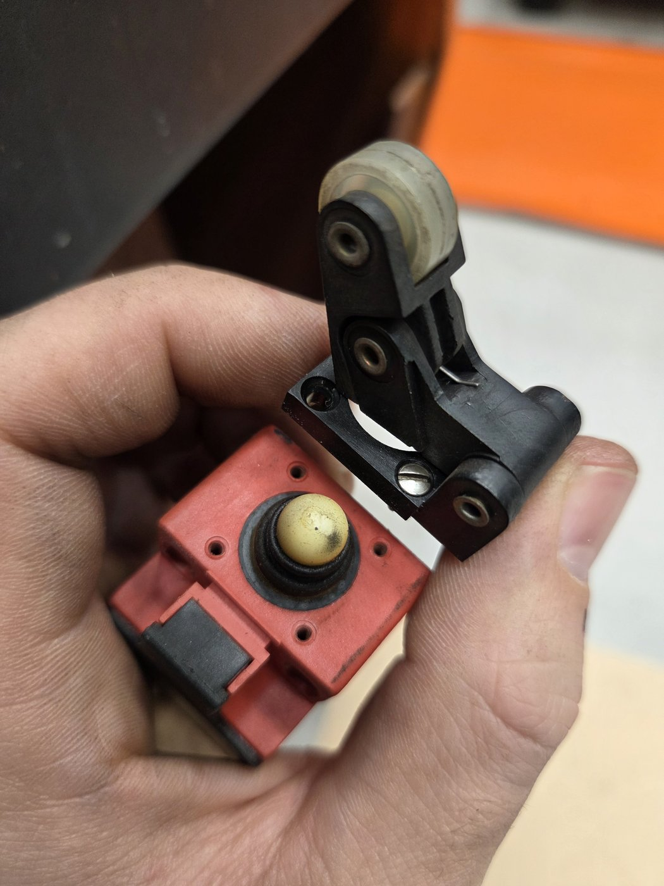

*Figure 17. The roller-lever head (black, four screws) taken off the switch body (red) with its plunger. The lever is hinged with a spring, so it only presses the plunger when pushed from one side.*

**When refitting the head:** check the plunger seal, tighten the four screws evenly, and before closing the machine push the lever by hand in the shaft's direction of rotation: it must press the plunger (the contact between wires 1 and 4 changes), and pushed the other way it must fold away. Then run the test below.

**Repair done (15 November 2026):** the roller-lever head was turned 180°, and the actuator pin on the shaft was given extra material at its tip so that it reaches the roller reliably. Tested in the machine: **single-stroke** gives one stroke and stops at the top with the pedal held; **continuous** runs while the pedal is held and stops when it is released. *Photos of the correct position of the switch head and the actuator will be added here.*

**Test after fitting** (with no sheet, hands clear): 20 or more single strokes with the pedal held. The knife must stop at the top **every time**, and must never make a second stroke while the pedal is held. Check that the cam is still tight afterwards. Single-stroke is a safety function on a guillotine, so the new cam should be checked by the person responsible for the machine before it is used again.

### 5.3 How to test the one-shot relay

All tests are done with the relay **out of the machine**, on the bench. The highest voltage used is 24 V; all tests are at extra-low voltage.

**A. Contacts and transformer (unpowered, multimeter on Ω / continuity)**

1. Touch the probes together and note the reading (the leads, usually 0.2–0.5 Ω). Subtract it from the readings below.
2. Measure **1–4** and **11–8**: they should beep and read under 0.5 Ω (NC contacts).
3. Measure **1–3** and **11–9**: they should read OL (NO contacts open).
4. Measure **2–10**: about 35 Ω. OL means the transformer is broken.

**B. Output relay coil**

1. Open the relay case. On the solder side, measure the two coil pads (Figure 9): about 700 Ω. OL means a broken coil.
2. Swap the probes. If one direction reads much lower, there is a protection diode across the coil. The pin where the red probe was for the **higher** reading is **+**.

**C. Output relay on DC**

1. Set a lab power supply to **24 V DC** with the **current limit at about 100 mA**, and connect it to the coil pads (Figure 11). With the current limit set, a wrong polarity does no harm: if the current goes straight to the limit, swap the leads.
2. The relay should click. While it is pulled in, **1–3** and **11–9** should read under 0.5 Ω, steadily, and **1–4** and **11–8** should read OL.
3. **Better contact test:** a multimeter's few milliamps cannot break through the oxide on worn silver contacts. Instead, put the 24 V 2 W lamp in series with a contact (24 V → pin 1 → lamp → back to the supply, lamp on the pin 3 side). It should light steadily every time the relay pulls in. Flickering means worn contacts.

**D. The whole relay**

1. Plug the relay into a spare 11-pin socket, or use clips on the pins. Bridge **5–6**.
2. Connect **24 VAC** to **pins 2 and 10**: from a separate 24 VAC transformer, or from the machine itself with two leads on socket terminals 2 and 10 (fitted with the power off and locked, by authorised personnel; the pedal then switches the 24 VAC, and the knife does not move because the relay is out of its socket). Check that the knife stays still before connecting the relay.
3. Put the lamp (or the multimeter on continuity) on **1–3**.
4. Each time you switch on the 24 VAC, the LED and the lamp should light **once, for about half a second**.

| Result of D | Fault |
| --- | --- |
| No LED, no click | The timer circuit: rectifier or capacitors. Measure the DC voltage across the 220 µF capacitors while powered: about 30–34 V is OK. |
| LED, but no click | Output relay, its driver transistor, or capacitors too weak to hold the pulse |
| Click, but no lamp | Output relay contacts |
| A clean 0.5 s pulse every time | The relay is OK. The fault is in the machine: the mode selector, the start circuit, the 5–6 bridge in the socket, or loose socket pins. |

Test D needs **AC**. Never put DC on pins 2–10: the relay's transformer does not work on DC, and about 0.7 A flows through its 35 Ω winding.

**E. DC on a capacitor (not reliable)**

Feeding DC directly onto one of the capacitors bypasses the transformer and rectifier, and probably the part of the circuit that detects switch-on. On 13 November 2026 the relay stayed on during this test, which cannot be interpreted without the circuit diagram. Use test D (24 VAC) or test F instead.

**F. In the machine**

Only with authorised personnel: main isolator off and locked while the relay is plugged in. Then, with no sheet in the shear, select single-stroke and press start. The "RELAY ON" LED should flash once, the knife should make **one** stroke and stop at the top, and holding the start signal must **not** give a second stroke.

### 5.4 Spare parts

| Part | What to order | Notes |
| --- | --- | --- |
| Output relay in the SC210 (ER23002L) | 24 V DC coil, 2 changeover contacts (2 CO), 8 A, PCB pins | Example: Finder 40.52.9.024.0000. Check the pin layout against the old relay; if it does not match, fit it with short wires. |
| Capacitors in the SC210 (2 ×) | 220 µF, 50 V, 105 °C electrolytic | Same diameter as the old ones. Mark the **+** side before desoldering: a reversed electrolytic capacitor is destroyed. |
| Whole SC210 relay (if it cannot be repaired) | **Finder 88.02.0.230.0002** (11-pin multifunction timer, 24–230 V AC/DC, 2 CO 8 A), set to function **DI**, 0.5 s. Socket if needed: Finder 90.21 | Checked against the Finder 88 series datasheet (XI-2018), see [the replacement table below](#replacement-for-the-sc210-finder-8802). The **5–6 bridge in the socket must be removed**. Must be fitted by authorised personnel. |
| Pilot lamp | BA9s, 24 V 2 W, tubular T10 | Or a BA9s LED lamp, 24 V AC/DC |

#### Replacement for the SC210: Finder 88.02

Pin-out from the Finder 88 series datasheet (XI-2018), compared with the SC210:

| Pin | SC210 | Finder 88.02 | Same? |
| --- | --- | --- | --- |
| 2 – 10 | Supply 24 VAC | Supply (A1 = 2, A2 = 10), 24–230 V AC/DC | Yes |
| 1 / 3 / 4 | Common / NO / NC | 11 common / 14 NO / 12 NC | Yes |
| 11 / 9 / 8 | Common / NO / NC | 31 common / 34 NO / 32 NC | Yes |
| 5 | Mode bridge (5–6 = pulse on energization) | **Pause input** (closing 2–5 stops the timing) | No |
| 6 | Mode bridge | **Start signal input** (2–6), only for functions BE, CEa, DE | No |
| 7 | Mode bridge (6–7 = pulse on de-energization) | **Reset input** (closing 2–7 resets the timer) | No |

**How to fit it:**

1. Main isolator off and locked. Authorised personnel only.
2. **Remove the 5–6 bridge** in the socket, and check that nothing else is connected to socket terminals 5, 6 and 7. On the Finder these are control inputs.
3. **Before plugging it in**, set the function selector to **DI** (Interval: the contacts close when power is applied and open after the set time, even if power stays on) and the time to **0.5 s**: unit "s", scale 1 s, knob at 0.5 (or scale 0.5 s at full scale). Finder: "time scales and functions must be set before energising the timer".
4. Test with no sheet in the shear: one stroke per pedal press, also when the pedal is held. The yellow LED shows power, the red LED shows that the timer is timing.

Notes from the datasheet: recovery time 300 ms (release the pedal at least 0.3 s before the next press), setting accuracy ±3 % of full scale, contacts AgNi 8 A, power 1 W at 24 V.

## 6. Open questions

- Where is the machine (which lab)? Add it to the [lab map](../../labs/map/README.md).
- What does contactor 2 do?
- Is the Feinwerkbau 01.505 the stroke counter?
- Is there a wiring diagram for the EMS-1250?
- What is the start signal: a foot pedal or a push button?
