# HM EMS-1250 – Plate shear (guillotine) – Machine and maintenance

Workshop · USN Kongsberg · Updated 13 November 2026

> **Norsk versjon:** [README.no.md](README.no.md)

**Status:** in progress. **Single-stroke ("one-shot") mode does not work** at the moment; continuous mode works. The fault is being traced to the one-shot timer relay, see [5. Maintenance](#5-maintenance). There is no student operating guide yet: follow the posted instruction on the machine and ask the lab supervisor before use.

**Location:** not yet on the [lab map](../../labs/map/README.md).

An electric plate shear (guillotine) for cutting sheet metal up to 1250 mm wide and 4.0 mm thick. This page records what we know about the machine and its electrics, and the measurements made while repairing it, so the next person does not have to start from scratch.

## 1. Before you start

**Safety rules**

- **Only trained users.** Ask the lab supervisor before you use the shear for the first time.
- Never put your hands under the hold-downs or behind the finger guard (the yellow grid). Only one person operates the machine.
- Do not exceed the capacity on the nameplate: **4.0 mm** (the rating is normally for mild steel; harder material such as stainless steel must be thinner). Never cut rod, wire or hardened material.
- **Before opening any cover or the electrical box:** switch off the main isolator, lock it and check that the machine is dead. The motor runs on 400 V three-phase.
- Work inside the electrical box is done **only by authorised personnel** (fagperson). The relay tests in [5.3](#53-how-to-test-the-one-shot-relay) are done on the bench, with the relay out of the machine and only 24 V.

## 2. The machine

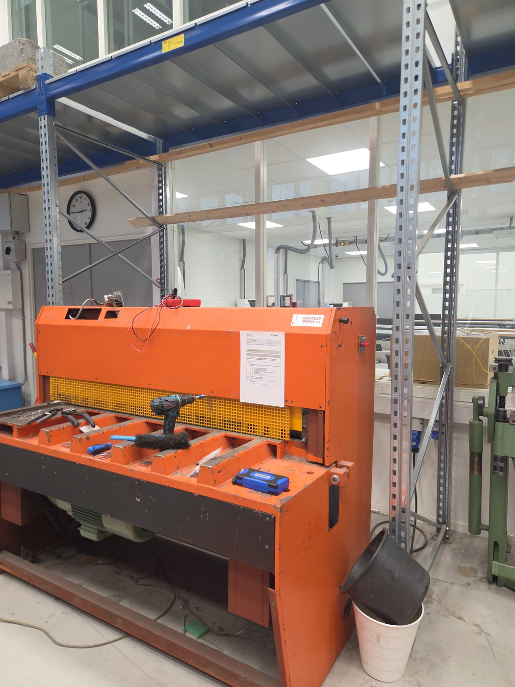

*Figure 1. The HM EMS-1250. The finger guard (yellow grid) is in front of the knife; the motor is under the table.*

| Item | Value |
| --- | --- |
| Make | H.M. Production A/S, 7700 Thisted, Denmark |
| Type | EMS-1250 (electric, motor-driven plate shear) |
| Serial no. | 180886 |
| Capacity | 1250 × 4.0 mm (from the nameplate) |
| Supplied by | Hogsveen Maskin a/s |
| Age | About 1990 (1992 or older) |
| Control voltage | 24 VAC, from a transformer in the electrical box |
| Modes | Single stroke (one-shot) and continuous |

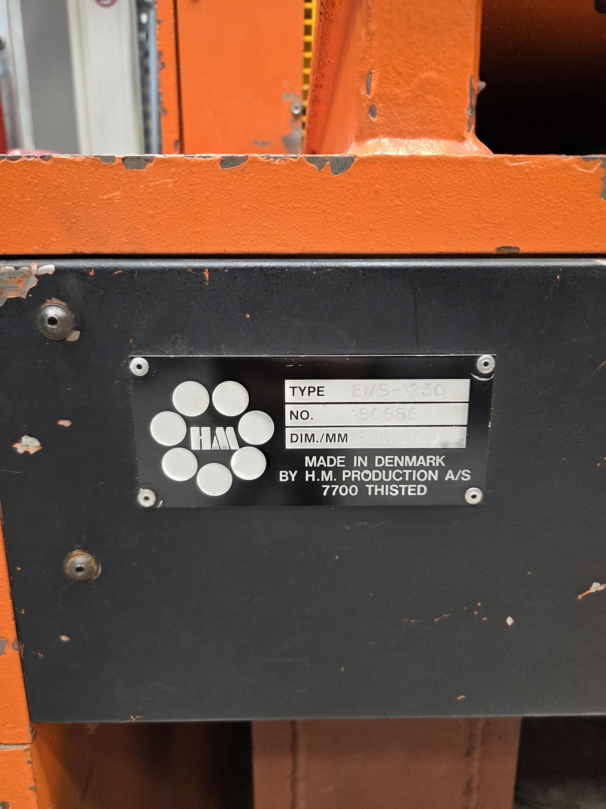

*Figure 2. The nameplate: type EMS-1250, no. 180886, 1250 × 4.0 mm.*

We have not found a manual or wiring diagram for the EMS model. If you find one (for example in a pocket inside a cover), please scan it and add it here.

## 3. The electrical box

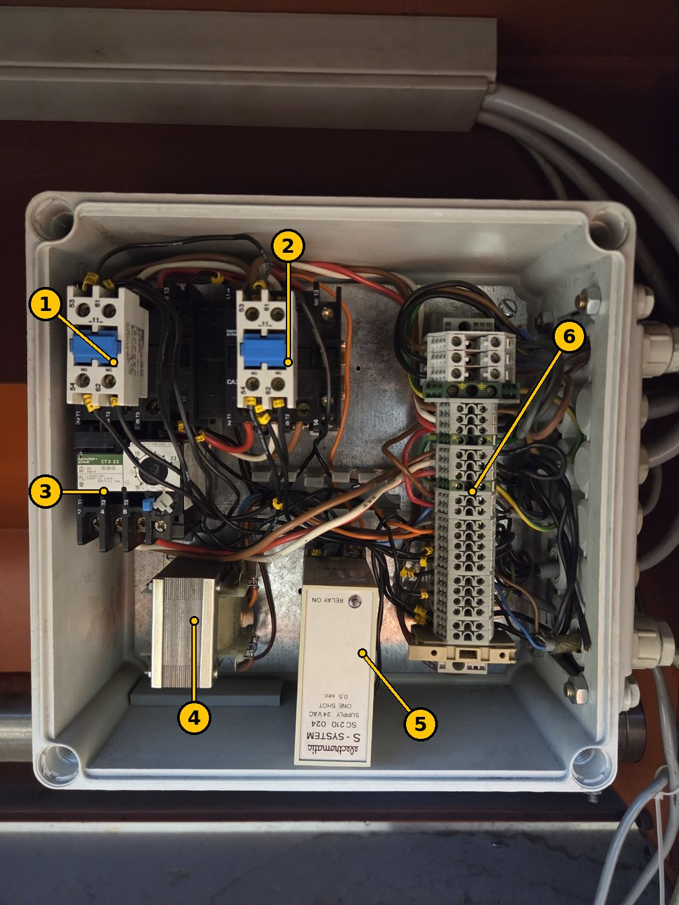

*Figure 3. The electrical box. The numbers match the table.*

| No. | Part | What it does |
| --- | --- | --- |
| 1 | Sprecher+Schuh CA3 contactor with auxiliary contact block (53-54 NO, 61-62 NC) | Switches the motor |
| 2 | Sprecher+Schuh CA3 contactor with auxiliary contact block | Second motor contactor (exact role not confirmed without the wiring diagram) |
| 3 | Sprecher+Schuh CT3-23 thermal overload relay | Protects the motor against overload |
| 4 | Control transformer | Makes the 24 VAC control voltage |
| 5 | **Electromatic S-System SC210 024, one-shot 0.5 s** | Gives one 0.5 s pulse per start in single-stroke mode, see [5.1](#51-the-one-shot-relay-electromatic-sc210-024) |
| 6 | Terminal strip | Connections to the motor, switches and control panel |

## 4. The control panel

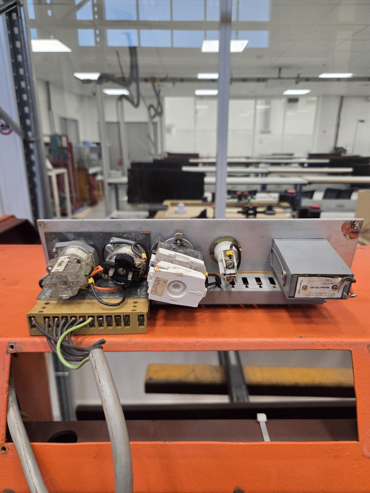

*Figure 4. The back of the control panel, taken out of the machine: selector switches, a cam switch, the pilot lamp holder and (right) a Feinwerkbau Modell 01.505, 24 VAC 4 VA, with "Rückstellspule" (reset coil).*

- The Feinwerkbau unit is probably the **stroke counter** with electric reset (not yet confirmed).
- **Pilot lamp:** BA9s bayonet base, tubular (T10), **24 V 2 W**. A BA9s LED lamp marked "24 V AC/DC" also fits.

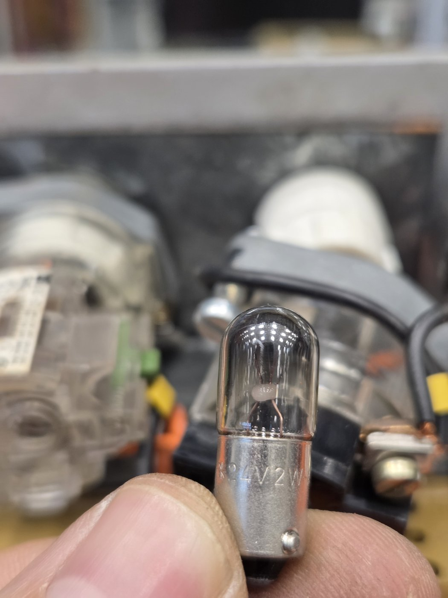

*Figure 5. The pilot lamp: BA9s base, 24 V 2 W. Check it with a multimeter on Ω between the bottom contact and the metal side: a few tens of ohms is OK, OL means the filament is broken.*

## 5. Maintenance

### 5.1 The one-shot relay (Electromatic SC210 024)

In **single-stroke mode** the start signal switches the 24 VAC supply onto this relay. The relay then closes its output contacts **once, for 0.5 s**, which starts one stroke. It does not pulse again until its supply has been switched off and on, so holding the start signal does not give more strokes. In **continuous mode** the relay is bypassed, which is why continuous mode still works when the relay is faulty.

Electromatic (Denmark) later became part of Carlo Gavazzi. The S-System range has been discontinued.

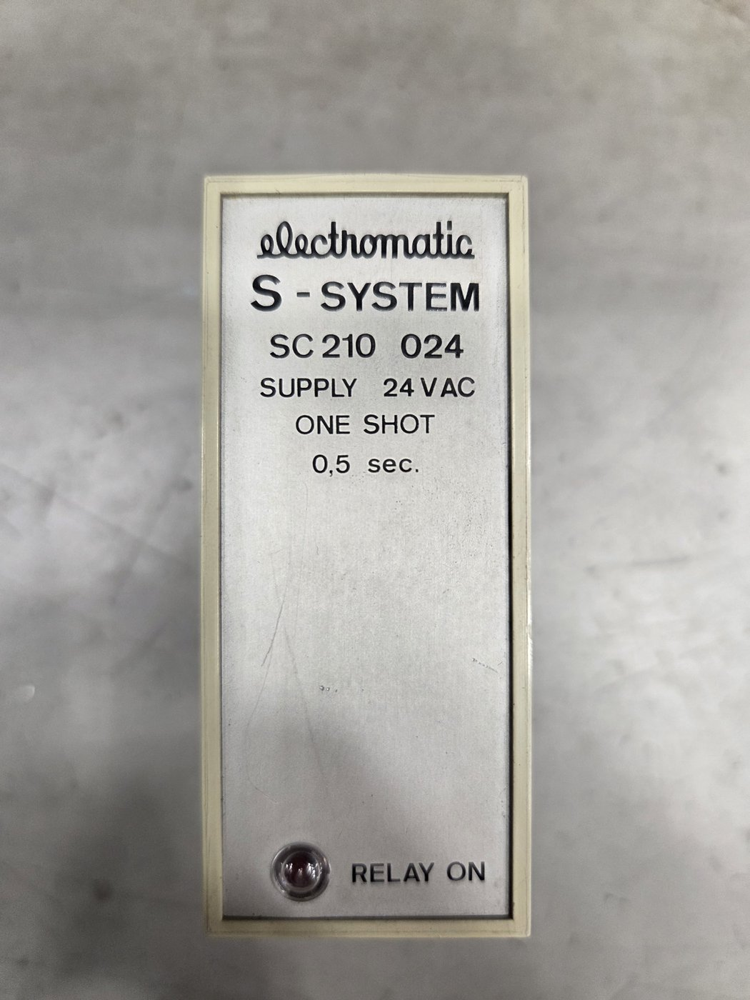

*Figure 6. Electromatic S-System SC210 024: supply 24 VAC, one shot 0.5 s. The "RELAY ON" LED lights while the output is on.*

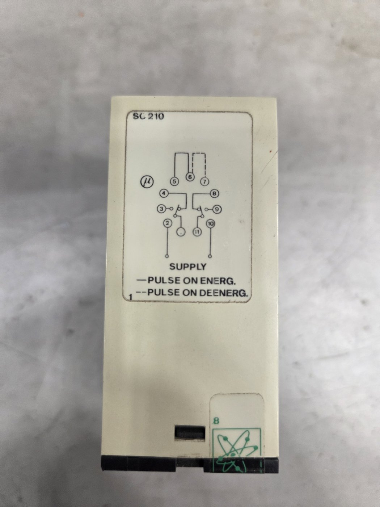

*Figure 7. The pin diagram on the side of the relay.*

It plugs into an **11-pin round socket** (undecal):

| Pins | Function |
| --- | --- |
| 2 – 10 | Supply, 24 VAC |
| 1 – 3 – 4 | Changeover contact 1: **1 = common, 3 = NO, 4 = NC** |
| 11 – 9 – 8 | Changeover contact 2: **11 = common, 9 = NO, 8 = NC** |
| 5 – 6 bridged | Pulse on energization (pulse when the supply is switched on) |
| 6 – 7 bridged | Pulse on de-energization (pulse when the supply is switched off) |

NO and NC were confirmed by measurement (see [5.2](#52-fault-log)).

**Inside the relay** (circuit board marked EM-1 / SC110-D): a small transformer, a rectifier, two Frako 220 µF 40 V electrolytic capacitors, two smaller electrolytic capacitors, transistors, the red LED and an output relay **Electromatic ER23002L** (coil 23.6 V DC, contacts 8 A).

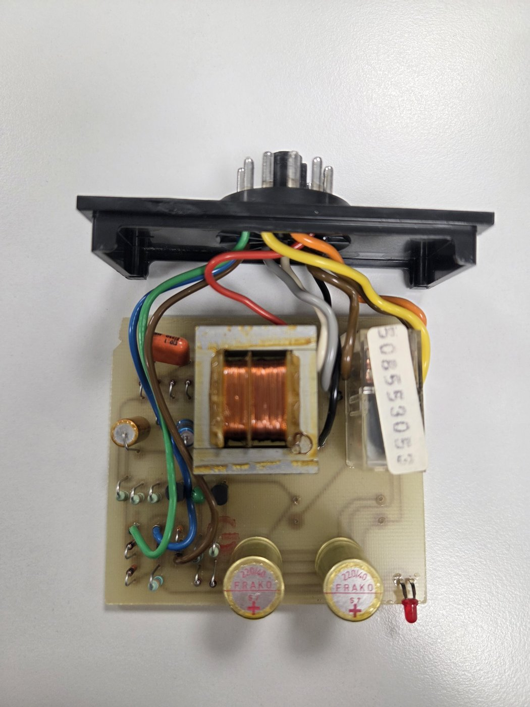

*Figure 8. Inside the SC210: transformer (middle), output relay ER23002L (right), the two 220 µF capacitors (bottom) and the LED.*

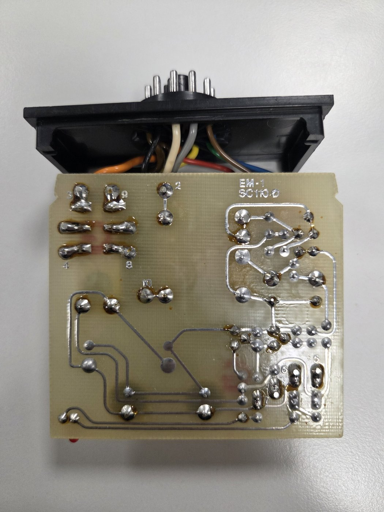

*Figure 9. Solder side. The large pads at top left marked 3, 9, 4 and 8 are the output relay's contact pins. The two round pads just below them, with thin tracks, are the relay coil.*

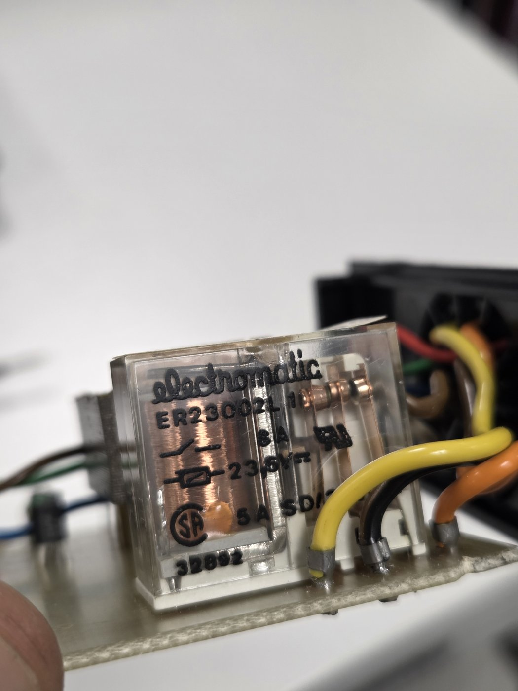

*Figure 10. The output relay inside the SC210: Electromatic ER23002L, coil 23.6 V DC, contacts 8 A.*

### 5.2 Fault log

**November 2026: single-stroke mode does not work, continuous mode works.**

Measurements on the SC210, taken out of the machine (13 November 2026):

| Test | Reading | Meaning |
| --- | --- | --- |
| 1 – 4, unpowered | Beeps; 2.0 Ω, then 1.0 Ω | NC contact closes, but the resistance is high and unstable (should be well under 0.5 Ω): worn contacts |
| 1 – 3, unpowered | Open | NO contact open, not welded: OK |
| 11 – 8, unpowered | Beeps; 0.8 Ω, then 0.2 Ω | NC contact OK |
| 11 – 9, unpowered | Open | NO contact OK |
| 2 – 10 (transformer primary) | 35.2 Ω | Winding intact |
| Output relay coil | 716 Ω | Coil intact (about 33 mA, 0.8 W at 23.6 V) |
| Output relay coil on 24 V DC from a lab supply | Clicks | The relay pulls in |
| 1 – 3 and 11 – 9, relay pulled in | 0.2 – 0.5 Ω, but sometimes jumps around | NO contacts close, but the reading is unstable: worn or oxidised contacts |

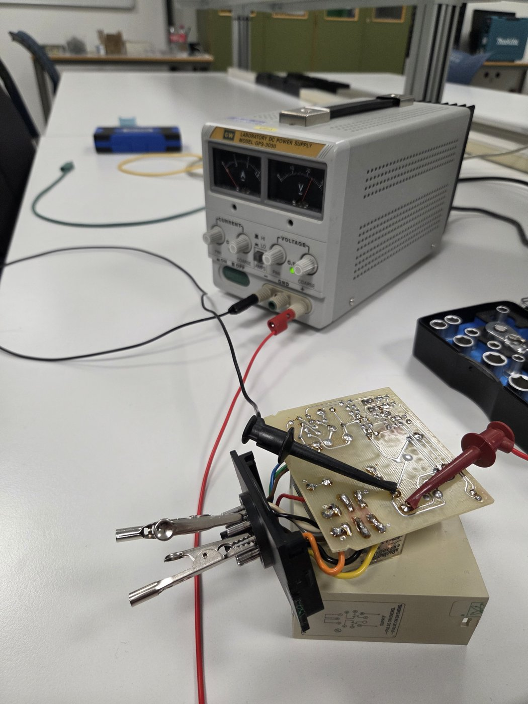

*Figure 11. Testing the output relay coil: a lab power supply (24 V DC, current limit set low) clipped onto the two coil pads, and the multimeter on the socket pins.*

**Conclusion so far:** the transformer and the relay coil are OK. The output relay's contacts are worn (high and unstable resistance), and the electrolytic capacitors are about 35 years old. Either can stop the 0.5 s pulse from getting through. The whole relay has **not yet** been tested with 24 VAC on pins 2–10 ([test D](#53-how-to-test-the-one-shot-relay)).

**Planned repair:** replace the two 220 µF capacitors and, if needed, the output relay ER23002L (see [5.4](#54-spare-parts)), then run test D and test the machine.

**13 November 2026:** the two Frako 220 µF 40 V capacitors were replaced with FMZ 220 µF 50 V 105 °C (10 × 13 mm). The output relay has not been replaced yet.

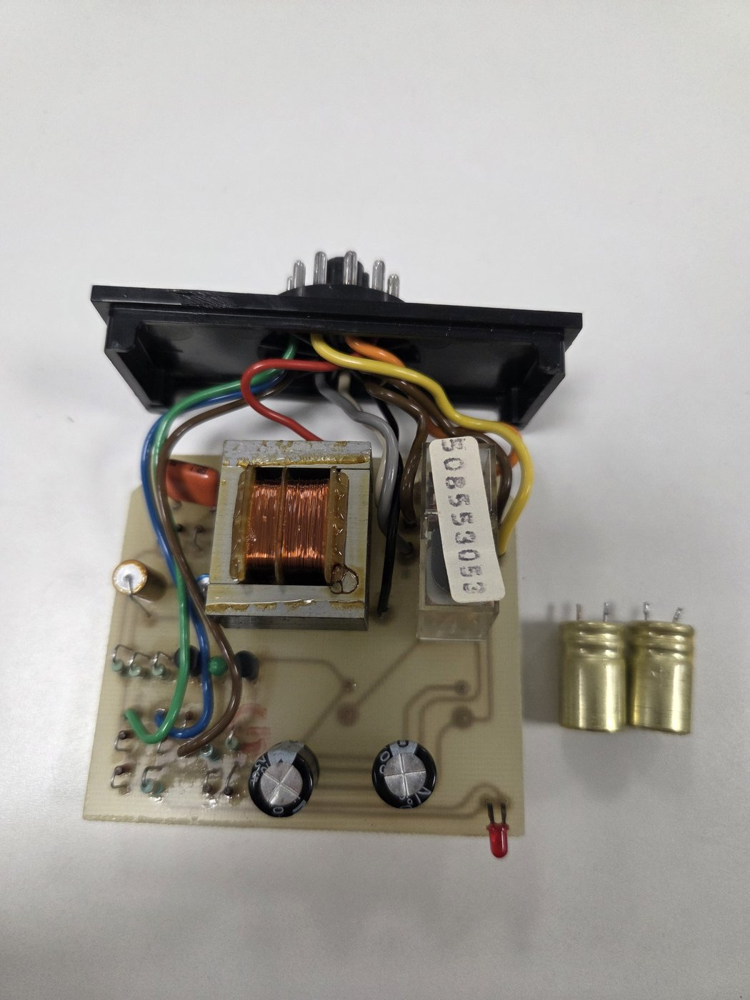

*Figure 12. The SC210 board with the two new 220 µF 50 V capacitors (bottom). The old Frako capacitors are on the right.*

After the capacitor change, the board was fed with about 30 V DC directly on one of the 220 µF capacitors. The output relay pulled in and **stayed on** for as long as the DC was connected (no 0.5 s pulse). This test bypasses the transformer and rectifier, and without a circuit diagram we do not know which capacitor was fed, so the result is **not conclusive**. If the relay also stays on with 24 VAC on pins 2–10, that would explain the fault: a relay that stays on makes single-stroke mode behave like continuous mode.

*Next: test the relay in the machine (no 24 VAC supply on the bench), or run test D with 24 VAC and add the result here: does the relay give one 0.5 s pulse, and does single-stroke mode work in the machine?*

### 5.3 How to test the one-shot relay

All tests are done with the relay **out of the machine**, on the bench. The highest voltage used is 24 V; all tests are at extra-low voltage.

**A. Contacts and transformer (unpowered, multimeter on Ω / continuity)**

1. Touch the probes together and note the reading (the leads, usually 0.2–0.5 Ω). Subtract it from the readings below.
2. Measure **1–4** and **11–8**: they should beep and read under 0.5 Ω (NC contacts).
3. Measure **1–3** and **11–9**: they should read OL (NO contacts open).
4. Measure **2–10**: about 35 Ω. OL means the transformer is broken.

**B. Output relay coil**

1. Open the relay case. On the solder side, measure the two coil pads (Figure 9): about 700 Ω. OL means a broken coil.
2. Swap the probes. If one direction reads much lower, there is a protection diode across the coil. The pin where the red probe was for the **higher** reading is **+**.

**C. Output relay on DC**

1. Set a lab power supply to **24 V DC** with the **current limit at about 100 mA**, and connect it to the coil pads (Figure 11). With the current limit set, a wrong polarity does no harm: if the current goes straight to the limit, swap the leads.
2. The relay should click. While it is pulled in, **1–3** and **11–9** should read under 0.5 Ω, steadily, and **1–4** and **11–8** should read OL.
3. **Better contact test:** a multimeter's few milliamps cannot break through the oxide on worn silver contacts. Instead, put the 24 V 2 W lamp in series with a contact (24 V → pin 1 → lamp → back to the supply, lamp on the pin 3 side). It should light steadily every time the relay pulls in. Flickering means worn contacts.

**D. The whole relay**

1. Plug the relay into a spare 11-pin socket, or use clips on the pins. Bridge **5–6**.
2. Connect **24 VAC** to **pins 2 and 10** (from a separate 24 VAC transformer, not from the machine).
3. Put the lamp (or the multimeter on continuity) on **1–3**.
4. Each time you switch on the 24 VAC, the LED and the lamp should light **once, for about half a second**.

| Result of D | Fault |
| --- | --- |
| No LED, no click | The timer circuit: rectifier or capacitors. Measure the DC voltage across the 220 µF capacitors while powered: about 30–34 V is OK. |
| LED, but no click | Output relay, its driver transistor, or capacitors too weak to hold the pulse |
| Click, but no lamp | Output relay contacts |
| A clean 0.5 s pulse every time | The relay is OK. The fault is in the machine: the mode selector, the start circuit, the 5–6 bridge in the socket, or loose socket pins. |

Test D needs **AC**. Never put DC on pins 2–10: the relay's transformer does not work on DC, and about 0.7 A flows through its 35 Ω winding.

**E. DC on a capacitor (not reliable)**

Feeding DC directly onto one of the capacitors bypasses the transformer and rectifier, and probably the part of the circuit that detects switch-on. On 13 November 2026 the relay stayed on during this test, which cannot be interpreted without the circuit diagram. Use test D (24 VAC) or test F instead.

**F. In the machine**

Only with authorised personnel: main isolator off and locked while the relay is plugged in. Then, with no sheet in the shear, select single-stroke and press start. The "RELAY ON" LED should flash once, the knife should make **one** stroke and stop at the top, and holding the start signal must **not** give a second stroke.

### 5.4 Spare parts

| Part | What to order | Notes |
| --- | --- | --- |
| Output relay in the SC210 (ER23002L) | 24 V DC coil, 2 changeover contacts (2 CO), 8 A, PCB pins | Example: Finder 40.52.9.024.0000. Check the pin layout against the old relay; if it does not match, fit it with short wires. |
| Capacitors in the SC210 (2 ×) | 220 µF, 50 V, 105 °C electrolytic | Same diameter as the old ones. Mark the **+** side before desoldering: a reversed electrolytic capacitor is destroyed. |
| Whole SC210 relay (if it cannot be repaired) | 11-pin plug-in timer, 24 VAC, function "interval" (pulse on energization), 0.5 s, 2 changeover contacts | Many 11-pin timers use pins 2–10 for the supply and 1 and 11 as the commons, but NO and NC can differ: compare with the table in [5.1](#51-the-one-shot-relay-electromatic-sc210-024) before plugging it in. It must give **one** pulse per start, also when the start signal is held. The new relay must be fitted by authorised personnel. |
| Pilot lamp | BA9s, 24 V 2 W, tubular T10 | Or a BA9s LED lamp, 24 V AC/DC |

## 6. Open questions

- Where is the machine (which lab)? Add it to the [lab map](../../labs/map/README.md).
- What does contactor 2 do?
- Is the Feinwerkbau 01.505 the stroke counter?
- Is there a wiring diagram for the EMS-1250?
- What is the start signal: a foot pedal or a push button?
