# HM EMS-1250 – Platesaks (giljotin) – Maskin og vedlikehold

Verksted · USN Kongsberg · Oppdatert 13. november 2026

> **English version:** [README.md](README.md)

**Status:** under arbeid. **Enkeltslag («one-shot») virker ikke** for øyeblikket; kontinuerlig drift virker. Feilen spores til tidsreléet for enkeltslag, se [5. Vedlikehold](#5-vedlikehold). Det finnes ingen studentveiledning ennå: følg instruksen som henger på maskinen, og spør labansvarlig før bruk.

**Plassering:** ikke lagt inn på [labkartet](../../labs/map/README.md) ennå.

En elektrisk platesaks (giljotin) for å klippe metallplater opptil 1250 mm brede og 4,0 mm tykke. Denne siden samler det vi vet om maskinen og elektrikken, og målingene fra reparasjonen, slik at neste person slipper å starte på nytt.

## 1. Før du starter

**Sikkerhetsregler**

- **Bare opplærte brukere.** Spør labansvarlig før du bruker saksen første gang.
- Stikk aldri hendene under nedholderne eller bak fingervernet (det gule gitteret). Bare én person betjener maskinen.
- Ikke gå over kapasiteten på typeskiltet: **4,0 mm** (gjelder vanligvis bløtt stål; hardere materiale som rustfritt stål må være tynnere). Klipp aldri rundstål, ståltråd eller herdet materiale.
- **Før du åpner et deksel eller el-skapet:** slå av hovedbryteren, lås den og kontroller at maskinen er spenningsløs. Motoren går på 400 V trefase.
- Arbeid inne i el-skapet gjøres **bare av fagperson**. Relétestene i [5.3](#53-slik-tester-du-enkeltslagsreléet) gjøres på benken, med reléet tatt ut av maskinen og bare 24 V.

## 2. Maskinen

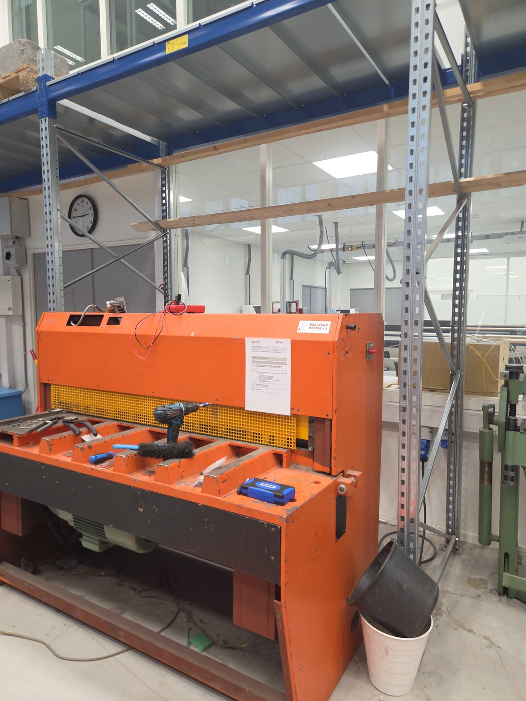

*Figur 1. HM EMS-1250. Fingervernet (gult gitter) står foran kniven; motoren er under bordet.*

| Hva | Verdi |
| --- | --- |
| Produsent | H.M. Production A/S, 7700 Thisted, Danmark |
| Type | EMS-1250 (elektrisk, motordrevet platesaks) |
| Serienr. | 180886 |
| Kapasitet | 1250 × 4,0 mm (fra typeskiltet) |
| Levert av | Hogsveen Maskin a/s |
| Alder | Omtrent 1990 (1992 eller eldre) |
| Styrespenning | 24 V AC, fra en transformator i el-skapet |
| Driftsmåter | Enkeltslag (one-shot) og kontinuerlig |

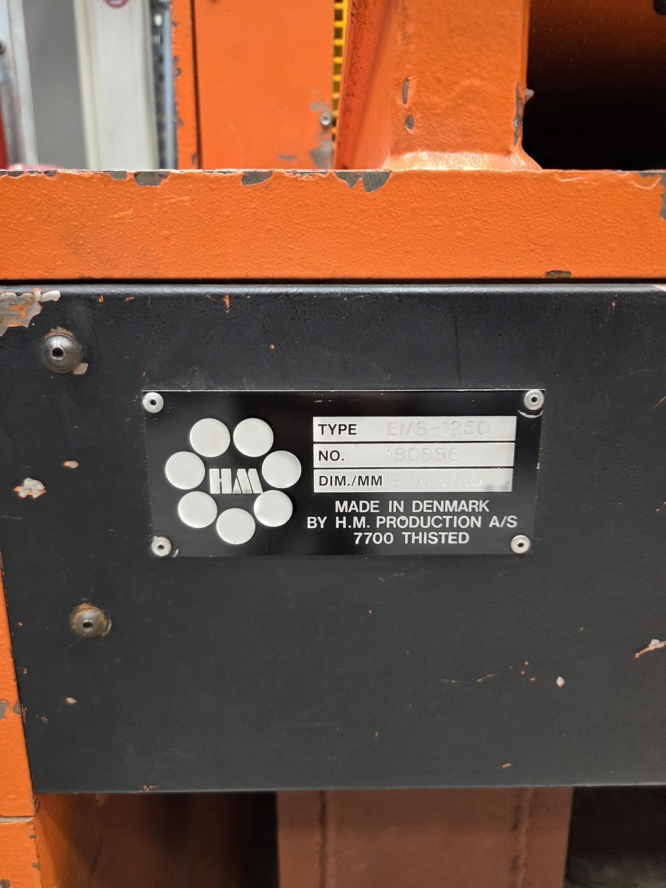

*Figur 2. Typeskiltet: type EMS-1250, nr. 180886, 1250 × 4,0 mm.*

Vi har ikke funnet bruksanvisning eller koblingsskjema for EMS-modellen. Finner du et (for eksempel i en lomme innenfor et deksel), skann det og legg det inn her.

## 3. El-skapet

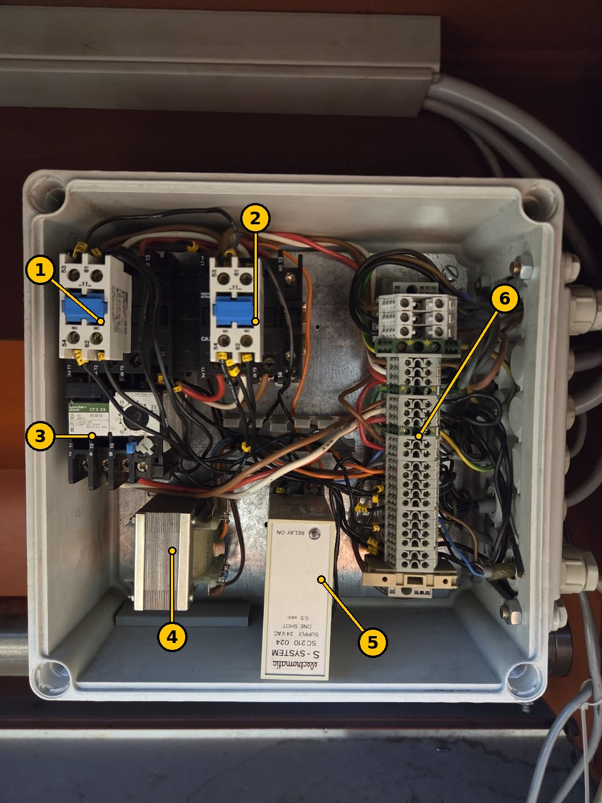

*Figur 3. El-skapet. Numrene stemmer med tabellen.*

| Nr. | Del | Funksjon |
| --- | --- | --- |
| 1 | Sprecher+Schuh CA3 kontaktor med hjelpekontaktblokk (53-54 NO, 61-62 NC) | Slår motoren av og på |
| 2 | Sprecher+Schuh CA3 kontaktor med hjelpekontaktblokk | Kontaktor nr. 2 for motoren (nøyaktig funksjon ikke bekreftet uten koblingsskjema) |
| 3 | Sprecher+Schuh CT3-23 termisk motorvern | Beskytter motoren mot overlast |
| 4 | Styretransformator | Lager styrespenningen på 24 V AC |
| 5 | **Electromatic S-System SC210 024, one-shot 0,5 s** | Gir én puls på 0,5 s per start i enkeltslag, se [5.1](#51-enkeltslagsreléet-electromatic-sc210-024) |
| 6 | Rekkeklemmer | Tilkobling til motor, brytere og betjeningspanel |

## 4. Betjeningspanelet

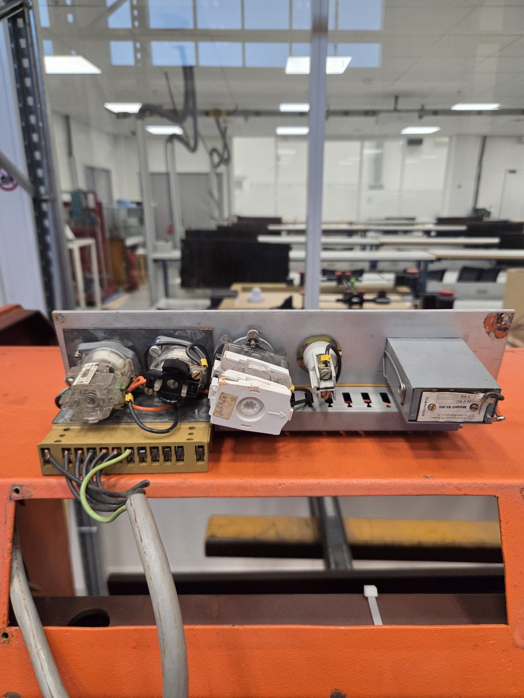

*Figur 4. Baksiden av betjeningspanelet, tatt ut av maskinen: velgerbrytere, en kambryter, lampeholderen og (til høyre) en Feinwerkbau Modell 01.505, 24 V AC 4 VA, med «Rückstellspule» (tilbakestillingsspole).*

- Feinwerkbau-enheten er trolig **slagtelleren** med elektrisk nullstilling (ikke bekreftet).
- **Signallampe:** BA9s bajonettsokkel, rørformet (T10), **24 V 2 W**. En BA9s LED-pære merket «24 V AC/DC» passer også.

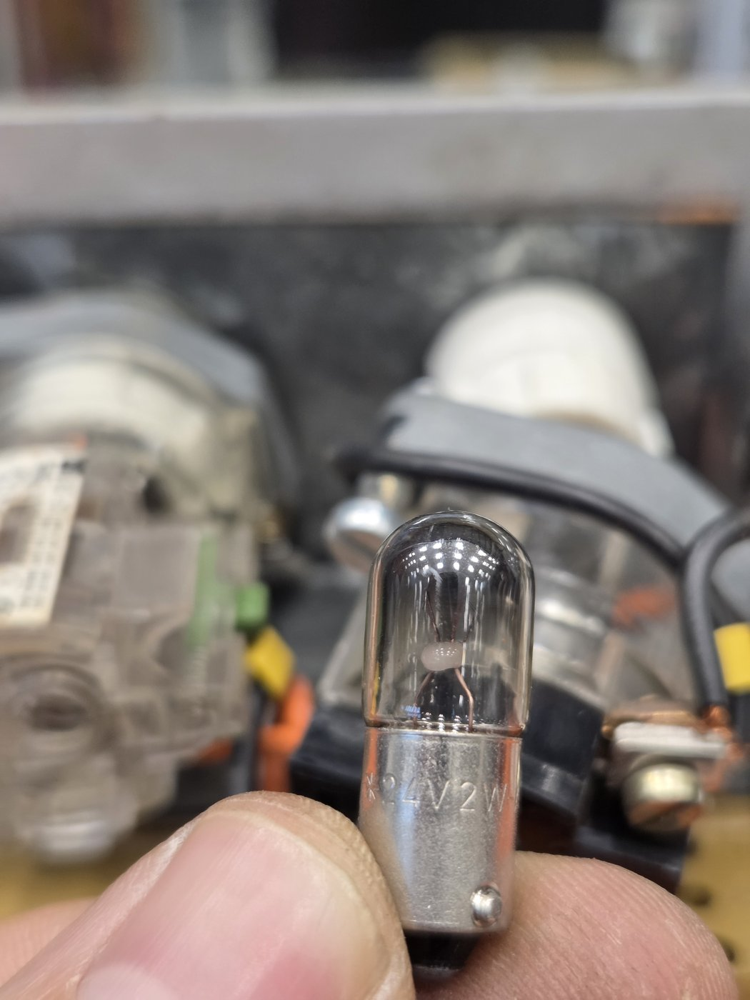

*Figur 5. Signallampen: BA9s-sokkel, 24 V 2 W. Mål den med multimeter på Ω mellom kontakten i bunnen og metallsiden: noen titalls ohm er OK, OL betyr at glødetråden er røket.*

## 5. Vedlikehold

### 5.1 Enkeltslagsreléet (Electromatic SC210 024)

I **enkeltslag** kobler startsignalet 24 V AC inn på dette reléet. Reléet lukker da utgangskontaktene **én gang, i 0,5 s**, og det starter ett slag. Det gir ingen ny puls før forsyningen er slått av og på igjen, så å holde startsignalet inne gir ikke flere slag. I **kontinuerlig drift** er reléet koblet forbi, og derfor virker kontinuerlig drift selv om reléet er defekt.

Electromatic (Danmark) ble senere en del av Carlo Gavazzi. S-System-serien produseres ikke lenger.

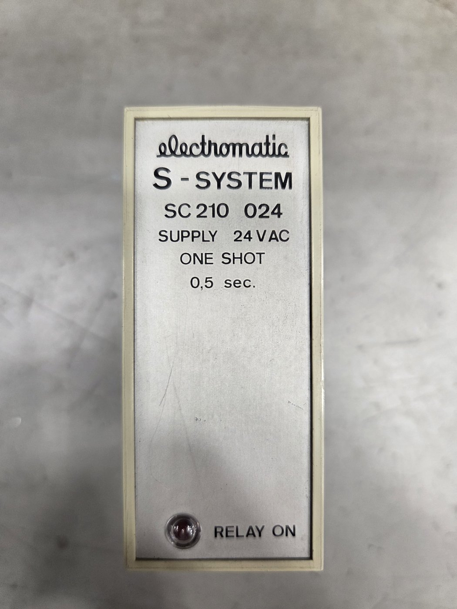

*Figur 6. Electromatic S-System SC210 024: forsyning 24 V AC, one shot 0,5 s. Lysdioden «RELAY ON» lyser mens utgangen er på.*

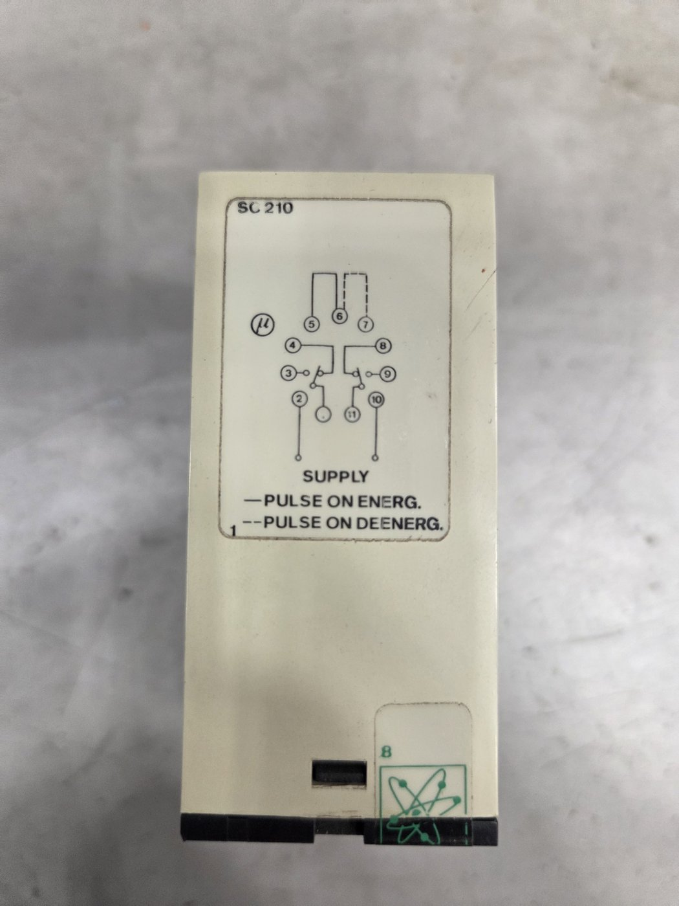

*Figur 7. Koblingsskjemaet på siden av reléet.*

Det står i en **11-polet rund sokkel** (undecal):

| Pinner | Funksjon |
| --- | --- |
| 2 – 10 | Forsyning, 24 V AC |
| 1 – 3 – 4 | Vekselkontakt 1: **1 = felles, 3 = NO (sluttekontakt), 4 = NC (brytekontakt)** |
| 11 – 9 – 8 | Vekselkontakt 2: **11 = felles, 9 = NO, 8 = NC** |
| 5 – 6 lasket | Puls ved innkobling (puls når forsyningen slås på) |
| 6 – 7 lasket | Puls ved utkobling (puls når forsyningen slås av) |

NO og NC er bekreftet ved måling (se [5.2](#52-feillogg)).

**Inne i reléet** (kretskortet er merket EM-1 / SC110-D): en liten transformator, en likeretter, to Frako 220 µF 40 V elektrolyttkondensatorer, to mindre elektrolyttkondensatorer, transistorer, den røde lysdioden og et utgangsrelé **Electromatic ER23002L** (spole 23,6 V DC, kontakter 8 A).

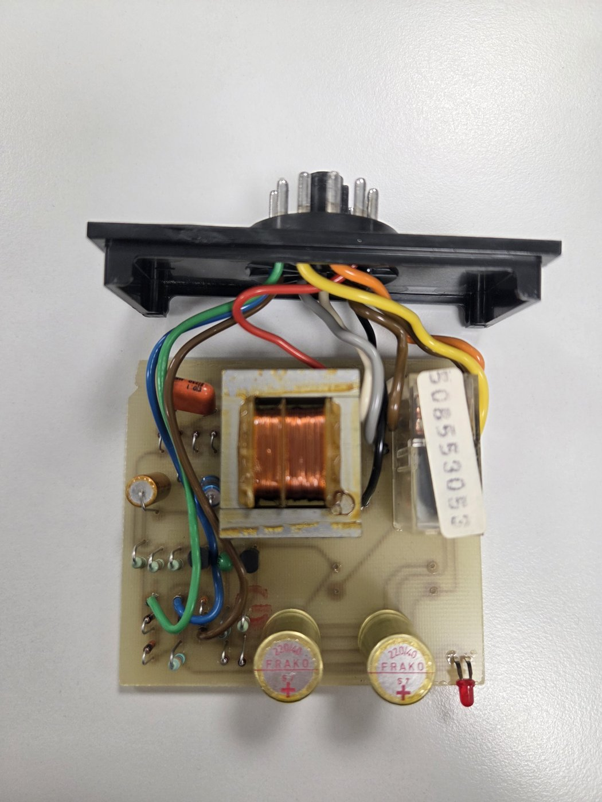

*Figur 8. Inne i SC210: transformator (midten), utgangsreléet ER23002L (til høyre), de to 220 µF-kondensatorene (nederst) og lysdioden.*

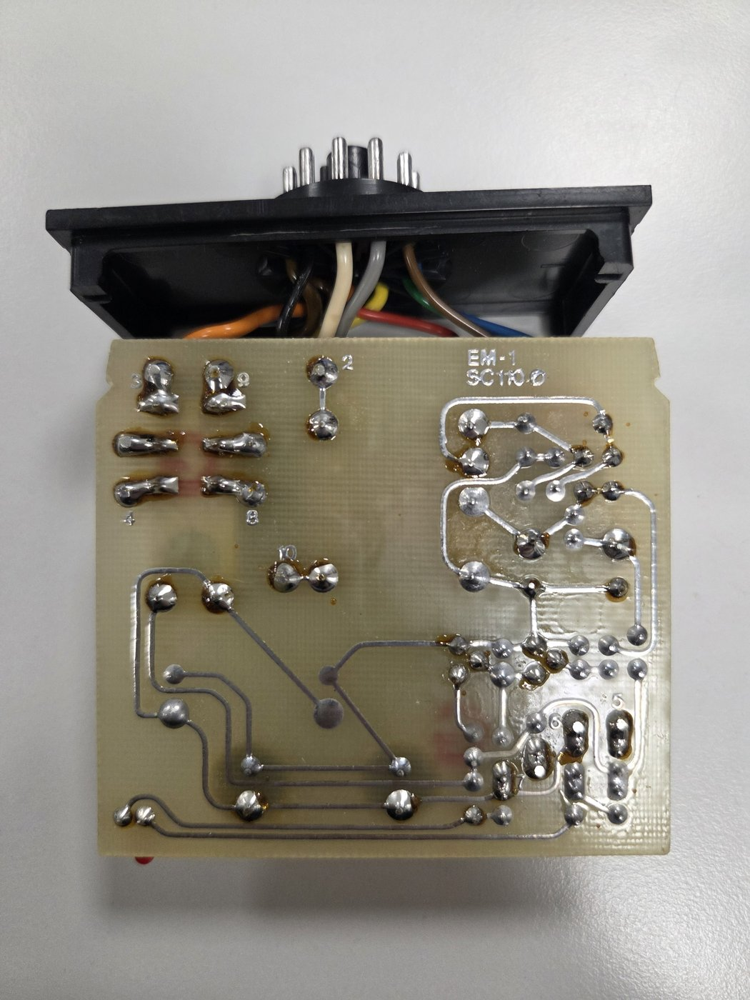

*Figur 9. Loddesiden. De store loddeøyene øverst til venstre merket 3, 9, 4 og 8 er kontaktpinnene til utgangsreléet. De to runde loddeøyene rett under, med tynne baner, er reléspolen.*

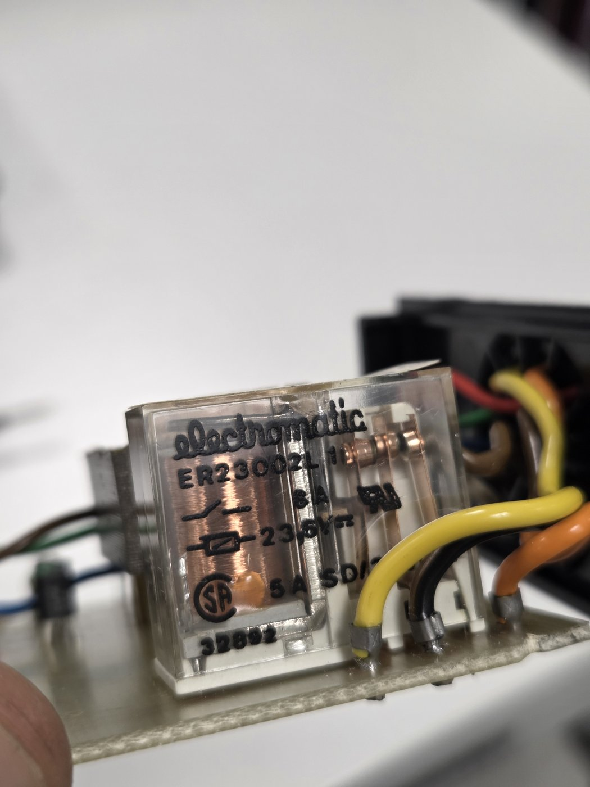

*Figur 10. Utgangsreléet inne i SC210: Electromatic ER23002L, spole 23,6 V DC, kontakter 8 A.*

### 5.2 Feillogg

**November 2026: enkeltslag virker ikke, kontinuerlig drift virker.**

Målinger på SC210, tatt ut av maskinen (13. november 2026):

| Test | Avlesning | Betydning |
| --- | --- | --- |
| 1 – 4, uten spenning | Piper; 2,0 Ω, deretter 1,0 Ω | NC-kontakten lukker, men motstanden er høy og ustabil (skal være godt under 0,5 Ω): slitte kontakter |
| 1 – 3, uten spenning | Åpen | NO-kontakten er åpen, ikke sveiset: OK |
| 11 – 8, uten spenning | Piper; 0,8 Ω, deretter 0,2 Ω | NC-kontakten OK |
| 11 – 9, uten spenning | Åpen | NO-kontakten OK |
| 2 – 10 (transformatorens primærvikling) | 35,2 Ω | Viklingen er hel |
| Spolen i utgangsreléet | 716 Ω | Spolen er hel (omtrent 33 mA, 0,8 W ved 23,6 V) |
| Spolen på 24 V DC fra labforsyning | Klikker | Reléet trekker |
| 1 – 3 og 11 – 9, reléet trukket | 0,2 – 0,5 Ω, men hopper av og til | NO-kontaktene lukker, men avlesningen er ustabil: slitte eller oksiderte kontakter |

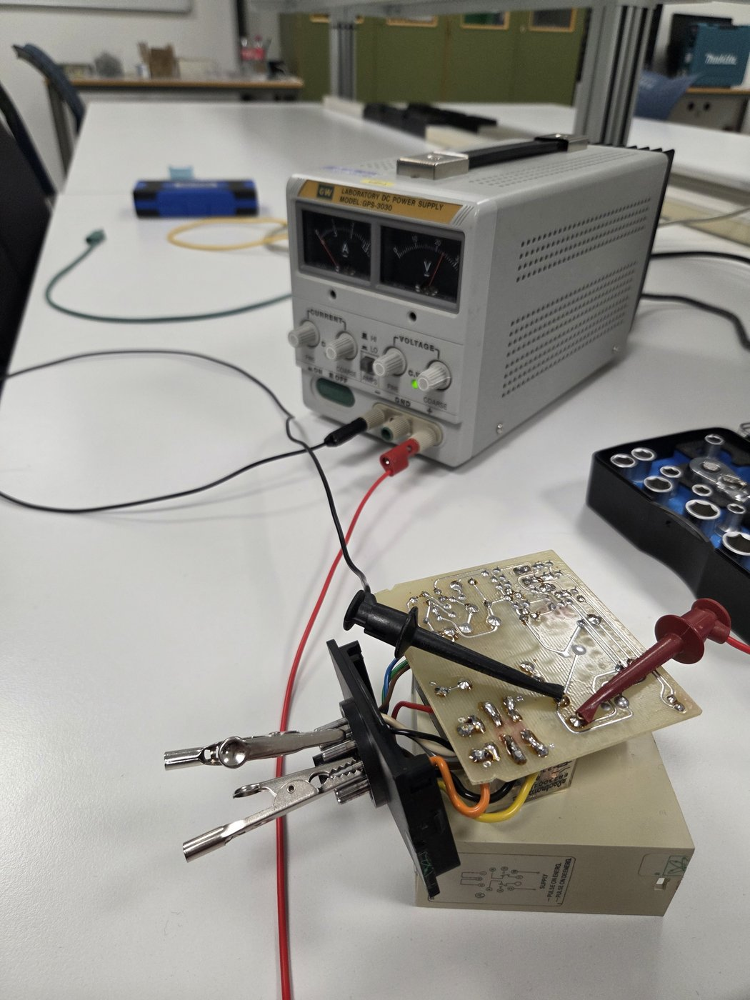

*Figur 11. Test av spolen i utgangsreléet: labforsyning (24 V DC, lav strømgrense) klipset på de to spoleøyene, og multimeteret på sokkelpinnene.*

**Konklusjon så langt:** transformatoren og reléspolen er OK. Kontaktene i utgangsreléet er slitte (høy og ustabil motstand), og elektrolyttkondensatorene er omtrent 35 år gamle. Begge deler kan hindre at pulsen på 0,5 s kommer fram. Hele reléet er **ikke** testet med 24 V AC på pinne 2–10 ennå ([test D](#53-slik-tester-du-enkeltslagsreléet)).

**Planlagt reparasjon:** bytte de to 220 µF-kondensatorene og ved behov utgangsreléet ER23002L (se [5.4](#54-reservedeler)), deretter kjøre test D og teste maskinen.

**13. november 2026:** de to Frako 220 µF 40 V-kondensatorene ble byttet til FMZ 220 µF 50 V 105 °C (10 × 13 mm). Utgangsreléet er ikke byttet ennå.

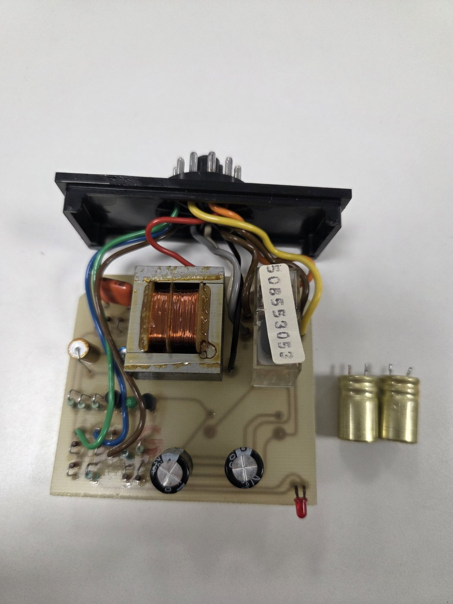

*Figur 12. SC210-kortet med de to nye 220 µF 50 V-kondensatorene (nederst). De gamle Frako-kondensatorene ligger til høyre.*

Etter kondensatorbyttet ble kortet forsynt med likespenning direkte på en 220 µF-kondensator (test E), og reléet slo inn igjen. Pulslengden ble ikke målt.

*Neste steg: test reléet i maskinen (det fantes ingen 24 V AC-forsyning på benken), eller kjør test D med 24 V AC og skriv inn resultatet her: gir reléet én puls på 0,5 s, og virker enkeltslag i maskinen?*

### 5.3 Slik tester du enkeltslagsreléet

Alle testene gjøres med reléet **tatt ut av maskinen**, på benken. Høyeste spenning er 24 V.

**A. Kontakter og transformator (uten spenning, multimeter på Ω / gjennomgang)**

1. Hold målepinnene mot hverandre og noter avlesningen (ledningene, vanligvis 0,2–0,5 Ω). Trekk den fra avlesningene under.
2. Mål **1–4** og **11–8**: de skal pipe og vise under 0,5 Ω (NC-kontakter).
3. Mål **1–3** og **11–9**: de skal vise OL (NO-kontakter åpne).
4. Mål **2–10**: omtrent 35 Ω. OL betyr at transformatoren er defekt.

**B. Spolen i utgangsreléet**

1. Åpne reléhuset. Mål de to spoleøyene på loddesiden (figur 9): omtrent 700 Ω. OL betyr brudd i spolen.
2. Bytt om målepinnene. Viser den ene retningen mye lavere, sitter det en beskyttelsesdiode over spolen. Pinnen der den røde målepinnen var ved den **høyeste** avlesningen, er **+**.

**C. Utgangsreléet på likespenning**

1. Still en labforsyning på **24 V DC** med **strømgrensen på omtrent 100 mA**, og koble den til spoleøyene (figur 11). Med strømgrensen satt gjør feil polaritet ingen skade: går strømmen rett til grensen, bytter du ledningene.
2. Reléet skal klikke. Mens det er trukket skal **1–3** og **11–9** vise under 0,5 Ω, stabilt, og **1–4** og **11–8** skal vise OL.
3. **Bedre kontakttest:** de få milliamperene fra et multimeter klarer ikke å bryte gjennom oksidet på slitte sølvkontakter. Sett heller 24 V 2 W-lampen i serie med en kontakt (24 V → pinne 1 → lampe → tilbake til forsyningen, lampen på pinne 3-siden). Den skal lyse stabilt hver gang reléet trekker. Flimring betyr slitte kontakter.

**D. Hele reléet**

1. Sett reléet i en ledig 11-polet sokkel, eller bruk klemmer på pinnene. Lask **5–6**.
2. Koble **24 V AC** til **pinne 2 og 10** (fra en egen 24 V AC-transformator, ikke fra maskinen).
3. Sett lampen (eller multimeteret på gjennomgang) på **1–3**.
4. Hver gang du slår på 24 V AC skal lysdioden og lampen lyse **én gang, i omtrent et halvt sekund**.

| Resultat av D | Feil |
| --- | --- |
| Ingen lysdiode, ikke noe klikk | Tidskretsen: likeretter eller kondensatorer. Mål likespenningen over 220 µF-kondensatorene med spenning på: omtrent 30–34 V er OK. |
| Lysdiode, men ikke noe klikk | Utgangsreléet, transistoren som driver det, eller kondensatorer som er for svake til å holde pulsen |
| Klikk, men ingen lampe | Kontaktene i utgangsreléet |
| En ren puls på 0,5 s hver gang | Reléet er OK. Feilen sitter i maskinen: velgerbryteren, startkretsen, laskingen 5–6 i sokkelen eller løse sokkelpinner. |

Test D krever **vekselspenning**. Sett aldri likespenning på pinne 2–10: transformatoren i reléet virker ikke på likespenning, og det går omtrent 0,7 A gjennom viklingen på 35 Ω.

**E. Uten 24 V AC-forsyning: likespenning på kondensatoren**

Dette forsyner kretsen etter transformatoren og likeretteren, så det tester tidskretsen og utgangsreléet, men ikke transformatoren eller likeretteren.

1. Still labforsyningen på **omtrent 30 V DC** med **strømgrensen på omtrent 100 mA**. Ikke gå over 34 V.
2. Koble **+** til benet på en av 220 µF-kondensatorene som **ikke** er på stripesiden, og **−** til benet på stripesiden.
3. Slå på forsyningen: lysdioden skal lyse, og reléet skal klikke og slippe etter omtrent 0,5 s, med lampen på 1–3 som blinker én gang.

**F. I maskinen**

Bare med fagperson: hovedbryteren av og låst mens reléet settes i. Deretter, uten plate i saksen, velg enkeltslag og trykk start. Lysdioden «RELAY ON» skal blinke én gang, kniven skal gjøre **ett** slag og stoppe i toppen, og å holde startsignalet inne skal **ikke** gi et nytt slag.

### 5.4 Reservedeler

| Del | Hva du bestiller | Merknad |
| --- | --- | --- |
| Utgangsreléet i SC210 (ER23002L) | 24 V DC spole, 2 vekselkontakter (2 CO), 8 A, pinner for kretskort | Eksempel: Finder 40.52.9.024.0000. Sammenlign pinneplasseringen med det gamle reléet; passer den ikke, monter det med korte ledninger. |
| Kondensatorer i SC210 (2 stk.) | 220 µF, 50 V, 105 °C elektrolytt | Samme diameter som de gamle. Merk **+**-siden før du lodder dem ut: en elektrolyttkondensator montert feil vei ødelegges. |
| Hele SC210-reléet (hvis det ikke kan repareres) | 11-polet plugg-inn tidsrelé, 24 V AC, funksjon «intervall» (puls ved innkobling), 0,5 s, 2 vekselkontakter | Mange 11-polede tidsreléer bruker pinne 2–10 til forsyning og 1 og 11 som felles, men NO og NC kan være byttet om: sammenlign med tabellen i [5.1](#51-enkeltslagsreléet-electromatic-sc210-024) før du setter det i. Det må gi **én** puls per start, også når startsignalet holdes inne. Det nye reléet skal monteres av fagperson. |
| Signallampe | BA9s, 24 V 2 W, rørformet T10 | Eller en BA9s LED-pære, 24 V AC/DC |

## 6. Åpne spørsmål

- Hvor står maskinen (hvilken lab)? Legg den inn på [labkartet](../../labs/map/README.md).
- Hva gjør kontaktor 2?
- Er Feinwerkbau 01.505 slagtelleren?
- Finnes det et koblingsskjema for EMS-1250?
- Hva er startsignalet: fotpedal eller trykknapp?
