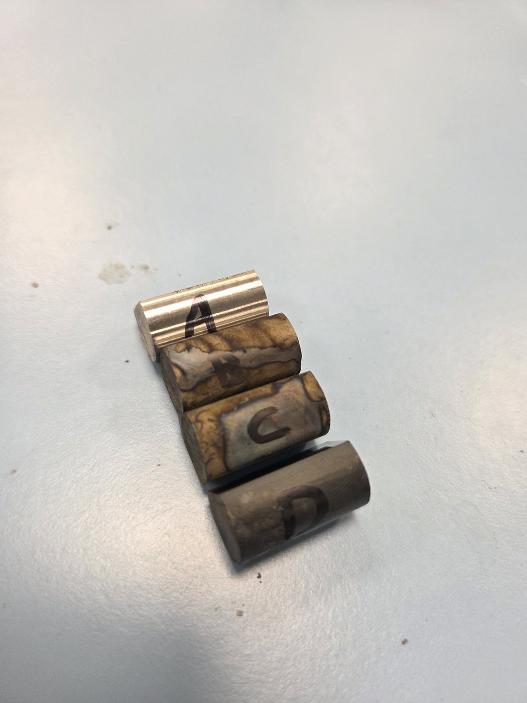

# TSM2370 Materialteknikk – Lab sessions, fall 2026

Two labs, run as one guided 1-hour session per group, led by the lab supervisors (Rasmus and Kent).

| Part | Time | What happens |
| --- | --- | --- |
| Lab 1: Tensile testing | 40 min | Demonstration of the Lloyd LR 10K: specimen mounting, safety, and setting up the camera extensometer for accurate strain measurement. |
| Lab 2: Thermal processing and quenching | 20 min | Demonstration of the lab furnaces (810 °C and 600 °C) and the quenching stations: cooling steel in different media (water vs. oil) and how that changes hardness and microstructure. |

**Before you come:** read the lab protocol and the equipment guides below. Wear appropriate lab clothing, including closed-toe shoes.

*Norsk:* Les labprotokollen og utstyrsveiledningene før dere kommer. Bruk egnede klær og lukkede sko.

## Protocol and report template

| Document | English | Norsk |
| --- | --- | --- |
| Lab protocol, Lab 1 and Lab 2 (objective, theory, procedure, what to calculate and discuss) | [PDF](protocols/lab-protocol-2026-en.pdf) · [Word](protocols/lab-protocol-2026-en.docx) | [PDF](protocols/lab-protocol-2026-no.pdf) · [Word](protocols/lab-protocol-2026-no.docx) |
| Lab report template (fill in and hand in) | [PDF](protocols/lab-report-template-2026-en.pdf) · [Word](protocols/lab-report-template-2026-en.docx) | [PDF](protocols/lab-report-template-2026-no.pdf) · [Word](protocols/lab-report-template-2026-no.docx) |

## Lab 1 – Axial tensile testing and strain measurement accuracy

Pull an aluminium dog-bone specimen of an **unknown alloy** (1 mm thick, 12.5 mm wide) to fracture. Compare the strain from the machine's crosshead travel with the strain from a camera extensometer, work out the yield strength, UTS and Young's modulus from both, and use the results to identify the alloy.

| Equipment | Guide |
| --- | --- |
| Lloyd LR 10K universal testing machine | [Equipment page](../../equipment/tensile-lloyd-lr10k/README.md) · [software user guide](https://github.com/ravo10/lr10k-2027/blob/main/docs/index.md) |
| Camera extensometer and markers | [Marker guide](https://github.com/ravo10/lr10k-2027/blob/main/docs/extensometer-markers.md) · [setup](https://github.com/ravo10/lr10k-2027/blob/main/docs/extensometer-setup.md) |
| Digital calipers (for L₀, width, thickness) | – |

## Lab 2 – Thermal processing and quench severity

Four prepared samples of **Sølvstål 2210** (1.2210 / 115CrV3, a high-carbon tool steel) per group, each with a different heat treatment. Measure the Vickers hardness (HV1) of each and explain the differences.

| Sample | Treatment | Expected microstructure | Expected hardness (approx.) |
| --- | --- | --- | --- |
| A | Untreated (baseline) | As delivered (soft-annealed: carbides in ferrite) | **220–240 HV1** |
| B | 810 °C → quench in 20 °C water | Martensite (most severe quench) | **750–850 HV1** |
| C | 810 °C → quench in 70 °C water or oil | Martensite, possibly mixed with softer pearlite/bainite (slower quench) | **450–750 HV1**, below B |
| D | 810 °C → 600 °C oven for 15–30 min → air cool to ~20 °C | Pearlite | **250–350 HV1**, above A |

**About the expected values.** They are guide values for checking that your results make sense, not targets. A comes from the delivery condition in the datasheets (max. about 220 HB, roughly 230 HV); a test on an untreated sample in the lab gave 236 HV1. B comes from the datasheet hardness after hardening (64–66 HRC, roughly 800–865 HV), a little lower here because the samples are small, not tempered and measured near the surface. C depends strongly on the medium and on how fast the sample gets into the bath, so a wide range is normal; it should still be clearly harder than A and D. D forms pearlite, which is harder than the soft-annealed state of A but far softer than martensite. Conversions between HB, HRC and HV follow ISO 18265 and are approximate.

If a result is far outside its range, check the measurement first (green objective, 1 Kgf, lines zeroed, see the [MXT50 guide](../../equipment/hardness-vickers-matsuzawa-mxt50/README.md#6-results-troubleshooting-and-shutdown)), then the sample: wrong letter, decarburized or scaled surface not ground off, or a delay before the quench.

*The four samples after heat treatment, marked A–D with a permanent marker. A (untreated) is still bright. B and C have coloured oxide from the quench, and D is covered in dark scale. Mark each sample as soon as it is cold, and keep track of which is which while they are in the furnace.*

| Equipment | Guide |
| --- | --- |
| Primary furnace (810 °C), secondary oven (600 °C) and quenching stations | [Guide (EN)](../../equipment/furnace-heat-treatment/README.md) · [Veiledning (NO)](../../equipment/furnace-heat-treatment/README.no.md) |
| Grinding and polishing machines | [Guide (EN)](../../equipment/polisher-metallographic/README.md) · [Veiledning (NO)](../../equipment/polisher-metallographic/README.no.md) (procedure in progress) |
| Matsuzawa MXT50 Vickers hardness tester | [Guide (EN)](../../equipment/hardness-vickers-matsuzawa-mxt50/README.md) · [Veiledning (NO)](../../equipment/hardness-vickers-matsuzawa-mxt50/README.no.md) · quick card [EN](../../equipment/hardness-vickers-matsuzawa-mxt50/quick-card-en.pdf), [NO](../../equipment/hardness-vickers-matsuzawa-mxt50/quick-card-no.pdf) |

Samples B, C and D are held at 810 °C for 15–30 minutes before quenching or transfer. 810 °C is inside the hardening range in the datasheets for 1.2210 (780–840 °C).

**PPE for Lab 2:** safety glasses, heat-resistant gloves, tongs, face shield, lab coat, closed-toe shoes. Hot samples go on the insulating brick, and scale from the quench is wiped up with paper, not rinsed down the drain (see the [furnace guide](../../equipment/furnace-heat-treatment/README.md)).

**Extra hazards:** high-carbon steel can crack in a severe water quench, and hot quenching oil can catch fire. Keep the oil-bath lid within reach and never use water on an oil fire.
